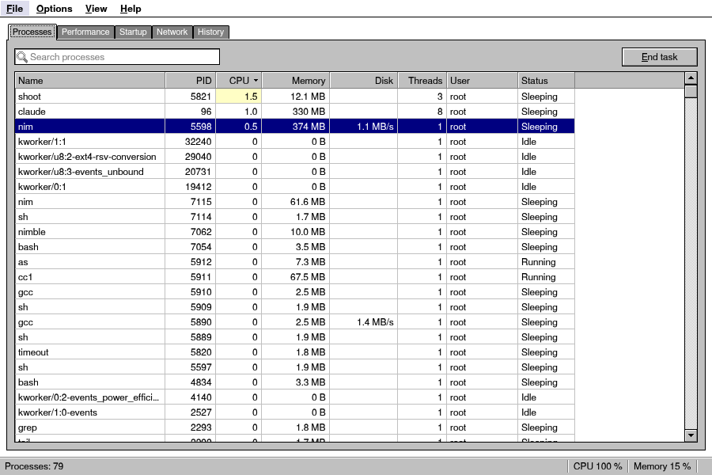
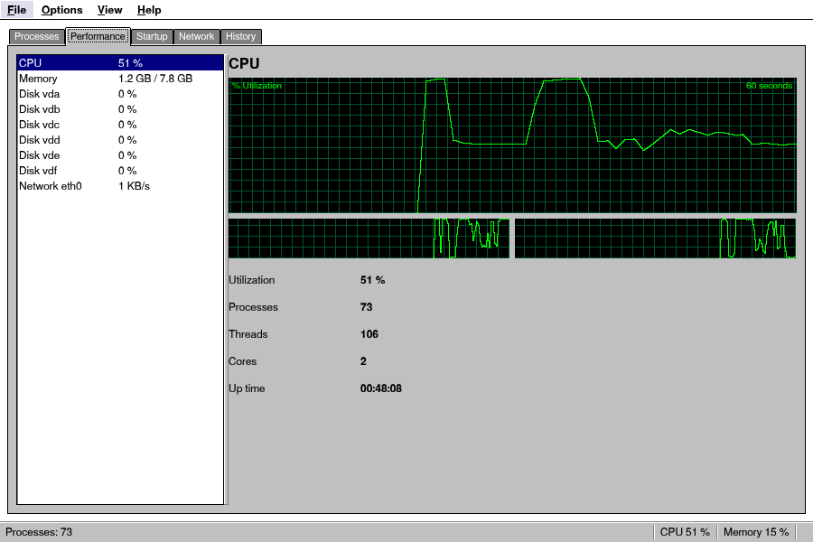
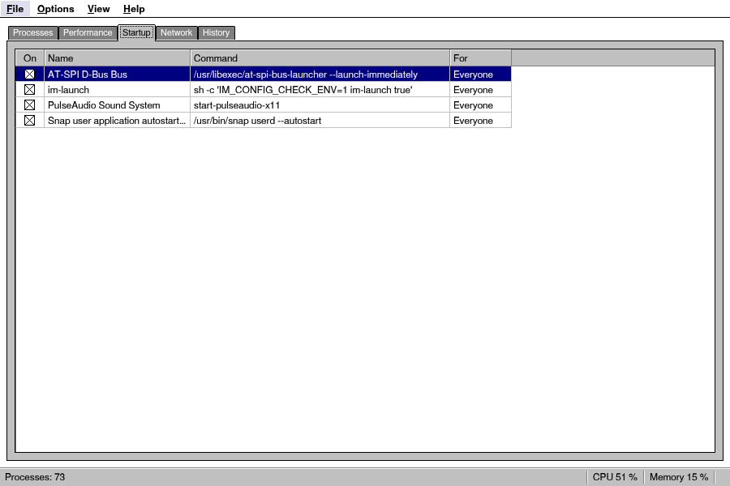

# Retro Nim UI

**Developed by Sultan Al Isaiee [@foxoman](https://github.com/foxoman)** --
[www.foxoman.net](https://www.foxoman.net) -- [sultan@foxoman.net](mailto:sultan@foxoman.net)  
Co-author: Claude (Anthropic)

A **Windows 3.1 style UI toolkit for Nim** that builds business and desktop
apps for **Windows, macOS, Linux, Android, iOS and the web** from one code
base, and packs them for the stores itself. The
package and its module are called `retroui`: `nimble install retroui`, `import retroui`.

**Learn the syntax: [docs/syntax.md](docs/syntax.md)** -- the whole way of
writing an app, every form of it as a small program with a picture of what
it draws: what `row([50, -1])` does with the 50 and the -1, binding, events,
containers, dialogs, how it is built and why it is easy to follow.

**Documentation: [docs/controls.md](docs/controls.md)** -- every control with
pictures: getting started, layout, each control's example and API, the looks.

**Design it: [Retro Designer](docs/designer.md)** -- `retrokit designer
app.nim` shows your file's windows drawn with the real controls: drop
controls, drag them, set their properties, add their events, and every
change is written into the same `.nim` file.


## Why Retro

- **Small and light.** A "hello" app is a single 1.9 MB file (Linux
  x86-64, built with `retrokit small`; about 1 MB of it the fonts) that
  runs in 7 MB of memory on one thread -- the same Hello in egui, iced or
  Slint is a 15-22 MB file in 15-120 MB (see [Speed and size](#speed-and-size));
  the full file manager is 4.3 MB, and the gallery with every control, the
  street map, 3D models, the canvas and PDF 5.7 MB. Fonts, icons, the PDF writer, the world map, the 3D view and
  the decoders are all built in, and only what an app calls is linked.
- **No dependencies.** You need Nim and a C compiler — nothing else to
  install, now or on the user's machine: no GTK, Qt, SDL, Electron, browser
  engine or Java toolchain. On Linux, libX11 is the one library an app
  needs, loaded when it starts (Xft, XRender, EGL and the rest are used when
  the system has them), so building needs no `-dev` packages; sound, video
  and printing use whatever the system offers, loaded only when used.
- **Runs anywhere.** One code base for Windows, macOS, Linux/BSD (X11, and
  Wayland with a driver of its own), Termux:X11, Android 7+, iOS, a web page
  (WebAssembly made by clang alone, no Emscripten) and a screen with no
  windowing system at all (a kiosk, a device: the Linux framebuffer or DRM).
  Touch, mouse and keyboard all work everywhere, and the layout adapts to
  phones, tablets, laptops and 4K screens.
- **Ships itself.** `retrokit` makes what each store takes, in Nim, on any
  system: an APK and an App Bundle for Google Play, an MSIX and an
  Authenticode-signed program for Windows and the Microsoft Store, a signed
  macOS app (notarized on a Mac), an .ipa for the App Store, a web page
  that installs and works offline.
- **Fast.** Immediate mode with a software renderer that redraws only the
  32-pixel bands that changed: a full 800×600 window takes about 0.25 ms, an
  unchanged frame costs nothing and is not sent to the screen, and the app
  uses no CPU while it waits. A 50,000-file folder or a 100,000-row grid
  scrolls in well under a millisecond per frame.
- **For everyone.** Screen readers read every control and act through it
  on every platform -- Orca, NVDA, JAWS, Narrator, VoiceOver, TalkBack --
  with nothing for an app to do but put a label before a box; input
  methods (Chinese, Japanese, Korean) compose in the text box; the window
  takes the scale of the monitor it is on, 125 % or 175 % alike.
- **Reaches any OS API.** `retroui/native` calls any Android Java API without
  writing Java, any macOS/iOS API through the Objective-C runtime, Win32 and
  COM, and any C library through `dlopen`, with ready-made cross-platform
  calls (battery, vibrate, dark mode, device name…).
- **Business ready.** Data grids with check boxes, colour status cells,
  drop-downs, buttons, per-cell colours and totals; forms with masked
  fields; record navigators; property grids; tree grids; 21 chart types;
  PDF reports from HTML templates, with printing; kanban, Gantt, agenda and
  org charts; maps; MDI windows; wizards.
- **Looks the part.** The 3.1 look down to the pixel — black outlines, the
  two-step bevels, the default button's ring, navy and white title bars,
  dithered scroll tracks, etched group boxes, hard menu shadows — in
  **FreeSans** (GNU FreeFont's Helvetica-like sans, with its bold, oblique
  and bold oblique), its heights on whole pixels so it is crisp at 100 %,
  at 125 % and 150 %, and on HD, 2K and 4K screens, with Arabic everywhere
  (FreeSerif's). **FreeSerif**, **FreeMono** or a font file are the other
  choices (`setUiFont`, or the user in `appearanceSettings`; see "The
  fonts" below). 255 pixel icons in
  the manner of the period. Lists and pages glide when scrolled, and a
  flicked finger keeps them moving.
- **Safe.** Every decoder and parser (pictures, zip and ZIP64, CSV,
  Markdown, HTML, OBJ, STL and glTF models, vector tiles, the map services'
  answers, certificates, the programs it signs) is fuzzed with hostile
  input, and the tests also run under AddressSanitizer and as 32-bit
  programs. See [SECURITY.md](SECURITY.md).

| | |
|---|---|
|  |  |
|  |  |
|  |  |
|  |  |
|  |  |

**Every control, its API and how it looks in each state** (normal, keyboard
focus, mouse over, pressed, disabled, open, touch screen, dark scheme) is in
**[docs/controls.md](docs/controls.md)**; the generated API reference of
every module is in `docs/api/` (open `docs/api/retro.html`).

## Contents

[The syntax, studied](docs/syntax.md) · [Install](#install) · [Your first app](#your-first-app) ·
[Retro Designer](#retro-designer) · [How it works](#how-it-works) · [Controls](#controls) · [Layout](#layout) ·
[Text and icons](#text-and-icons) ·
[Screen readers and input methods](#screen-readers-and-input-methods) · [Business apps](#business-apps) ·
[Charts](#charts) · [Reports, PDF and printing](#reports-pdf-and-printing) ·
[Planning views](#planning-views) · [Desktop apps](#desktop-apps) ·
[Files](#files) · [Maps](#maps) · [3D](#3d-view) · [Canvas](#canvas) · [Whiteboard](#whiteboard) ·
[What the computer is doing](#what-the-computer-is-doing) ·
[Image editing](#image-editing) · [Web and HTML](#web-and-html) · [Sound and video](#sound-and-video) ·
[Camera and microphone](#camera-and-microphone) · [More windows](#more-windows) ·
[The system's features](#the-systems-features) · [The system's own APIs](#the-systems-own-apis) ·
[Updates inside the app](#updates-inside-the-app) · [Platform services](#platform-services) · [Android](#android) · [iOS](#ios) ·
[Apps as web pages](#apps-as-web-pages) · [Screens without a desktop](#screens-without-a-desktop) ·
[Shipping to the stores](#shipping-to-the-stores) ·
[Platforms](#platforms) · [Speed and size](#speed-and-size) ·
[Safety](#safety) · [Tests](#tests) · [Examples](#examples) · [FAQ](#faq) ·
[Limits](#limits) · [License](#license)

## Install

You need **Nim 2.0 or newer** and **a C compiler**:

| System | Get them | Notes |
|---|---|---|
| Windows | `choosenim` (brings MinGW-w64) | GDI, nothing else |
| macOS | `brew install nim`, `xcode-select --install` | Cocoa |
| Linux / BSD | your package manager: `nim`, `gcc` or `clang` | X11 is loaded at run time, Wayland spoken by the kit itself: no `-dev` packages |
| Android, on the device | Termux: `pkg install nim clang ndk-sysroot git` | builds APKs right on the phone |
| Android, from a desktop | a clang with lld (LLVM on Windows, `brew install llvm lld`, `clang lld` packages) or zig; with neither, the first APK build fetches the NDK into `~/.retro/ndk` | no NDK, no Java, no Gradle, no SDK, no OpenSSL |
| iOS | a Mac with Xcode | |
| The web | clang and lld (`apt install clang lld`, LLVM on Windows, `brew install llvm lld`) | WebAssembly without Emscripten |

Then:

```sh
nimble install retroui          # the library and its tools (or the repository's URL)
retrokit doctor                                # checks what this machine has
retrokit new myapp --kind:business             # a ready app: hello, form, business, files, charts
cd myapp && nimble run
```

`retrokit` is the helper that comes with the package:

| Command | What it does |
|---|---|
| `retrokit new NAME --kind:K` | a folder with `NAME.nim`, `NAME.nimble` (tasks run, small, apk) and an icon |
| `retrokit doctor` | checks Nim, the C compiler, the screen libraries, the Android tools, what Retro Designer needs, and says how to fix what is missing |
| `retrokit run app.nim` | builds in release mode and runs it |
| `retrokit small app.nim` | the smallest build (optimized for size, stripped), and its size |
| `retrokit apk app.nim` | an Android APK (the `retroapk` tool, below) |
| `retrokit aab app.nim` | an Android App Bundle for Google Play, signed with your upload key |
| `retrokit web app.nim` | the app as a web page: installable, offline ([Apps as web pages](#apps-as-web-pages)); `retrokit run --web --watch` serves it and reloads on every save |
| `retrokit sign app.exe` | Windows' Authenticode signature, made here, with a time stamp |
| `retrokit msix app.exe` | an MSIX for the Microsoft Store and Windows' installer, signed |
| `retrokit mac app` | a macOS `.app`, signed ad hoc here or with your Developer ID, notarized and stapled on a Mac |
| `retrokit ipa App.app` | an iOS app as the `.ipa` TestFlight and the App Store take |
| `retrokit model car.blend` | a 3D model (Blender's, glTF, OBJ, STL) as the `.glb` an app carries, its parts and clips named |
| `retrokit designer app.nim` | [Retro Designer](#retro-designer): the file's windows to design, every change written into the file (built once for this computer) |

From a clone of this repository (the examples are built only when you ask,
one at a time; `nimble install retroui` installs only the toolkit and its
tools):

```sh
nimble gallery        # every control in one window
nimble files          # Retro Files, the file manager (a folder after it: opens there)
nimble ledger         # a small business app: invoices, customers, reports
nimble invoice        # an invoice from an HTML template: preview, PDF, printing
nimble charts         # Chart Viewer: a CSV file as charts, saved as PNG
nimble photo          # Retro Photo, the image editor
nimble board          # Retro Board, the whiteboard
nimble taskman        # Retro Task Manager: the programs, the processor, the memory, the network
nimble mail           # Retro Mail: Microsoft 365, Outlook.com, Gmail, any IMAP (mailexe, mailapk)
nimble hrbook         # HR Book: employee records of several hotels, sealed with a PIN
nimble apk            # Retro Files as an Android APK (build/RetroFiles.apk)
nimble photoapk       # Retro Photo as an APK (photoinstall: build and adb install)
nimble galleryapk     # the gallery as an APK
nimble boardapk       # Retro Board as an APK (boardinstall: build and adb install)
nimble taskmanapk     # Retro Task Manager as an APK (taskmanexe: for Windows)
nimble photoexe       # Retro Photo for Windows, with its icon (from Linux or macOS: MinGW; build/win/)
nimble filesexe       # Retro Files for Windows (galleryexe, boardexe: the others)
nimble photoappimage  # Retro Photo as a Linux AppImage, with its icon and menu entry (one file, runs anywhere:
nimble filesappimage  # Retro Files as an AppImage      built against glibc 2.31 with zig when it is there)
RETRO_APP=hrbook nimble exe        # any one app of the table in retroui.nimble: exe, appapk,
RETRO_APP=hrbook nimble appapk     #   appimage, macapp
nimble apks           # every app as an APK            (the apps: the table in retroui.nimble)
nimble exes           # every app for Windows
nimble appimages      # every app as an AppImage
nimble macapps        # every app for macOS, zipped .app (on a Mac: build/mac/)
nimble apps           # every example for this computer, into build/
nimble dist           # the apps and all the APKs, into build/
nimble test           # the headless tests
nimble fuzz           # the fuzzers
nimble docs           # the API reference (docs/api) and docs/controls.md
```

**Step by step** -- an APK from Windows, macOS, Linux or a BSD without
the Android SDK, an iOS app on a Mac, signing and installing: see
[BUILDING.md](BUILDING.md).

Every task builds with what `nimble install` brought: the APK tasks need
no Android NDK -- `retroapk` carries Android's headers and libraries (1.2 MB,
unpacked once into `~/.retro/android-sysroot`) and builds with a clang that
has lld, or zig; with neither they fetch the NDK once (about 700 MB, into
`~/.retro/ndk`; `nimble ndk` does it now, `ANDROID_NDK_HOME` uses yours), sign with a key made for you in
`~/.retro/android` (`RETRO_KEYS` another folder), and need no Java, Gradle, SDK, OpenSSL or apksigner. In
Termux the compiler is installed with `pkg` the first time.

GitHub builds them too: **CI** runs the tests on each push and compiles
the tools on Linux, Windows and macOS (the examples when run by hand);
**Release** -- a `v...` tag pushed, or by hand -- makes the apps I use
every day, Retro Gallery, Retro Files, Retro Photo, Retro Board and Retro
Mail, as an AppImage, a Windows .exe, an APK and a macOS .app, and puts
them on the GitHub release of that tag. Its APKs are signed with the key in
the secrets `ANDROID_KEY_PEM` and `ANDROID_CERT_DER` (base64 of the files in
`~/.retro/android`), so a new one installs over the one before.

### The window's frame

A desktop app has the system's own frame, or the one Windows 3.1 had: the
gray sizing border with dark lines at its corners, the navy title bar (white
while another window is in front) with the control-menu box at its left and
the minimize and maximize buttons at its right. The app draws that one
itself, in a window without the system's frame, and the system still does
the rest: drag the title bar to move the window (Aero Snap on Windows), the
border or a corner to size it; a double click or the maximize button
maximizes it, down to the taskbar; Alt+Space opens the control menu
(Restore, Move, Size, Minimize, Maximize, Close, the UI's size). The menu bar,
tool bars and the content move down under it as under a phone's title bar,
so an app needs no change. A **size grip** sits in the bottom right corner
inside the frame (in the status bar's end when there is one; the bottom
left, right to left): drag it to size the window, with the mouse or a
finger, on every platform the 3.1 frame is drawn. The frame takes the
theme's colors, and follows when the user picks another theme.

**A window that keeps its size:** `app "Calculator", 260, 320, resizable = false:`
(or `setResizable(false)`). The 3.1 frame then has no sizing border to drag,
no maximize button and no grip (its border is the plain band 3.1's dialogs
had), and the system's frame is told the same: Windows drops the sizing
border and the maximize box, macOS the resize edges and the zoom button,
X11 window managers get the same least and largest size, GTK 4 and SDL
make the window fixed.

```sh
RETRO_FRAME=classic nimble mailexe    # Retro Mail for Windows with the 3.1 frame
RETRO_FRAME=classic nimble apps       # every example (exes and appimages the same way)
nim c -d:retroFrame=classic app.nim   # by hand (system: the default)
RETRO_FRAME=system ./app              # when it starts: the system's frame after all
```

**The user can always switch.** In every app, with nothing to write: the
3.1 frame's control menu has **Windows' Own Frame** (elsewhere **Desktop's
Own Frame**); on Windows the system's frame gets **Windows 3.1 Frame** in
its system menu (the title bar's icon, Alt+Space), and on macOS the menu
bar gets it in a **Window** menu (checked while that frame is on). The
choice is kept for the app (`window.ini` in its data folder) and wins over
the frame it was built with at the next start; `appearanceSettings` offers
it too, as **Window**. On X11 and Wayland the window manager keeps its menu
(Alt+Space, a right click on the title bar) to itself: there
`appearanceSettings` is the way back to the 3.1 frame, so offer it.

**Where:** every desktop. Windows; macOS; Linux and the BSDs on X11, with
any window manager (EWMH: GNOME, KDE, Xfce, openbox... -- snapping and
tiling as for other windows) or none (an X server that shows one app: the
app's window is then moved, sized and maximized by the driver); Wayland
desktops with the kit's own Wayland driver (the default build takes it when
there is no X11, `RETRO_DRIVER=wayland` asks for it: the system's frame
where the compositor draws one, else the 3.1 frame by itself), through
XWayland, or with `-d:gtk4` or `-d:sdl3`. The other drivers have it too: GTK 4, SDL 3
and SDL 2 (where a double click on the title bar maximizes on Windows only,
and the control menu's Move and Size do nothing), Siwin (not on macOS; on
Windows the frame chosen is the next window's). Only the phones keep their
own.

**For the developer:** `app`'s `frame` (`wfAsBuilt`, `wfSystem`,
`wfClassic`) is the frame the window opens with, `userFrame = false` takes
the user's choice away; `setClassicFrame(on)` changes it while the app runs,
`chooseClassicFrame(on)` changes it as the user would (and keeps it),
`classicFrame()` says which one is on. A window manager's own keys stay its
own: openbox, say, opens its window menu for Alt+Space before the app sees
it (the control-menu box still opens the app's).

## Your first app

```nim
import retroui

var name = "World"
var greeting = ""

app "Hello", 320, 120:
  row([50, -1]):
    label "&Name:"
    edit name
  row:
    if button("&Greet", isDefault = true):
      greeting = "Hello, " & name & "!"
    if button("E&xit"): quitApp()
  label greeting
```

```sh
nim c -r -d:release -d:useMalloc hello.nim   # or: retrokit run hello.nim
retrokit small hello.nim          # optimized for size, LTO, stripped: about 1.9 MB, one file
retroapk hello.nim --install      # on a phone in Termux
```

In Termux the same `nim c -r` runs it in a window on Termux:X11 (see
BUILDING.md, "A desktop app in Termux").

**Working on an app in Termux.** Without a window manager, Termux:X11 gives
an app the whole screen, as Android does. To see it as a desktop window
while you work on it:

```sh
retrokit run --window app.nim              # its own size, in its 3.1 frame, in the middle
retrokit run --live app.nim                # the same, built again and shown again on every save
retrokit run --window --scale:125 app.nim  # everything (and the window) a quarter larger
retrokit run --window --theme:Dark --size:420x840 app.nim
```

The toolkit draws a desktop (the 3.1 teal) over the screen and puts the
window on it at the size the app asked for, grown by the screen's own scale
(its density, so a 2K tablet shows it at its real size), with the title bar
to move it, the border and the grip to size it, the maximize button and the
control menu. Keys go to the window, also after a tap on the desktop. When
the screen changes size (the tablet turns, Termux:X11's window is made
floating or sized) the desktop follows, and the window stays in view: made
smaller while the screen is, its size again when there is room. The
line it prints says what it came to (`RETRO_WINDOW: 660 x 304 pixels on a
2560 x 1600 screen; the screen's scale 200 %`); `--scale:N` makes it
larger or smaller. `retrokit run` passes anything else to the compiler.

**Live: see each change as you save**, on any desktop. `retrokit run --watch
app.nim` builds the app again whenever a `.nim` file in its folder (or two
levels below) is saved, starts the new one where the window was -- the place
and the size you gave it -- and then closes the one before, so the window
never goes blank. It is the same on Windows, macOS, Linux (any window
manager, or none) and Termux, where `--live` is `--watch` with `--window`.
Only what changed is compiled again: a few seconds, most of it Nim reading
the kit. Code that does not build leaves the window running what it had,
with the compiler's message in the terminal; an app that crashes starts
again with the next save. The app starts fresh each time (its variables are
new); closing its window, or Ctrl+C, ends it. The window's place is kept by
the X11, Windows, macOS, SDL 2 and SDL 3 drivers (`RETRO_WINDOW_STATE`,
`keptWindowPlace`); GTK 4 and Siwin cannot place a window, so theirs opens
where the system puts it.

```sh
retrokit run --watch app.nim              # Windows, macOS, a Linux desktop
retrokit run --live app.nim               # Termux:X11: --window and --watch
```

On Windows from Linux: `nim c -d:release -d:useMalloc -d:lto --opt:size --passL:-s -d:mingw
--cpu:amd64 --app:gui hello.nim`.

Build with `-d:useMalloc` (or put `switch("define", "useMalloc")` in your
`config.nims`; `retroapk` adds it by itself): with Nim's own allocator a
program never gives memory back to the system, and one that shows many
pictures only grows. The toolkit warns at compile time without it, and
`retroui/memwatch` gives back what the program lets go of
(`trimHeap`, by itself when it rests and when it goes to the background).

`app` opens the window and runs its body once per frame. Each widget
draws itself and returns what happened: `button` is `true` when it is
clicked, and `edit name` edits `name` in place and returns `true` when it
changes.

`app` takes options by name after the size, all optional:

```nim
const ledgerIcon = staticRead("ledger.png")

app "Ledger", 900, 600,
    theme = Dark,                    # the colors (builtinThemes, or your own Theme)
    frame = wfClassic,               # wfAsBuilt (default), wfSystem, wfClassic
    userFrame = true,                # the user may switch it (kept per app)
    gpu = gmAuto,                    # gmAuto, gmGpu, gmCpu
    scale = 125,                     # the size of everything, in percent
    font = ufSans,                   # the UI's font (ufSerif, ufMono)
    zoom = 0,                        # whole-pixel magnification (0: the display's)
    id = "ledger",                   # the app's name for what the toolkit keeps
    icon = ledgerIcon,               # the window's picture (a PNG's bytes)
    resizable = true,                # false: the window keeps its size
    look = "ledger":                 # keep the look the user picks (appearanceSettings)
  label "Hello"
```

A misspelled option is a compile error that lists them all.
$RETRO_FRAME, $RETRO_GPU, $RETRO_SCALE, $RETRO_THEME, $RETRO_SIZE and
$RETRO_ZOOM win over the options when the app starts (tests, screenshots);
$RETRO_SCALE makes the window larger with everything in it.
$RETRO_WINDOW=1 opens the app as a window in its 3.1 frame, in the middle of
a desktop the toolkit draws, where the screen has no window manager (see
"Working on an app in Termux" below).

## Retro Designer


`retrokit designer app.nim` opens your `.nim` file in **Retro Designer**, the
kit's visual designer, in the manner of Qt Designer: its windows drawn with
the real controls, the Widget Box with every control of the kit, the Object
Tree, the properties, events and variables of what you choose. Drop and drag
controls, put them in rows and groups, set their properties, add their
events -- each change is written into the same file as Nim, touching only
the lines that changed: no form file, no generated code. It is purely a
designer: **Edit Code** opens your editor at the control's code, and while
one of them has the file the other leaves it alone (a lock beside it, the
file read-only for the others). Dialogs and menus open over their window
when you choose something in them; F5 shows the window working, in each
look.

It comes with the package and builds itself the first time you run it, for
your computer and your Nim: Windows, macOS, Linux and BSD, and Termux on
Android (Termux:X11). The whole guide: **[docs/designer.md](docs/designer.md)**.

```sh
retrokit designer app.nim       # app.nim's windows (a new file when there is none)
```

## How it works

- **Immediate mode.** The UI is plain code that runs every frame, and
  widgets are procs bound to your own variables. There are no callbacks
  and no widget objects to create, keep or free; whatever your code draws
  is what the screen shows. A widget is known by the variable it is bound
  to or by its label, so you never manage ids (use `pushId` / `withId` for
  rows of the same widgets).
- **Frames only when needed.** A frame runs when input arrives, when a
  timer asked for one (`wakeIn(ms)`) or when work on a background thread
  finished. Between frames the app sleeps. Drawing commands carry hashes:
  an unchanged frame is skipped, and a changed one redraws only the bands
  that changed.
- **Input, the same everywhere.** Mouse: click, double-click, the wheel
  (Shift for sideways, Ctrl to zoom where it makes sense), drag, the right
  button for menus, the middle and side buttons. Keyboard: Tab and
  Shift+Tab move the focus (shown as the dotted 3.1 rectangle), Space and
  Enter activate, arrows/Home/End/PageUp/PageDown move, Esc closes,
  Alt+letter for `&` mnemonics, the menu key or Shift+F10 for context
  menus. Fingers: a tap activates (a drag cancels it), dragging scrolls
  lists and pages, a long press is the right click, and a held-then-moved
  finger drags items. Hover effects appear only for a real mouse.
- **Looks.** The 3.1 look (bevels, X check boxes, navy selections, group
  boxes, bold menus) in eight colour schemes (`builtinThemes`: Classic,
  Gray, Dark, Ocean, Desert, Plum, Hot Dog, Paper), or your own `Theme`
  (`ui.theme = Dark`).
  Text is FreeSans (the default), FreeSerif or FreeMono -- GNU FreeFont,
  built in, each in its four styles, Arabic everywhere -- or a font file
  (`setUiFont`, `loadUiFontFile`); icons are
  the 3.1-style pixel icons or the Nerd Fonts symbols.
- **Sizes.** Layout uses design pixels that follow the screen's density
  (Xft.dpi, GDK_SCALE, the monitor's real size, Android's density, Windows
  per-monitor DPI), in whole pixels so lines stay sharp. Users can make
  everything larger (Ctrl + / − / 0, `setUiScale`) or just the text
  (`setTextScale`). Touch screens get finger-sized metrics.
- **Content larger than its place scrolls**, always with the standard 3.1
  scroll bar (on touch screens too, where a finger can also drag the
  content): the window's page (both ways), dialogs, panes, lists, grids,
  MDI windows, the details pane.

## Controls

The full catalogue, with every signature, a usage example and pictures of
each state, is **[docs/controls.md](docs/controls.md)**. In short:

| Group | Controls |
|---|---|
| Text | `label`, `paragraph`, `heading`, `styledText`, `link`, `badge`, `icon`, `iconLabel`, `tooltip` |
| Buttons | `button` (also with a picture: icon only, text only, text below or beside the icon -- `ButtonLook`), `barButton` (tool bars; `setToolbarLook`), `buttonAt`, `toolButton`, `menuButton`, `splitButton`, `segmented`, `buttonRow` |
| Choices | `checkbox`, `radio`, `toggle` (3.1 slide switch), `chips`, `tagInput`, `rating`, `knob` |
| Text input | `edit`, `editArea`, `searchBox`, `autocomplete`, `maskedEdit`, `comboEdit`, `hotkeyEdit` |
| Numbers, dates, colours | `spin`, `intEdit`, `numberEdit`, `slider`, `rangeSlider`, `progress`, `datePicker`, `calendar`, `dateRange`, `timePicker`, `colorPicker` |
| Lists | `listbox`, `combo`, `checkList`, `grid` (with cell kinds), `tree`, `treeGrid`, `iconView`, `lineView`, `dualList`, `propertyGrid` |
| Status | `progressRing`, `spinner`, `sparkline`, `usageBar`, `banner`, `toast`, `led`, `pill`, `timeline`, `emptyState`, `busyState`, `statusbar` |
| Containers | `group`, `card`, `tabs`, `tabStrip`, `expander`, `accordionHeader`, `form`/`field`, `split`, `vsplit`, `sidePane`, `scrollPanel`, `adaptive`, `row`, `col` |
| Menus and bars | `menubar`, `menu`, `menuItem`, `submenu`, `contextMenu`, `popupMenu`, `toolbar`, `statusbar`, `breadcrumb`, `pathBar`, `driveBar`, `pager`, `stepper`, `recordNav`, `findBar` |
| Dialogs | `dialog`, `msgBox`, `inputBox`, `progressBox`, `wizard`, `aboutBox`, `fileDialog` (3.1), `filePicker` (modern), `propertiesDialog` |
| Desktop | `mdiArea` / `mdiWindow`, `mdiWindowMenu`, `hotkeyPressed`, `findIn`, `replaceAllIn` |
| App parts | `settingToggle`, `settingChoice`, `settingSlider`, `settingButtons`, `settingCombo`, `settingLink`, `appearanceSettings`, `avatar`, `factList`, `bottomNav`, `fab`, `captionBar` |
| Business views | `chart` (21 kinds), `gauge`, `kanbanBoard`, `ganttView`, `agendaView`, `kpiTile`, `statCard`, `orgChart`, `reportView` |
| Files | `fileList`, `filePreview`, `folderTree`, `placesView`, `trashList`, `driveBar`, `pathBar`, `textFileView`, `hexFileView`, `runJobDialog` |
| Media and more | `mapView`, `view3d`, `canvas2d`, `htmlView`, `webView`, `markdownView`, `imageView`, `animation`, `videoView` |

Buttons with a picture show it four ways -- icon only (the label becomes the
tooltip), text only, the text below the icon, or beside it -- and a tool bar
shows all of its `barButton`s one way, which the app can offer as a setting
(Explorer 98's "Text Labels"):

```nim
setToolbarLook(blTextBelow)            # labels under the icons; the bar grows
toolbar:
  if barButton(pxBack, "Back"): goBack()
  if barButton(pxCopy, "Copy", tip = "Copy (Ctrl+C)"): copy()
if button("Open", pxOpen, blTextBeside): openIt()
if button("Save", glyphPic(nfSave), blIconOnly): saveIt()
```

Drawing your own: `canvas(w, h)` gives a rectangle to draw into with
`fill`, `box`, `hline`, `vline`, `line`, `text`, `image`, `drawBitmap`
and the smooth shapes `disc`, `ring`, `roundRect`, `polygon`,
`thickLine`, `pieSlice`; `canvas2d` adds the whole HTML5 Canvas API.

## Layout

```nim
row([120, -1, -2]):             # fixed, one share, two shares
  label "Name:"
  edit name
  edit notes
row:
  label "Total: 120"
  spring()                       # the buttons go to the right end
  button "OK"
  button "Cancel"
adaptive(260):                   # 1 column on a phone, 3 on a desktop
  card "Sales": ...
  card "Stock": ...
  card "Orders": ...
if isCompact(): ...              # sizeClass(): scCompact, scMedium, scExpanded
let cols = responsive(1, 2, 3)
```

Widths in rows, `col(w)`, dialogs and grid columns are design pixels:
they grow with the screen and the user's size. `dp(13)` scales your own.
Content larger than the window scrolls both ways under the fixed menu,
tool and status bars, always with the standard scroll bars (on touch
screens too): the wheel (Shift + the wheel goes sideways), a finger,
PageUp / PageDown, Ctrl+Home / End, and Tab brings the focused control
into view. A dialog taller than the screen scrolls inside; `scrollPanel`
scrolls a part of a page (`scrollPanel -1:` down to the bottom).

**Smooth scrolling.** Lists, grids, trees, text areas and pages glide a
short way per wheel notch or key, follow a finger pixel for pixel and fly
on when it is flicked; a finger landing on a flying list stops it without
picking an item. `setSmoothScrolling(false)` (or the user, in
`appearanceSettings`) makes every scroll jump at once. Views of your own
get the same with `scrollWheel`, `scrollPan`, `scrollTo` / `scrollBy` /
`scrollShow` and one `scrollTick` a frame.

**Sizes.** The UI follows the display's density: whole pixels keep lines
sharp (2x, 3x) and the text and controls make up the rest (a 1.33x tablet
gets 1x lines and 1.33x text). `setUiScale(125)` (and Ctrl + / - / 0, and
the phone title bar's menu) scales everything; `setTextScale(120)` only
the text (controls grow with it); `setBaseTextSize(14)` changes the 100%
size (12 pixels per em on desktops and tablets, 15 on phones).
[docs/syntax.md](docs/syntax.md#widths-in-a-row) shows each kind of width
with the pixels it came to. Try layouts on a desktop with `RETRO_SIZE=420x840`, `RETRO_TOUCH=1`,
`RETRO_CAPTION=1` (the phone title bar), `RETRO_SCALE=150`, `RETRO_ZOOM=2`.

**Controls for a mouse or for fingers.** `setControlSizes` chooses:
`csAuto` (finger-sized on a phone, desktop-sized on a tablet and a desktop,
whose screens hold a desktop layout), `csDesktop` or `csTouch` (finger-sized
everywhere). The user chooses in Appearance (`appearanceSettings`, Controls),
kept with the look. `RETRO_TOUCH=1` is a finger on any screen: finger-sized
controls, no hover, tooltips above the finger; `RETRO_CONTROLS=touch`,
`desktop` or `auto` sets the sizes alone (`retrokit run --touch`,
`--controls:touch`). Both win over what the user kept.

## Text and icons

```nim
text(x, y, "Plain", c)
text(x, y, "Big bold", c, style(bold = true, size = 2.0))
text(x, y, "مرحبا بالعالم", c)                  # joined, right to left
label nfFolderOpen & " Documents"              # an icon inside text
toolButton(nfCopy, "Copy", size = 1.3)
image(x, y, glyphIcon(nfFolder, color(222, 170, 40), 24))   # as an Icon
```

`TextStyle` has `bold`, `italic` (the font's own italic: FreeSans Oblique,
not a slanted copy), `mono` (FreeMono), `serif` (FreeSerif), `underline`,
`strike`, `size` (times the UI's text size) and `rtl`. `textWidth`, `lineHeight` and
`FontH` measure. The icon constants (`nfFolder`, `nfCog`, `nfGithub`...,
`nerdIconNames` lists them all) come from Font Awesome, Material Design,
Seti and Devicons via Nerd Fonts. Characters in no built-in font (CJK,
emoji) are drawn by the platform.

**Drawing.** Apps draw into one software framebuffer cut in tiles: only
the tiles whose commands changed are drawn (on all cores) and sent, and a
picture changed in part (`changed(bitmap, rect)`) only there; nothing at
all when nothing changed. The framebuffer is the window's own memory where
the system lends it -- shared with the X server (MIT-SHM) on X11, a DIB
section on Windows -- so a frame is never copied on its way to the screen
(`RETRO_SURFACE=0` copies it, as before 0.26). Where the platform has OpenGL ES 2 / OpenGL 2.1
(EGL on Linux and Android, WGL on Windows -- loaded at run time, nothing
to link) the frames are drawn by the GPU instead: the same commands as
rectangles from textures the CPU makes once (text, icons, shapes),
pictures as textures sent only where they changed. A start-up self-test,
a fall back to the CPU and a guard against a crash at start keep a bad
driver from hurting; `setGpuMode(gmAuto/gmGpu/gmCpu)` or "Drawing" in
`appearanceSettings` chooses. The text is drawn at the screen's own
resolution on every screen; on HD and 4K screens pixel icons are scaled
with Scale2x and Scale3x, and small marks are drawn at the screen's
resolution (`setHdText(false)`: the pixels of 1998, magnified). There is a true-black OLED theme; in it (and in Dark) the pixel icons are
drawn as their line twins -- Nerd Fonts symbols in the text's color, crisp
at any size (`setIconStyle`).

**Big images.** The photo engine (`retroui/photo`) shows a change being made
with the mouse -- a layer moved, transformed, adjusted -- before it is done
(`LivePart`): the view's pixels are composited straight from the layers at
the view's size, and the full-size pixels change once, when it is put down
(`touchWhole` hands the old ones to the undo step without a copy). On a
70-megapixel photo, dragging a layer costs about 8 ms a frame and Free
Transform 25 ms.

**The fonts.** Every app's text is **FreeSans** unless it chooses
otherwise: GNU FreeFont's sans (in the manner of Helvetica and Arial),
built into the app in its regular, bold, oblique and bold oblique.
`setUiFont(ufSerif)` gives **FreeSerif** (in the manner of Times),
`setUiFont(ufMono)` **FreeMono** (in the manner of Courier); monospaced
text (code blocks, editors, hex) is FreeMono whatever the UI's font, and
serif families in HTML, on the canvas and in documents are FreeSerif.
Italic and bold italic are the fonts' own italics, not slanted copies.
**Arabic is everywhere:** FreeSans has none of its own, so its Arabic --
in every style -- is FreeSerif's (FreeSerif Bold's in bold text), joined,
lam-alef as one letter, right to left among Latin text, mirrored brackets;
FreeMono draws its own in its regular and FreeSerif's in its other styles;
a font of the user's without Arabic gets FreeSerif's the same way. The
same holds in text boxes, the rich editor, `htmlView`, the canvas, PDF
files and reports, and in documents (`retroui/textengine`: FreeSerif's
OpenType tables set the Arabic, as Amiri did before). Characters no
built-in font has (CJK, emoji) are drawn by the platform.

**Right to left** is the whole Unicode bidirectional algorithm (UAX #9):
numbers and brackets, the direction marks, and the explicit embeddings,
overrides and isolates (U+202A..202E, U+2066..2069) -- every case of
Unicode's conformance tests passes. The zero width non-joiner and joiner
steer the joining (Persian می‌خواهم) and never cut a word in two; text is
kept in its letters (joined shapes pasted in, or read from an old PDF,
come back as letters: `plainLetters`). In text boxes and the rich editor
the caret goes through a line as it reads -- Left goes on in an Arabic
line, a letter and its vowels are one step, Backspace takes a vowel off
and Delete a letter with its vowels -- and stands where the next letter
typed goes when Latin and Arabic meet; a selection of both is drawn where
its parts are. PDF files carry Arabic as it is written (`/ActualText`,
the letters themselves) and say their language (`lang`); an Arabic
sheet written to Excel opens right to left (`XlsxSheet.direction`). The
Arabic interface (`setUiLanguage("ar", @toolkitArabic)`) mirrors the
frame, menus, lists, scroll bars and back and forward arrows; text
boxes, documents and Markdown keep their own direction, and charts,
maps, the media controls (play, the time bar) and pictures their sides.

The fonts are subsets of GNU FreeFont 0412 made by `tools/genfreefont.py`
from the fonts GNU publishes: Latin (with Latin-1, Extended-A and -B,
IPA), Greek, Cyrillic, Hebrew, Arabic (FreeSerif, FreeMono), punctuation,
currency, arrows, mathematical operators, box drawing, geometric shapes
and the symbols the kit's own text uses -- the bold and italic styles the
letters, their symbols coming from the regular -- with their OpenType
kerning, marks, ligatures and Arabic forms, without the TrueType hinting.
The twelve files take 0.94 MB in every app (compressed, unpacked when a
face is first used; the fonts before them took 0.96 MB, and apps with
`retroui/textengine` carried Amiri's 0.21 MB more).

**Crisp at every scale.** Glyphs are drawn by the kit's own TrueType
engine (`retroui/ttf`), at the screen's own resolution, on the CPU and the
same masks on the GPU: the coverage of each pixel computed exactly, in
gray, the baseline, x-height, cap height and ascender set on whole pixels
at small sizes (below 26 pixels to the em), the strokes as the font draws
them (FreeSans' stems, a little over a pixel at 12, keep their weight),
letters placed at quarter pixels without drift; FreeMono's thin strokes
(half a pixel at 12) are darkened to a whole pixel there; small text is
drawn with a light gamma (1.2). Lines take the font's own line gap.

**Sharp text** (`setSubpixelText(true)`, or "Text edges: Sharp" in
`appearanceSettings`; `RETRO_TEXT=sharp`) draws the letters in the
screen's red, green and blue strips, three times as fine across, as
Windows' ClearType does, the stems then fitted to the pixels: off by
default on every platform, used on screens of one device pixel per pixel
(it follows Windows' strip order, RGB or BGR).

`loadUiFontFile(path)` gives a font of the user's (a .ttf, or the first
face of a .ttc; its bold, italic and bold italic beside it when they are,
"X-Bold.ttf", "X-Italic.ttf"...); an app built with
`-d:retroAppFont=path/X-Regular.ttf` carries its own and starts with it
(`useAppFont`). Choose before `app` for one app's default, or at any
time; `uiFont()` tells which is on; `appearanceSettings` puts the choice
in an app's Settings -- FreeSans, FreeSerif, FreeMono, a font file -- and
`storeAppearance` / `restoreAppearance` keep it (a choice stored before
FreeFont is FreeSans now, a font file stays one). `builtinUiFonts` lists
the built-in fonts for a menu of an app's own, `uiFontKey` / `uiFontOfKey`
name them in its settings ("sans", "serif", "mono"; the words
of before -- "w98", "kawkab"... -- still read). The fonts' names of before
compile for one release as deprecated aliases: `ufW98`, `ufRetro`,
`ufSmooth`, `ufOpenSans` are `ufSans`, `ufKawkab`, `ufFixedsys` `ufMono`.

**Licences.** GNU FreeFont is under the GNU GPL v3 or later with the
font exception ("if you create a document which uses this font, and embed
this font or unaltered portions of this font into the document, this font
does not by itself cause the resulting document to be covered by the GNU
GPL"), `src/retroui/fonts/LICENSE-FreeFont.txt`; the subsets keep that
text, and the files GNU publishes (and their FontForge sources) are where
the licence says. The rest of the kit is MIT; the icon font is the Nerd
Fonts symbols (MIT and SIL OFL, `src/retroui/fonts/LICENSE-NerdFonts.txt`).
An app that hands out its binaries hands out the fonts in it: keep the
licence text with it (the About box's credit is `RetroFontCredit`).

**Pixel icons** (`retroui/pixelicons`) are used the same way, as text:

```nim
toolButton(pxCopy, "Copy", size = 1.3)          # a 3.1-style tool bar icon
iconLabel(pxFolder, "Documents")
image(x, y, glyphIcon(pxComputer, black, 32))   # the 32x32 art at 32
label retroOr(pxSave, nfSave) & " Save"         # pixel icon, or the Nerd one
```

There are 255 (`pixelIconNames` lists them): folders and places, drives,
file kinds, the tool bar's actions, the message box signs, the
hourglass, charts, maps, mail, calendar, clock, media keys, an image
editor's tools and panels, and more. Each has 16x16 and 32x32 art and is drawn at a whole number
of screen pixels per art pixel; disabled ones look embossed. Set
`retroIcons = false` to have `retroOr` (and the toolkit's own parts) use
the Nerd icons. The art is original, drawn in the manner of 3.1, made by
`tools/genicons.py`.

## Screen readers and input methods

Every control tells screen readers what it is, its name, its value and
its state as it is drawn: Orca on Linux and BSD (AT-SPI, over D-Bus,
which the kit speaks itself), NVDA, JAWS and Narrator on Windows (UI
Automation), VoiceOver on macOS and iOS, TalkBack on Android. A label
names the control after it, so a form needs nothing more:

```nim
row([70, -1]):
  label "&Name:"        # read as the text box's name
  edit name
if button("&Save"): save()
```

The screen reader moves the focus, presses buttons and menu items, checks
boxes, picks list and grid items, tree nodes and calendar days, puts text
in a box and moves sliders and spin boxes: each comes into the next frame
as the click or the typing would. The grid is read as a table (its
headers, the rows in view, their cells), the tree with each item's depth
and whether it is open, a chart by its title, kind and series and the
point the keys are on. The tree is made only while a screen reader
listens; `RETRO_ACCESS=1` makes it without one, to try it.

What an app draws itself is not read until it says what it is:

```nim
let r = canvas(dp(300), dp(200))
drawSales(r)
accessNode(arImage, "Sales by month", id = 0, r = r)   # a picture, read by its name
accessName("Delete")                                   # an icon-only button's name
if toolButton(nfTrash): deleteIt()
```

`accessBegin` / `accessEnd` group nodes (a list of your own, its items
`accessNode(arListItem, ...)` with `accessItem`), `accessRange` gives a
value a range, `accessible()` says whether a screen reader listens. A
custom control takes a screen reader's press through `interact`, as a
click.

**Input methods.** What the system's input method is composing (pinyin,
kana, hangul, a phone keyboard's word) is drawn underlined in the text box
at the caret, and typed when it is settled: XIM on X11, IMM on Windows,
marked text on macOS, GTK 4's preedit, the kit's own input connection on
Android. `ui.composing` holds it for a text box of your own.

**Scaling.** The window takes the scale of the screen it is on -- on X11
the monitor's DPI (RandR), on Windows and macOS the system's -- and again
when it moves to another monitor; at 125 %, 150 % or 175 % controls and
text are the size asked for, and lines stay on whole pixels.

## Business apps

### The data grid

`grid` shows rows that come from a proc, so 100,000 rows cost only what
the visible ones cost. Click a header to sort, drag its edge to resize;
arrows, Home, End, PageUp/PageDown; F2, a double click or typing edits an
`editable` cell, Enter commits, Esc cancels. Pass `marked` for multi-select
(Ctrl/Shift click, Ctrl+A, a rectangle, check boxes on phones).

Columns can hold more than text — the controls of a business screen:

| Column | Cells show | Interaction |
|---|---|---|
| `column`, `numberColumn` | text, numbers (right aligned) | edited in place when `editable` |
| `checkColumn` | a check box ("1", "yes", "x"…) | a click or Space flips it: `ev.toggled` |
| `colorColumn` | a block of colour ("#RRGGBB", "green", "orange"…) | status lights |
| `progressColumn` | a bar ("0.62" or "62%") | |
| `choiceColumn` | text picked from a list | F4 or a click drops the list: `ev.edited` |
| `buttonColumn`, `linkColumn` | a push button, a link | `ev.clicked` |
| `iconColumn` | a pixel icon or icon-font glyph | |
| `customColumn` | anything you draw in `paint(row, rect, selected)` | |

`style(row, col)` gives any cell its own text and background colours and
bold text; `rowHeaders` adds the record indicator column (an arrow at the
current row, a star while it is edited); `footer(col)` adds a totals row.

```nim
var cols = @[column("Order", 160), numberColumn("Amount", 90),
             colorColumn("Status"), checkColumn("Paid"),
             choiceColumn("Store", ["Kitchen", "Engineering"], 110), buttonColumn("", 60)]
let ev = grid(cols, orders.len, proc (r, c: int): string = orders[r][c], sel,
              height = -1, rowHeaders = true,
              style = proc (r, c: int): CellStyle =
                if c == 1 and isLate(r): cellStyle(fg = color(200, 0, 0), bold = true)
                else: CellStyle(),
              footer = proc (c: int): string = (if c == 1: total() else: ""))
if ev.edited: orders[ev.row][ev.col] = ev.text   # typed, picked or a check box flipped
if ev.clicked: openOrder(ev.row)                 # its button
```

### Forms and records

```nim
form 0:
  field "&Customer:": comboEdit draft.customer, customers   # suggests as you type
  field "&Phone:":    maskedEdit(draft.phone, "+### #### ####")
  field "&Date:":     datePicker draft.date                 # Alt+Down or F4 drops it
  field "&Amount:":   numberEdit draft.amount, lo = 0
  field "&Period:":   dateRange(fromDay, toDay)             # with This month, Last year...
  field "Status:":    checkbox "&Paid", draft.paid
case recordNav(pos, customers.len, dirty)                     # |< < 3 of 20 > >|  New Delete Save
of raNew: addCustomer()
of raSave: saveCustomer()
else: discard
```

- `maskedEdit` types into a mask (`#` digit, `A` letter, `U` upper case,
  `X` letter or digit, `*` anything; Arabic-Indic digits count as digits);
  `maskFormat`, `maskFull`, `maskRaw` read the value.
- `dualList(available, chosen)` moves items between two lists (buttons,
  double click, Enter, up/down order).
- `propertyGrid(props, sel)` edits properties by category: text, numbers,
  yes/no, choices, colours and dates, with a help line.
- `treeGrid(cols, rows, sel)` is a tree with columns (a chart of accounts).
- `wizard(open, title, step, steps, width): body` is a dialog of steps
  with Back / Next / Finish; `stepDone(false)` keeps Next disabled.

`Date` is a plain `(year, month, day)` with `today()`, `addDays`,
`addMonths`, `weekday`, `parseDate`, `$` in `dateStyle`, `presetRange`.
`formatNumber` / `parseNumber` read and write "1,234.50".

`examples/ledger.nim` puts it together: a tree, a splitter, a sortable,
editable grid, an invoice form, CSV import and export, reports, settings.

## Charts

`chart` draws 21 kinds of business chart from the same few lines:

| Kind | | Kind | |
|---|---|---|---|
| `chBar`, `chBarH` | bars, up or sideways | `chScatter`, `chBubble` | points, sized points |
| `chStacked`, `chStacked100` | stacked, as shares | `chWaterfall` | changes adding up to a total |
| `chLine`, `chArea`, `chStackedArea` | lines and areas (`smooth`) | `chFunnel` | the stages of a pipeline |
| `chCombo` | bars with a line on a second axis | `chGauge` (`gauge`) | one value on a dial, a target, bands |
| `chPie`, `chDonut` | shares (the total in the hole) | `chCandle` | open, high, low, close |
| `chHistogram` | how values spread | `chHeatmap` | a table as colours |
| `chRadar` | series around the labels | `chTreemap` | shares as rectangles |
| `chBullet` | values against targets | | |

```nim
let months = ["Jan", "Feb", "Mar", "Apr"]
chart("Sales", chBar, months, [series("2025", [12.0, 15, 9, 20]),
                               series("2026", [14.0, 18, 11, 24])])
chart("Revenue and margin", chCombo, months,
      [series("Revenue", rev), lineSeries("Margin %", margin)],
      opts = ChartOpts(format: NumFormat(prefix: "$", short: true),
                       format2: NumFormat(percent: true)))
gauge("Target", 0.82, lo = 0, hi = 1, target = 0.9, format = NumFormat(percent: true))

# Straight from a CSV file (comma, semicolon or tab; quotes; a BOM):
let t = readCsv("sales.csv")
let ev = chart("By region", chDonut, t, "Region", ["Amount"], height = -1)
if ev.clicked: showRegion(ev.index)        # a bar, point or slice (or Enter)
exportPng(ui.lastRect, "chart.png")        # the chart as a picture
discard writeCsv("sales-copy.csv", t)      # and a table back to CSV (quoted where needed)
```

Every chart has round axis numbers, a legend (click an entry to hide that
series), a tooltip (the mouse, a tap, or the arrow keys once it has the
focus) and numbers written as money, shares, or 1.2K / 3.4M (`NumFormat`).
`ChartOpts` sets the titles, axis names, legend place, data labels, axis
range, bands and palette. Empty, missing (NaN), negative and huge values
are drawn as well as they can be, never a crash.

**A chart app in a minute.** `examples/charts.nim` is a ready Chart
Viewer: open a CSV, pick the kind, the label column and the value columns,
and save the PNG. `retrokit new sales --kind:charts` starts your own.

## Reports, PDF and printing

Invoices, quotes, statements and lists are laid out on pages and come out
as PDF files, PNG pictures, an on-screen preview, or paper — all in Nim,
with nothing to install, and linked only into apps that use them (PDF
alone adds about 45 KB). The fonts are embedded, the text in the PDF can
be selected and searched, and Arabic is joined, runs right to left and
is copied out of the file as it reads.


**From an HTML template and data** — the way most business apps do it.
Templates are Mustache style: `{{name}}` (escaped), `{{{raw}}}`,
`{{#items}}…{{/items}}` repeats, `{{^items}}` for "none", `{{a.b}}`,
`{{price|n2}}` formats a number:

```nim
import retroui, std/json

const tpl = """
<header><span>Acme Trading</span><span>Invoice {{number}}</span></header>
<footer><span>{{date}}</span><span>Page {page} of {pages}</span></footer>
<h1>Invoice {{number}}</h1>
<p>Bill to: <b>{{customer}}</b></p>
<table>
<thead><tr><th width="60%">Item</th><th align="right">Price</th></tr></thead>
{{#items}}<tr><td>{{name}}</td><td>{{price|n2}}</td></tr>{{/items}}
<tfoot><tr><td>Total</td><td>{{total|n2}}</td></tr></tfoot>
</table>"""

let doc = reportFromHtml(renderTemplate(tpl, %*{"number": 42, "date": $today(),
  "customer": "Sohar Steel", "items": [{"name": "Paper", "price": 45}], "total": 45}))
doc.savePdf("invoice.pdf")          # or: reportView(doc) / printReport(doc) / savePng(doc, 0, "p1.png")
```

The HTML it reads: `h1`–`h4`, `p`, `div`, `br`, `hr`, `pre`, lists, `b`,
`i`, `u`, `code`, `small`, links, `span` / `font` with colour, weight,
style and size, tables (`thead`, `tfoot` for totals, `th`, `td`,
`colspan`, `width`, `align`, `bgcolor`; `border="1"` for a grid,
`class="plain"` for layout), local pictures, `text-align`, `dir="rtl"`,
`page-break-before`, and `<header>` / `<footer>` for every page with
`{page}`, `{pages}`, `{title}`, `{date}`.

**From Nim code**, when the document is built by the program:

```nim
var doc = newReport("Invoice 42", author = "Acme Trading LLC")
doc.header("Acme Trading LLC", "", "Invoice 42")
doc.footer("", "Page {page} of {pages}", "")
doc.heading("Invoice 42")
doc.paragraph([span("Bill to: "), span("Sohar Steel", bold = true)])
var t = newTable(["Item", "Qty", "Price"], widths = [-3.0, -1, -1],
                 aligns = [alLeft, alRight, alRight])
t.addRow(["Paper A4", "10", "45.00"])
t.addTotals(["Total", "", "45.00"])
doc.table(t)
doc.savePdf("invoice.pdf")
```

Pages flow by themselves: a table's header row comes again on each page,
rows are never cut, headings stay with what follows, and `keepTogether`
keeps a group on one page. `reportView(doc)` shows the pages on a gray
desk with page buttons and zoom (wheel, keys, fingers, the standard
scroll bars). `retroui/pdf` draws PDF pages directly (`newPdf`, `addPage`,
`text`, `line`, `rect`, `image`, `link`) for forms and labels.

**Printing:** `printReport(doc)` (or `printPdf(path)`) returns
`(ok, message)`:

| Platform | How it prints |
|---|---|
| Linux, BSD, macOS | CUPS (`lp`): the default printer or the one named |
| Windows | the app that prints PDF files (a PDF reader must be installed) |
| Android | the system's print dialog (printers, Save as PDF) |
| iOS | not yet: save the PDF and share it |

`examples/invoice.nim` is a complete invoice app: edit the customer and
lines at the left, the pages follow at the right; save the PDF or print.

## Planning views

What a project, sales or service app shows its work with:

```nim
kpiRow:                                              # numbers of a dashboard
  kpiTile("Revenue", "$1.24M", delta = 0.12, trend = weekly)
  kpiTile("Open tickets", "37", delta = -0.08, lowerIsBetter = true)
  statCard(nfUsers, "Customers", "1,208", "+52 this month")
let k = kanbanBoard(lanes, cardSel)      # drag cards between lanes (a finger: hold, then move)
let g = ganttView(tasks, taskSel, scale) # bars move and stretch; parts fold; links between tasks
let a = agendaView(meetings, day, mode)  # month, week or day; drag to move or resize
let o = orgChart(staff, person)          # who reports to whom; branches fold
```

- `kanbanBoard`: lanes (`KanbanLane`: title, cards, a work limit) of cards
  (`KanbanCard`: title, detail, colour tag, due date, who has it). Drag,
  or Ctrl + the arrows, to move one; Enter opens it.
- `ganttView`: `GanttTask` (name, start, finish, progress, colour, level,
  dependencies, milestone) on a day, week or month scale with weekends and
  today marked; drag a bar to move it, its ends to change its dates.
- `agendaView`: `Appointment` (title, day, start and end minutes, all day,
  colour) by month, week or day.
- `kpiTile`, `statCard`, `kpiRow`: a value with its change (green or red),
  a target and a sparkline; `kpiRow` wraps them to the width.
- `orgChart`: `OrgNode` (name, title, parent, colour) as boxes and lines.

All of them take mouse, keyboard and fingers, draw only what is in view
(thousands of tasks or cards stay fast) and scroll with the standard
scroll bars.

## Desktop apps

- **Menus and bars:** `menubar` / `menu` / `menuItem` (shortcuts, check
  marks, `submenu`), `contextMenu` (right click, long press, the menu
  key), `popupMenu` (drop it down under a button), `toolbar` (buttons that
  do not fit go into a "more" menu), `statusbar`.
- **Windows in the window (MDI)**, as in Program Manager:

  ```nim
  var accounts = MdiWindow(title: "Accounts", open: true)   # keep them in globals
  var invoices = MdiWindow(title: "Invoices", open: true)
  menu "&Window": mdiWindowMenu()           # Cascade, Tile, the window list
  mdiArea(-1):
    mdiWindow(accounts): grid(...)
    mdiWindow(invoices): listbox(...)
  ```

  They have the 3.1 frame (a thick sizing border, the control-menu box,
  a navy title bar when in front and a white one behind), move by their
  title bars, size by their edges, minimize to icons, maximize (also with
  a double click on the title), and come to the front with a click; Ctrl+F6 goes to the next
  one and Ctrl+F4 closes; their content scrolls when it is taller. A pin
  in the title bar keeps one on top; `noPin = true` leaves it out (a
  window that is never kept on top, as Program Manager's groups).
- **Find and replace:** `findBar(state)` (Enter / F3 next, Shift+F3
  previous, Esc closes; Match case, Whole word, Replace, Replace all) with
  `findIn` and `replaceAllIn` for the text.
- **Shortcuts the user chooses:** `hotkeyEdit(keys)` takes the next key
  pressed ("Ctrl+Shift+S"); `hotkeyPressed(keys)` tells when it is pressed.
- **When the app stopped:** `app` shows what the last run's crash wrote
  down before the app's own code runs (`stoppedScreen`: Copy, Send by
  Email, Start); an app with its own frame loop calls `stoppedFrame` first
  in each frame and `stoppedPending` before it brings back what was open,
  and leaves that out when `startFresh` (the user chose so).
- **About:** `aboutBox(open, "Ledger", "2.0", ["(c) 2026 ..."], tagline = ...,
  iconPng = staticRead("icon.png"), whatsNew = [...], credits = [...])`: a
  banner in the blue of a 1994 Setup screen with the icon, name, version
  and a rainbow; pages About (with the system, the screen, the toolkit's
  and Nim's versions), What's New and Credits; Copy Info.
- **Dialogs:** modal `dialog`s with a 3.1 frame that drag by their titles
  and scroll when taller than the screen; `msgBox`, `inputBox`,
  `progressBox`, the 3.1 `fileDialog` and the modern `filePicker`.

## Files

```nim
for f in listFolder(dir): echo f.name, " ", sizeText(f.size), " ", kindName(f)
let job = newJob(jkCopy, @["a.txt", "photos"], "/backup")   # also jkMove, jkDelete,
while job.state == jsRunning: job.run(12)                   # jkZip, jkUnzip, jkMeasure
# job.progressOf, job.conflict + resolve(cfReplace / cfSkip / cfKeepBoth), cancel()

zipFolder("photos", "photos.zip"); extractZip("photos.zip", "out")
let pic = loadPicture("IMG_0001.jpg", 1600, 1600)   # PNG, JPEG (baseline, progressive,
drawBitmap(rect(10, 10, 160, 120), pic)              # EXIF turned), BMP; more on phones
```

File jobs work in slices so the window stays alive, never follow links
out of a folder they delete, refuse to copy a folder into itself, and
leave no half-written file when cancelled.

Slow work goes to worker threads, and big files are read a window at a
time:

```nim
let t = folderAsync(dir)                  # or pictureAsync(path, 1600, 1600)
for r in finished():                      # every frame: what is done
  if r.ticket == t: items = r.items       # (pictures: r.toBitmap)
discard pictureAsync(path, 800, 800, onDone = proc (r: var TaskResult) =
  photo = r.toBitmap)                     # or a callback, on the UI thread

var log = openTextFile("huge.log")        # opens at once, any size
textFileView(log, sel)                    # lines counted a few ms a frame
hexFileView(openHexFile("app.bin"), sel)  # any file as hex, read as shown
```

### Files on screen

`retroui/filewidgets` has what a file manager, an Open dialog or a photo
app is made of:

```nim
var folder = newFolderModel(getHomeDir())        # listed on a worker thread
app "Files", 900, 600:
  sidePane(true, previewW, previewH):            # beside, or under on phones
    let ev = fileList(folder, fvIcons)           # or fvDetails; thumbnails
    if ev.activated and ev.item.isDir: folder.open(ev.item.path)
  do:
    let p = filePreview(folder)                  # picture or text, sizes...
    if p.open: openFile(p.item.path)
```

- `FolderModel`: `open`, `goBack`, `goForward`, `goUp` (the folder you
  were in stays selected), `reload`, `setFilter`, `search` (through the
  subfolders, a few milliseconds a frame), `patterns` (`["*.png"]`),
  natural sorting, a selection (`marked`, `selectedItems`, `selectAll`),
  `makeFolder`, `makeFile`, `rename`, and it lists the folder again when
  another program changes it. The old listing stays until the new one is
  there, so a slow folder never blanks the window.
- `fileList`: details (sortable, resizable columns, rename in place) or
  icons with picture thumbnails; empty, searching and "reading..." states.
- `filePreview`: the details pane -- the picture (decoded in the
  background) or the start of a text, size, what a folder holds
  (measured as you look), dates, picture size, Open / Share / Properties.
- `folderTree`: places (home, documents, storage, drives) and favorites.
- `cachedPicture`, `drawPicture`, `pictureBox`: pictures decoded on
  worker threads and kept up to a memory budget (`PictureCache`).
- `runJobDialog(job, "Copying")`: runs a file job with its progress box
  and asks "Replace / Keep both / Skip"; `propertiesDialog`; `filePicker`.
- `fileGlyph`, `fileIcon`: an icon and a color for each kind of file.
- `fileList` views: `fvDetails`, `fvTiles` (icon, name, kind, size) and
  `fvIcons` at any `iconSize`; Ctrl + the wheel reports `ev.zoom` so the
  app can step through sizes. Hovering a row highlights it, and after a
  short rest `filePreview(m, followHover = true)` shows that item.
  Dragging from the empty part draws a selection rectangle.
- Drag and drop: rows and tiles drag as `"files"`; folders in the list,
  in `folderTree`, on `tabStrip` tabs and on the folders of `pathBar` take
  them, and each reports a `FileDrop` (`paths`, `into`, `copy` when Ctrl
  is held). `jobFor(drop)` makes the move, copy or trash job and
  `runJobDialog(job, jobTitle(job.kind))` runs it. On touch screens a
  finger held on a file until its menu opens, then moved, drags it.
- `pathBar(path)`: the folders as buttons, as in Windows Explorer: a
  click on one goes there, the arrow after each drops a menu of the
  folders in it, "<<" lists the folders that do not fit; a click on the
  empty part, or `editNow` (F4, Alt+D, Ctrl+L), turns it into a box with
  the subfolders suggested.
- `placesView`: "This device" -- places and favorites as tiles with how
  full their disks are.
- The trash: `moveToTrash`, `trashItems`, `restore`, `deleteForever`,
  `emptyTrash` (the freedesktop.org trash on Linux and Android, the
  Recycle Bin on Windows, ~/.Trash on macOS) and `trashList`, a widget
  with Restore, Delete forever and Empty the trash. `jkTrash` jobs.
- Undo: `remember(job)` after a job (or `remember(UndoStep(...))` after
  a rename); `canUndo`, `undoLabel`, `undo()` moves things back.
- `driveBar(current, favorites)`: the drive buttons of the 3.1 File
  Manager (places and favorites), taking drops.
- A folder not shown yet comes in two steps: the names at once, then the
  sizes and dates (`listFolder(dir, quick = true)` gives `stub` items),
  so thousands of photos on a phone's shared storage show without
  waiting.

**Other apps' files** (`retroui/docfs`). On Android, an app's files are
its own; one that shares them offers a documents provider. Termux does,
for its home, and Retro's file parts treat it as a folder:
`/data/data/com.termux/files/home` is listed, opened, copied to and
from, moved, zipped, renamed and deleted like any other (the `v...`
procs -- `vIsDir`, `vOpen`, `vWalk`, `vMove`... -- go through the provider
there and to the disk elsewhere; the file jobs use them). Until the user
allows it, a `FolderModel` showing it has `needsAccess`, and `fileList`
offers "Allow access", which opens the system's folder picker at
Termux's home (`askAccess`), asked once. `localCopy` gives viewers a
file to read. Inside Termux itself its files are simply files, and
"Termux home", "Termux system" and "Shared storage" are among the places.
The parts any app can use for this:

```nim
# drag and drop of anything
if dragStarted: startDrag("cards", [cardId], label = "1 card")
case dropTarget(lane, "cards")          # dsOver: draw it highlighted
of dsDropped: moveCard(ui.drag.items, laneId)
else: discard

# files dropped from Explorer, Nautilus... (Windows, X11): attach them
for path in fileDropTarget(attachmentsBox): attach(path)
# ... and dragged out to them (Windows, X11, macOS): made only once dragged
fileDragSource(iconRect, proc (): seq[string] = @[saveToTemp(att)])

let t = tabStrip(names, cur, closable = true, addButton = true)  # browser tabs
if t.closed >= 0: names.delete(t.closed)
toast("Copied 12 items", title = "Files")    # a yellow Windows 95 balloon
```

### Retro Files

`examples/filemanager.nim` (about 2,100 lines: the rest is the toolkit's)
is **Retro Files 3.3.4**, a complete file manager in the manner of the Windows 98
Explorer -- the Standard Buttons with their labels under the icons (View >
Toolbars > Text Labels), the Address bar, View as Web Page (the folder's
name large and the selection described at the left), Large and Small icons,
Details, Tiles, Columns (each folder of the way a column, as Finder has it,
with type-ahead and the picked file's preview), Arrange Icons, Explorer Bar >
Folders, Tools > Find (F3),
Folder Options, the zone in the status bar -- and what one does today:
tabs (Ctrl+T, Ctrl+W, drag files onto a tab) -- or each folder in a
window of its own, as the 3.1 File Manager had them (View > Folders in
Windows: Cascade, Tile, Always on Top) -- two panes side by side
(F9, F6 to switch, copy or move to the other pane), drag and drop
between lists, the tree, tabs and the path bar (Ctrl copies), a
path bar whose folders are clicked or dropped down as in Explorer and
that takes a typed path with suggestions (F4, Alt+D, Ctrl+L), "This device"
with how full each disk is, the trash with restore (Delete moves there,
Shift+Delete deletes for good), undo of renames, moves, copies, new items
and trashing (Ctrl+Z), details, tiles and five icon sizes (Ctrl + the
wheel), a selection rectangle, a preview that follows the mouse, file
name extensions shown or hidden, copy speed and time left,
folder tree with places and favorites, the 3.1 drive bar, picture
thumbnails, pixel icons, a tab menu (duplicate, close the others, move to
the other pane), the middle button opening a folder in a new tab, the
mouse's back and forward buttons, a selection bar on phones, Termux's
home folder (after "Allow access"), a preview
pane (the picture or the start of a text,
size, contents of folders, picture size, Open / Share / Properties; under
the listing on phones), natural sorting ("photo 2" before "photo 10"),
multi-select (check boxes on phones), cut / copy / paste in the background
with progress and "Replace / Keep both / Skip", rename in place (F2),
delete, new folders and files, zip and extract, search in the folder or
all its subfolders, properties with folder sizes and permissions, viewers
for text of any size (with editing and saving for small ones), Markdown
(preview and source), pictures (next / previous, fit / 1:1, a slide show),
PDF documents (pages drawn as you scroll, zoom, a page box), videos and
sounds (with the folder's sounds as a play list), zip archives and hex,
pictures of PDFs and videos in the lists, renaming many by a pattern,
Select Matching, Duplicate, Open Terminal Here, open with and share, a Settings dialog in tabs (look, sizes,
the font -- FreeSans, FreeSerif, FreeMono, the system's or a font file --, smooth scrolling, thumbnails,
preview, single tap, confirm delete, start folder, Termux access), an
About box that fits any screen, mouse hover, and settings that stick.

New in 3.1: very big pictures (gigapixel scans, huge maps) are shown and
thumbnailed a band at a time (`retroui/bigpicture`), and in Arabic a line
that mixes Arabic with numbers reads right to left. New in 3.0: thumbnails of almost every picture (camera raw photos by
their own previews, PSD and Retro Photo documents, SVG, JPEG XL,
WebP, TIFF, EXR, HEIC/AVIF) **kept on disk**, so a folder of photos opens
at once the second time; **smart memory** -- the pictures kept are a share
of the device's memory and are let go when it runs short or the app goes
to the background (`retroui/memwatch`, `retroui/thumbcache`); an **Arabic
interface** mirrored right to left; Tools > **Folder Sizes**; Copy To /
Move To Folder, Send To, Share; Help > **Report a Problem** (a fault no
longer closes the app).

Fast with big folders and big files: lists glide when scrolled (a flick
goes on, a tap stops it), folders are listed and pictures
decoded on worker threads (the window never waits), a 1 GB log opens at
once and its lines are counted while you read, zip files are read from
their directory only. On Android it asks for "All files access" and
starts in the internal storage; Back goes back through the folders, File
> Exit leaves.

```sh
nimble files                                                # desktop
retroapk examples/filemanager.nim --name:"Retro Files" --id:org.retro.files \
  --storage --icon:examples/assets/filemanager-icon.png --install
```


## Maps

Two maps. **The world map** for dashboards needs nothing from the network:
the countries of Natural Earth (public domain) are built in, about 70 KB,
and linked only into apps that use it.

```nim
var world = MapState()
let ev = mapView(world,
  values = [("OM", 120.0), ("AE", 340.0), ("Saudi Arabia", 210.0)],  # codes or names
  markers = [cityMarker("Muscat"), cityMarker("Dubai")],
  routes = [MapRoute(fromLat: 23.6, fromLon: 58.4, toLat: 51.5, toLon: -0.1)])
if ev.clicked and ev.country >= 0: showCountry(ev.name)
fitTo(world, ["OM", "AE", "SA"])          # or zoomTo, resetView
```

Countries are coloured by value with a legend, markers are dots or bubbles
with labels, routes are great-circle arcs. Drag to move, the wheel, a
double click, + / − or the corner buttons to zoom; the country under the
mouse is lit and named, and a click or a tap reports it. The map is drawn
anti-aliased into a picture of its own only when the view or the colours
change.

**The street map** (`retroui/tilemap`) shows the whole world from any map
service, or from maps of your own, with places and routes from
`retroui/geo`:

```nim
import retroui, retroui/[tilemap, geo]
var city = TileMapState(lat: 23.588, lon: 58.3829, zoom: 12)
let src = mapTilerVector(key)          # osmTiles(), googleTiles(key), azureTiles(key), pmtilesSource("oman.pmtiles")...
var trip: Route
app "Deliveries", 1000, 700:
  if button("&Route"):
    let r = route([(23.588, 58.383), (23.614, 58.593)], service(gpOsrm))
    if r.ok:
      trip = r.route
      city.fitPoints(trip.points)
  let ev = tileMap(city, src, markers = [MapMarker(lat: 23.614, lon: 58.593, label: "Airport")],
                   shapes = [routeShape(trip)])
  if ev.clicked: echo ev.lat, " ", ev.lon
```

- **Every service's tiles**: OpenStreetMap, OpenTopoMap, CARTO, Google
  (its map tiles API, with a session made for you), Azure Maps, Mapbox,
  HERE, MapTiler, Protomaps, Esri, TomTom, Stadia, China's AMap, Tencent
  and Tianditu (drawn in GCJ-02, with your GPS points moved to match), any
  TileJSON. Raster tiles at twice the pixels on dense screens; vector tiles
  (Mapbox Vector Tiles) drawn by the kit in a style of yours
  (`classicStyle`, `darkStyle`), their names upright and never on top of
  each other.
- **Maps of your own, offline**: a PMTiles file (or a PMTiles address: only
  the parts shown are read), an MBTiles file, a folder of tiles.
  `retroui/pmtiles` writes PMTiles too, and `retroui/mvt` vector tiles.
- **Places and routes** from 13 services (Nominatim, Photon, OSRM,
  Valhalla, GraphHopper, OpenRouteService, Google, Mapbox, HERE, Azure
  Maps, TomTom, MapTiler, Esri): `geocode`, `reverseGeocode`, `route`
  (with its turns, in words), or `geocodeAsync` and friends on a worker
  thread; distances, bearings, polylines (Google's and HERE's), GeoJSON in
  and out.
- Tiles come on six worker threads, are kept in memory and on the disk
  (a week), and the tile above is shown larger while one comes. The map
  shows each service's attribution, as each asks. OpenStreetMap's own
  servers are for light use: `keepArea` (tiles for offline use) refuses
  them; a business app takes a service with a key, or its own tiles.
- Apple's maps and Google's JavaScript map are not tiles another program
  may draw: `mapKitPage` and `googleMapsPage` make a page of theirs for
  `webView`.

## 3D view

A 3D view drawn by the kit itself -- on the CPU with nothing to install, or
on the GPU where there is one -- for product viewers, car configurators,
3D bar charts and scenes that move.

```nim
var scene = Scene3()
discard scene.add box(1, 1, 1, color(0, 0, 160))
discard scene.add loadModel("part.stl")             # or .obj
scene.addGrid(); scene.addAxes()
var cam = camera3()
fitView(scene, cam)
let ev = view3d(scene, cam, height = -1)            # drag turns, Shift+drag moves, wheel zooms
if ev.clicked and ev.picked >= 0: echo scene.meshes[ev.picked].name
var bars = bars3d([@[3.0, 5, 4], @[4.0, 6, 7]], ["2025", "2026"], ["Q1", "Q2", "Q3"])  # a 3D bar chart
discard render3d(scene, cam, 800, 600).savePng("scene.png")
```

**Models from Blender** (and every 3D tool) come as glTF 2.0
(`retroui/gltf`): `.glb`, or `.gltf` with its files; a `.blend` is turned
into one by Blender when it is installed (`loadModel3`, or once with
`retrokit model car.blend`). Their parts are nodes the app moves, turns,
hides and tints by name, their clips play, their bones and shapes follow:

```nim
import retroui, retroui/[view3d, gltf]
var car = loadGltf("car.glb")
var cam = camera3()
fitView(car, cam)
app "Showroom", 1000, 700:
  if button("&Open the door"): car.play("DoorOpen", loop = false)
  if button("&Red"): car.recolor("CarPaint", color(170, 0, 20))
  if button("&Steer"): car.turnNode("Wheel_FL", vec3(0, 1, 0), 15)  # setVisible, tint, moveNode
  car.animate(1 / 60)
  let ev = view3d(car, cam)
  if ev.clicked and ev.nodeName == "Hood": car.play("HoodOpen", loop = false)
```

Meshes: `box`, `sphere`, `cylinder`, `cone`, `plane`, or `loadObj` /
`loadStl` (text and binary) / `loadModel` / `loadGltf`. Materials are
glTF's metallic-roughness (paint, chrome, glass that lets light through,
lights that glow, pictures on surfaces, KHR_materials_unlit and
emissive_strength, KHR_texture_transform, WebP pictures); clips are
linear, stepped or cubic, of places, turns, sizes and shapes' weights;
bones skin the points. On the CPU triangles are filled with a z-buffer at
the screen's own resolution, lit on all the cores; with `RETRO_GPU=gpu`
(or where the kit draws with the GPU) the view is drawn by OpenGL into a
picture of its own, the same scene, the same light. Either way it is drawn
again only when the scene, the camera or the size changed.

## Canvas

`retroui/canvas2d` is the HTML5 Canvas 2D API in Nim — the same names, so
any canvas tutorial or JavaScript drawing code carries over — drawn by
the kit's own anti-aliased rasterizer at the screen's resolution (crisp on
4K screens and phones). No browser, no GPU, no library.


```nim
import retroui, std/math
var angle = 0.0
app "Canvas", 420, 320:
  canvas2d(ctx, 400, 280):
    let g = ctx.createLinearGradient(0, 0, 400, 0)
    g.addColorStop(0, "#000080")
    g.addColorStop(1, "#00a0ff")
    ctx.fillStyle = g
    ctx.fillRect(0, 0, 400, 280)
    ctx.translate(200, 140)
    ctx.rotate(angle)
    ctx.fillStyle = "gold"
    ctx.beginPath()
    ctx.arc(0, 0, 60, 0, 2 * PI)
    ctx.fill()
    if ctx.input.down: angle += ctx.input.dx / 100    # drag to turn it
```

- **Paths:** `beginPath`, `moveTo`, `lineTo`, `quadraticCurveTo`,
  `bezierCurveTo`, `arc`, `arcTo`, `ellipse`, `rect`, `roundRect`,
  `closePath`, `Path2D`; `fill` (non-zero or even-odd), `stroke`, `clip`.
- **Style:** colours as CSS strings (`"#c00"`, `"rgba(0,0,0,.5)"`,
  `"gold"`) or `Color`; linear, radial and conic gradients; patterns; line
  width, caps, joins, miter limit, dashes; `globalAlpha`; 16
  `globalCompositeOperation` modes; shadows with blur.
- **Transforms:** `translate`, `rotate`, `scale`, `transform`,
  `setTransform`, `save` / `restore`.
- **Text:** `fillText`, `strokeText`, `measureText`, `font`,
  `textAlign`, `textBaseline` (the built-in Sans, Bold and Mono; Arabic
  is shaped).
- **Pictures:** `drawImage` (any `Bitmap`: loaded PNG / JPEG, another
  canvas), `getImageData`, `putImageData`, `createImageData`.
- **Input:** `ctx.input` has the pointer, buttons, fingers, the wheel and
  keys in the canvas's coordinates; `isPointInPath` / `isPointInStroke`
  tell which shape is under them — for diagrams, games, signature pads.
- **Speed:** immediate mode like the rest of the kit — the canvas is
  drawn again only when what you drew changed; `canvas2dWith(...,
  CanvasOptions(retained: true))` keeps the picture between frames (a
  paint program). `newCanvas2D(w, h)` draws without a window, and
  `savePng` / `toBitmap` take the result (charts for a report, thumbnails
  on a server).

`canvas(w, h)` is the simpler, faster alternative for pixel-exact 3.1
drawing (`fill`, `box`, `line`, `text`, `disc`, `polygon`…).

## Mail


`examples/mail.nim` is **Retro Mail 1.1**: Outlook Express 4 to look at and to
use, with what the new Outlook does, for Microsoft 365, Outlook.com and Gmail
-- and any other provider through IMAP and SMTP. It is the toolkit's network
modules at work:

- `retroui/oauth` signs in in the system browser (OAuth 2.0, PKCE, a loopback
  address) and `retroui/secrets` keeps the tokens (DPAPI, the keychain,
  libsecret): no password is ever typed into the app.
- `retroui/http` talks to Microsoft Graph and the Gmail API from the sync
  thread (WinHTTP, libcurl, Java's HTTP on Android).
- `retroui/imap` and `retroui/smtp` read and send any other provider's mail,
  over `retroui/netconn`'s connections (the system's own TLS: SChannel,
  Secure Transport, Java's, OpenSSL loaded when needed);
  `retroui/mailsetup` finds an address's servers (autoconfig, Thunderbird's
  list, DNS).
- `retroui/db` keeps every message in SQLite with a full-text index: search
  is offline and instant; `retroui/mime` reads and writes the messages.
- `htmlView` draws the mail -- newsletters' nested tables and styles,
  hidden preheaders, quotes, Arabic -- with no browser and no script;
  pictures from the web wait until asked.
- `retroui/richedit` writes it: bold, colors, lists, quotes, links,
  signatures.

Threads with + and - boxes, Focused and Other, tags in their colors,
flags, pin, snooze, quick replies, send later, the calendar, people, to do
and notes; Undo and Undo Send, many messages at once, Quick Steps, Sweep,
Follow Up, Message Rules, meeting invitations, Automatic Replies, Local
Folders (Outlook Express's mail imported), spelling and AutoCorrect in
English and Arabic, Summarize and Translate with your own key, Print with a
preview, Properties and Message Source, Find Message, Search Folders,
Unsubscribe, Block Sender, Ignore Conversation, My Templates, the new-mail
sound; on a phone,
swipe a message right to archive it, left to delete it, hold one to choose
several, pull to refresh. Adding an account is your address and Enter: the browser opens the
right sign-in page, done (`docs/retromail.md`: the app registrations a build
carries, made once); for any other provider, the password, and the servers
are found.

| | |
|---|---|
|  |  |

## Chat

`retroui/xmpp` is chat on XMPP (Jabber): an account on any public server,
talking to anyone on any XMPP app (Conversations, Gajim, Monal, Dino...).
Signing on (STARTTLS, SASL), the contact list and its groups, presence and
status notes, typing notifications, delivery receipts, the messages you
send from another device, asking to add someone, profiles with a picture,
chat rooms, files (HTTP upload), making an account from inside the app
where the server allows it, and the history the server keeps (the message
archive, XEP-0313: `askArchive` -- what you said from your other devices,
or while this one was off, a page at a time). The connection runs on a
thread of its own:

```nim
import retroui, retroui/xmpp
xmppStart("me@yax.im", "my password")
app "Chat", 400, 300:
  for e in xmppEvents():
    if e.kind == xeMessage: echo e.jid, ": ", e.text
  if button("Hello"): discard sendChat("friend@xmpp.jp", "Hello!")
  if xmppRunning(): wakeIn(250)
```

`retroui/omemo` locks the messages end to end, as Conversations, Monal,
Gajim, Dino and Siskin do (OMEMO 0.3, the Signal protocol: X3DH, then the
double ratchet -- a new key for every message): the server carries words
it cannot read. Each device has its own keys, kept in one file; trust is
blind until you verify a device's fingerprint. Files go locked too
(`encryptFile`, aesgcm://). The cryptography is OpenSSL's libcrypto
(X25519, Ed25519, AES), loaded when needed:

```nim
import retroui/omemo
let keys = omemoOpen(dataDir("chat"), "me@yax.im")
for e in xmppEvents():
  if keys.omemoHandle(e): continue                 # its own answers
  if e.kind == xeOnline: keys.omemoStart()          # this device's keys published
  if e.kind == xeMessage and isEncrypted(e):
    let (ok, words, why) = keys.omemoDecrypt(e)
discard keys.omemoSend("friend@xmpp.jp", "Hello!")  # when their keys are here
for n in keys.omemoNotes(): echo n                  # sent, could not send, devices
```


Build with `-d:ssl` (OpenSSL, loaded at run time). `examples/communicator.nim`
is **Retro Communicator** on it (`nimble communicator`): the friends list
with groups, a window for each talk, rooms, away messages, your profile
with a picture and a QR code to add you, files sent, the sounds of 1999 --
and the history synced from the server when you sign on (Earlier messages
in a talk goes further back), and **voice messages**: the microphone
button records (Termux:API on a phone, PulseAudio or ALSA on Linux; AAC in
an .m4a with ffmpeg, as Conversations and Monal play it) and sends it, and
a voice message that comes plays in the talk -- and **encryption**: the
lock button in a talk (on by itself when the other one's app has OMEMO),
the fingerprints in Info and My Profile, files and voice messages locked
too.

In a web page (`retrokit web --threads`) the connection is a WebSocket
(RFC 7395) to the address the server's host-meta names (Prosody's
`mod_websocket`, ejabberd's `ejabberd_http_ws`).

## Whiteboard

`retroui/board` is a whiteboard's document, in the manner of tldraw: pages
of shapes on an endless canvas, with undo and redo, hit-testing, snapping
and the outlines each shape is drawn with -- at any zoom, on the CPU or the
GPU (`fillContours`). `retroui/freehand` is its ink: the outline of a stroke
from a pen, a finger or the mouse, thinner where it was drawn fast or
pressed lightly (real pressure from a pen), tapered if asked, as one
polygon.


```nim
import retroui/board
let b = newBoard()
b.change("Flow"):                       # one step to undo
  let a = b.addShape(b.geoShape(gkRectangle, 0, 0, 200, 120))
  var n = b.noteShape(400, 60, "Ship it")
  let c = b.addShape(n)
  var ar = b.arrowShape(0, 0, 0, 0)     # held by both: it follows them
  ar.t0 = Terminal(bound: a, nx: 0.5, ny: 0.5)
  ar.t1 = Terminal(bound: c, nx: 0.5, ny: 0.5)
  discard b.addShape(ar)
writeFile("flow.png", encodePng(b.renderBitmap([], scale = 2)))
writeFile("flow.svg", b.toSvg([]))
b.saveBoard("flow.board")
```

- **Shapes:** freehand ink and the highlighter; 31 geometric shapes
  (rectangle, rounded, ellipse, diamond, star, cloud, heart, check box,
  cylinder, document, speech bubble, cube, person, lightning, moon,
  arrows…) with labels; arrows that hold on to shapes (to their edge, or a point
  of them), bent, with seven kinds of head and a label; lines through
  points, straight or smooth; text (wrapped or as wide as its words);
  sticky notes; frames; pictures; groups.
- **Styles:** twelve colors (light and dark sets), fill none / semi /
  solid / pattern, hand-drawn / dashed / dotted / solid / sketch lines
  (sketch: each edge drawn twice, loosely, the pattern a quick hatching),
  four sizes, alignment, opacity; ten fonts -- six handwriting fonts the
  module carries (Caveat, Patrick Hand, Architects Daughter, Gochi Hand,
  Indie Flower, and Aref Ruqaa for Arabic; SIL OFL, about 480 KB) and
  FreeSans, FreeSerif, FreeMono and FreeSerif Italic. A letter the font
  lacks is set in another (`fontSpans`): Arabic after a handwriting font
  in Aref Ruqaa, else in FreeSerif.
- **As Excalidraw's options:** a fill color of its own (`fillColor`),
  fills hachure / cross-hatch / zigzag / dots (`fillLines`), sloppiness
  (`roughness`: architect, artist, cartoonist), sharp or round edges
  (`round`, `roundCorners`), straight, curved and elbow arrows (`elbow`,
  `elbowPath`), the canvas's color (`paper`, `paperColors`), links
  (`link`), the next step of a flowchart (`addConnected`), `findText`.
- **Editing:** move, size and turn (about any point, rotated shapes in
  their own frame), flip, align, distribute, order, group, lock, copy and
  paste (`toClipboard`, `pasteShapes`), duplicate; `snapBox` lines edges
  and middles up; `textCaret` / `textIndexAt` for typing in a shape.
- **Memory:** a picture is kept once (`addAsset`), however often it is
  moved or undone; the steps to undo keep at most `undoBudget` bytes, the
  drawings `drawingBudget` (`forgetDrawings` when memory is short).
- **Files:** `.board` (JSON, pictures inside), PNG (`renderBitmap`: any
  scale, transparent or on the canvas's color), SVG and PDF (vectors,
  text as outlines).

`examples/retroboard.nim` is **Retro Board 1.3.4**, a whiteboard app made of
it: the 3.1 title bar on phones and tablets, a status bar (the tool's
hint, page, shapes, zoom, memory), the color schemes and Appearance, a
floating tool bar (select, hand, draw, highlighter, eraser, laser,
shapes, arrow, line, text, note, frame, picture), pages, zoom; Excalidraw's
options in Retro Photo's docked panels (`retroui/dock`), tabs grouped by
what they are about -- **Color, Stroke, Fill** (stroke and background
colors, opacity; stroke style, width, sloppiness, edges; hachure,
cross-hatch, zigzag, dots), **Text, Arrow, Shapes** (fonts, size, align;
arrow type and arrowheads; all 31 shapes) and **Arrange, Board, Info**
(layers, align, distribute, flip, actions; pages, the canvas's color,
grid and snap; the memory) -- dragged, floated, folded to icons (on a
phone, a strip of them), hidden with Tab, kept between runs; lines that
hold on to the shapes they are drawn from and to; links opened from
a badge, Ctrl+Arrow for a flowchart's next step, Find, Position and Size,
Stats (with the memory used, and Free Memory), Zen and View modes; pinch to
zoom and two fingers to pan on a phone (the toolkit's
`ui.pinch`, `ui.panDX` / `panDY`); a long press for the menu; the
keyboard shortcuts of tldraw on a desktop; saved as you go. About 2 MB as
an APK (`nimble boardapk`).

| | |
|---|---|
|  |  |

## What the computer is doing

`retroui/sysmon` reads the processor (all of it and each core), the
memory, the disks, the network, the battery and every process with its
share of them -- on a thread of its own, so the window never waits for the
system. What Argus taught about doing that lightly is in it: a read that
fails leaves the last good numbers (`stale`), a process is known by its id
*and* its start (an id is used again: `endProcess` leaves another program
alone), rates come from the real time between two reads, what does not
change (a program's file, its command line, its user) is read once per
process, and the system is read less often while nobody looks
(`setMonitorInterval`).

```nim
import retroui, retroui/sysmon
startMonitor()                        # read every second, on its thread
app "Monitor", 500, 400:
  let s = latestSample()              # never waits; nil before the first
  if s != nil:
    label "CPU " & $int(s.cpu) & " %, memory " & bytesText(s.memUsed)
    for p in s.processes[0 ..< min(10, s.processes.len)]:
      label p.name & "  " & $p.pid & "  " & formatFloat(p.cpu, ffDecimal, 1) & " %"
```

| Where | What it reads |
|---|---|
| Linux, Termux | /proc and /sys (Termux: Android shows a shell its own processes; the cores' speeds instead of their times); a BSD: what its Linux /proc (linprocfs) shows |
| Windows | one `NtQuerySystemInformation` for every process and the cores; the memory, the disks, the network, the battery |
| macOS | `host_statistics64`, `host_processor_info`, `proc_pidinfo` |
| Android app | its own process, the memory, the storage, the network, the battery (Android shows an app no other) |

Also: `endProcessTree` (a process and every one it started), `setPriority`,
`startupItems` / `setStartupEnabled` (the programs that start with the
system: freedesktop's autostart entries, Windows' Run keys turned off and
on as Task Manager does, a Mac's launch agents to look at),
`connections` (TCP and UDP, with their programs: Linux, Termux and
Windows), `appendHistory` / `loadHistory` (a point every few seconds on disk, the
last week).

`liveGraph` (charts) is the graph of a task manager: black, a green grid
that moves with the line. It keeps its picture and moves it left a step
for each new value, drawing only the new part -- a frame costs a copy of
the picture whatever the number of values.



`examples/taskman.nim` is **Retro Task Manager 1.0**: the processes with
their share of the processor, the memory and the disk (search, sort by any
column, End task, End process tree, a priority, Open file location,
Properties; Delete ends the one selected, after asking), the processor (and
each core), the memory, the disks and the network as graphs that move, the
programs that start with the system (turned off and on), the network's
connections with their programs, and the last week's history; the update
speed (twice a second, every second, every 4 seconds, paused); on a phone,
a bottom bar. `nimble taskman` builds and runs it, `nimble taskmanapk`
makes its APK (about 1.8 MB).

| | |
|---|---|
|  |  |

## Image editing

`retroui/photo` is an image editor's engine: documents of layers (opacity,
29 blend modes from Multiply to Luminosity, Preserve Transparency, the
Background, layer masks, adjustment layers), a soft selection with
feathering, Grow, Border and Smooth,
alpha channels, Quick Mask, Bézier paths, and many undos (only the 64-pixel
tiles a change touched are kept). Its native files (.rpd) keep all of
that; PNG, JPEG and BMP are read and written (`openImage`, `saveFlat`), and
`retroui/photofiles` reads and writes PSD and the other formats.
`retroui/photopaint` paints on them: soft or hard brushes of any size,
angle and roundness (or cut from the image), the airbrush, pencil,
eraser, rubber stamp, smudge, blur and sharpen, dodge, burn and sponge,
the paint bucket, gradients, lines with arrowheads, type. `retroui/photofx`
has over 45 filters (Gaussian Blur, Unsharp Mask, Motion Blur, Twirl,
Shear, Lens Flare, Emboss, Extrude, Crystallize...) and the color
adjustments (Levels, Curves, Color Balance, Hue/Saturation by color range,
Selective Color, Variations, Replace Color...), each with a preview.
`retroui/photodevelop` makes a photo's everyday corrections in one go, as
camera raw programs do: white balance, exposure, contrast, highlights,
shadows, whites, blacks, clarity, dehaze, vibrance, saturation, noise
reduction, sharpening, vignette and grain, with Auto and presets; and
Auto Tone / Contrast / Color, Shadows/Highlights, Vibrance, Exposure,
Photo Filter, Black & White and Channel Mixer. `retroui/photosmart` has the
smart tools, all worked out on the device: Content-Aware Fill, the
healing tools (Spot Healing, Healing Brush, Patch), red eye, Select
Subject and Select Sky, Content-Aware Scale and enlarging with Preserve
Details. `retroui/photowarp` has Liquify, Lens Correction and Straighten.
Type layers stay editable: `retroui/textengine` sets styled text in any
font of the system (tracking, kerning, leading, scales, caps, super- and
subscript, underline; paragraphs aligned and justified, indented; Arabic
and other right-to-left text; warps such as Arc, Flag and Fisheye; text
along a path), and `retroui/photostyles` gives layers their styles (drop
and inner shadows, glows, bevel and emboss, satin, overlays, strokes).
`retroui/photoshapes` makes shape layers (rectangles, rounded rectangles,
ellipses, polygons and stars, lines with arrowheads, 19 custom shapes, any
SVG path; combined, subtracted, intersected; filled with a color or a
gradient and stroked inside, centered or outside, solid or dashed) that
stay sharp at any size, and layers can be clipped to the one under them.
`retroui/photofiles` opens and saves PSD documents (.psd and .psb:
layers, groups, masks, vector masks, shapes, clipping, adjustment and fill
layers, layer styles) and exports to JPEG, PNG, PNG-8, GIF, TIFF, Targa
and BMP with their options. `retroui/photoinks` models printing inks for
the CMYK mode, Proof Colors and the gamut warning, with Lab and duotones.
Brushes have dynamics (jitter, scattering, flow, color) and symmetry, and
`retroui/filterfactory` runs filters written as formulas, kept as plug-ins.
`retroui/photowidgets` shows
a document (zoom 1:16 to 16:1, rulers, marching ants; drawn from smaller
copies when zoomed out) and has the editor's controls: the color picker,
the curves and levels editors, brush and swatch grids, layer rows.

All of it runs on every core (`retroui/parallel`): a 24 megapixel photo
opens, blurs, sharpens and develops in about a second.


```nim
import retroui/[photo, photopaint, photofx, photodevelop]
let d = openImage("cat.png")
d.setSelection(d.ellipseMask(80, 40, 360, 280))
d.feather(8)
d.beginStep("Hue/Saturation")                    # one undo step
d.applyFilter(0, hueSaturation(40, 25, 0, colorize = true))
d.endStep()
d.saveFlat("cat-sepia.jpg", "jpg", 90)

# a dull photo made right: Auto, then a little more of everything
let p = openImage("beach.jpg")
var s = autoDevelop(Img(w: p.w, h: p.h, px: p.layer.px))
s.clarity = 20
s.dehaze = 10
p.applyFilter(developMargin(s), develop(s))
```

`examples/photo.nim` is **Retro Photo 4.9.5**, an image editor in the manner
of the ones of 1994: the toolbox, the tabbed floating palettes (Brushes
and Options; Picker, Swatches and Scratch; Layers, Channels and Paths;
Info; Commands; Navigator, History and Actions; Properties), an options
bar, document windows, every menu of the time and its dialogs -- and
what a photo editor has since: layer groups, Smart Objects and Smart
Filters, Warp and Puppet Warp, the Blur Gallery, Select and Mask,
Content-Aware tools, Photomerge, Merge to HDR, Sky Replacement, actions
and Batch, color profiles, raw photos (DNG), saving in the background.
Since 3.6: documents in tabs, the status bar of today's image editors,
Preferences in pages, today's keys (or 1994's, or your
own), brush presets in folders with Brush Settings and tips from 1 to
5000 pixels, the standard preset files (.aco, .ase, .acv, .alv, .grd,
.pat, .abr), 16 bits a channel, autosave and recovery, recent files and
workspaces. Since 3.7: the canvas and the window drawn by the GPU when
there is one, the transform box on the Move tool (type stays
type), held keys (Space, Ctrl, Alt), Place Into (a picture inside type or
a frame), gradient masks, the Type Mask tool, Remove Background, the Object
Finder, Refine Hair, CMYK/Lab/Bitmap images from New, Color Settings and
Color Libraries (.acb books). Since 3.8: today's toolbar (one column,
grouped tools that open when held, Shift+letter to go through a group, Edit
> Toolbar), the Polygonal Lasso, and big photos that move, transform and
adjust live (the view made from the layers at its own size while dragging).
Since 4.0: the Perspective Crop, Background Eraser, Color Replacement,
Freeform and Curvature pens, Star and Spiral shapes; Illustrator's path
operations (Merge Shape Components, Offset Path, Outline Stroke, Simplify);
Neural Filters; Save Adobe PDF for the web, print or a press (up to 3500
ppi, CMYK, marks and bleed, type and shapes as outlines) and PDF
Presentation; PDF, Illustrator, PostScript and EPS files opened; Arabic set
on the canvas with kashida; Get Google Fonts; documents that come back at
the next start. Since 4.1: a faster engine (composite, open and save about
twice as fast), panels docked as in today's editors (`retroui/dock`), documents
as tabs filling the workspace (windows of their own, MDI, as an option), a
status bar under each picture, Adjustment Presets, Clarity, Dehaze and
Grain, Layer Cleanup, Harmonize, Colorize, Content-Aware Expand, artboards,
the Frame tool, the Triangle, the Magnetic Lasso, Dynamic Text, RTL/LTR and
kashida lengths, and the selection tools as today's (a drag inside moves
the outline). Since 4.2: the Filter Gallery (30 filters) with Oil Paint, Lighting
Effects, Fibers, Displace and Smart Sharpen (`retroui/photoartistic`), 109
custom shapes in 12 sets with Live Shape properties, the Slice, Note and
Count tools, and the toolbar docked at the left with the panels' header. Since 4.3:
32 Bits/Channel (HDR: Radiance and PFM files, HDR Toning), press-ready PDF
(PDF/X, printer's marks, bleed, type kept as editable text), Arabic
justified by the scribes' kashida rules with the tashkeel kept, text in
columns and flowing between boxes. Since 4.4: 16 bits a channel kept through filters,
adjustments, transforms and the composite; CMYK by any ICC profile; OpenType shaping
(FreeSerif built in), variable fonts, the OpenType, Character Styles and Paragraph Styles
panels; editable type and Smart Objects in PSD, layered TIFF; WebP, OpenEXR, camera
raw (NEF, ARW, CR2, ORF, RW2, PEF, RAF), HEIC/AVIF, SVG export; the Timeline (frame
animation, animated GIF and WebP); Rotate View, the Art History Brush, Vanishing Point;
scripts (File > Scripts); a pen's pressure and tilt; filters on the GPU; the interface
in Arabic, right to left. Since 4.5: File > New with presets and 23 templates, the
Assets window (free photos, icons, SVG, textures from open sources; the Retro Photo
Library of brushes, patterns, gradients, styles and designs), Quick Actions, Share,
Image Processor, Contact Sheet, Crop and Straighten Photos, Match Color, Focus Area,
Before & After, QR codes, JPEG XL, SVG, CR3, layers composited on the GPU (the
Timeline and video left to the toolkit: `photoanim`, `media`). Since 4.6: pictures too
big to edit whole open as a smaller copy or a part of them (read a band at a time),
JPEG XL written lossy too, Pexels and Unsplash in the Assets window. Since 4.8: the Move
tool as today's editors have it (handles that light up and take the pointer from further away, the
pointer showing what a drag does, a double-click on type to edit it, the layers under the
pointer on a right click, Auto-Select by Layer or Group), Smart Guides, the Selection
Brush, the Adjustment Brush and Content-Aware Tracing (`retroui/edgetrace`), floating
images kept on top, the panels' side sized from its edge. Since 4.9: lines with arrowheads and other
ends that stay lines (their ends dragged with the Move tool), Image Size in pixels, percent, inches,
centimeters, millimeters, points or picas with a link for the proportions, Esc letting go of what is
under way, File > Save as PDF. `examples/magazine.nim` makes a three-page magazine with the
engine, tool by tool.

```nim
import retroui/[adobefiles, photobrushes]
let swatches = readAco(readFile("Pastels.aco"))         # (name, color) pairs
writeFile("Pastels.ase", writeAse(swatches))
let curves = readAcv(readFile("Contrast.acv"))           # a curve a channel
let presets = defaultPresets()                           # 32 brushes in 4 folders
let pic = strokePreview(presets[0], 200, 40)             # as the Brushes palette shows it
```

```nim
import retroui/[photo, photomerge, rawphoto, iccprofile]
let pano = photomerge(@[left, middle, right], amPerspective)   # layers and their blending masks
let hdr = exposureFusion(@[dark, normal, bright])
let raw = readDng(readFile("IMG_0042.dng"))                  # light, white balanced
let img = developRaw(raw, Develop(exposure: 50))             # +0.5 stop, before 8 bits
var px = img.px
convertPixels(px, displayP3Profile(), srgbProfile())
```

```nim
import retroui/[webp, gifanim, exr, core, lang_ar]
var frames: seq[tuple[px: seq[uint32]; delayMs: int]]
for (bmp, ms) in decodeWebpFrames(readFile("spin.webp")): frames.add (bmp.px, ms)
writeFile("spin.gif", encodeGifFrames(240, 240, frames))      # an animated GIF
let light = readExr(readFile("sky.exr"))                      # floats, brighter than white
setUiLanguage("ar", @toolkitArabic)                           # the toolkit in Arabic, right to left
```

### Following a tutorial

Retro Photo 4.9 is laid out as today's image editors are, so their tutorials
work step by step, in a 1994 window: the menus have today's names and
places (Image > Adjustments > Curves, Edit > Free Transform, Edit >
Transform > Flip Horizontal, Layer > New > Layer, Select > Modify > Feather,
Filter > Camera Raw Filter, View > Show > Grid), the panels are in Window A
to Z (Adjustments, Brushes, Channels, Character, Clone Source, Color,
Glyphs, Gradients, Histogram, History, Info, Layer Comps, Layers, Navigator,
Paragraph, Paths, Patterns, Properties, Shapes, Styles, Swatches, Tool
Presets), the tools have their names and letters (the Ruler and Straighten
Layer, the Color Sampler, the Magic Eraser among them), the keys are
today's (Ctrl+T, Ctrl+J, Ctrl+Shift+N, Shift+F6, Ctrl+Alt+F...), and Free
Transform keeps the proportions as it has since 2019. **Edit > Search**
(Ctrl+F) finds any command, panel or tool by name; the **Contextual Task
Bar** under the image offers the next steps. With the Retro Photo 1994 key
set (Preferences > Tools) the menus are 1994's.


## Web and HTML

```nim
let ev = htmlView(readFile("help/index.html"), baseDir = "help")   # framed, scrolls
if ev.link.len > 0: discard openUrl(ev.link)
htmlBlock "<b>Bold</b> and <span style='color:red'>red</span> in a card"
let w = webView("https://nim-lang.org", key = "docs", engine = weSystem)  # the system's browser
if button("Back"): webGoBack("docs")
for m in w.messages: echo "the page says ", m     # retro.post(text) in its scripts
```

`htmlView` shows a safe subset of HTML — headings, paragraphs, bold,
italic, underline, strike, code, marked and coloured text, links, lists,
quotes, preformatted text, tables, pictures next to the page, definition
lists — read by a forgiving parser. Scripts, styles, frames and forms are
left out, so no page can run code or reach the network. `htmlToMarkdown`
converts a page.

`webView` is a web page, shown by one of two engines:

- **The system's** (`engine = weSystem`, or `RETRO_WEB=system` for every
  view; the default in an Android app): the browser the system already has,
  placed over the widget — WebView2 on Windows 10 and 11, WKWebView on
  macOS and iOS, WebKitGTK on Linux and BSD (`libwebkit2gtk-4.1`, or 4.0,
  when it is installed), Android's WebView. Nothing is linked: it is loaded
  when the first page is shown, and without it the kit's engine stands in.
  Scripts, forms and video work; links are followed in it, with
  `webGoBack`, `webGoForward`, `webReload`, `webStop` and `webClose`.
- **The kit's own** (`weKit`, and the default on desktops): local pages
  (`file://`, paths, `html:` text) drawn with `htmlView`, and pages on the
  web get a button that opens them in the browser.

The system's engine talks to your app both ways, as Qt's web view does with
its web channel, without a bridge object to set up:

```nim
var ask = 0                                  # (beside your other state)

# in the frame:
webAllow("help", ["nim-lang.org"])           # other hosts: kept out, in page.blocked
let page = webView("help/index.html", key = "help", engine = weSystem)
for m in page.messages: handle(m)            # the page called retro.post(text)
if button("&Dark"): webPost("help", "dark")  # the page gets a "retro" event
if button("&Count"): ask = webRun("help", "document.querySelectorAll('h2').length")
for r in page.results:                       # a later frame: its answer, as JSON
  if r.id == ask: echo "headings: ", r.value, r.error
if button("&Larger"): webZoom("help", 1.25)  # text and pictures 125 %
```

In the page: `retro.post("text")` to the app, and
`window.addEventListener("retro", e => use(e.detail))` from it. The
`WebEvent` also says the address, the title, how much is loaded, and
whether Back and Forward can go. While a menu or a dialog of the app is
over it, the view steps aside and the widget shows a picture of the page
as it last was, so the menu is drawn over the page as over any control;
a click in the app takes the keyboard back from it.

The page is part of the app, as a page in a browser is part of the
browser:

```nim
webAppFolder(getAppDir() / "web")            # the app's own pages, scripts, styles
let ui = webView(webAppUrl("index.html"), key = "ui", engine = weSystem)  # app://local/...
webPermit("ui", {wpCamera, wpMicrophone})    # what the page may use when it asks (none by default)
for p in ui.asked: echo "the page wanted ", p # asked and not allowed
for d in ui.downloads: echo d.file, " ", d.done   # into the Downloads folder
if button("&Print"): webPrint("ui")          # the system's print dialog
```

`webAppUrl` gives the app's pages an address of their own
(`app://local/`, `https://app.local/` on Windows,
`https://appassets.androidplatform.net/app/` on Android), so they fetch
each other as a site's files do, which a `file://` page may not. A page's
file box opens the system's file chooser. An Android app needs
the INTERNET permission for pages on the web (`retroapk
--permission:INTERNET`). While you make the app, `RETRO_WEB_TOOLS=1` offers
the engine's developer tools (Inspect Element in the page's menu, F12 in
WebView2, Safari's Web Inspector for WKWebView); without it they are off.

### Markdown

```nim
var notes = readFile("README.md")
let ev = markdownView(notes, baseDir = ".")   # framed, scrolls
if ev.link.len > 0: openUrl(ev.link)          # "#heading" links scroll by themselves
if ev.task >= 0: toggleTask(notes, ev.task)   # a "- [ ]" box was clicked
markdown "**Inline** in a card or a page"
```

Headings (ATX and setext), paragraphs, **bold**, *italic*, ~~strike~~,
`code`, links (inline, reference, `<auto>` and bare `www.`), images,
fenced and indented code, block quotes (nested), bullet, numbered and
task lists (nested), tables with alignment, rules, hard breaks, escapes
and entities. Right-to-left paragraphs are aligned right, with Latin
words and numbers kept in their order; a list item or a quote in Arabic
has its bullet, number or bar at the right, and a table in Arabic its
first column at the right (a help page in Arabic reads right to left all
through).

## Sound and video

```nim
let ding = decodeWav(readFile("ding.wav"))       # WAV decoded by the kit
if button("&Ding"): discard playSound(ding)
discard playSound("music.mp3")                    # other formats: the system's player
tone(880, 150)                                    # a sound made on the spot
uiSound(usError)                                  # the toolkit's own sounds
let v = videoView("intro.mp4", height = 240)      # play / pause, position, time
discard videoView("https://example.com/live.m3u8")  # web addresses and streams (HLS)
animation(spinner)        # spinner = loadGif(readFile("spinner.gif"))
```

The kit decodes WAV and makes tones itself and plays them through the
system's own audio, loaded only when the first sound plays; videos and the
other formats are played by the system's own player, and the kit draws
the video's pictures in the window itself, under its menus and dialogs:

| Platform | WAV, tones | MP3, OGG, AAC… | Video (`videoView`) |
|---|---|---|---|
| Linux, BSD, Termux:X11 | PulseAudio or ALSA | GStreamer, when installed | in the window (GStreamer) |
| Windows | waveOut | the system (MCI) | in the window (Media Foundation) |
| macOS, iOS | AudioQueue | AVAudioPlayer | in the window (AVFoundation) |
| Android | MediaPlayer | MediaPlayer | in the window (VideoView) |

Without a sound device, or a format the system cannot play, sounds are
quietly not heard; nothing waits or crashes. `videoInfo`, `videoFrameAt`
and `videoFrames` read a video's pictures; `beginVideo`, `addFrame` and
`finish` write an MP4.

**The system's media controls** (`retroui/mediasession`): what the app
plays shows on the lock screen, the notification shade, the taskbar's
media flyout, the menu bar's Now Playing or the desktop's media applet,
and their buttons and the keyboard's media keys come back to the app --
MPRIS on Linux and the BSDs, the System Media Transport Controls on
Windows, MPNowPlayingInfoCenter on macOS and iOS, a MediaSession on
Android:

```nim
setNowPlaying(NowPlaying(title: song.title, artist: song.artist, playing: playing,
                         positionMs: pos, durationMs: dur, canNext: true))
for k in mediaKeys():
  case k.key
  of mkPlayPause: playing = not playing
  of mkNext: nextSong()
  else: discard
```

## Camera and microphone

`retroui/capture` takes the camera and the microphone through each
system's own API, loaded when first used: a live picture in the window
(drawn by the kit, under its menus and dialogs), photos, videos of the
camera, sound recorded to a file.

```nim
let cam = cameraView(height = 420)                  # cameras() lists them
if button("&Photo"): cameraPhoto("", "photo.jpg")
if button(if cam.recording: "&Stop" else: "&Record"):
  if cam.recording: cameraStop() else: cameraRecord("", "clip.mp4")
if button("&Voice"):
  if recordingSound(): discard stopRecordingSound() else: discard recordSound("note.wav")
progress(soundLevel())
```

| Platform | Camera | Microphone |
|---|---|---|
| Linux, BSD | Video4Linux (YUYV, MJPEG) | PulseAudio (or PipeWire's), else ALSA |
| Windows | Media Foundation | waveIn |
| macOS, iOS | AVFoundation | AVAudioRecorder |
| Android app | Camera2, its preview over the widget | MediaRecorder |
| Termux | Termux:API (photos) | Termux:API |

Phones ask the user the first time: an Android app needs `retroapk
--permission:CAMERA --permission:RECORD_AUDIO`; `retroios` and `retrokit
mac` put the usage texts in Info.plist.

## More windows

`window` opens a window of the system's own beside the app's -- a tool
palette, a second view for another monitor, a preview -- laid out and
drawn as the app's own is, with its own menus and dialogs, at the place in
the frame the app draws it:

```nim
var toolsOpen = true
app "Editor", 800, 600:
  if menuItem("&Tools"): toolsOpen = true
  window(toolsOpen, "Tools", 240, 360):     # its close button sets toolsOpen to false
    if button("&Bold"): bold = not bold
  textArea(doc)
```

It closes when it is no longer drawn; `inWindow` says whether the code
runs inside one, and `Event.window` which window an event came from. X11,
Wayland, WinAPI and Cocoa open real windows; where the system has one
window (phones, the browser, a screen without a desktop) it is a dialog
over the app. Where the system draws no title bar (phones, Wayland
without server-side frames, the screen driver), `captionBar` draws the
3.1 one.

## The system's features

Notifications, sharing, the place, speech, a tap felt, starting with the
computer, the battery, the device: `retroui/system` asks each system for
its own, with the same calls on Linux, Windows, macOS, Android, iOS and
in a web page. Nothing waits on the system (an answer that comes later is
asked again next frame), and "not here" is an answer, never an error:
the app offers what it can instead. **[docs/system.md](docs/system.md)**
says what every call does on every system, what the app declares for it
(Android permissions, Info.plist, https) and how to write it so it works
everywhere.

```nim
import retroui, retroui/system
var askPlace = false
app "Shop", 420, 300:
  if button("&Notify"):
    if not notify("Order 1042", "Ready at the counter", tag = "orders"):
      toast("Order 1042 is ready")                       # no system notifications here
  if button("&Share"):
    if not share(text = "Order 1042 is ready", url = "https://example.com/o/1042"):
      putClipboardText("https://example.com/o/1042")     # no share sheet: copied
  if button("&Where am I?"): askPlace = true
  if askPlace:
    let p = location()                                   # psWaiting until the first fix
    if p.state == psOk: label "At " & $p.lat & ", " & $p.lon
  if button("S&peak"): speak("Your order is ready")
  if button("&Tap"): haptic(hSuccess)
  let d = deviceInfo()                                   # name, system, language, battery, dark, online
  label d.name & ", " & d.system
```

| | Linux | Windows | macOS | Android | iOS | Web |
|---|---|---|---|---|---|---|
| `notify`, `setBadge` | ✓ | ✓ | ✓ | ✓ | – | ✓ |
| `share` | – | – | ✓ | ✓ | ✓ | ✓ |
| `location` | – | – | ✓ | ✓ | ✓ | ✓ |
| `speak` | ✓ | ✓ | ✓ | ✓ | ✓ | ✓ |
| `haptic`, `vibrate` | – | – | ✓ | ✓ | ✓ | ✓ |
| `setOpenAtLogin` | ✓ | ✓ | ✓ | – | – | – |
| `requestAttention` | ✓ | ✓ | ✓ | – | – | ✓ |
| camera, microphone, media keys, secrets, signing in | ✓ | ✓ | ✓ | ✓ | ✓ | ✓ |

The Gallery's System page tries each one.

## The system's own APIs

Retro never stands between an app and its system: `retroui/native` reaches
**any** OS API from Nim, with nothing to install and no second language to
write.

```nim
import retroui
echo deviceName(), ", ", osVersion(), ", battery ", batteryLevel(), "%"
if systemDarkMode(): ui.theme = Dark
vibrate(40); keepScreenOn(true)

# Any C library, on any system
let lib = nativeLib("libm.so.6")                    # .so, .dll, .dylib, a framework
let cbrt = nativeProc[proc (x: cdouble): cdouble {.cdecl.}](lib, "cbrt")
echo cbrt(27.0)

when defined(android):                              # any Java API, by reflection
  echo javaStatic("android.os.Build", "MODEL")
  echo javaActivity("getPackageName")
when defined(macosx) or defined(ios):               # any Objective-C API
  let info = objcSend(ObjcId, objcClass("NSProcessInfo"), "processInfo")
  echo toNim(objcSend(ObjcId, info, "hostName"))
when defined(windows):                              # Win32 and COM
  echo windowsDocumentsFolder(); taskbarProgress(0.4)
```

| | How |
|---|---|
| any system | `nativeLib`, `nativeProc`: a typed proc of any function in any shared library |
| Android | `javaStatic`, `javaActivity`, `javaCall`, `javaNew`, `javaRelease`, `onUiThread`: any Java API, no JNI or Java to write |
| macOS, iOS | `objcClass`, `sel`, `objcSend`, `nsString`, `toNim`, `autoreleasePool` |
| Windows | typed Win32 helpers and COM (`taskbarProgress`); anything else through `nativeProc` |
| Linux, Termux | `termuxApi` (Termux:API commands), any library through `nativeLib` |
| everywhere | `vibrate`, `deviceName`, `osVersion`, `batteryLevel`, `systemDarkMode`, `beepSystem`, `userName`, `keepScreenOn`, `openSettings` — neutral answers where a system has no such thing; they never raise |

Nim also compiles to C, so `{.importc.}` and C headers work as in any Nim
program; `examples/native.nim` shows each platform.

## Updates inside the app

`retroui/update`: the app reads the update file you publish, checks its
signature (Ed25519) with the public key built into it, downloads its file
for the system, checks its SHA-256, and installs it -- an AppImage
replaced, a Windows program or installer, a package handed to the
system's installer, a web page's newest build. Nothing comes from anyone
without your key.

```nim
import retroui/update
const updateKey = "01VFThQl2gEEkWYqnvsvw+bbRTD59hQ2SAdg6kBwDjU="   # retrokit update-key printed it
let u = checkForUpdate("https://example.com/notes/update.json", updateKey, "1.2.0")
if u.available:
  let file = downloadUpdate(u)        # raises UpdateError when it is not the signed file
  if installUpdate(file): restartApp()
```

```sh
retrokit update-key                   # once: update-key.secret (yours alone) and the public key
retrokit update-sign update.json      # each release: sizes and SHA-256s filled in, update.json.sig
```

## Platform services

```nim
let dir = dataDir("myapp")         # a folder the app may write to (any platform)
var s = loadSettings("myapp")       # key = value, saved safely
s.put("theme", 2)
storeAppearance(s)                  # the look the user chose (restoreAppearance)
saveSettings("myapp", s)
openUrl("https://nim-lang.org")     # browser, mail, maps...
openFile(path); shareFile(path)     # the system's app for it; Android's share sheet
for (name, path) in places(): ...   # Home, Documents, Downloads, SD cards, drives
if not storageAccess(): requestStorageAccess()   # Android "All files access"
if isMobile(): ...                  # platformName(): "android", "ios", "windows"...
```

The clipboard works everywhere (`getClipboardText`, `putClipboardText`,
`Ctrl+C`/`Ctrl+V`, `Cmd` on iPad keyboards). `closeRequested()` /
`cancelClose()` catch the window's close button, Alt+F4 and, on Android,
the Back button.

## Android

`retroapk` compiles the app into `libmain.so` for Android's
`NativeActivity` and writes the APK itself: binary manifest, resource
table, icon, zip and APK Signature Scheme v2 signature. The Android side
is one C file in the driver plus a small Java activity that comes already
compiled inside the tool (soft-keyboard text, system-bar colors and
insets, opening and sharing files, decoding pictures, storage access) --
you never need Java or Gradle. The parts that need Android's own
classes come compiled the same way: the web view, sound and video,
printing, and the reflection calls of `retroui/native`.

**On the phone or tablet, in Termux:**

```sh
pkg install nim clang ndk-sysroot openssl-tool git
nimble install retroui
retroapk ledger.nim --name:Ledger --install    # the installer asks to confirm
```

**On a desktop** -- Windows, macOS, Linux or a BSD -- with a clang that has
lld, or zig: no NDK (`retroapk` carries Android's headers and libraries;
an NDK in `ANDROID_NDK_HOME` is used when it is there, and fetched once when
there is no compiler at all). `adb` installs and starts the app:

```sh
retroapk app.nim --name:"My App" --id:com.me.myapp --run
retroapk app.nim --abi:arm64-v8a,x86_64     # also the emulator (32-bit ABIs: with the NDK)
```

**Permissions:** `retroapk` reads what the app's compiled code uses -- the
camera, the microphone, notifications, the place, a buzz, the network --
and lists those permissions by itself (it says which; the hardware they
imply is not required, so the app still installs where there is none).
The app asks the user the first time the feature is used, and goes on
without it when the answer is no.

**When an app stops:** a crash of its Nim code, of its native code (a
signal) or of Java is written to its fault log; the next start shows it
first -- before the app's own code runs, so a crash at the start shows too
-- with Copy and Send by Email, and "Start without what was open the last
time" (`startFresh`: Files, Photo and Board leave their last folders,
pictures and board).

**On a phone or tablet,** a build runs as many C compilers as the memory
allows, at most four in Termux (Android stops builds with too many:
"signal 9"; BUILDING.md has the setting that turns that off).

Other options: `--icon:icon.png`, `--version:1.2 --code:3`, `--jobs:N`,
`--orientation:portrait`, `--permission:INTERNET`, `--storage` (a file
manager; it may also see Termux), `--query:com.termux` (another app this
one looks for), `--debuggable`, `--key:key.pem --cert:cert.der` (else a debug
key is made once in `~/.retro/android`; keep it: updates must be signed
with the same key). `echo` output goes to `adb logcat -s retro`.

For Google Play, `--aab` (or `retrokit aab`) writes an Android App Bundle
instead: the manifest and resources in aapt2's proto formats, the
libraries of each ABI, signed with your upload key (`--key`, `--cert`);
Play makes the APKs for each phone from it, with the libraries
uncompressed on 16 KB pages.

On Android the app gets the touch metrics, the window's real density,
its own navy title bar under a matching status bar, safe margins, the
soft keyboard while a text field has the focus, Back as Esc, pause and
resume.

## iOS

On a Mac with Xcode:

```sh
retroios app.nim --simulator --run                      # in the Simulator
retroios app.nim --sign:"Apple Development: Me (TEAMID)" \
           --profile:dev.mobileprovision --device:"My iPad" --run
```

The driver is UIKit in one Objective-C file: the frame is the view's
layer image, touches and the keyboard (`UIKeyInput`, hardware keys with
Cmd as Ctrl) come in. Without a Mac, `retroios app.nim --sdk:iPhoneOS.sdk`
cross-links an unsigned bundle with `lld`. `--ipa` also writes the `.ipa`
(`Payload/<Name>.app`, zipped) that Transporter and TestFlight take; for
the App Store, sign with your distribution certificate and profile.

## Apps as web pages

`retrokit web app.nim` makes the app a web page, with nothing but Nim and
clang: Nim's C becomes WebAssembly by clang and wasm-ld alone -- no
Emscripten, no WASI SDK -- with the kit's own small C library and page
script, carried inside the tool. The same app, the same code, the same
pixels:

```sh
retrokit web ledger.nim --files:data --icon:ledger.png    # build/web: index.html, app.wasm, retro.js, ...
retrokit run --web --watch ledger.nim                     # served on localhost, built again on every save
```

The page installs (a manifest, icons) and works offline (a service worker
keeps it); the app's files are at `/app`, and what it writes in its home
folder stays in the browser (IndexedDB) for the next visit. Input is the
browser's: input methods, dead keys, paste, the pen, touch, the wheel;
drops land in `/tmp/dropped`; sound plays through an AudioWorklet, video
through the browser's own; `httpRequest` reaches the page's own site with
a short address, other sites when they allow the page (CORS). A web view
is the page's own frame. What the app writes in `/downloads` is handed to
the user (the browser's Save As), Open is the browser's file chooser,
printing is the browser's print dialog. The camera and the microphone,
the media keys, notifications, sharing, the place, secrets (sealed by a
key the browser keeps), signing in (a pop-up back to `oauth.html`), chat
(XMPP over a WebSocket), the 3D view on the GPU (WebGL 2) and screen
readers (the controls mirrored as ARIA) work in a page too.

```sh
retrokit web app.nim --threads        # and a build with threads, taken where the browser allows it
retrokit web mail.nim --threads-only  # an app that needs them: Retro Mail in a page
```

**Threads:** with `--threads` the kit's drawing, pictures and maps run on
every core, and the app's own `createThread` works: Web Workers on one
memory, real locks. The page keeps itself apart from other sites
(crossOriginIsolated) on any server through its service worker; a browser
that will not runs the build without threads. **Small:** SIMD,
link-time optimization, the fonts beside the page (fetched when used), a
gzipped copy; `--small` for the least. What a page cannot do: other
programs and raw sockets. `tests/web/run.sh` checks it all in a real
Chromium (at 100 % and 200 %, with and without threads), and
`tests/web/node.sh` runs the headless tests as WebAssembly under Node.

## Screens without a desktop

A kiosk, a till, a machine's panel, a Raspberry Pi with no desktop
installed: the screen driver draws straight to the Linux screen (DRM/KMS,
or the framebuffer `/dev/fb0` where there is no DRM) and reads the
keyboard, mouse, touch screen, touch pad and pen itself (evdev). Started
on a text console with no X11 or Wayland, an app takes it by itself;
`RETRO_DRIVER=kms` (or `fb`) asks for it, `-d:kiosk` builds an app with
only it.

It takes the screen's own mode (`RETRO_KMS_MODE=1280x800` another), the
keyboard's layout from the system's settings, and the scale from the
screen's size in millimetres; Ctrl+Alt+F1..F12 switch consoles and give
the screen back, Ctrl+Alt+Backspace closes the app. `tests/kiosk/run.sh`
checks it with a file as the screen and pipes as the devices.

## Shipping to the stores

What each store takes is made in Nim, on any system: no Android SDK, no
Windows SDK, no Xcode (except where Apple's own tools must sign).

| Store | Command | What it makes |
|---|---|---|
| Google Play | `retrokit aab app.nim --key:upload.pem --cert:upload.der` | an Android App Bundle (aapt2's proto formats, JAR-signed with your upload key); Play makes the APKs |
| Android, side-loaded | `retrokit apk app.nim` | an APK, signed (APK signature v2) |
| Microsoft Store, Windows | `retrokit msix app.exe --name:Company.App --version:1.2.0.0 --key:k.pem --cert:c.pem --timestamp:URL` | an MSIX (its manifest, block map, logos, signature) with the program inside signed too |
| Windows, any | `retrokit sign app.exe --key:k.pem --cert:c.pem --timestamp:URL` | the program signed (Authenticode, SHA-256, an RFC 3161 time stamp) |
| macOS, outside the store | `retrokit mac app --sign:"Developer ID Application: ..." --notarize:PROFILE` | an `.app` (Info.plist, the icon as `.icns`), signed with the hardened runtime, notarized and stapled (on a Mac), zipped |
| macOS, to try | `retrokit mac app` | the `.app` signed ad hoc, on whatever system builds it (Apple silicon runs it; a downloaded copy asks once) |
| App Store, TestFlight | `retroios app.nim --sign:... --profile:... --ipa` (or `retrokit ipa App.app`) | the `.ipa` |
| The web | `retrokit web app.nim` | a page that installs and works offline |

Without `--key` and `--cert` a test key is made once (`~/.retro/android`,
`~/.retro/windows`): good to try a package, never to publish. A key from a
`.pfx` is two `openssl pkcs12` commands away (`retrokit sign --help`). Each
package is checked with the tools of others: `jarsigner` and `bundletool`
for the bundle, `osslsigncode` for the program and the MSIX (all its
digests), `rcodesign` for the Mac's signature -- and on GitHub, by
Windows itself (`Get-AuthenticodeSignature`, `signtool verify`, the MSIX
installed and removed) and by macOS (`codesign --verify --deep --strict`).

## Platforms

| Target | Driver | Build | Checked |
|---|---|---|---|
| Linux / BSD, X11 | X11 (Xlib loaded at run time) | `nim c -d:release app.nim` | run, screenshots, every test; GitHub: the live check under Xvfb with WebKitGTK |
| Linux / BSD, Wayland | Wayland, the protocol spoken by the kit (no libwayland) | the same build (`RETRO_DRIVER=wayland`, or by itself with no X11) or `-d:wayland` | sway with no screen, 100 % and 150 % (here and on GitHub); weston by hand |
| Linux, no desktop | the screen driver: DRM/KMS, else the framebuffer; evdev input | the same build (on a console, or `RETRO_DRIVER=kms`), or `-d:kiosk` | a file as the screen and pipes as the devices, three sizes and depths (here and on GitHub); not yet on a real DRM screen |
| Windows | WinAPI (GDI) | `nim c -d:release --app:gui app.nim` | Wine; GitHub: the portable tests, the live check (WebView2), a program signed and an MSIX installed by Windows |
| Windows from Linux | WinAPI | `nim c -d:release -d:mingw --cpu:amd64 --app:gui --passL:-static app.nim` | built |
| macOS | Cocoa | `nim c -d:release app.nim` (`retrokit mac` for the `.app`) | GitHub: the portable tests, the live check (WKWebView), an `.app` signed in Nim checked by `codesign` and run |
| Android 7+ | NativeActivity | `retroapk app.nim` (`--aab` for Google Play) | built, signed, verified with `apksigner`, `aapt`, `jarsigner` and `bundletool`; built without the NDK (clang + lld, zig); run on a tablet; the driver against a simulated Android; GitHub: the live check in the emulator |
| iOS 14+ | UIKit | `retroios app.nim` (`--ipa` for the App Store) | linked against the iOS SDK; GitHub: the live check in the Simulator |
| The web | WebAssembly (clang and wasm-ld, the kit's own C library) | `retrokit web app.nim` | Chromium (Playwright), 100 % and 200 %, here and on GitHub |
| anywhere | SDL3 | `nim c -d:release -d:sdl3 app.nim` (needs the `sdl3` wrapper package) | built |

"GitHub" is the *Every system* workflow (`.github/workflows/systems.yml`),
run on a push to `next` or `main`; the README says what it runs, its
results are in each run's log and pictures.

## Speed and size

Widgets record small drawing commands, each with a hash. At the end of a
frame the screen is cut into tiles 64 pixels wide and 32 high: an
unchanged frame costs no drawing and no driver call at all, and otherwise
only the tiles whose commands changed are drawn again and sent to the
screen (with the GPU, only they are drawn, in a few rectangles). The
tiles are drawn straight into the window's own memory where the system
lends it (shared with the X server on X11, a DIB section on Windows), and
drawing the controls makes no string, list or closure: a frame of the kit
takes no memory at all. A small
change is drawn on the app's own thread; a big one on all the cores. When
nothing happens the app sleeps: no frame, no CPU, until input or a timer.
Glyphs are rendered once per size and kept; maps, 3D scenes, canvases and
report pages are drawn into pictures of their own only when they change;
slow work (listing folders, decoding pictures) runs on worker threads
(`retroui/background`).

Measured on Linux (`nimble bench`, library cost without the OS: a change
and the frames until it is on the screen; a small, shared 2-core cloud
machine, so the numbers wander by a third):

| | per change | memory taken |
|---|---|---|
| full redraw, 800×600, ~60 widgets | 0.24 ms | none |
| nothing changed | 0.04 ms, nothing sent | none |
| one value changed | 0.08 ms, only its tiles drawn and sent | none |
| the pointer onto a tool button (lit) | 0.09 ms | none |
| a letter typed in a text box | 0.13 ms (two frames) | 6 allocations (the text) |
| 100,000-row grid, tree and chart, full redraw | 0.26 ms | the cells' strings the app gives |
| scrolling that grid with the wheel | 0.28 ms (two frames) | the same |
| a folder of 50,000 files: details / icons, full redraw | 0.36 / 0.49 ms | its names and sizes as text |
| ... scrolling it with the wheel | 0.45 / 0.63 ms | the same |

| | once |
|---|---|
| sort 50,000 names naturally | 16 ms |
| decode a 2000×1500 PNG | 65 ms |
| decode a 12 MP JPEG (baseline / progressive) | 330 / 780 ms |
| ... its thumbnail (1/8, the blocks' averages) | 40 ms |
| the world map at a new zoom | 32 ms (then nothing until it changes) |
| a 106-page table report laid out and written as PDF | 0.15–0.3 s |
| 1,000 filled and stroked canvas shapes, 800×600 | 15 ms |
| a street map's vector tile decoded and drawn, 512 px | 7 ms |
| a glTF model read (the tests' car) / drawn lit on the CPU, 800×600 | 0.4 / 11 ms |
| a 4 MB program signed (Authenticode) / made into a signed MSIX | 80 / 75 ms |

JPEG colours are scaled up smoothly as libjpeg does (within 3 levels of it
on every pixel); on Android and iOS the system decodes pictures.

**Sizes** (Linux x86-64, `retrokit small`: optimized for size, LTO,
stripped):

| App | Size |
|---|---|
| `examples/hello.nim` | 1.9 MB |
| `examples/ledger.nim` (grids, forms, CSV) | 2.2 MB |
| `examples/taskman.nim` (Retro Task Manager) | 2.3 MB |
| `examples/charts.nim` (Chart Viewer) | 2.5 MB |
| `examples/notepad.nim` (with the file dialogs) | 2.5 MB |
| `examples/invoice.nim` (templates, reports, PDF, printing) | 2.6 MB |
| `examples/communicator.nim` (chat, end-to-end encryption) | 2.8 MB |
| `examples/hrbook.nim` (HR Book) | 3.4 MB |
| `examples/retroboard.nim` (the whiteboard) | 3.7 MB |
| `examples/filemanager.nim` (Retro Files) | 4.3 MB |
| `examples/gallery.nim` (everything: street map, 3D models, canvas, PDF, HTML, media) | 5.7 MB |
| `examples/mail.nim` (Retro Mail) | 6.0 MB |
| `examples/photo.nim` (Retro Photo) | 10.6 MB |

Only what an app calls is linked: an app without the map, the 3D view or
PDF does not carry them. The fonts (FreeSans, FreeSerif and FreeMono in
four styles each) are about 1 MB of every app, the Nerd icons 52 KB and the
255 pixel icons 24 KB, all stored compressed and unpacked when first used.

**Beside other toolkits.** `tools/compare/compare.sh` builds the same
Hello -- a label, a text box, two buttons -- with egui 0.37, iced 0.14 and
Slint 1.18 (release builds, stripped) and measures each the same way on an
X screen of its own (Xvfb 1920×1080, no window manager, no graphics card:
OpenGL is Mesa's llvmpipe, as in a VM, a remote desktop or Termux:X11).
Resizing at 1080p draws every pixel again; CPU is per step, counted in
10 ms ticks, so the small numbers are within a tenth of a millisecond:

| | file | memory idle | at 1080p | threads | CPU idle | a resize at 1080p | a hover |
|---|---|---|---|---|---|---|---|
| **Retro Nim UI** | **1.9 MB** | **7.1 MB** | **14.6 MB** | **1** | 0 % | 1.8 ms | **0.2 ms** |
| Retro Nim UI, no shared memory | | 7.2 MB | 14.9 MB | 1 | 0 % | 3.8 ms | 0.15 ms |
| Retro Nim UI, OpenGL | | 107 MB | 115 MB | 6 | 0 % | 12 ms | 0.5 ms |
| egui (OpenGL) | 20.2 MB | 122 MB | 153 MB | 8 | 0 % | 46 ms | 88 ms |
| iced (wgpu) | 15.5 MB | 120 MB | 142 MB | 12 | 0 % | 33 ms | 16 ms |
| iced (tiny-skia, CPU) | | 15.1 MB | 26.4 MB | 6 | 0 % | 2.2 ms | 0.45 ms |
| Slint (OpenGL) | 21.6 MB | 121 MB | 151 MB | 8 | 0 % | 16 ms | 13 ms |
| Slint (software) | | 19.9 MB | 27.5 MB | 3 | 0 % | 1.7 ms | 0.6 ms |

On a software OpenGL every GPU path pays for Mesa's own memory and
threads; "automatic", the kit's default, draws on the CPU there and with
the GPU when the GPU is a real one. With a real graphics card the GPU paths
of all four are faster than here, and the kit's CPU path is what it is
here.

## Safety

- **Every decoder and parser checks what it reads:** PNG, BMP, JPEG and
  GIF headers, Huffman tables and coefficient ranges, deflate streams, zip
  directories (ZIP64 too) and dates, WAV chunks, CSV, OBJ, STL and glTF
  models (every index, kind and size of the JSON, every accessor inside its
  buffer), vector tiles and PMTiles archives, the map services' answers
  (JSON of any shape), Markdown and HTML nesting (deeper than 24 levels is
  text), report templates, certificates, time-stamping answers, and the
  Windows and macOS programs it signs. A damaged or hostile file is refused
  with an error, never a crash.
- **Limits on size:** pictures larger than `maxPicturePixels` (120 million)
  are refused, inflating stops at the size the file claims (a "zip bomb"
  cannot use up the memory), models, sounds and templates have limits of
  their own, and zip names that would climb out of their folder ("../")
  are refused.
- **Pages cannot run code:** `htmlView` leaves out scripts, styles, frames
  and forms and never reaches the network; report templates only read the
  data they are given.
- **Fuzzed:** `tests/fuzz/fuzz.nim` feeds hundreds of thousands of damaged
  files to every decoder; `fuzzui.nim` drives the widgets with random
  Unicode (Arabic, marks, bidi controls, broken UTF-8), keys, clicks,
  touches and hostile data — the explorer parts, the grids with every cell
  kind, masks, property and tree grids, MDI windows, find, the planning
  views, the map, the 3D view and HTML; `fuzz_charts`, `fuzz_htmlview`,
  `fuzz_view3d`, `fuzz_media`, `fuzz_canvas2d`, `fuzz_report`,
  `fuzz_models` (glTF: damaged bytes, and JSON with its numbers, kinds and
  indices changed, then played and drawn), `fuzz_maps` (vector tiles,
  PMTiles, the answers of all 13 services, polylines) and `fuzz_store`
  (certificates, time stamps, Windows and macOS programs, zip archives and
  MSIX packages) do the same for their modules. They found real bugs, now
  fixed and kept as tests. Every night the decoders also run under
  libFuzzer (`tests/fuzz/libfuzz.nim`: coverage-guided, with the
  sanitizers).
- **32-bit:** `tests/run32.sh` runs the tests as 32-bit programs, where an
  `int` is as small as WebAssembly's: a number that only fits in 64 bits
  (a checksum, a color's weighted sum, a file's size) shows up there.
- **Memory checked:** the tests also run under AddressSanitizer, UBSan
  and LeakSanitizer (`--cc:clang -d:useMalloc
  --passC:"-fsanitize=address,undefined" --passL:"-fsanitize=address,undefined"`,
  `LSAN_OPTIONS=suppressions=tests/lsan.supp` for what Nim's runtime keeps
  for each thread), without a report. `tools/returncheck.py` finds the
  shape of code Nim 2.2 leaks with (`return x` after `result` was set):
  none in the kit or the apps.
- **Threads:** work on worker threads never shares state with the UI
  thread except through a locked queue; results are handed over at the
  start of a frame. A file that changes or shrinks while it is shown (a
  log rotated) is read safely.
- **Updates only from you:** `retroui/update` installs nothing that your
  key did not sign (Ed25519), and only the download whose SHA-256 was signed.
- **Files written safely:** settings, PDFs and pictures are written to a
  temporary file and moved into place; file jobs leave no half-written
  file when cancelled and never follow links out of a folder they delete.
- **No exceptions out of the UI:** the widgets clamp what they are given
  (negative sizes, NaN, empty lists, a selection past the end) instead of
  raising.

## Tests

The tests swap the screen for a fake driver that plays back scripted
mouse, keyboard and touch input and keeps the pixels, so no window is
needed. `nimble test` runs them all; `nimble fuzz` runs the fuzzers.
`sh tools/cicheck.sh` runs what GitHub's CI runs, here, and
`sh tools/warncheck.sh` checks that the kit's own files build without a
warning as every system builds them (Linux, Termux, an Android app,
Windows, macOS, iOS, the web with threads and without), and the examples
and the tests too.

**Every app on Android's emulator:** the systems workflow builds the main
apps for the emulator (`nimble emuapks`) and `tests/android/apps.sh` opens
each on Android 11 and 15 -- with nothing allowed, then with every
permission -- drives it with the monkey (random taps and keys, the same
each time), and fails on a crash of Java or of the native code, with the
screens, the log and the app's own fault log kept.

**On every system, with its own drivers.** `tests/live/livecheck.nim` opens
a real window and goes through pages of the guide by itself -- controls, a
grid, a chart, HTML, an open menu, a dialog -- saving each frame, then
shows a page in the system's browser engine and talks to it (`webRun`,
`webPost`, `retro.post`), and writes `results.txt`. GitHub Actions
(`.github/workflows/systems.yml`, on a push to `next` or `main`) runs it on
Linux (Xvfb, WebKitGTK), Windows (WebView2), macOS (WKWebView), the iOS
Simulator and the Android emulator, with the tests made for every system
on Windows and macOS; `tools/live/compare.nim` checks every system's
frames against `tests/live/ref`, made on Linux: the kit draws the same
pixels everywhere. The pictures, the results and the differences (in red)
are kept with each run. After a change to how one of those pages draws,
`sh tools/live/makeref.sh` makes the reference again.

The same workflow checks what has no window of its own to test with a
fake: the Wayland driver on sway with no screen (`tests/wayland/run.sh`,
100 % and 150 %), the screen driver with a file as the screen
(`tests/kiosk/run.sh`), the 3D view on the GPU against the CPU
(`tests/gpu3d`), an app as a web page in Chromium (`tests/web/run.sh`), the
headless tests as 32-bit programs (`tests/run32.sh`: an `int` as small as
WebAssembly's), and the store packages with the tools of others and the
systems themselves (`tests/store`).

Every night (`.github/workflows/nightly.yml`) the headless tests run under
AddressSanitizer and UBSan, the fuzzers run for long under them, the
decoders run under libFuzzer (`tests/fuzz/libfuzz.nim`), the tests run as
32-bit programs under UBSan and as WebAssembly under Node
(`tests/web/node.sh`). `.github/workflows/devices.yml` runs the live check
on real phones (Firebase Test Lab) and on a Raspberry Pi when they are set
up; on Windows, UI Automation reads the controls and presses a button as a
screen reader does (`tests/access/windows.ps1`).

| Test | What it checks |
|---|---|
| `test_widgets` | clicks, slide-off, default button, typing and the clipboard, Tab and Space, mnemonics, lists, modal dialogs, pixels, frame skipping, hover (mouse yes, finger no), Back versus Exit |
| `test_business` | dates, number formats, sorting; the grid (selection, multi-select, sorting, editing, resizing, every cell kind, cell colours, record indicator, totals); tree; icon view; calendar and date picker; check list; number fields; auto-complete; splitter; dialogs |
| `test_text` | fonts (FreeSans the default, its real bold, oblique and bold oblique, GPOS kerning, crisp stems at 100 %, 125 %, 150 % and 2x, Arabic joined in every face and in a font file, the settings of before), Arabic joining and lam-alef, bidi order, the rasterizer, sizes, rows, `spring`, `adaptive`, forms, page scrolling both ways with the standard scroll bars, Tab scrolling into view, Markdown (right to left in Arabic: lists and tables) |
| `test_bidi` | the bidi algorithm against Unicode's (a corpus of Arabic, Persian and mixed lines, explicit embeddings and isolates, conformance lines), the joiners, Arabic in text boxes and the rich editor (caret, marks, Backspace and Delete, selections, the clipboard), PDF read back in reading order, right-to-left Excel sheets, the Arabic interface's text boxes and charts |
| `test_uifonts` | the font choices and their settings words, a .ttc collection read and used as the UI's font, the canvas's font names, every character of the kit's strings and the Arabic translations in the fonts |
| `test_input` | every kind of input on the widgets that take it: the slide switch, the tab strip, chips, the bottom bar, the menu key, the mouse's side buttons, a tall dialog on a touch screen |
| `test_files` | listings (quick and full), natural sorting, copy / move / delete / zip / unzip jobs with conflicts, links and cancelling, JPEG decoding, big text and hex files, worker threads, thousands of damaged files, zip bombs, names that climb out |
| `test_apps` | settings rows, appearance, avatars, steps, pages, banners, the bottom bar, the folder model, the file list, thumbnails, the preview, text and hex views, properties, file jobs |
| `test_explorer` | drag and drop (mouse, Ctrl, Esc, a finger held then moved), drops and the jobs and undo they lead to, the tab strip, the path bar (clicks on folders, the folder menus, typing, suggestions), names first and then sizes, balloons |
| `test_docfs` | another app's folder through a fake documents provider: "Allow access", listing, reading and writing, renames, every file job in and out of it, undo |
| `test_records` | masked fields (typing, pasting, Arabic digits), the record navigator by mouse and keys, date ranges, the dual list, the property grid, the tree grid, the wizard |
| `test_desktop` | MDI windows (moving, sizing, min / max / restore, the control menu, z order, Ctrl+F6 and Ctrl+F4, cascade and tile, clicks blocked under windows), find and replace, hot keys, the About box |
| `test_charts` | every kind of chart with odd data (empty, NaN, negative, huge), axes, legends, tooltips by mouse and keys, events, CSV reading, PNG export |
| `test_planning` | the kanban board, Gantt, agenda and org chart by mouse, keys and finger; KPI tiles |
| `test_mapview` | the built-in countries, lookups, values, markers, routes, zoom and pan, hits |
| `test_windows` | windows besides the app's own: opened, drawn, their input, closed by their button or by not being drawn, a dialog where the system has one window |
| `test_capture` | the camera and the microphone without either: a webcam's YUYV picture turned into pixels exactly, a recording's WAV header, the view and the recorder saying plainly there is nothing |
| `test_mediasession` | the app's MPRIS player on a session bus of the test's own: its state and track as a desktop's applet reads them, the applet's buttons coming back in `mediaKeys` |
| `test_view3d` | meshes, OBJ and STL (text and binary), the camera, picking, rendering |
| `test_htmlview` | the HTML parser, entities, nesting, tables, pictures, links, `htmlToMarkdown`, the web view's fallbacks, its talk with the page (messages, scripts' answers, allowed hosts, zoom, Forward) through a fake system |
| `test_media` | WAV decoding and encoding, tones, GIF frames, the video and animation widgets without a device |
| `test_native` | loading libraries and functions, the cross-platform calls, neutral answers where there is no such thing |
| `test_photo` | the image engine: blend modes, layers, undo and cancelled steps, the selection and channels, Quick Mask, paths, every painting tool, transforms, color modes, every filter and adjustment, .rpd / PNG / JPEG / BMP files |
| `test_canvas2d` | the Canvas 2D API: paths, fills and strokes, transforms, gradients and patterns, text, pictures, clipping, compositing, against expected pixels |
| `test_pdf`, `test_report` | the PDF writer (structure, fonts, pictures, cross-reference table), templates, HTML reports, page breaks, repeated headers, totals, previews |
| `test_apk` | the APK tool's SHA-256, CRC-32, deflate and PNG; the App Bundle's proto manifest and resources, its JAR signature (checked with `jarsigner` and `bundletool` when they are there) |
| `test_store` | DER, certificates and their subjects, JAR signatures, Authenticode (the digest, the checksum, signing again, a time stamp from an authority made with OpenSSL), MSIX (ZIP64 records, the block map's blocks one by one, the signed digests rebuilt by the test), macOS: the `.icns`, the code directory read back page by page (one architecture and universal), the sealed resources, the `.ipa`; `osslsigncode` and `rcodesign` when they are there |
| `test_tilemap` | the street map: tiles of every kind of source, the cache, dragging, zooming, markers and shapes, the services' answers (places and routes of each), polylines, GCJ-02, GeoJSON, vector tiles decoded and drawn, PMTiles and MBTiles read and written |
| `test_system` | `retroui/system` on Linux: what answers and what says false, the autostart entry made and taken away, the answers of a page and of phones read right, speech when a voice is installed |
| `test_update` | Ed25519 against RFC 8032, signatures checked (a byte changed, another key), versions compared, an update found, checked and downloaded from a small server, a changed file or update file refused |
| `test_fontsoption` | `-d:retroFonts`: the faces left out drawn with FreeSans, or read from a folder of their files |
| `test_gltf` | glTF read and written, the car's parts moved, turned, hidden and tinted, its clips (linear, step, cubic), shapes and bones, a picture on a surface (unlit), damaged files refused, Blender's `.blend` when Blender is there |
| `test_sysmon`, `test_taskman` | what the computer is doing: a sample's numbers in their ranges, this program among the processes with its start time, the reading thread, a child given another priority and ended, an id that is another process's left alone, the autostart entries turned off and on, a socket of its own among the connections, the history on disk, the live graph's frame with a new value; Retro Task Manager as a program -- the list and the selection kept on the same process as samples come, search and sort, the graphs, the other pages, paused |
| `test_board`, `test_boardapp` | the whiteboard: ink, shapes, arrows held by shapes, typing, undo, files, PDF, the memory kept; Retro Board as a program -- its docked panels, Tab, the panels kept between runs, Zen and View mode and the button that leaves them |
| `test_xmpp` | chat on XMPP with a small server of the test's own: signing on, the account's archive found, a page of it (yours and theirs, in order, with their archive ids), a forged answer from someone else left out; a port where nothing answers |
| `test_omemo` | OMEMO: X25519, Ed25519 and HKDF against the RFCs' vectors, XEdDSA (the identity's X25519 key and its signatures, keys of both signs), AES-GCM, protobuf; two devices talking (a session from a bundle, answers, messages out of order, one twice, a changed one, one not for this device, the store read back from its file), trust (a verified device: only it), a bundle not signed right; files (aesgcm://) |
| `test_access` | the screen readers' tree: every control's role, name (from the label before it), value, state, place in its list; the grid's headers, rows and cells, the tree's levels, the check list, the calendar's days, charts; presses, text, values and focus asked for, done by the next frame; nothing made without a screen reader |
| `test_atspi` | Orca's side on a real X server and AT-SPI bus: the window's objects walked, text put in a box, a button pressed, the focus moved and its event heard |
| `test_uia` | (Windows, also under Wine) the UI Automation provider: the tree a client reads, names, the patterns (invoke, value, toggle, range, selection) |
| `test_scale` | fractional scales (125 % to 300 %): controls and text the size asked for, lines on whole pixels, a change of scale followed |
| `test_touchsizes` | `RETRO_TOUCH` and `RETRO_CONTROLS`: finger-sized controls on a tablet's screen when asked, desktop and automatic sizes |
| `test_shm` | the frame drawn into memory shared with the X server and what the window then shows, with and without it (`RETRO_SURFACE=0`) |
| `test_designer` | Retro Designer: every example app read and drawn, each of their controls deleted and the file still Nim, every control of the Widget Box dropped into one app that compiles, moves, groups, events, properties, renames, undo, the lock on the file; `windowBox`, `inert`, `showMenu` |
| `android_mock/run.sh` | the real Android driver against a fake Android (looper, input queue, window, JNI): frames, taps, keyboard, Arabic text, insets, cancelled touches, keys, rotation, Back, an input method composing |
| `soak_maps3d` (not in `nimble test`: a few minutes, `nim c -r -d:release -d:useMalloc tests/soak_maps3d.nim`) | a long session: the street map moved and zoomed over the world through thousands of tiles, then a model's clips played for thousands of frames -- the memory levels off |

## Examples

| File | What it is |
|---|---|
| `examples/hello.nim` | the first app above |
| `examples/gallery.nim` | every control, page by page (also an APK: `nimble galleryapk`) |
| `examples/filemanager.nim` | Retro Files: an Explorer-class file manager (also an APK: `nimble apk`) |
| `examples/ledger.nim` | a small accounting app: grids, forms, CSV, reports |
| `examples/notepad.nim` | a 3.1 Notepad: open, save, cut / copy / paste, time and date, find, print to PDF, "Save changes?" |
| `examples/communicator.nim` | Retro Communicator: chat on XMPP -- friends, groups, rooms, away messages, profiles, files, the history synced from the server, voice messages, OMEMO encryption (`-d:ssl`) |
| `examples/charts.nim` | Chart Viewer: open a CSV, pick a chart, save a PNG |
| `examples/invoice.nim` | an invoice from an HTML template: preview, PDF, print |
| `examples/native.nim` | calling the system's own APIs on each platform |
| `examples/photo.nim` | Retro Photo 4: an image editor of 1994 laid out as today's image editors -- layers and groups, Smart Objects, 62 tools, filters, Neural Filters, PDF for print, Arabic type, panoramas, raw photos |
| `examples/magazine.nim` | a three-page magazine made with Retro Photo's engine, tool by tool, saved as .rpd and PDF |
| `examples/taskman.nim` | Retro Task Manager: the processes (end one or a tree, a priority), the processor, the memory, the disks and the network as graphs that move, what starts with the system, the connections, the last week (also an APK: `nimble taskmanapk`) |
| `examples/retroboard.nim` | Retro Board: a whiteboard in the manner of tldraw -- ink, shapes, arrows, notes, frames, pages; PNG, SVG and PDF (also an APK: `nimble boardapk`) |
| `examples/hrbook.nim` | HR Book: the staff records of a group of hotels, private on a tablet -- smart Excel import, letters and certificates, charts, expiry alerts, encrypted backups |

`examples/hrbook.nim` is **HR Book**: every employee of your hotels in one
private book -- records, salaries and allowances, documents and the dates
they expire, groups; Excel sheets of any layout imported smartly (the
header row, the columns, the hotel and the people found by themselves, in
English or Arabic; what is not sure is asked); letters and certificates
from templates, in English and Arabic on each hotel's paper, saved as PDF
or printed; charts and alerts. Everything stays on the device: the app
has no internet permission, and its data file and its backups (which move
to another tablet and merge) are sealed with a PIN (`retroui/vault`).
`tests/test_hrbook.nim` tests its engine; `tests/hrbook_demo.nim` makes a
book of invented people to try it with (PIN 246810).

```sh
nim c -r -d:release examples/hrbook.nim
```

| | |
|---|---|
|  |  |
|  |  |

## FAQ

**Why Windows 3.1?**
Because its controls are the clearest ever made for business work: every
control looks like what it does, data is dense, the keyboard reaches
everything, and nothing moves for no reason. It is also cheap to draw,
which is why Retro is small and fast. Everything else is modern: touch,
high-DPI screens, Arabic text, phones, threads.

**Can it look less retro?**
Yes. `ui.theme` takes one of eight colour schemes or your own `Theme`;
`setUiFont(ufSerif)` draws in FreeSerif, `loadUiFontFile("...")` in a
font of your own;
`retroIcons = false` uses the Nerd Fonts icons; `appearanceSettings()`
gives users the choices. Cards, banners, chips, bottom bars, floating
buttons and switches are there for app-style screens.

**Does the 3.1 look hold up on a 4K screen or a phone?**
Yes. Lines and bevels stay whole pixels (2x, 3x), the text is drawn at
the screen's own resolution with its heights fitted to the pixels at
every scale (100 %, 125 %, 150 %, 2x), and the pixel icons are
scaled by whole pixels. On touch screens the controls get
finger-sized, lists and pages scroll with momentum, and the layout folds
into one column (`adaptive`, `isCompact`).

**Can I use the fonts in my other programs?**
Yes: `src/retroui/fonts/Free*.ttf` are ordinary TrueType files, subsets of
GNU FreeFont under the GNU GPL v3 or later with the font exception (keep
the licence with them; `tools/genfreefont.py` makes them from GNU's
files).

**What do my users need to install?**
Nothing. The app is one file (an `.exe`, a binary, an `.app`, an `.apk`).
On Linux it needs a desktop -- X11 or Wayland, or Termux:X11 -- which every
desktop has, or none at all (a console: the screen driver); sound and
video use the system's audio and, for compressed formats, GStreamer when
it is there.

**How big is an app?**
About 1.9 MB for "hello" (`retrokit small`; 1 MB of it the fonts), 4.3 MB
for a full file manager, 1.6 MB as an APK. Only what the app calls is
linked: an app without the map does not carry the map. With fewer fonts
built in (`-d:retroFonts=ui`: FreeSans and its bold; `sans`; `none`) hello
is 1.4 MB; the faces left out are read from `fonts/` beside the program
when they are there.

**Is drawing every frame slow, or bad for the battery?**
No. A frame runs only when something happened (input, a timer you asked
for with `wakeIn`, finished background work); an unchanged frame is not
drawn or sent; a changed one redraws only the bands that changed. An idle
app uses no CPU.

**Where do widget ids come from? What about lists of rows?**
From the variable a widget is bound to, or its label. When the same
widgets repeat (a row per record), wrap each in `withId(record.id): ...`
or `pushId(i)` / `popId()`.

**How do I show data from a database or a server?**
Retro is the UI only, so any Nim library works: `db_connector` for SQLite,
PostgreSQL or MySQL, `std/httpclient` for web services, `std/json`. The
grid asks for each cell through a proc, so it can show a query's rows
without copying them; slow work goes to a thread with `retroui/background`
and comes back to the UI at the next frame.

**How do I make a report, a PDF or print?**
Write the report as HTML with `{{name}}` fields and `{{#items}}` loops
(Mustache style), or as Nim code; `retroui/report` lays it out in pages (headers, footers, totals,
page numbers), shows a preview, saves a PDF and prints. See
[Reports](#reports-pdf-and-printing).

**Can I call something the toolkit does not wrap?**
Yes, always. `retroui/native` loads any library and calls any Java (Android)
or Objective-C (macOS, iOS) API by reflection; Nim's `{.importc.}` works
as in any Nim program. See [The system's own APIs](#the-systems-own-apis).

**Does it work with right-to-left languages?**
Arabic, Persian and Urdu are shaped (joined letters, lam-alef) and laid out
right to left, mixed with Latin words and numbers in the right order, in
labels, fields, lists, Markdown, HTML, charts and PDFs.

**How do I try a phone layout on my desktop?**
`RETRO_SIZE=420x840 RETRO_TOUCH=1 RETRO_CAPTION=1 ./myapp`: a phone-sized
window with touch metrics and the phone title bar. `isCompact()` and
`responsive(1, 2, 3)` adapt the layout.

**Can I have more than one window?**
One top-level window per app; dialogs, popups and MDI windows
(`mdiArea`) live inside it, as in 3.1's Program Manager. On phones there
is only one window anyway.

**Does it support screen readers?**
Yes, on every platform: Orca (Linux and BSD), NVDA, JAWS and Narrator
(Windows), VoiceOver (macOS and iOS) and TalkBack (Android) read every
control and can press, check, type and move the focus through it, with
nothing for an app to do but put a label before a box (see
[Screen readers and input methods](#screen-readers-and-input-methods)).
Everything also works from the keyboard, with a visible focus, and users
can enlarge the UI or the text and pick the high-contrast Paper scheme.

**Can I type Chinese, Japanese or Korean?**
Yes: the system's input method composes in the text box itself (X11,
Windows, macOS, GTK 4, Android), and the platform's fonts draw what the
kit's own do not.

**Can I use it commercially?**
Yes: the kit is MIT, and the included data allow it; the text fonts are
GNU FreeFont, GPL v3 or later with the font exception -- hand out their
licence with the app (see [License](#license)).

**Is the API stable?**
It is 0.x: names may still change between versions, and the CHANGELOG
says how.

## Limits

- Not run on a real phone in this release: Android was run on a tablet
  before; the Android parts new since 0.7 (the web view, sound and video,
  the camera, the media session, printing, the Java calls, the new look
  and font) build into the APKs and pass the desktop-side tests, and
  Termux's files are tested against a fake documents provider. The live
  check runs in the Android emulator and the iOS Simulator on GitHub; no
  phone or tablet has run this release yet.
- What an input method is composing is drawn in the text box on X11,
  Windows, macOS, GTK 4 and Android; with SDL 2, SDL 3 and on iOS it shows
  in the input method's own window. Screen readers were tried end to end
  with AT-SPI's own client (what Orca uses) and with UI Automation under
  Wine; VoiceOver and TalkBack build and pass the tests of their parts, but
  have not been run on a device in this release.
- Retro Photo's own picture controls (curves, levels, gradients, the
  brushes and swatches, the color field) and a canvas an app draws itself
  are read only as what they are (a picture) until the app says more with
  `accessNode`; the panels' tabs, buttons, boxes and the layer list around
  them are read.
- At fractional scales lines stay one whole pixel (or two at 200 %...):
  sizes and text follow the scale exactly, lines do not.
- Text shaping covers Latin, Greek, Cyrillic, Hebrew and Arabic (with
  Persian and Urdu letters); in the UI marks are placed without the font's
  positioning tables (documents use them). Other scripts use the
  platform's text where it has one. A font file is drawn with its Arabic
  only when it has the joined forms (presentation forms) in its character
  map; else FreeSerif's Arabic stands in.
- `webView`'s system engine is a window of the system's over the app's:
  under the app's menus and dialogs it steps aside and a picture of the
  page stands in, so a page that changes then (a video) is still until
  the menu closes. It is used with the X11 driver (and Termux:X11),
  WinAPI, Cocoa and UIKit; on Wayland's own driver, SDL, GTK 4 and Siwin
  the kit's engine shows pages. WebKitGTK was run end to end on X11;
  WebView2 and WKWebView run in the live check on GitHub: on Windows,
  `WebView2Loader.dll` beside the program is the surest start (without it
  the kit finds the runtime where Windows keeps it). In a web page
  (`retrokit web`) a web view is the page's own frame: pages of the same
  site talk with the app, others are shown but not driven. `htmlView` is a
  subset of HTML without CSS layout or scripts.
- Video in the window on Windows (Media Foundation) and macOS and iOS
  (AVFoundation) is new in this release: it runs in the live check on
  GitHub, not yet by hand on those systems.
- More windows (`window`) open on X11, Wayland, WinAPI and Cocoa; on
  phones, in a web page and on a screen without a desktop they are dialogs
  over the app.
- An app as a web page has threads only in its `--threads` build and only
  where the browser keeps the page apart from other sites (else background
  work runs in the frame); no raw sockets and no other programs (chat goes
  over a WebSocket the server must offer); `httpRequest` waits for its
  answer (another site must allow the page: CORS). A thread started while
  every worker is busy starts once the page's thread is free again: a
  program that starts many threads and waits for them at once asks for
  more workers (`--threads:N`).
- The screen driver (DRM/KMS, framebuffer) is tested with a file as the
  screen, not yet on a real DRM screen.
- Store packages: a Developer ID signature, notarization and stapling are
  Apple's tools' (`retrokit mac --sign --notarize` runs them on a Mac); an
  iOS app is signed with your profile by `codesign`. The App Bundle passes
  `bundletool`'s checks and the MSIX `osslsigncode`'s and Windows' own
  (installed on GitHub), but neither has gone through Google Play's or
  Partner Center's upload in this release. Windows signatures are stamped
  with the time only when `--timestamp` names an authority (the network is
  needed then).
- Maps: Apple's maps and Google's JavaScript map are web pages of theirs
  (`mapKitPage`, `googleMapsPage`), not tiles the kit draws; vector tiles
  are drawn flat (no 3D buildings or terrain).
- 3D: no shadows, and no Draco or meshopt compression in glTF (export
  without them); cameras and lights of a model are not read (the view has
  its own).
- Retro Photo: no Rotate View, 32-bit or Multichannel modes, or Generative
  Fill. PostScript and EPS files open by the picture they hold (or their
  preview): there is no PostScript interpreter. Get Google Fonts has not
  been tried against the live catalog in this release (only against saved
  copies of its answers).
- Retro Files: no List view (column-wise small icons) and no Paste Shortcut;
  sounds play from the start, without seeking, where neither GStreamer nor
  Android plays them (Windows and macOS use the system's sound playing).

## License

MIT; see `LICENSE`. Included: uirelays (MIT) -- with my changes, the same
code as the `uirelays` branch, which is upstream's history and my commits on
top, ready for a pull request (`src/retroui/uirelays/RETRO.md`); **GNU
FreeFont** -- FreeSans, FreeSerif and FreeMono, subsets of release 0412
(GNU GPL v3 or later with the font exception,
`src/retroui/fonts/LICENSE-FreeFont.txt`; the exception covers documents
that embed the fonts; see "The fonts" for apps); the Nerd Fonts symbols
(MIT and SIL OFL, `src/retroui/fonts/LICENSE-NerdFonts.txt`); the countries
of Natural Earth (public domain, `src/retroui/fonts/LICENSE-NaturalEarth.txt`);
the handwriting fonts of `retroui/board` -- Caveat, Patrick Hand, Architects
Daughter, Gochi Hand, Indie Flower and Aref Ruqaa (SIL OFL 1.1,
`src/retroui/fonts/hand/OFL-*.txt`).
The look follows Windows 3.1 as recreated by the Win31 project of
Wiesław Šoltés (MIT); no Microsoft code, fonts or pictures are included,
and the pixel icons are original, drawn in the manner of the period.
`tools/genfreefont.py`, `tools/genfonts.py`, `tools/genicons.py` and
`tools/genworld.py` rebuild the text fonts, the icon font, the icons and
the map.

## Developer

Retro Nim UI, Retro Photo, Retro Files and the examples are developed by
**Sultan Al Isaiee (@foxoman)** -- [www.foxoman.net](https://www.foxoman.net),
[sultan@foxoman.net](mailto:sultan@foxoman.net). Co-author: Claude, Anthropic's AI. Every app made with the kit
says so in its About box (`RetroCredit`, `RetroWebsite`, `RetroEmail` in
`retroui/core`).
