# Retro Nim UI: the guide

Every control of Retro Nim UI, with pictures: what it does, how it looks, an
example, and its API. Start with [Getting started](#getting-started) and
[Layout](#layout); then look up the controls you need. The pictures show
each control as it is, on a touch screen and in a dark color scheme (some
in more states too), and they are drawn from the very example beside them,
so they always match the toolkit.

Every control works with the mouse, the keyboard (Tab, the arrows, Space,
Enter, Esc, `&` letters with Alt, the menu key), fingers (a tap, a drag to
scroll, a long press for the menu) and screen readers (see
[Screen readers and input methods](#screen-readers-and-input-methods)).
The [README](../README.md) tells the rest:
files, mail, the image editor, the system's own APIs, Android and iOS. The
reference of every module is made by `nimble docs` into `docs/api/`.

-- Sultan Al Isaiee ([@foxoman](https://github.com/foxoman))

## Contents

- **[Getting started](#getting-started)**: [Install](#install) · [A first app](#a-first-app) · [How immediate mode works](#how-immediate-mode-works) · [The app's options](#the-apps-options) · [Building and running](#building-and-running)
- **[Layout](#layout)**: [Rows and columns](#rows-and-columns) · [Widths in a row](#widths-in-a-row) · [spring and space](#spring-and-space) · [Groups, cards and separators](#groups-cards-and-separators) · [Forms and fields](#forms-and-fields) · [adaptive, and the window's size](#adaptive-and-the-windows-size) · [Scrolling: scrollPanel, panel, pane](#scrolling-scrollpanel-panel-pane) · [Tabs](#tabs) · [Splitters: split, vsplit](#splitters-split-vsplit) · [sidePane](#sidepane)
- **[Text](#text)**: [label, paragraph, heading](#label-paragraph-heading) · [styledText, link, badge](#styledtext-link-badge) · [icon, iconLabel, image](#icon-iconlabel-image) · [tooltip](#tooltip)
- **[Buttons](#buttons)**: [button](#button) · [Buttons with a picture](#buttons-with-a-picture) · [segmented](#segmented) · [menuButton, splitButton](#menubutton-splitbutton) · [buttonRow](#buttonrow) · [buttonAt](#buttonat)
- **[Choices](#choices)**: [checkbox](#checkbox) · [radio](#radio) · [toggle (a switch)](#toggle-a-switch) · [chips](#chips) · [tagInput](#taginput) · [rating](#rating)
- **[Text input](#text-input)**: [edit](#edit) · [editArea](#editarea) · [searchBox](#searchbox) · [autocomplete](#autocomplete) · [maskedEdit](#maskededit) · [comboEdit](#comboedit) · [hotkeyEdit](#hotkeyedit)
- **[Numbers, dates, colors](#numbers-dates-colors)**: [spin, intEdit, numberEdit](#spin-intedit-numberedit) · [slider, progress](#slider-progress) · [rangeSlider](#rangeslider) · [popupSlider](#popupslider) · [knob](#knob) · [datePicker](#datepicker) · [calendar](#calendar) · [dateRange, presetRange](#daterange-presetrange) · [timePicker](#timepicker) · [colorPicker](#colorpicker) · [colorWell and the Color dialog](#colorwell-and-the-color-dialog)
- **[Lists and data](#lists-and-data)**: [listbox](#listbox) · [combo](#combo) · [checkList](#checklist) · [fontCombo, fontStyleCombo](#fontcombo-fontstylecombo) · [grid](#grid) · [grid with cell kinds](#grid-with-cell-kinds) · [tree, branch, leaf](#tree-branch-leaf) · [treeGrid](#treegrid) · [iconView](#iconview) · [lineView](#lineview) · [dualList](#duallist) · [propertyGrid](#propertygrid) · [imageView](#imageview)
- **[Progress and status](#progress-and-status)**: [progressRing, spinner, sparkline, usageBar](#progressring-spinner-sparkline-usagebar) · [banner](#banner) · [toast](#toast) · [showSnackbar, snackbar](#showsnackbar-snackbar) · [led, pill](#led-pill) · [timeline](#timeline) · [emptyState, busyState](#emptystate-busystate) · [statusbar](#statusbar) · [statusRow, statusSep](#statusrow-statussep)
- **[Containers](#containers)**: [expander](#expander) · [accordionHeader](#accordionheader) · [tabStrip (document tabs)](#tabstrip-document-tabs)
- **[Menus and bars](#menus-and-bars)**: [menubar, menu, menuItem, submenu](#menubar-menu-menuitem-submenu) · [contextMenu](#contextmenu) · [popupMenu, openPopupMenu](#popupmenu-openpopupmenu) · [breadcrumb](#breadcrumb) · [pager, stepper](#pager-stepper) · [recordNav](#recordnav) · [findBar, findIn, replaceAllIn](#findbar-findin-replaceallin)
- **[Dialogs](#dialogs)**: [msgBox](#msgbox) · [inputBox](#inputbox) · [dialog](#dialog) · [progressBox](#progressbox) · [wizard, stepDone](#wizard-stepdone) · [aboutBox](#aboutbox) · [splashBox](#splashbox) · [problemBox, reportProblem](#problembox-reportproblem) · [stoppedScreen, stoppedFrame, stoppedPending, startFresh, showStoppedScreen](#stoppedscreen-stoppedframe-stoppedpending-startfresh-showstoppedscreen) · [fileDialog (3.1)](#filedialog-31)
- **[App parts](#app-parts)**: [toolbar, toolButton, toolSeparator](#toolbar-toolbutton-toolseparator) · [window](#window) · [windowBox, inert, showMenu, hideMenu](#windowbox-inert-showmenu-hidemenu) · [barButton, setToolbarLook](#barbutton-settoolbarlook) · [customizeToolbar](#customizetoolbar) · [mdiArea, mdiWindow, mdiWindowMenu](#mdiarea-mdiwindow-mdiwindowmenu) · [dockPanels: docked panels](#dockpanels-docked-panels) · [paletteTabs](#palettetabs) · [keymapEditor, keymapPressed](#keymapeditor-keymappressed) · [settingToggle, settingChoice, settingSlider, settingCombo, settingButtons, settingLink](#settingtoggle-settingchoice-settingslider-settingcombo-settingbuttons-settinglink) · [appearanceSettings](#appearancesettings) · [avatar, factList](#avatar-factlist) · [bottomNav, fab](#bottomnav-fab) · [captionBar](#captionbar)
- **[Files](#files)**: [fileList](#filelist) · [fileList: large icons](#filelist-large-icons) · [folderTree](#foldertree) · [placesView](#placesview) · [filePreview](#filepreview) · [pathBar](#pathbar) · [driveBar](#drivebar) · [filePicker](#filepicker) · [trashList](#trashlist) · [propertiesDialog](#propertiesdialog) · [runJobDialog](#runjobdialog) · [textFileView, hexFileView](#textfileview-hexfileview) · [pictureBox](#picturebox) · [storageDialog](#storagedialog)
- **[Charts](#charts)**: [chart](#chart) · [A combo chart](#a-combo-chart) · [gauge](#gauge) · [barChart, lineChart, pieChart](#barchart-linechart-piechart) · [The 21 kinds of chart](#the-21-kinds-of-chart) · [liveGraph](#livegraph)
- **[Planning and dashboards](#planning-and-dashboards)**: [kpiTile, statCard, kpiRow](#kpitile-statcard-kpirow) · [kanbanBoard](#kanbanboard) · [ganttView](#ganttview) · [agendaView](#agendaview) · [orgChart](#orgchart)
- **[Maps and 3D](#maps-and-3d)**: [mapView](#mapview) · [tileMap](#tilemap) · [view3d](#view3d) · [Models: parts and clips](#models-parts-and-clips) · [bars3d](#bars3d)
- **[HTML, Markdown and rich text](#html-markdown-and-rich-text)**: [htmlView, htmlBlock](#htmlview-htmlblock) · [webView, webRun, webPost](#webview-webrun-webpost) · [markdownView, markdown](#markdownview-markdown) · [richEdit, richToolbar](#richedit-richtoolbar)
- **[Canvas and reports](#canvas-and-reports)**: [canvas: your own drawing](#canvas-your-own-drawing) · [canvas2d (the HTML5 Canvas 2D API)](#canvas2d-the-html5-canvas-2d-api) · [reportView (an HTML template: PDF, printing)](#reportview-an-html-template-pdf-printing) · [pdfView](#pdfview) · [QR codes](#qr-codes)
- **[Sound and video](#sound-and-video)**: [animation (animated GIFs)](#animation-animated-gifs) · [videoView](#videoview) · [cameraView](#cameraview) · [setNowPlaying, mediaKeys](#setnowplaying-mediakeys) · [audioView](#audioview)
- **[The system's features](#the-systems-features)**: [notify, share, haptic](#notify-share-haptic) · [location, speak](#location-speak) · [deviceInfo, setOpenAtLogin](#deviceinfo-setopenatlogin) · [saveSecret, loadSecret](#savesecret-loadsecret) · [checkForUpdate, downloadUpdate, installUpdate](#checkforupdate-downloadupdate-installupdate)
- **[Looks](#looks)**: [Themes](#themes) · [Dark mode](#dark-mode) · [Size and text size](#size-and-text-size) · [Fonts](#fonts) · [The window's frame](#the-windows-frame)
- **[Screen readers and input methods](#screen-readers-and-input-methods)**: [Screen readers: what an app draws itself](#screen-readers-what-an-app-draws-itself)

## Getting started

### Install

You need **Nim 2.0 or newer** and **a C compiler** (on Windows `choosenim`
brings MinGW-w64; on macOS `xcode-select --install`; on Linux `gcc` or
`clang` from your package manager; in Termux `pkg install nim clang`).
Then:

```sh
nimble install retroui                  # the library and its tools
retrokit doctor                       # checks what your machine has, and says how to fix it
retrokit new myapp --kind:business    # a ready app: hello, form, business, files, charts
cd myapp && nimble run
```

Nothing else to install: no GTK, Qt, SDL or browser engine. The fonts,
icons, PDF writer and decoders are built in, and only what an app calls
is linked.

### A first app

```nim
import retroui

var name = "World"
var greeting = ""

app "Hello", 320, 120:
  row([50, -1]):
    label "&Name:"
    edit name
  row:
    if button("&Greet", isDefault = true):
      greeting = "Hello, " & name & "!"
    if button("E&xit"): quitApp()
  label greeting
```

| Normal | Touch screen | Dark scheme |
|---|---|---|
|  |  |  |

`app` opens the window and runs its block once per frame, until the window
is closed. On a phone the app takes the whole screen.

### How immediate mode works

- **Controls are calls.** The UI is plain code that runs every frame. A
  control draws itself where the layout puts it and returns what happened.
  There are no widget objects to make, keep or free, and no callbacks.
- **A click is a `true`.** `if button("OK"): save()` -- `button` returns
  true in the frame it is clicked. `checkbox`, `edit`, `slider` and the
  others return true when they changed something.
- **Your variables hold the state.** `edit name` edits `name` in place;
  `checkbox("&Bold", bold)` flips `bold`; `listbox(items, sel)` moves
  `sel`. What your code draws is what the screen shows, so the screen is
  never out of step with your data.
- **Ids come by themselves.** A control is known by the variable it is
  bound to, or by its label (two "OK" buttons in one frame are told apart
  by their order). When a loop draws the same controls for each row, give
  each row its own id: `withId(i): ...` (or `pushId(i)` ... `popId()`).
  Some controls take a `key` for the same purpose.
- **Frames only when needed.** A frame runs when input comes, when a timer
  asks for one (`wakeIn(ms)`), or when work on another thread is done.
  Between frames the app sleeps. An unchanged frame is not drawn at all.
- **Mouse, keyboard and fingers.** Every control takes all three: Tab and
  the arrows, Space and Enter, `&` letters with Alt; a tap, a drag to
  scroll, a long press for the menu.

### The app's options

`app` takes options by name after the size, all optional:

```nim
const ledgerIcon = staticRead("ledger.png")

app "Ledger", 900, 600,
    theme = Dark,          # the colors (builtinThemes, or a Theme of your own)
    frame = wfClassic,     # wfAsBuilt (the default), wfSystem, wfClassic (Windows 3.1's)
    userFrame = true,      # the user may switch the frame (kept for the app)
    gpu = gmAuto,          # gmAuto, gmGpu, gmCpu
    scale = 125,           # the size of everything, in percent
    font = ufSans,         # the UI's font: ufSans, ufSerif, ufMono
    zoom = 0,              # whole-pixel magnification (0: the display's)
    id = "ledger",         # the app's name for what the toolkit keeps for it
    icon = ledgerIcon,     # the window's picture (a PNG's bytes)
    look = "ledger":       # keep the look the user picks (appearanceSettings)
  label "Hello"
```

A misspelled option is a compile error that lists them all. `RETRO_FRAME`,
`RETRO_GPU`, `RETRO_SCALE`, `RETRO_THEME`, `RETRO_SIZE` and `RETRO_ZOOM`
win over them when the app starts: handy for trying a phone's size on a
desktop (`RETRO_SIZE=420x840 RETRO_TOUCH=1 ./myapp`).

An app that runs its own frame loop calls `openApp` with the same options:

```nim
openApp("Hello", 320, 120, look = "hello")
while beginFrame():
  captionBar()
  label "Hello"
  endFrame()
  appFrameDone()
closeApp()
```

### Building and running

```sh
nim c -r -d:release -d:useMalloc hello.nim   # build and run
retrokit run hello.nim                       # the same, in one word
retrokit small hello.nim                     # the smallest build: optimized for size, stripped
retroapk hello.nim --install                 # an Android APK (on a phone, in Termux)
```

Build with `-d:useMalloc` (or put `switch("define", "useMalloc")` in your
`config.nims`): with it the memory a program lets go of goes back to the
system. From a clone of the repository, `nimble gallery` runs every
control in one window, and `nimble files`, `nimble ledger`, `nimble mail`
the bigger examples.

**Android, iOS, Windows from Linux, signing:** step by step in
[BUILDING.md](../BUILDING.md). An APK needs no Java, Gradle or Android
SDK, and no NDK when the computer has clang with lld, or zig.

## Layout

Controls go down the window, one under the other. `row` puts them side
by side, `col` stacks them inside a row, and groups, cards, forms, tabs and
splitters hold them. Sizes are **design pixels**: they grow with the
screen's density and with the size the user picks, so the same numbers fit
a phone, a laptop and a 4K screen. The window's content scrolls when it is
taller or wider than the window, always with the standard scroll bars.

### Rows and columns

`row` puts controls side by side at their own widths; when the row is full they wrap. `col` makes a column inside a row.

| Normal | Touch screen | Dark scheme |
|---|---|---|
|  |  |  |

```nim
var colA = true
var colB = false

row:
  button "One"
  button "Two"
  button "Three"
row:
  col:
    label "A column"
    checkbox("in a row", colA)
  col:
    label "Another one"
    checkbox("beside it", colB)
```

**API**

```nim
template row*(body: untyped)
```

Widgets side by side, each at its natural width (wrapping when full).

```nim
template row*(widths: openArray[int]; body: untyped)
```

Widgets side by side in columns: a width > 0 is fixed, -1 shares the
rest, 0 is the widget's own width. More widgets than widths wrap.
The widths are design pixels, scaled as everything is: write
`row([80, -1])`, not `row([dp(80), -1])` (that scales twice: the
columns too wide on a tablet or a phone); widths measured on the
screen (a text's width) go to `rowPx`.

```nim
template col*(body: untyped)
```

Widgets stacked top to bottom (a column inside a row).

```nim
template col*(width: int; body: untyped)
```

A column `width` design pixels wide.

```nim
template rowPx*(widths: openArray[int]; body: untyped)
```

`row` with widths in logical pixels, as they are (measured on the
screen: `textWidth`, `dp`): not scaled again.

### Widths in a row

`row([widths])` gives each control its width: a number is fixed, -1 shares the room left, -2 takes two shares, 0 is the control's own width.

| Normal | Touch screen | Dark scheme |
|---|---|---|
|  |  |  |

```nim
var firstName = "Sultan"
var lastName = "Al Isaiee"
var docPath = "Documents/Budget.csv"

row([80, -1]):
  label "Name:"
  edit firstName
row([80, -1, -2]):
  label "Shares:"
  edit firstName
  edit lastName
row([80, 0, -1]):
  label "Own width:"
  button "Browse..."
  edit docPath
```

### spring and space

`spring()` pushes what comes after it to the row's right end: the place for OK and Cancel. `space(px)` leaves room, down in a column or right in a row.

| Normal | Touch screen | Dark scheme |
|---|---|---|
|  |  |  |

```nim
row:
  label "Total: 120.000"
  spring()
  button("OK", isDefault = true)
  button "Cancel"
space(12)
row:
  button "Left"
  space(40)
  button "After a space"
```

**API**

```nim
proc spring*()
```

In a row: the widgets after it go to the row's right end.

```nim
proc space*(px = Gap)
```

Empty space: down in a column, right in a row.

### Groups, cards and separators

A group box frames controls that belong together, as a 3.1 dialog does. A card is a raised panel with a title: the tiles of a dashboard. `separator` draws an etched line.

| Normal | Touch screen | Dark scheme |
|---|---|---|
|  |  |  |

```nim
row([-1, -1]):
  group("Group box"):
    label "In a 3.1 group box"
  card("Card"):
    label "A raised panel"
separator()
label "Under a separator"
```

**API**

```nim
template group*(title: string; body: untyped)
```

A group box: a frame with a title around `body`.

```nim
template card*(title: string; body: untyped)
```

A panel drawn as a 3.1 group box (its title set into the top line);
in an `adaptive` row, cards make a dashboard that reflows from one
column (phone) to several.

```nim
adaptive(260):
  card "Sales": label "12,400"
  card "Orders": label "318"
```

```nim
proc separator*()
```

A horizontal etched line.

### Forms and fields

`form` lines up labels and their controls in two columns (0: the labels as wide as the longest). On a phone the label goes above its control.

| Normal | Touch screen | Dark scheme |
|---|---|---|
|  |  |  |

```nim
var customer = "Al Noor Trading"
var invoiceAmount = 1234.5
var paid = true

form 0:
  field "&Customer:":
    edit customer
  field "&Amount:":
    numberEdit invoiceAmount
  field "":
    checkbox("&Paid", paid)
```

**API**

```nim
template form*(labelWidth: int; body: untyped)
```

`field` rows with a label column `labelWidth` design pixels wide, or,
with 0, as wide as the widest caption.

```nim
template field*(caption: string; body: untyped)
```

A form row: `caption` in a label column, then the control(s). In a
narrow space (a phone) the caption goes above the control instead.

### adaptive, and the window's size

`adaptive(minW)` makes as many equal columns as fit, each at least `minW` wide, and its cards flow through them. Three columns on a desktop, one on a phone, from the same code. `isCompact`, `sizeClass` and `responsive` tell the code how much room there is.

| A desktop window | A phone |
|---|---|
|  |  |

```nim
adaptive(140):
  card("Sales"):
    label "OMR 1,240"
  card("Stock"):
    label "312 items"
  card("Orders"):
    label "18 open"
```

**API**

```nim
template adaptive*(minW: int; body: untyped)
```

As many equal columns as fit, each at least `minW` design pixels
wide; the widgets (groups, cards) of `body` flow through them and wrap.
One column on a phone, three on a desktop -- with the same code.

```nim
proc responsive*[T](compact, medium, expanded: T): T
```

The value for the window's size class.

```nim
proc isCompact*(): bool
```

A phone in portrait, or a narrow window.

```nim
proc sizeClass*(): SizeClass
```

How much room the window has: phone, tablet, desktop.

```nim
proc columnsFor*(minW: int; maxCols = 6): int
```

How many columns at least `minW` design pixels wide fit in the space
the layout is at.

```nim
proc dp*(v: int): int
```

`v` design pixels in logical pixels: sizes follow the screen's density
and the user's UI size (`setUiScale`). 1 stays 1.

### Scrolling: scrollPanel, panel, pane

The window's page scrolls by itself. `scrollPanel(height)` scrolls a part of it, in a frame; `panel` is a framed white page down to the bottom (a page beside a tree, as in File Manager); `pane` scrolls on the dialog's face. `withId` gives the rows drawn by a loop ids of their own. Rows you draw yourself cost on every frame, each one: `visibleRows` draws only those in view and keeps the others' room, so a list of thousands costs what fits on the screen.

| Normal | Touch screen | Dark scheme |
|---|---|---|
|  |  |  |

```nim
var scrollChecks = newSeq[bool](20)

label "Twenty rows in 100 pixels:"
scrollPanel 100:
  for i in visibleRows(scrollChecks.len):
    withId(i):
      checkbox("Item " & $(i + 1), scrollChecks[i])
```

**API**

```nim
template scrollPanel*(height: int; body: untyped)
```

A framed area of `height` pixels whose content scrolls (-1: down to
the bottom).

```nim
template panel*(body: untyped)
```

A framed white area down to the bottom, its content `Pad` in from
every edge, scrolling (with a scroll bar) only when it is taller: the
page of an app beside a tree or a list, as in File Manager.

```nim
template panel*(height: int; body: untyped)
```

`panel` `height` pixels high.

```nim
template pane*(height: int; body: untyped)
```

An area `height` pixels high on the dialog's face (no frame) whose
content scrolls when it is taller: the pages of a dialog that keeps its
size (Preferences).

```nim
iterator visibleRows*(n: int; rowH = -1; key = ""; varying = false): int
```

The rows `0 ..< n` that are in view, to draw in the loop's body: in a
`panel`, `scrollPanel`, `pane` or the page, a list you draw yourself
costs what is on the screen, not its length (3,000 labels, a release
build: 1.5 ms a frame drawn all, under 0.1 ms so; `tests/test_rows.nim`
measures it). The others keep their room, so
the scroll bar and what comes after are where they would be.

Each row is what the body places in the column for its index, the same
height each (`rowH`: its cells' height, `ItemH` when -1; measured as
drawn) or, `varying`, its own -- text that wraps, a message with a
picture: each row's is kept from the last time it was drawn, `rowH`
guessed for those not drawn yet. `key` tells several lists apart.
Rows not drawn take no focus, no Tab stop; never `break` out of it (the
room of the rows after would be lost). In a `row` it draws them all.

```nim
panel:
  for i in visibleRows(lines.len, key = "log"):
    withId(i): label(lines[i])
```

```nim
proc revealInPanel*(r: Rect; glide = true)
```

Inside a `panel` (or `pane`): scrolls it so that `r` (drawn this frame)
comes to its top, or as near as it can: a message picked in a
conversation, a heading jumped to. `glide` false: at once.

```nim
template withId*(key: typed; body: untyped)
```

Give the widgets in `body` their own id scope (e.g. per list row).

```nim
proc pushId*(key: string)
```

Widgets made until `popId` get ids of their own under `key` (rows of a
list drawn with the same code; see `withId`).

```nim
proc pushId*(key: int)
```

`pushId` with a number (a row's index).

### Tabs

Pages of a dialog. `sel` is the page shown; Ctrl+Tab and the arrows move between them. `sameHeight` keeps the pages one height, so the dialog does not jump.

| Normal | Touch screen | Dark scheme |
|---|---|---|
|  |  |  |

More states:

| Keyboard focus |
|---|
|  |

```nim
var tabSel = 0

tabs(tabSel, ["&General", "&Look", "&Advanced"], sameHeight = true):
  label("The page of tab " & $(tabSel + 1))
```

**API**

```nim
template tabs*(sel: var int; labels: openArray[string]; body: untyped)
```

Tabs bound to `sel`; draw the page for `sel` in `body`.

```nim
template tabs*(sel: var int; labels: openArray[string]; sameHeight: bool;
               body: untyped)
```

Tabs whose page keeps the height of the tallest one shown so far
(property sheets, settings dialogs).

```nim
proc setTabLook*(look: TabLook)
```

Every `tabs` and `tabStrip` from now on in this look (a change draws
again; the same look again, nothing).

### Splitters: split, vsplit

Two panes with a bar between them to drag: side by side (`split`) or one above the other (`vsplit`). `pos` is where the bar is; keep it in your settings.

| Normal | Touch screen | Dark scheme |
|---|---|---|
|  |  |  |

```nim
var split1 = 140
var splitFruits = @["Apple", "Banana", "Cherry", "Dates", "Figs", "Grapes"]
var splitFruit = 1

split(split1, 100):
  listbox(splitFruits, splitFruit, rows = -1)
do:
  paragraph("Drag the bar between the panes.")
```

**API**

```nim
template split*(pos: var int; height: int; left, right: untyped)
```

Two panes side by side; drag the bar between them (`pos` is its x).

```nim
split(listW, 300):
  listbox items, sel, rows = -1
do:
  editArea text, lines = -1
```

```nim
template vsplit*(pos: var int; height: int; upper, lower: untyped)
```

Two panes above each other; drag the bar between them.

```nim
proc splitBar*(): int
```

The thickness of the bar of `split` and `vsplit`.

### sidePane

Content with a details pane beside it when there is room, and under it on a phone held upright: the details pane of an explorer, the inspector of an editor.

| Normal | Touch screen | Dark scheme |
|---|---|---|
|  |  |  |

```nim
var paneW = 150
var paneH = 100
var paneFruits = @["Apple", "Banana", "Cherry", "Dates"]
var paneFruit = 0

sidePane(true, paneW, paneH):
  listbox(paneFruits, paneFruit, rows = -1)
do:
  factList({"Name": paneFruits[paneFruit], "Kind": "Fruit"})
```

**API**

```nim
template sidePane*(show: bool; paneW, paneH: var int; main, pane: untyped)
```

`main` with a `pane` beside it (`paneW` wide, in design pixels) when
there is room, else under it (`paneH` tall): the details pane of an
explorer, the inspector of an editor. Dragging the bar between them
changes `paneW` or `paneH` (keep them in the app's settings).

```nim
sidePane(showDetails, detailsW, detailsH):
  listbox items, sel, rows = -1
do:
  factList(details(items[sel]))
```

```nim
proc paneBeside*(paneW: int; minMain = 320): bool
```

A pane `paneW` logical pixels wide fits beside content that needs
`minMain` (not on phones held upright).

## Text

Text, headings, links, icons and tips. Text is FreeSans unless the app
chooses another font (see [Looks](#looks)); Arabic is joined and runs right
to left everywhere.

### label, paragraph, heading

Static text. A `&` before a letter underlines it, and Alt with that letter moves the focus to the control after the label.

| Normal | Touch screen | Dark scheme |
|---|---|---|
|  |  |  |

```nim
heading("Quarterly report", 2)
label "&Name: (a label with a mnemonic)"
paragraph("A paragraph wraps to the room it has, as 3.1\'s static text did.")
```

**API**

```nim
proc label*(s: string; bold = false; color = Color(); enabled = true; literal = false)
```

Static text; '\n' starts a new line, '&' underlines the next letter
(Alt + that letter moves the focus to the control after the label, as
in a 3.1 dialog).
Wider than the room it is in (a narrow dialog, a phone), it wraps, as
a 3.1 static text does. In another language (`setUiLanguage`) the
whole text is looked up before it wraps. `literal`: shown as it is --
a file's name: not translated, its '&' kept.

```nim
proc paragraph*(s: string; w = 0; color = Color())
```

Word-wrapped text as wide as the space it is in (or `w`).

```nim
proc heading*(s: string; level = 1; color = Color())
```

A title in large bold text (level 1 largest .. 4).

### styledText, link, badge

Text in a style of its own (bold, italic, mono, underlined, larger), a link that is true when clicked, and a small count in a colored badge.

| Normal | Touch screen | Dark scheme |
|---|---|---|
|  |  |  |

```nim
styledText("Bold, italic and mono", style(bold = true))
styledText("Italic, underlined", style(italic = true, underline = true))
row:
  if link("Open the website"):
    discard
  badge("3")
  badge("NEW", color(0, 128, 0))
```

**API**

```nim
proc styledText*(s: string; st: TextStyle; color = Color())
```

One line of text in any style (`style(italic = true, size = 1.2)`).

```nim
proc link*(caption: string; enabled = true): bool {.discardable.}
```

Underlined clickable text; true when clicked (or Enter/Space).

```nim
proc badge*(s: string; bg = color(200, 0, 0); fg = color(255, 255, 255))
```

A small rounded count or status label ("3", "NEW").

### icon, iconLabel, image

The 109 pixel icons of the 3.1 manner (`px...`) and the Nerd Fonts symbols (`nf...`) are text: `icon` draws one, `iconLabel` one with a label. `image` draws an `Icon` at its size.

| Normal | Touch screen | Dark scheme |
|---|---|---|
|  |  |  |

```nim
row:
  for g in [pxFolder, pxComputer, pxTrashFull, pxWarning, pxPrint, pxSave]:
    icon(g, size = 2.0)
iconLabel(pxDocuments, "Documents")
iconLabel(nfGithub, "Nerd Fonts icons too", iconColor = color(0, 0, 128))
image(glyphIcon(nfFolderOpen, color(222, 170, 40), 32))
```

**API**

```nim
proc icon*(glyph: string; color = Color(); size = 1.0): Rect {.discardable.}
```

An icon of the icon font (`nfStar`...) as a widget, `size` times the
text size; returns where it is.

```nim
proc iconLabel*(glyph, s: string; color = Color(); iconColor = Color();
                bold = false)
```

An icon followed by a label: `iconLabel(nfFolder, "Documents")`.

```nim
proc image*(ic: Icon)
```

A picture at its own size.

### tooltip

A tip for the control drawn last, shown when the mouse rests on it. Fingers have no hover, so a touch screen shows none.

| Normal | Touch screen | Dark scheme |
|---|---|---|
|  |  |  |

```nim
if button("&Save"):
  discard
tooltip "Save the document (Ctrl+S)"
```

**API**

```nim
proc tooltip*(text: string)
```

Show `text` when the mouse rests on the widget drawn last (never after
a finger was lifted there).

## Buttons

### button

A push button: true in the frame it is clicked. `isDefault` gives it the 3.1 default ring, and Enter clicks it.

| Normal | Touch screen | Dark scheme |
|---|---|---|
|  |  |  |

More states:

| Keyboard focus | Mouse over | Pressed | Disabled |
|---|---|---|---|
|  |  |  |  |

```nim
var okClicks = 0

row:
  if button("&OK", isDefault = true):
    inc okClicks
  button("Cancel")
```

**API**

```nim
proc button*(label: string; isDefault = false; enabled = true;
             w = 0): bool {.discardable.}
```

A push button; true when clicked. `isDefault` = Enter clicks it.

```nim
proc button*(label: string; pic: ButtonPic; look = blTextBeside; isDefault = false;
             enabled = true; w = 0; h = 0): bool {.discardable.}
```

A push button with a picture: icon only (the label its tooltip), text
only, the text below the icon, or beside it. True when clicked.

```nim
proc button*(label: string; glyph: string; look = blTextBeside; isDefault = false;
             enabled = true; w = 0; h = 0): bool {.discardable.}
```

`button` with a glyph of the icon font as its picture (`pxSave`,
`nfCopy`...).

### Buttons with a picture

A button with an icon shows it four ways: the text beside it, below it, the icon only (the text becomes its tooltip), or the text only. `glyphPic` makes a Nerd Fonts symbol the picture.

| Normal | Touch screen | Dark scheme |
|---|---|---|
|  |  |  |

```nim
row:
  button("Open", pxOpen, blTextBeside)
  button("Print", pxPrint, blTextBelow)
  button("Save", glyphPic(nfContentSave), blIconOnly)
  button("Text only", pxSave, blTextOnly)
```

**API**

```nim
proc glyphPic*(glyph: string; size = 1.25): ButtonPic
```

An icon-font glyph as a button's picture (`glyphPic(nfCopy)`).

### segmented

A row of joined buttons of which one is down: Day, Week, Month.

| Normal | Touch screen | Dark scheme |
|---|---|---|
|  |  |  |

More states:

| Keyboard focus | Pressed | Disabled |
|---|---|---|
|  |  |  |

```nim
var view2 = 1

segmented(["Day", "Week", "Month"], view2)
```

**API**

```nim
proc segmented*(options: openArray[string]; sel: var int; w = 0;
                enabled = true): bool {.discardable.}
```

Buttons joined in a row, one of them pressed in: a choice of a few.
A click or a tap picks one; Left, Right, Home and End move the choice;
Alt + a letter picks that one.

### menuButton, splitButton

A button that drops a menu (`menuButton`: the index chosen, else -1), and a button with two parts (`splitButton`): the left one does the usual thing, the arrow offers the others.

| Normal | Touch screen | Dark scheme |
|---|---|---|
|  | 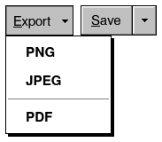 |  |

```nim
row:
  let pick = menuButton("&Export", ["PNG", "JPEG", "-", "PDF"])
  if pick >= 0:
    discard
  let sb = splitButton("&Save", ["Save As...", "Save a Copy..."])
  if sb.clicked:
    discard
```

**API**

```nim
proc menuButton*(label: string; items: openArray[string]; w = 0; enabled = true): int
```

A button with an arrow that drops a menu of `items`: the index
chosen, or -1. ("-" in `items` is a separator.) A click, Space,
Enter, Down, Alt+Down or F4 drop it.

```nim
proc splitButton*(label: string; items: openArray[string]; w = 0; enabled = true): tuple[clicked: bool; chose: int]
```

A button whose left part does its default (`clicked`: a click, Space,
Enter) and whose arrow part drops a menu of the other ways (`chose`:
the index, else -1; Alt+Down or F4 drop it too).

### buttonRow

The buttons at the foot of a dialog, right-aligned, the first the default: the number clicked (from 1), else 0.

| Normal | Touch screen | Dark scheme |
|---|---|---|
|  |  |  |

```nim
case buttonRow(["OK", "Cancel", "Help"])
of 1:
  discard
of 2:
  discard
else:
  discard
```

**API**

```nim
proc buttonRow*(labels: openArray[string]): int
```

Buttons right-aligned in a row (the first is the default); returns
which was clicked (1-based), 0 if none.

### buttonAt

A button at a place of your own: over a picture, on a bar you lay out yourself. `down` draws it held in.

| Normal | Touch screen | Dark scheme |
|---|---|---|
|  |  |  |

```nim
var mapZoom = 3

let r = canvas(220, 60)
fill(r, color(0, 96, 128))
if buttonAt("zoom-in", rect(r.x + 8, r.y + 8, 30, 24), "+"):
  inc mapZoom
if buttonAt("zoom-out", rect(r.x + 42, r.y + 8, 30, 24), "-"):
  dec mapZoom
discard buttonAt("layers", rect(r.x + 76, r.y + 8, 30, 24), "", pxPictures,
                 blIconOnly, down = true)
```

**API**

```nim
proc buttonAt*(key: string; r: Rect; label: string; st = TextStyle(); enabled = true;
               down = false): bool {.discardable.}
```

A push button at `r` (for bars and overlays laid out by hand); true
when clicked. `down` draws it held in (a toggle that is on).

```nim
proc buttonAt*(key: string; r: Rect; label: string; pic: ButtonPic; look = blTextBeside;
               enabled = true; down = false): bool {.discardable.}
```

`buttonAt` with a picture, the `look` way.

```nim
proc buttonAt*(key: string; r: Rect; label: string; glyph: string; look = blTextBeside;
               enabled = true; down = false): bool {.discardable.}
```

`buttonAt` with a glyph of the icon font as its picture.

## Choices

### checkbox

A yes or no, bound to a `bool`: the 3.1 box with its X. True when it flips.

| Normal | Touch screen | Dark scheme |
|---|---|---|
|  |  |  |

More states:

| Keyboard focus | Pressed | Disabled |
|---|---|---|
|  |  |  |

```nim
var autoSave = true
var backups = false

checkbox("&Auto save", autoSave)
checkbox("Keep &backups", backups)
```

**API**

```nim
proc checkbox*(label: string; v: var bool; enabled = true): bool {.discardable.}
```

A check box bound to `v`; true when toggled.

### radio

One of several: each radio button sets the `int` to its value when clicked.

| Normal | Touch screen | Dark scheme |
|---|---|---|
|  |  |  |

More states:

| Keyboard focus | Pressed | Disabled |
|---|---|---|
|  |  |  |

```nim
var size = 1

radio("&Small", size, 0)
radio("&Medium", size, 1)
radio("&Large", size, 2)
```

**API**

```nim
proc radio*(label: string; v: var int; value: int;
            enabled = true): bool {.discardable.}
```

One option of a group: selected when `v == value`; true when chosen.
The options sharing `v` are a group: the arrow keys move the choice
(and the focus) between them, as in 3.1.

### toggle (a switch)

An on/off switch in the manner of 3.1's slide switches. Click, tap or slide it; Space, Left and Right with the focus. `switchAt` is its behavior at a place of your own.

| Normal | Touch screen | Dark scheme |
|---|---|---|
|  |  |  |

More states:

| Keyboard focus | Pressed | Disabled |
|---|---|---|
|  |  |  |

```nim
var wifi = true

toggle("&Wi-Fi", wifi)
```

**API**

```nim
proc toggle*(label: string; v: var bool; enabled = true): bool {.discardable.}
```

An on/off slide switch with a label; true when flipped. Click, tap or
slide it; Space, Left and Right with the focus; Alt + its letter.

```nim
proc switchAt*(id: Id; track: Rect; v: var bool; hit: var Hit;
               enabled = true): bool
```

The behavior of a slide switch at `track` (`hit`: the interaction of
the widget it is part of, which may be bigger): a click or a tap flips
it, the thumb can be slid with the mouse or a finger, Space flips it,
Left / Right turn it off / on. Draws it; true when it changed.

```nim
proc switchSize*(): tuple[w, h: int]
```

The size of a switch's slot (bigger on touch screens).

### chips

Words to turn on and off (filters), each with its x when `closable`: `ev.clicked` and `ev.closed` say which.

| Normal | Touch screen | Dark scheme |
|---|---|---|
|  | 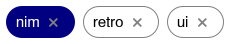 |  |

More states:

| Keyboard focus | Mouse over |
|---|---|
|  |  |

```nim
var tags = @["nim", "retro", "ui"]
var tagOn = @[true, false, false]

let ev = chips(tags, tagOn, closable = true)
if ev.clicked >= 0:
  tagOn[ev.clicked] = not tagOn[ev.clicked]
```

**API**

```nim
proc chips*(items: openArray[string]; selected: openArray[bool] = [];
            closable = false; enabled = true): ChipEvent {.discardable.}
```

Rounded tags in a row that wraps: filters, labels, recipients. One
stop for Tab: Left / Right move between them, Space or Enter clicks
one, Delete closes it (`closable`).

### tagInput

Tags as chips and a box to type the next one: Enter, a comma or Tab adds it, Backspace in the empty box takes the last one off.

| Normal | Touch screen | Dark scheme |
|---|---|---|
|  | 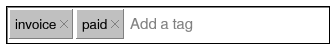 |  |

```nim
var tagList = @["invoice", "paid"]
var tagText = ""

tagInput(tagList, tagText)
```

**API**

```nim
proc tagInput*(tags: var seq[string]; text: var string; w = 0; enabled = true;
               placeholder = "Add a tag"): bool {.discardable.}
```

Tags as chips (each with its ×) and a box to type the next: Enter, a
comma or Tab adds it, Backspace in the empty box takes the last off.
True when the tags changed.

### rating

Stars, one to five: click one, or use the arrows.

| Normal | Touch screen | Dark scheme |
|---|---|---|
|  |  |  |

More states:

| Keyboard focus | Mouse over | Pressed | Disabled |
|---|---|---|---|
|  |  |  |  |

```nim
var stars = 3

rating(stars)
```

**API**

```nim
proc rating*(v: var int; stars = 5; enabled = true): bool {.discardable.}
```

Stars to click or tap, 0..`stars`; clicking the current one clears it.
With the focus: Left / Right one star less / more, Home none, End all.

## Text input

Every text box has Cut, Copy, Paste, Undo and its menu (a right click, a
long press), selects with the mouse, the keyboard and fingers, and takes
Arabic and any text the system's input method gives. Its caret blinks for
`CaretBlinkFor` (10 seconds) after it last moved, then stays shown: a
window left with a text box focused runs no frames.

### edit

A one-line text box bound to a `string`: true when the text changed. `password` hides it, `readOnly` lets it be selected and copied only.

| Normal | Touch screen | Dark scheme |
|---|---|---|
|  |  |  |

More states:

| Keyboard focus | Disabled |
|---|---|
|  |  |

```nim
var name = "Sultan"
var secret = "hunter2"

form 0:
  field "&Name:":
    edit(name)
  field "&Password:":
    edit(secret, password = true)
```

**API**

```nim
proc edit*(s: var string; w = 0; password = false;
           enabled = true; readOnly = false): bool {.discardable.}
```

A one-line text box bound to `s`; true when the text changed.
`readOnly`: selected and copied, not changed.

```nim
proc editAt*(id: Id; s: var string; r: Rect; multi, pass, enabled: bool;
             allowed: set[char] = {}; right = false; frameless = false;
             wrap = false; readOnly = false): bool
```

A text box at `r` (for widgets made of one: spin, number fields...).
`allowed` limits the characters typed, `right` aligns the text right,
`frameless` leaves out the border (the widget around draws one),
`wrap` (several lines) wraps long lines at the words, `readOnly`: the
text is selected, copied and scrolled through, not changed.
Its menu (a right click, a long press): Cut, Copy, Paste, Delete,
Select all. In a right-to-left interface its text keeps its own
direction (a line of Arabic at the right, of Latin at the left, an
empty box's caret at the right), not mirrored with the frame.

### editArea

Text of several lines, `lines` high (-1: down to the bottom), with its scroll bars.

| Normal | Touch screen | Dark scheme |
|---|---|---|
|  |  |  |

More states:

| Keyboard focus | Disabled |
|---|---|
|  |  |

```nim
var notes = "Line one\nLine two\nLine three"

editArea(notes, lines = 4)
```

**API**

```nim
proc editArea*(s: var string; lines = 6; w = 0;
               enabled = true; wrap = true; readOnly = false): bool {.discardable.}
```

A multi-line text box with a scroll bar. `lines` < 0 fills the
height left in the window. Long lines wrap at the words (`wrap`
false: they scroll sideways). `readOnly`: the text can be selected,
copied and scrolled through, not changed (a log, a message's source).

### searchBox

A box with a magnifier, its hint while empty, and an x that clears it.

| Normal | Touch screen | Dark scheme |
|---|---|---|
|  |  |  |

More states:

| Keyboard focus | Disabled |
|---|---|
|  |  |

```nim
var query = "invoices"

searchBox(query, "Search invoices")
```

**API**

```nim
proc searchBox*(s: var string; placeholder = "Search"; w = 0;
                enabled = true): bool {.discardable.}
```

A text box with a magnifier and a clear button; true when the text
changed. Esc clears it.

### autocomplete

A text box whose choices that match drop under it as you type: Down and Up pick, Enter or a click takes one.

| Normal | Touch screen | Dark scheme |
|---|---|---|
|  |  |  |

```nim
var acCity = ""

autocomplete(acCity, ["Muscat", "Muttrah", "Sohar", "Salalah", "Nizwa", "Sur"],
             w = 200)
```

**API**

```nim
proc autocomplete*(s: var string; choices: openArray[string]; w = 0; rows = 6;
                   enabled = true): bool {.discardable.}
```

A text box whose list of `choices` that begin with (or hold) what is
typed drops under it: Down and Up pick, Enter or Tab or a click takes
one, Esc closes it. True when the text changed.

### maskedEdit

Typing into a mask: `#` a digit, `A` a letter, `U` an upper-case letter, `X` a letter or digit, `*` anything. `maskRaw` gives what was typed without the mask.

| Normal | Touch screen | Dark scheme |
|---|---|---|
|  |  |  |

More states:

| Keyboard focus | Disabled |
|---|---|
|  |  |

```nim
var phone = "96891234"

row:
  label "&Phone:"
  maskedEdit(phone, "+### #### ####")
```

**API**

```nim
proc maskedEdit*(value: var string; mask: string; w = 0;
                 enabled = true): bool {.discardable.}
```

A field typed into `mask` (see `maskFormat`): the literals are there
already, the caret jumps over them, only what a slot takes goes in
(Arabic-Indic digits become digits). `value` holds the characters
typed, without the literals (`maskFormat` shows them, `maskFull`
tells when it is complete). Left, Right, Home, End, Backspace,
Delete, Ctrl+C / Ctrl+V. True when `value` changed.

```nim
proc maskFormat*(value, mask: string; blank = '_'): string
```

`value` (the characters typed) laid into `mask`:
`maskFormat("96891234567", "+### #### ####")` is "+968 9123 4567";
slots not typed yet show `blank`. Mask characters: `#` or `9` a
digit, `A` a letter, `U` a letter made upper case, `L` lower case,
`X` a letter or digit, `*` any; ``\`` takes the next one as it is; the
rest is shown as it is.

```nim
proc maskFull*(value, mask: string): bool
```

Every slot of `mask` is typed, each with what it takes.

```nim
proc maskRaw*(text, mask: string): string
```

The characters typed, from a text laid out like `mask` (or typed
loosely: what does not fit the next slot is skipped).

### comboEdit

A text box with a list beside it: type anything, or drop the list (Alt+Down, F4, the arrow) and pick. It suggests what begins with what is typed.

| Normal | Touch screen | Dark scheme |
|---|---|---|
|  |  |  |

More states:

| Clicked / open |
|---|
|  |

```nim
var city = "Ber"

comboEdit(city, ["Berlin", "Bern", "Beirut", "Muscat", "Sohar"], w = 180,
          )
```

**API**

```nim
proc comboEdit*(text: var string; items: openArray[string]; w = 0;
                enabled = true): bool {.discardable.}
```

A text field that suggests matching `items` as you type (or lists
them all from its button, Alt+Down, F4, or Enter when no list is
open; F4, Alt+Up or Esc close it). Up/Down, Enter, Esc work in the
list; none is picked until Down (or the mouse) points at one, so Enter
on its own keeps what was typed.

### hotkeyEdit

A box that takes the next key pressed, with Ctrl, Alt and Shift, as a shortcut ("Ctrl+Shift+S"). `hotkeyPressed` tells when that shortcut is pressed.

| Normal | Touch screen | Dark scheme |
|---|---|---|
|  |  |  |

More states:

| Keyboard focus | Disabled |
|---|---|
|  |  |

```nim
var hotkey = "Ctrl+Shift+S"

row:
  label "&Save as:"
  hotkeyEdit(hotkey)
```

**API**

```nim
proc hotkeyEdit*(keys: var string; w = 0; enabled = true): bool {.discardable.}
```

A box that takes the next key pressed, with its Ctrl, Alt and Shift,
as a shortcut ("Ctrl+Shift+S"); Backspace or Delete alone clears it,
Tab and Esc leave it. True when it changed.

```nim
proc hotkeyText*(key: KeyCode; mods: set[Modifier]): string
```

"Ctrl+Shift+S" for Ctrl + Shift + S; on a Mac "Cmd+Shift+S" -- Cmd is
reported as Ctrl there, the Control key as the Gui key ("Control+"),
Option as Alt ("Option+") -- elsewhere the Gui key is "Win+".

```nim
proc parseHotkey*(s: string): tuple[key: KeyCode; mods: set[Modifier]]
```

"Ctrl+Shift+S" -> (KeyS, {CtrlPressed, ShiftPressed}); KeyNone when it
is not a shortcut. "Cmd" is Ctrl on every system (the key shortcuts
are made with: Cmd on a Mac, Ctrl elsewhere), so a shortcut kept on one
is the same on the others; "Control" is a Mac's Control key there (the
Gui key), Ctrl elsewhere.

```nim
proc hotkeyPressed*(s: string): bool
```

The shortcut `s` ("Ctrl+S") was pressed this frame (and not used yet);
uses it. On a Mac "Ctrl+S" is Cmd+S, as `s` written either way.

## Numbers, dates, colors

Numbers are typed and shown as the user reads them ("1,234.50";
`formatNumber`, `parseNumber`). `Date` is a plain (year, month, day) with
`today()`, `addDays`, `addMonths`, `weekday` and `parseDate`.

### spin, intEdit, numberEdit

Numbers to type: `spin` with its arrows (the wheel and Up/Down too), `intEdit` whole numbers, `numberEdit` decimals with `lo`, `hi` and `decimals`.

| Normal | Touch screen | Dark scheme |
|---|---|---|
|  |  |  |

More states:

| Keyboard focus | Disabled |
|---|---|
|  |  |

```nim
var copies = 2
var qty = 12
var amount = 1234.5

form 0:
  field "&Copies:":
    spin(copies, 1, 99)
  field "&Quantity:":
    intEdit(qty)
  field "&Amount:":
    numberEdit(amount)
```

**API**

```nim
proc spin*(v: var int; lo, hi: int; w = 80; step = 1;
           enabled = true): bool {.discardable.}
```

A number box with up and down arrows bound to `v` in `lo..hi`: type a
number, click or hold the arrows, or with the focus Up / Down (`step`),
Page Up / Page Down (ten steps) and the wheel.

```nim
proc intEdit*(v: var int; w = 80; lo = low(int); hi = high(int);
              thousands = false; enabled = true): bool {.discardable.}
```

A right-aligned whole-number field. Only whole numbers from `lo` to
`hi` are taken (true when `v` changed); clicking or tabbing into it
selects the number, so typing replaces it.

```nim
proc numberEdit*(v: var float; decimals = 2; w = 110; lo = NegInf;
                 hi = Inf; thousands = true;
                 enabled = true): bool {.discardable.}
```

A right-aligned number field; shows `decimals` places (0 to 12) and
thousands separators when it does not have the focus. Only numbers
from `lo` to `hi` are taken (true when `v` changed). Clicking or
tabbing into it selects the number, so typing replaces it.

### slider, progress

A track bar for a value between two ends, and a 3.1 progress bar (0.0 to 1.0).

| Normal | Touch screen | Dark scheme |
|---|---|---|
|  |  |  |

More states:

| Keyboard focus | Pressed | Disabled |
|---|---|---|
|  |  |  |

```nim
var volume = 40

slider(volume, 0, 100)
progress(0.62)
```

**API**

```nim
proc slider*(v: var int; lo, hi: int; w = 0; ticks = 10;
             enabled = true): bool {.discardable.}
```

A track bar bound to `v` in `lo..hi`; arrows, PgUp/PgDn, Home/End.
On touch screens the thumb is large enough for a finger.

```nim
proc progress*(value: float; w = 0; showText = true)
```

A progress bar, `value` from 0.0 to 1.0, with the percentage.

### rangeSlider

A track bar with two thumbs: a range from `lo` to `hi`. Drag either, or the band between them to move both.

| Normal | Touch screen | Dark scheme |
|---|---|---|
|  | 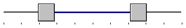 |  |

More states:

| Keyboard focus |
|---|
|  |

```nim
var priceLo = 120
var priceHi = 380

rangeSlider(priceLo, priceHi, 0, 500)
```

**API**

```nim
proc rangeSlider*(lo, hi: var int; minV, maxV: int; w = 0; ticks = 10;
                  enabled = true): bool {.discardable.}
```

A track bar with two thumbs, `lo` and `hi` (`minV <= lo <= hi <=
maxV`): drag either (the nearer is taken), or the band between them
to move both. Keys: arrows move the focused end (Tab... the left
first; Shift+arrows the right). True when either changed.

### popupSlider

A number box with a slider that drops from its arrow, as a tool's options bar has for Opacity: type the number, or press the arrow and drag.

| Normal | Touch screen | Dark scheme |
|---|---|---|
|  |  |  |

More states:

| Clicked / open |
|---|
|  |

```nim
var opacity = 80

row:
  label "Opacity:"
  popupSlider(opacity, 0, 100, w = 60)
```

**API**

```nim
proc popupSlider*(v: var int; lo, hi: int; w = 0; unit = "%";
                  enabled = true): bool {.discardable.}
```

A number box with a slider that drops down from its arrow, as a tool's
options bar has for Opacity, Flow or Tolerance: type the number; or
press the arrow and drag (letting go closes it); or click the arrow,
then click or drag on the slider (Enter, Esc or a click outside close
it). Up / Down and the wheel step it when it has the focus; F4 or
Alt+Down drop the slider from the keyboard (Left / Right move it).

### knob

A round knob (a volume, a balance): drag up or right to turn it up; the wheel and the arrows too. Its value shows under it.

| Normal | Touch screen | Dark scheme |
|---|---|---|
|  |  |  |

More states:

| Keyboard focus |
|---|
|  |

```nim
var knobVolume = 65
var knobBass = 30

row:
  knob(knobVolume, 0, 100, size = 56, label = "Vol")
  knob(knobBass, 0, 100, size = 56, label = "Bass")
```

**API**

```nim
proc knob*(v: var int; lo, hi: int; size = 0; label = ""; enabled = true): bool {.discardable.}
```

A round knob (a volume, a pan): drag up or right to turn it up, the
wheel and the arrow keys too; its value under it.

### datePicker

A date field with a calendar that drops down (Alt+Down or F4). Type the date, or pick it.

| Normal | Touch screen | Dark scheme |
|---|---|---|
|  |  |  |

More states:

| Keyboard focus | Clicked / open | Disabled |
|---|---|---|
|  |  |  |

```nim
var day = date(2026, 10, 27)

datePicker(day)
```

**API**

```nim
proc datePicker*(d: var Date; w = 0; enabled = true): bool {.discardable.}
```

A date field (typed in `dateStyle`) with a drop-down calendar (its
button, Enter, Alt+Down or F4; F4, Alt+Up or Esc close it). With the
focus, Up / Down move a day and Page Up / Page Down a month.

### calendar

A month to pick a day from: the arrows move the day, Page Up and Page Down the month.

| Normal | Touch screen | Dark scheme |
|---|---|---|
|  |  |  |

More states:

| Keyboard focus |
|---|
|  |

```nim
var calDay = date(2026, 10, 27)

calendar(calDay)
```

**API**

```nim
proc calendar*(d: var Date; enabled = true): bool {.discardable.}
```

A month calendar bound to `d`: click or tap a day; the arrows move a
day or a week, Page Up / Page Down a month, Home / End the first /
last day; the wheel and the < > buttons show other months.

### dateRange, presetRange

From and to, with the ranges people ask for most (This month, Last year...) in a list.

| Normal | Touch screen | Dark scheme |
|---|---|---|
|  |  |  |

More states:

| Keyboard focus |
|---|
|  |

```nim
var fromDay = date(2026, 10, 1)
var toDay = date(2026, 10, 31)

dateRange(fromDay, toDay)
```

**API**

```nim
proc dateRange*(a, b: var Date; presets = true; key = ""): bool {.discardable.}
```

From and to dates (each with its drop-down calendar) and, with
`presets`, a list of periods (Today, This month, Last year...) that
sets both; it shows the period the dates make, else "Custom". The
"to" date is never before the "from" one. True when they changed.

```nim
proc presetRange*(p: RangePreset; day = today()): tuple[a, b: Date]
```

The first and last day of the period `p` around `day` (weeks start on
`firstWeekday`).

### timePicker

Hours and minutes, each with its spin arrows.

| Normal | Touch screen | Dark scheme |
|---|---|---|
|  |  |  |

More states:

| Keyboard focus | Disabled |
|---|---|
|  |  |

```nim
var hh = 9
var mm = 30

timePicker(hh, mm)
```

**API**

```nim
proc timePicker*(h, m: var int; enabled = true): bool {.discardable.}
```

Hours (0..23) and minutes as two spin boxes.

### colorPicker

The 48 basic colors of the 3.1 Color dialog, a preview and a box for "#RRGGBB".

| Normal | Dark scheme |
|---|---|
|  |  |

More states:

| Keyboard focus | Disabled |
|---|---|
|  |  |

```nim
var pick = color(0, 128, 128)

colorPicker(pick)
```

**API**

```nim
proc colorPicker*(c: var Color; enabled = true): bool {.discardable.}
```

The 48 basic colors of the 3.1 color dialog to pick from (a click, a
tap, or the arrow keys with the focus), a preview and a "#RRGGBB" box
to type any color in. True when `c` changed.

```nim
proc hexOf*(c: Color): string
```

"#RRGGBB" of `c`.

```nim
proc parseHexColor*(s: string; c: var Color): bool
```

"#RRGGBB" or "RRGGBB" (or "#RGB") into `c`.

### colorWell and the Color dialog

A swatch of a color: a click opens the Color dialog -- the basic and custom colors, the spectrum, Hue, Sat, Lum, Red, Green, Blue and "#RRGGBB". OK sets the color. The pictures show the dialog after a click.

| Normal | Touch screen | Dark scheme |
|---|---|---|
| 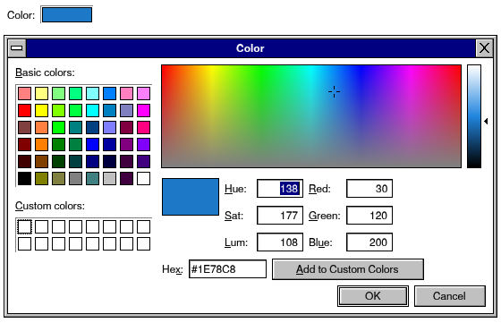 | 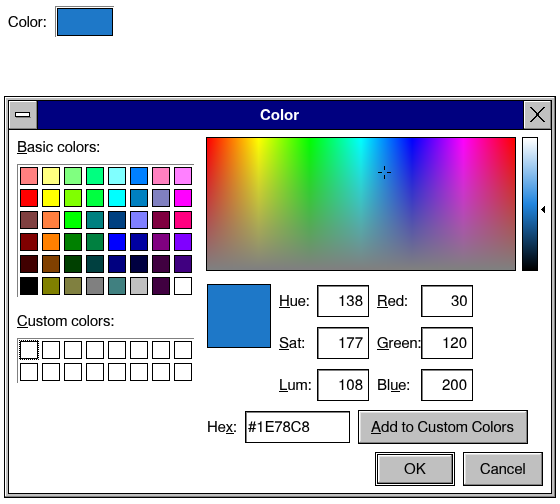 | 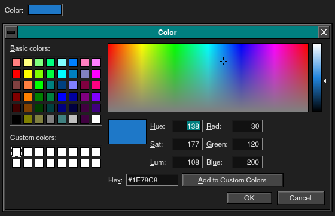 |

```nim
var wellColor = color(30, 120, 200)

row:
  label "Color:"
  colorWell(wellColor, "label-color", w = 60)
```

**API**

```nim
proc colorWell*(c: var Color; key: string; w = 0; title = "Color"; enabled = true): bool {.discardable.}
```

A swatch of `c` in a sunken frame: a click (Enter, Space) opens the
Color dialog -- the basic and custom colors, the spectrum, Hue / Sat /
Lum, Red / Green / Blue, "#RRGGBB" -- and OK sets `c` (true then).
Use one wherever a color is chosen; `key` tells the wells apart.

```nim
proc openColorDialog*(key: string; c: Color; title = "Color")
```

Opens the Color dialog for `key` at color `c`; `colorDialogResult(key)`
gives the color chosen (`colorWell` does both).

```nim
proc colorDialogResult*(key: string; c: var Color): bool
```

True once, after OK in the Color dialog opened for `key`: `c` is set.

```nim
proc storeCustomColors*(s: var Settings)
```

The custom colors into the settings (`restoreCustomColors` reads them).

```nim
proc restoreCustomColors*(s: Settings)
```

The custom colors as `storeCustomColors` kept them.

## Lists and data

Lists, grids and trees draw only the rows in view, so 100,000 rows cost
what 20 do. They scroll with the wheel, the scroll bars, the keys and a
finger, select with Ctrl and Shift, and find a row as its first letters are
typed.

### listbox

A list to pick one item from: `sel` is its index. `rows` is its height in items (-1: down to the bottom).

| Normal | Touch screen | Dark scheme |
|---|---|---|
|  |  |  |

More states:

| Keyboard focus | Mouse over | Disabled |
|---|---|---|
|  |  |  |

```nim
var fruits = @["Apple", "Banana", "Cherry", "Dates", "Figs", "Grapes"]
var fruit = 1

listbox(fruits, fruit, rows = 5)
```

**API**

```nim
proc listbox*(items: openArray[string]; sel: var int; rows = 6; w = 0;
              tabs: openArray[int] = []; enabled = true): bool {.discardable.}
```

A list bound to the selected index `sel`; true when it changed.
Items may hold '\t' columns aligned on `tabs` (pixels at 100%: they
grow with the UI's size).

### combo

A drop-down list: one item shown, the list under it when it is opened (a click, Enter, Alt+Down, F4 -- `dropKey` is that key for a control of your own). Typing a letter picks the next item that begins with it.

| Normal | Touch screen | Dark scheme |
|---|---|---|
|  |  |  |

More states:

| Keyboard focus | Clicked / open | Disabled |
|---|---|---|
|  |  |  |

```nim
var comboFruits = @["Apple", "Banana", "Cherry", "Dates", "Figs", "Grapes"]
var fruitCombo = 2

combo(comboFruits, fruitCombo, w = 160)
```

**API**

```nim
proc combo*(items: openArray[string]; sel: var int; w = 0;
            enabled = true; preview: ItemPreview = nil): bool {.discardable.}
```

A drop-down list bound to the selected index `sel`; `preview` draws
its items in the list (a font's name in the font). With the focus:
Enter, Alt+Down or F4 open it (F4, Alt+Up or Enter close it on
the item lit; Esc without), Up / Down / Home / End pick, letters typed
pick the item that starts with them (in the open list; in the closed
one when Tab brought the focus -- a list clicked leaves the letters to
the app's keys).

```nim
proc dropKey*(): bool
```

F4 or Alt+Down was pressed (and is taken): what drops a drop-down with
the focus open, or closes it, as in Windows -- combo boxes, date
pickers, menu buttons, a grid's drop-down cells. (Enter opens a closed
one too; Alt+Up and Esc close an open one.)

### checkList

A list whose items each have a check box.

| Normal | Touch screen | Dark scheme |
|---|---|---|
|  |  |  |

More states:

| Keyboard focus | Disabled |
|---|---|
|  |  |

```nim
var checks = @[true, false, true, false]

checkList(["Cash", "Bank", "Cards", "Vouchers"], checks, rows = 4,
          )
```

**API**

```nim
proc checkList*(items: openArray[string]; checked: var seq[bool]; rows = 6;
                w = 0; enabled = true): bool {.discardable.}
```

A list with a check box on each item: a click, a tap or Space flips
the item; Up, Down, Page Up, Page Down, Home, End move.

### fontCombo, fontStyleCombo

Drop-down lists of the font families (the built-in ones and the system's) and of a family's styles, each shown in its own letters. From `retroui/textwidgets`.

| Normal | Touch screen | Dark scheme |
|---|---|---|
|  |  |  |

More states:

| Clicked / open |
|---|
|  |

```nim
var fontFamily = "FreeSerif"
var fontStyle = "Bold"

row:
  fontCombo(fontFamily, w = 160)
  fontStyleCombo(fontFamily, fontStyle, w = 100)
```

**API**

```nim
proc fontCombo*(family: var string; w = 0; enabled = true): bool {.discardable.}
```

A drop-down list of the font families (the system's and the built-in
ones), each shown in its own letters.

```nim
proc fontStyleCombo*(family: string; style: var string; w = 0; enabled = true): bool {.discardable.}
```

The styles of `family` ("Regular", "Bold"...), each in its letters.

```nim
proc fontSample*(family, style, text: string; h: int; color = 0xFF000000'u32): Bitmap
```

`text` in a font, `h` screen pixels tall (kept: drawn once).

### grid

Rows and columns, the rows from a `seq` or from a proc (so a million cost what twenty do). Click a header to sort, drag its edge to size it; F2 or typing edits an `editable` cell.

| Normal | Touch screen | Dark scheme |
|---|---|---|
|  |  |  |

More states:

| Keyboard focus | Disabled |
|---|---|
|  |  |

```nim
var cols = @[column("Item", 130), numberColumn("Qty", 50),
             numberColumn("Price", 70)]
var gridSel = 1

grid(cols, @[@["Paper", "10", "4.50"], @["Ink", "2", "21.00"],
             @["Pens", "40", "0.80"]], gridSel, height = 4,
     )
```

**API**

```nim
proc grid*(cols: var seq[Column]; rows: int; cell: proc (row, col: int): string;
           sel: var int; height = 10; w = 0; sortColumn = -1;
           sortDescending = false; enabled = true;
           icon: proc (row: int): Icon = nil; typeToEdit = true;
           tapActivates = false; style: proc (row, col: int): CellStyle = nil;
           rowHeaders = false; footer: proc (col: int): string = nil): GridEvent
          {.discardable.}
```

A table of `rows` rows; `cell(row, col)` gives the text of the cells
on screen (so a million rows cost what the visible ones cost). Click a
header to sort, drag its edge to resize; arrows, Enter, F2 to edit an
`editable` cell (or just type). `height` is in rows (-1 fills).
`sortColumn`, `sortDescending`: the order the rows are in, for the
arrow in the header (else the grid remembers the last header click).
`icon(row)`: a 16x16 icon before the first column's text.
`typeToEdit` false: typing jumps to the row that starts with it.
`tapActivates`: on a touch screen one tap opens a row (as in a file
manager), not two.

Columns can hold more than text (`Column.kind`: `checkColumn`,
`colorColumn`, `progressColumn`, `choiceColumn`, `buttonColumn`,
`linkColumn`, `iconColumn`, `numberColumn`): a check box cell flips on
a click or Space (`toggled`, `edited` with "1" / "0"), a drop-down cell
opens its `choices` (F4, Alt+Down, Enter, a click on the current cell;
`edited`), a button or link reports `clicked`. `style(row, col)` gives cells their
own colors and weight; `rowHeaders` adds the record indicator column
(an arrow at the current row); `footer(col)` a totals row.

```nim
proc grid*(cols: var seq[Column]; rows: int; cell: proc (row, col: int): string;
           sel: var int; marked: var seq[bool]; height = 10; w = 0;
           sortColumn = -1; sortDescending = false; enabled = true;
           icon: proc (row: int): Icon = nil; typeToEdit = true;
           tapActivates = false; checkboxes = false; dragRows = false;
           dropOk: proc (row: int): bool = nil;
           style: proc (row, col: int): CellStyle = nil; rowHeaders = false;
           footer: proc (col: int): string = nil): GridEvent {.discardable.}
```

A grid where many rows can be selected: `marked[row]`; `sel` is the
row with the focus. Ctrl+click toggles a row, Shift+click selects a
range, Ctrl+A all, dragging from below the rows draws a selection
rectangle; `checkboxes` adds a check box to every row. On a touch
screen, once a row is marked (long press, or its check box), taps mark
more rows. `dragRows`: dragging a row reports `dragStarted` (call
`startDrag`); `dropOk(row)` says which rows take a drop (-1: the empty
part), reported as `dropOver` and `dropped`.

```nim
proc grid*(cols: var seq[Column]; data: seq[seq[string]]; sel: var int;
           height = 10; w = 0; sortColumn = -1; sortDescending = false;
           enabled = true; style: proc (row, col: int): CellStyle = nil;
           rowHeaders = false; footer: proc (col: int): string = nil): GridEvent
          {.discardable.}
```

A table showing `data` (rows of cells).

```nim
proc column*(title: string; width = 100; align = alLeft;
             editable = false; kind = ckText; choices: openArray[string] = []): Column
```

A column of text (or of `kind`); the others below are short cuts.

```nim
proc sortRows*(data: var seq[seq[string]]; col: int; descending = false)
```

Sort table rows by column `col`: as numbers when every cell is one
(thousands separators allowed), else alphabetically ignoring case.

```nim
proc gridEdit*(row, col: int; selectTo = -1)
```

Open the editor on cell `row`, `col` of the next grid drawn (a
"Rename" command, say). `selectTo`: select only the text before it
(a file name without its extension); -1 selects all.

### grid with cell kinds

The columns of a business screen: numbers, check boxes, status colors, drop-down choices, buttons, bars, links, icons and cells you draw. `style` colors a cell, `rowHeaders` adds the record indicator, `footer` a totals row.

| Normal | Touch screen | Dark scheme |
|---|---|---|
|  |  |  |

More states:

| Keyboard focus |
|---|
|  |

```nim
var orderCols = @[column("Order", 120), numberColumn("Amount", 70),
                  colorColumn("DA", 30), colorColumn("PD", 30),
                  checkColumn("S", 28), choiceColumn("Store",
    ["Engineering", "Kitchen", "Cafeteria"], 100), buttonColumn("", 56)]
var orders = @[@["Pool glass door", "70.000", "green", "green", "1",
                 "Engineering", "Open"], @["Stewarding", "51.800", "green",
    "blue", "0", "Kitchen", "Open"], @["Bread for canteen", "54.155", "orange",
                                       "green", "0", "Cafeteria", "Open"]]
var orderSel = 0

grid(orderCols, orders.len, proc (r, c: int): string =
  orders[r][c], orderSel, height = 3, rowHeaders = true, style = proc (r, c: int): CellStyle =
  if c == 1 and r == 0:
    cellStyle(fg = color(200, 0, 0), bold = true)
  else:
    CellStyle()
  , footer = proc (c: int): string =
  if c == 0:
    "Total"
  elif c == 1:
    "175.955"
  else:
    ""
  )
```

**API**

```nim
proc numberColumn*(title: string; width = 90; editable = false): Column
```

Numbers, right aligned.

```nim
proc checkColumn*(title: string; width = 40; editable = true): Column
```

Check boxes; a click flips them.

```nim
proc colorColumn*(title: string; width = 34): Column
```

Blocks of color (status lights).

```nim
proc choiceColumn*(title: string; choices: openArray[string]; width = 120;
                   editable = true): Column
```

Text picked from `choices` in a drop-down list.

```nim
proc buttonColumn*(title: string; width = 80): Column
```

Push buttons showing the text; a click is `clicked`.

```nim
proc progressColumn*(title: string; width = 100): Column
```

Progress bars ("0.62" or "62%").

```nim
proc linkColumn*(title: string; width = 100): Column
```

Links (blue underlined text); a click is `clicked`.

```nim
proc iconColumn*(title: string; width = 28): Column
```

Icons: the text is a pixel icon ("Sheet", "pxSheet" or `pxSheet`
itself) or an icon-font glyph.

```nim
proc customColumn*(title: string; width: int;
                   paint: proc (row: int; r: Rect; selected: bool)): Column
```

Cells drawn by `paint` (a sparkline, a rating, a gauge...).

```nim
proc cellStyle*(fg = Color(); bg = Color(); bold = false): CellStyle
```

A cell's look for `grid`'s `style` (a color left out is the grid's).

```nim
proc namedColor*(s: string): Color
```

"#RRGGBB", "#RGB" or a 3.1 palette name ("green", "red", "navy",
"orange"...); alpha 0 when it is none.

```nim
proc isChecked*(s: string): bool
```

How a check box cell reads its text.

### tree, branch, leaf

A tree view: `sel` is the path of the node picked ("My computer/Documents"). A `branch` shows its children while its `bool` is true, so they can be read only when it is opened.

| Normal | Touch screen | Dark scheme |
|---|---|---|
|  |  |  |

More states:

| Keyboard focus |
|---|
|  |

```nim
var treeSel = "My computer/Documents"
var treeOpen = true
var treeOpen2 = false

tree(treeSel, 7):
  branch("My computer", treeOpen):
    leaf("Documents")
    branch("Pictures", treeOpen2):
      leaf("Holidays")
    leaf("Music")
```

**API**

```nim
template tree*(sel: var string; rows: int; body: untyped)
```

A tree view; `sel` is the path ("Parent/Child") of the selected node.
Inside, `branch` and `leaf` make the nodes.

```nim
template branch*(label: string; expanded: var bool; body: untyped)
```

A node with children, shown in `body` while `expanded`.

```nim
template branch*(label: string; expanded: var bool; pic: Icon; id: string;
                 hasKids: bool; body: untyped)
```

A node with its own icon and identity (`id`, e.g. a folder's path);
`body` runs only while it is open, so children can be loaded lazily.

```nim
proc leaf*(label: string; icon = true; pic = Icon(); id = ""): bool {.discardable.}
```

A node without children; true when it was clicked.

```nim
proc treeClicked*(): string
```

Inside or right after a `tree`: the node clicked this frame ("" if none).

### treeGrid

A tree with columns: a chart of accounts, a bill of materials.

| Normal | Touch screen | Dark scheme |
|---|---|---|
|  |  |  |

More states:

| Keyboard focus |
|---|
|  |

```nim
var accCols = @[column("Account", 170), numberColumn("Balance", 90)]
var accRows = @[TreeRow(level: 0, cells: @["Assets", "15,000.00"], open: true),
                TreeRow(level: 1, cells: @["Cash", "5,000.00"]),
                TreeRow(level: 1, cells: @["Bank", "10,000.00"]),
                TreeRow(level: 0, cells: @["Liabilities", "4,000.00"])]
var accSel = 1

treeGrid(accCols, accRows, accSel, height = 4)
```

**API**

```nim
proc treeGrid*(cols: var seq[Column]; rows: var seq[TreeRow]; sel: var int;
               height = 10; w = 0; boldParents = true): TreeGridEvent {.discardable.}
```

A tree whose rows have columns (accounts with their balances, parts
with their quantities): rows with deeper rows after them open and
close with their ``[+]`` box, a double click, Right / Left or Space;
Up, Down, Page Up, Page Down, Home, End move; Enter (or a double click
on a row without children) activates. Drag a header's edge to resize
its column. `height` in rows (-1 fills). Parents are bold.

### iconView

Items as large pictures with their names under them (the Large icons view), as tiles with a detail line, or as small icons. You draw each picture.

| Normal | Touch screen | Dark scheme |
|---|---|---|
|  |  |  |

More states:

| Keyboard focus |
|---|
|  |

```nim
var iconSel = 0
var iconMarked: seq[bool]

iconView(6, proc (i: int): string =
  ["Reports", "Budget", "Photos", "Music", "Notes", "Setup"][i], proc (i: int;
    r: Rect) =
  let g = [pxFolder, pxSheet, pxPictures, pxMusic, pxText, pxApp][i]
  image(r.x + (r.w - 32) div 2, r.y + (r.h - 32) div 2,
        glyphIcon(g, ui.theme.text, 32)), iconSel, iconMarked, height = 130)
```

**API**

```nim
proc iconView*(count: int; label: proc (i: int): string;
               picture: proc (i: int; r: Rect); sel: var int;
               marked: var seq[bool]; tile = 0; height = -1;
               tapActivates = false; checkboxes = false;
               enabled = true; picSize = 0; detail: proc (i: int): string = nil;
               dragItems = false; dropOk: proc (i: int): bool = nil;
               oneLine = false): GridEvent {.discardable.}
```

Items as large pictures with their names under them, in rows (the
"Large icons" view of a file manager); with `detail` as tiles: the
picture at the left, the name and a line or two of `detail(i)` beside
it. `picture(i, r)` draws item `i` into `r` (an icon, a thumbnail with
`drawBitmap`). With `oneLine`, small tiles of one line each: the
picture and the name beside it ("Small icons"). Selection, keys,
touch, selection rectangles (drag on
the empty part), `dragItems` and `dropOk` work as in the multi-select
`grid`; arrows move in two dimensions.

### lineView

Lines of text from a proc, any number of them: a log, a huge file. Only the lines in view are asked for.

| Normal | Dark scheme |
|---|---|
|  |  |

More states:

| Keyboard focus |
|---|
|  |

```nim
var logSel = 3

lineView(100000, proc (i: int): string =
  "2026-10-27 10:" & $(i mod 60) & " request " & $i & " ok", logSel,
         height = 100, numbers = true)
```

**API**

```nim
proc lineView*(count: int; line: proc (i: int): string; sel: var int;
               height = -1; w = 0; mono = true; numbers = false;
               wrap = false): LineViewEvent {.discardable.}
```

A fast read-only view of `count` lines (only the visible ones are asked
for): logs, big text files, hex dumps. A click (or the arrows) selects
a line, Shift or a mouse drag extends, Ctrl+A all, Ctrl+C copies them.
The wheel scrolls (Shift + the wheel sideways), a finger drags. `wrap`
is off: long lines scroll sideways.

### dualList

Two lists to move items between (the buttons, a double click, Enter), and to order the chosen ones.

| Normal | Touch screen | Dark scheme |
|---|---|---|
|  |  |  |

More states:

| Keyboard focus |
|---|
|  |

```nim
var avail = @["Cash", "Bank", "Sales"]
var chosen = @["Rent", "Salaries"]

dualList(avail, chosen, rows = 5)
```

**API**

```nim
proc dualList*(available, chosen: var seq[string]; rows = 8;
               titles = ("&Available:", "&Chosen:"); sortAvailable = true;
               key = ""): bool {.discardable.}
```

Two lists and the buttons between them: > moves the item picked on
the left to the right, >> all of them, < and << back; a double click
(or Enter) moves an item across. Up / Down buttons order the chosen
ones. On phones the lists are stacked. True when the lists changed.

### propertyGrid

Properties by category: text, numbers, yes/no, choices, colors and dates, with a help line for the one picked.

| Normal | Touch screen | Dark scheme |
|---|---|---|
|  |  |  |

More states:

| Keyboard focus |
|---|
|  |

```nim
var props = @[textProp("Name", "Main store", "General",
                       "What the store is called"),
              boolProp("Active", true, "General"),
              choiceProp("Region", ["North", "South", "East"], 1, "General"),
              numberProp("Budget", 1500.5, 2, "Money"),
              colorProp("Label", color(0, 128, 0), "Look")]
var propSel = 0

propertyGrid(props, propSel, height = 220)
```

**API**

```nim
proc propertyGrid*(props: var seq[Prop]; sel: var int; height = -1;
                   help = true; key = ""): int {.discardable.}
```

Properties as names and values in two columns, by `category` (a
category folds away with its ``[-]`` box), the chosen one edited in place:
text and numbers typed, Yes / No flipped with a click or Space,
choices dropped down (or flipped through with a double click), colors
typed as #RRGGBB or picked, dates with their calendar. The `help` line
under it tells what the chosen property is. Up / Down move, Enter (or
typing) edits, Esc goes back to the list. Drag the line between the
columns to resize them. Returns the index of the property changed this
frame, -1 if none.

```nim
proc textProp*(name, value: string; category = ""; help = ""): Prop
```

A line of text to edit.

```nim
proc numberProp*(name: string; value: float; decimals = 2; category = "";
                 help = ""): Prop
```

A number to edit, shown with `decimals` places.

```nim
proc intProp*(name: string; value: int; category = ""; help = ""): Prop
```

A whole number to edit.

```nim
proc boolProp*(name: string; value: bool; category = ""; help = ""): Prop
```

A check box.

```nim
proc choiceProp*(name: string; choices: openArray[string]; chosen = 0;
                 category = ""; help = ""): Prop
```

One of `choices` (`chosen` is the index of the one chosen).

```nim
proc colorProp*(name: string; value: Color; category = ""; help = ""): Prop
```

A color to pick.

```nim
proc dateProp*(name: string; value: Date; category = ""; help = ""): Prop
```

A date to pick.

```nim
proc infoProp*(name, value: string; category = ""; help = ""): Prop
```

Text shown, not edited.

```nim
proc valueText*(p: Prop): string
```

A property's value as the grid shows it.

### imageView

A picture to look at: fitted while `zoom` is 0, else that many screen pixels per picture pixel. The wheel zooms, a double click goes between fitted and actual size, a drag moves it.

| Normal | Touch screen | Dark scheme |
|---|---|---|
|  |  |  |

More states:

| Keyboard focus |
|---|
|  |

```nim
var beach = loadPicture(getHomeDir() / "Pictures" / "Beach.png")
var picZoom = 0.0

imageView(beach, picZoom, height = 180)
```

**API**

```nim
proc imageView*(b: Bitmap; zoom: var float; height = -1; w = 0)
```

A picture to look at: fitted into the view while `zoom` is 0, else
`zoom` screen pixels per picture pixel (1.0: actual size). The wheel
zooms about the point under the mouse (+ / - / 0 with the focus, about
the middle), a double click or double tap
goes between fitted and actual size, dragging (a finger, the arrow
keys) moves it.

## Progress and status

### progressRing, spinner, sparkline, usageBar

A ring of progress, a busy spinner, a small line of numbers, and a bar of how full something is.

| Normal | Touch screen | Dark scheme |
|---|---|---|
|  |  |  |

```nim
row:
  progressRing(0.62)
  spinner()
  col:
    sparkline([3.0, 5, 4, 7, 6, 9, 8, 11], w = 140, h = 30)
    usageBar(62, 100, w = 140)
```

**API**

```nim
proc progressRing*(value: float; size = 0; color = Color(); showText = true)
```

A round progress indicator, `value` from 0.0 to 1.0.

```nim
proc spinner*(size = 0; color = Color())
```

A busy indicator: dots going round (animates by itself).

```nim
proc sparkline*(values: openArray[float]; w = 0; h = 0; color = Color();
                fillUnder = true)
```

A tiny line chart without axes, for a trend next to a number.

```nim
proc usageBar*(used, total: int64; w = 0; h = 0)
```

How full something is (a drive): a bar, red when over 90%.

### banner

A message across the page, with its buttons (the index clicked, or 0 for its x).

| Normal | Touch screen | Dark scheme |
|---|---|---|
|  |  |  |

More states:

| Mouse over |
|---|
|  |

```nim
discard banner("A new version is ready.", bkInfo, ["Update"])
discard banner("Low on storage: 300 MB left.", bkWarning, closable = false)
```

**API**

```nim
proc banner*(msg: string; kind = bkInfo; actions: openArray[string] = [];
             closable = true): int
```

A colored strip with an icon, a message and buttons ("Update", "Undo"):
the button clicked (1-based), 0 when closed with its x, -1 if none.

### toast

A balloon in the style of Windows 95 and 98: pale yellow, with its tail, an icon and a title. It goes away by itself. The pictures show it after the button was clicked.

| Normal | Touch screen | Dark scheme |
|---|---|---|
|  |  |  |

```nim
if button("&Save"):
  toast("Saved \"Budget.csv\" to Documents.", glyph = pxCheck, title = "Ledger")
```

**API**

```nim
proc toast*(msg: string; ms = 3500; glyph = ""; title = "")
```

A notification in the style of the Windows 95 / 98 balloons: pale
yellow, a black border, a tail pointing at the corner, an optional
icon and bold `title`. It goes away by itself (or when clicked).

```nim
proc dismissToast*()
```

Closes the balloon (`toast`) now.

```nim
proc toastShown*(): bool
```

A balloon (`toast`) is on screen.

```nim
proc toastArea*(): Rect
```

Where the balloon was drawn last (empty before the first one).

### showSnackbar, snackbar

A bar at the bottom that says what was just done, with one action: the Undo of today's apps. `showSnackbar` asks for it; `snackbar()`, once a frame, draws it and is true when its action is clicked.

| Normal | Touch screen | Dark scheme |
|---|---|---|
|  |  |  |

```nim
if button("&Delete 3 messages"):
  showSnackbar("3 messages deleted")
if snackbar():
  discard
```

**API**

```nim
proc showSnackbar*(msg: string; action = "Undo"; ms = 8000)
```

Shows a bar at the bottom of the window saying what was just done
("3 messages deleted") with one action (`action`, "" none) for `ms`
milliseconds: the Undo of today's apps. `snackbar` draws it and says
when the action was clicked.

```nim
proc snackbar*(): bool
```

Draws the bar `showSnackbar` asked for (call it once a frame, after the
window's content); true the frame its action is clicked (or Ctrl+Z
pressed and no text box took it), which also takes the bar away.

```nim
proc hideSnackbar*()
```

Takes the bar (`showSnackbar`) away now.

```nim
proc snackbarShown*(): bool
```

The bar (`showSnackbar`) is on screen.

### led, pill

A small light, lit or dark, with its label; and a word in a colored tag ("Paid", "Overdue").

| Normal | Touch screen | Dark scheme |
|---|---|---|
|  |  |  |

```nim
row:
  led(true, "Online")
  led(false, "Syncing", color(255, 160, 0))
  pill("Paid", color(0, 140, 0))
  pill("Overdue", color(200, 0, 0))
```

**API**

```nim
proc led*(on: bool; label = ""; c = Color())
```

A small light: lit (in `c`, green when not given) or dark, with a label.

```nim
proc pill*(text: string; c = Color())
```

A short word in a colored, rounded tag ("Paid", "Overdue", "New").

### timeline

Events down a line: the time, a dot (the current one filled), a title and a line of detail.

| Normal | Touch screen | Dark scheme |
|---|---|---|
|  |  |  |

```nim
timeline([("09:00", "Order placed", "Al Noor Trading"),
          ("11:30", "Packed", ""), ("14:10", "Shipped", "by courier")],
         current = 1)
```

**API**

```nim
proc timeline*(items: openArray[tuple[time, title, detail: string]]; current = -1)
```

Events down a line: their time, a dot (the `current` one filled), the
title and a line of detail.

### emptyState, busyState

What a list shows when it has nothing (an icon, a line, what to do), and while it is loading.

| Normal | Touch screen | Dark scheme |
|---|---|---|
|  |  |  |

```nim
row([-1, -1]):
  emptyState(pxInbox, "No messages", 100)
  busyState("Loading...", 100)
```

**API**

```nim
proc emptyState*(glyph, msg: string; h = -1; detail = "")
```

A framed area with a large glyph and a message ("This folder is
empty", "No results"); `h` -1: the room left.

```nim
proc busyState*(msg: string; h = -1)
```

A framed area with busy dots and a message ("Loading...").

### statusbar

The bar at the bottom of the window, of texts: the first takes the spare room. Content above it can fill down to it (`rows = -1`).

| Normal | Touch screen | Dark scheme |
|---|---|---|
|  |  |  |

```nim
statusbar("Ready", "NUM", "12:30")
```

**API**

```nim
proc statusbar*(parts: varargs[string])
```

The status bar at the bottom of the window: the first part takes the
spare room. Content above it can fill down to it (`rows = -1`).

### statusRow, statusSep

A status bar with controls in it (a zoom field, a menu arrow, texts), its parts parted by `statusSep`.

| Normal | Touch screen | Dark scheme |
|---|---|---|
|  |  |  |

```nim
var zoomPct = 100

statusRow:
  row:
    label "Page 3 of 12"
    statusSep()
    label "Zoom:"
    spin(zoomPct, 10, 400, w = 70)
```

**API**

```nim
template statusRow*(body: untyped)
```

A status bar with controls in it (an editable zoom field, a menu
arrow, texts), laid out by `body` -- usually one `row`. Separate the
parts with `statusSep`. (`statusbar` is the one of texts only.)

```nim
proc statusSep*()
```

The etched line between two parts of a status bar.

## Containers

Groups, cards, forms, tabs, scrolling and splitters are in
[Layout](#layout). Here are the ones that fold and the tabs of documents.

### expander

A header that folds away what most people do not need.

| Normal | Touch screen | Dark scheme |
|---|---|---|
|  |  |  |

More states:

| Keyboard focus |
|---|
|  |

```nim
var more = true

expander("Advanced settings", more):
  label "Hidden until it is opened"
```

**API**

```nim
template expander*(label: string; open: var bool; body: untyped)
```

A section that opens and closes (click its header, or Left/Right).

### accordionHeader

Sections of which one is open at a time: true for the open one, so draw its content then.

| Normal | Touch screen | Dark scheme |
|---|---|---|
|  |  |  |

More states:

| Keyboard focus |
|---|
|  |

```nim
var openSection = 0

for i, t in ["General", "Advanced", "About"]:
  if accordionHeader(t, i, openSection):
    label("The " & t & " section")
```

**API**

```nim
proc accordionHeader*(title: string; index: int; open: var int): bool
```

One header of an accordion (sections of which one is open at a time):
true when section `index` is the open one -- draw its contents then.
A click opens it (or closes it when it was open: `open` -1).

```nim
for i, t in ["General", "Advanced"]:
  if accordionHeader(t, i, openSection): label "..."
```

### tabStrip (document tabs)

The tabs of open documents, each with its icon and its x, and a + for a new one; tabs can be dragged to order them.

| Normal | Touch screen | Dark scheme |
|---|---|---|
|  | 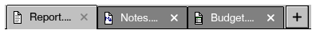 |  |

More states:

| Keyboard focus | Mouse over |
|---|---|
|  |  |

```nim
var docTab = 0
var docTabs = @["Report.txt", "Notes.md", "Budget.csv"]

discard tabStrip(docTabs, docTab, [pxText, pxMarkdown, pxSheet])
```

**API**

```nim
proc tabStrip*(labels: openArray[string]; sel: var int; glyphs: openArray[string] = [];
               closable = true; addButton = true; dropKind = "";
               enabled = true; look = tabLook): TabStripEvent
```

Document tabs (a browser's, a file manager's): a strip of tabs with
an x to close each and a + to add one; the page is yours to draw under
it. Tabs shrink when there are many, and scroll when they still do not
fit (arrow buttons, the wheel, a finger). With `dropKind`, a drag of
that kind resting on a tab selects it, and dropping on it is reported.
Keys: Ctrl+Tab / Ctrl+Shift+Tab anywhere; Left, Right, Home, End when
the strip has the focus. The middle button closes a tab; a right click
or a long press reports `menu` (show a menu with `contextMenu` after).

## Menus and bars

### menubar, menu, menuItem, submenu

The window's menu bar: `menuItem` is true when chosen, with its shortcut, a check mark or disabled. Alt, F10 and the letters work as in 3.1.

| Normal | Touch screen | Dark scheme |
|---|---|---|
|  |  |  |

More states:

| Clicked / open |
|---|
|  |

```nim
menubar:
  menu "&File":
    discard menuItem("&New", "Ctrl+N")
    discard menuItem("&Open...", "Ctrl+O")
    menuSeparator()
    discard menuItem("&Save", "Ctrl+S", enabled = false)
    discard menuItem("&Word wrap", checked = true)
  menu "&Edit":(discard menuItem("&Undo", "Ctrl+Z"))
```

**API**

```nim
template menubar*(body: untyped)
```

The menu bar at the top of the window; call it first.

```nim
template menu*(title: string; body: untyped)
```

A menu of the menu bar; `body` (its items) runs only while it is open.

```nim
proc menuItem*(label: string; shortcut = ""; checked = false;
               enabled = true): bool
```

An item of the open menu; true when chosen.

```nim
template submenu*(label: string; body: untyped)
```

An item that opens a menu of its own (one level deep).

```nim
proc menuSeparator*()
```

A line between groups of menu items (none at the top of a column).

### contextMenu

A menu for the control drawn last, opened by a right click, a long press or the menu key. The pictures show it open.

| Normal | Touch screen | Dark scheme |
|---|---|---|
|  |  |  |

```nim
label "Right click here, or hold a finger on it"
contextMenu:
  discard menuItem("&Copy", "Ctrl+C")
  discard menuItem("&Paste", "Ctrl+V")
  menuSeparator()
  discard menuItem("P&roperties")
```

**API**

```nim
template contextMenu*(body: untyped)
```

A menu that a right click (a long press on a touch screen) on the
widget drawn last opens.

### popupMenu, openPopupMenu

A menu dropped where you say: under a button, at the mouse. `openPopupMenu(key, x, y)` opens it, `popupMenu(key)` draws its items.

| Normal | Touch screen | Dark scheme |
|---|---|---|
|  |  |  |

```nim
var sortBy = 0

if button("&Sort by"):
  openPopupMenu("sort", ui.lastRect.x, ui.lastRect.y + ui.lastRect.h)
popupMenu("sort"):
  if menuItem("&Name", checked = sortBy == 0):
    sortBy = 0
  if menuItem("&Date", checked = sortBy == 1):
    sortBy = 1
  if menuItem("&Size", checked = sortBy == 2):
    sortBy = 2
```

**API**

```nim
template popupMenu*(key: string; body: untyped)
```

The menu opened with `openPopupMenu(key, x, y)`: `menuItem`s in
`body`; it closes when one is chosen, on Esc or a click outside.

```nim
proc openPopupMenu*(key: string; x, y: int)
```

Opens the menu `key` with its top left at `x`, `y` (under a button
that drops it down); draw it with `popupMenu(key)`.

```nim
proc popupMenuOpen*(key: string): bool
```

The menu `key` is open.

### breadcrumb

Where the user is, each part a link back: the index clicked, else -1.

| Normal | Touch screen | Dark scheme |
|---|---|---|
|  |  |  |

More states:

| Mouse over |
|---|
|  |

```nim
breadcrumb(["C:", "Users", "Foxoman", "Documents"])
```

**API**

```nim
proc breadcrumb*(parts: openArray[string]; w = 0;
                 enabled = true): int {.discardable.}
```

The parts of a path as buttons in a row ("C: > Users > me"); returns
the index of the part clicked, -1 if none. Parts that do not fit are
folded into a "<<" button at the start.

### pager, stepper

Pages to go through (|< < 3 of 12 > >|), and the steps of a task (Cart, Address, Payment) with the one reached.

| Normal | Touch screen | Dark scheme |
|---|---|---|
|  | 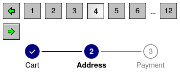 |  |

More states:

| Keyboard focus |
|---|
| 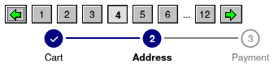 |

```nim
var page = 3
var stepAt = 1

pager(page, 12)
discard stepper(["Cart", "Address", "Payment"], stepAt)
```

**API**

```nim
proc pager*(page: var int; pages: int; enabled = true): bool {.discardable.}
```

Page buttons: "< 1 ... 4 5 6 ... 20 >"; `page` is 0-based. True when
it changed.

```nim
proc stepper*(steps: openArray[string]; current: int; enabled = true): int
```

The steps of a task (a wizard, a checkout) as numbered circles joined
by a line: done ones ticked, the current one highlighted. Returns the
step clicked (only steps already done can be), -1 if none.

### recordNav

The record navigator of a form: first, previous, "3 of 20", next, last, New, Delete and Save (`raNew`, `raSave`...).

| Normal | Touch screen | Dark scheme |
|---|---|---|
|  |  |  |

More states:

| Keyboard focus |
|---|
|  |

```nim
var recPos = 2

discard recordNav(recPos, 20, dirty = true)
```

**API**

```nim
proc recordNav*(pos: var int; count: int; dirty = false; canAdd = true;
                canDelete = true; key = ""): RecordAction {.discardable.}
```

The navigator of a form over records: first, previous, "Record 3 of
20" (type a number to go there), next, last, then New, Delete, Save and
Cancel (Save and Cancel while the record is `dirty`). `pos` is the
record shown (0-based); the moves change it. Ctrl+Home / Ctrl+End,
Ctrl+PageUp / Ctrl+PageDown move too. On phones it is shorter.

### findBar, findIn, replaceAllIn

A bar to find and replace text in: Enter or F3 the next match, Shift+F3 the one before, Esc closes it. The app does the finding with `findIn` and `replaceAllIn`.

| Normal | Touch screen | Dark scheme |
|---|---|---|
| 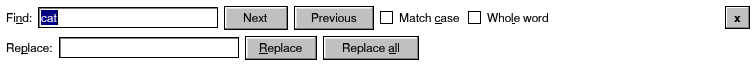 | 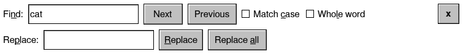 | 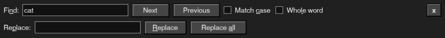 |

```nim
var findState = FindState(open: true, what: "cat", replacing: true)

discard findBar(findState)
```

**API**

```nim
proc findBar*(f: var FindState; key = ""): FindEvent
```

A bar to find (and replace) text in: Enter or F3 finds the next match,
Shift+Enter or Shift+F3 the previous one, Esc closes it. With
`replacing`, a second line replaces the match or all of them. The app
does the finding (`findIn`, `replaceAllIn`) on its text.

```nim
proc findIn*(text, what: string; start: int; matchCase = false; wholeWord = false;
             backwards = false; wrap = true): int
```

Where `what` is in `text` from `start` on (backwards: before it); it
goes round the end when `wrap`. -1 when it is not there.

```nim
proc replaceAllIn*(text: var string; what, with: string; matchCase = false;
                   wholeWord = false): int {.discardable.}
```

Replaces every match; returns how many.

## Dialogs

Dialogs are modal, have the 3.1 frame, drag by their titles and scroll
when they are taller than the screen; on a phone they take the screen.
Each is drawn while its `open` is true, and sets it false when it closes,
so `if button("Save as..."): saveOpen = true` is all it takes to show one.

### msgBox

A message with its icon and buttons: the button clicked (from 1) in the frame it closes, else 0.

| Normal | Touch screen | Dark scheme |
|---|---|---|
| 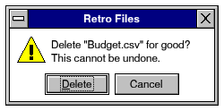 | 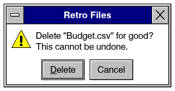 | 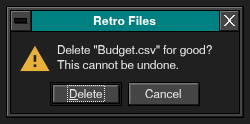 |

```nim
var msgOpen = true

discard msgBox(msgOpen, "Retro Files",
               "Delete \"Budget.csv\" for good?\nThis cannot be undone.",
               ["&Delete", "Cancel"], miWarning)
```

**API**

```nim
proc msgBox*(open: var bool; title, msg: string;
             buttons: openArray[string] = ["OK"]; icon = miInfo): int
```

A message box while `open`. Returns the number of the button clicked
(1 = first) once, closing it; Esc counts as the last button.

```nim
proc msgIcon*(kind: MsgIcon)
```

A 32x32 message box icon (at 100%: it grows with the UI's size).

### inputBox

A question with a text box: true once, when OK is clicked.

| Normal | Touch screen | Dark scheme |
|---|---|---|
| 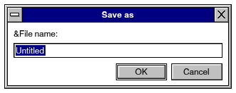 | 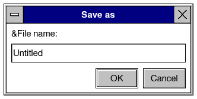 | 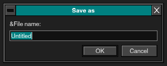 |

```nim
var inputOpen = true
var inputText = "Untitled"

discard inputBox(inputOpen, "Save as", "&File name:", inputText)
```

**API**

```nim
proc inputBox*(open: var bool; title, prompt: string; text: var string;
               password = false; width = 320): int
```

Asks for one line of text while `open`; returns 1 for OK, 2 for
Cancel or Esc (once, closing it).

### dialog

A dialog of your own: any controls in its body. Esc closes it.

| Normal | Touch screen | Dark scheme |
|---|---|---|
| 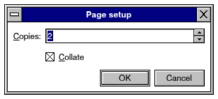 | 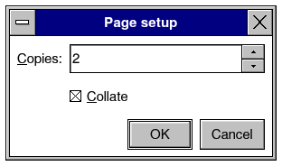 | 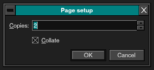 |

```nim
var dlgOpen = true
var dlgCopies = 2
var collate = true

dialog(dlgOpen, "Page setup", 300):
  form 0:
    field "&Copies:":
      spin(dlgCopies, 1, 99)
    field "":
      checkbox("&Collate", collate)
  row:
    spring()
    if button("OK", isDefault = true):
      dlgOpen = false
    if button("Cancel"):
      dlgOpen = false
```

**API**

```nim
template dialog*(open: var bool; title: string; width: int; body: untyped)
```

A modal dialog, `width` pixels wide, shown while `open` is true. Esc
and the control-menu box close it; drag it by its title. Work that
takes a while in it (its OK) is named by its title in the box that
comes up.

### progressBox

A modal box with a progress bar while work goes on: true once when the user cancels.

| Normal | Touch screen | Dark scheme |
|---|---|---|
| 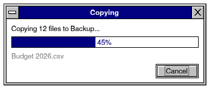 | 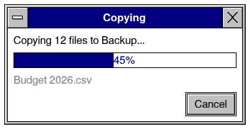 | 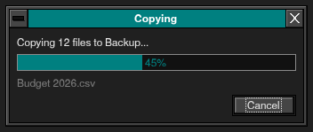 |

```nim
var copying = true

if progressBox(copying, "Copying", "Copying 12 files to Backup...", 0.45,
               detail = "Budget 2026.csv"):
  discard
```

**API**

```nim
proc progressBox*(open: var bool; title, message: string; value: float;
                  detail = ""; canCancel = true): bool
```

A modal box with a progress bar while `open`; true (once) when the
user cancels (Cancel or Esc).

### wizard, stepDone

A dialog of steps with Back, Next and Finish. `stepDone(false)` keeps Next disabled until the step is filled in.

| Normal | Touch screen | Dark scheme |
|---|---|---|
| 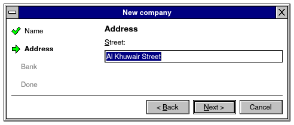 | 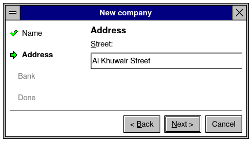 | 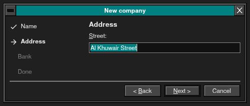 |

```nim
var wizOpen = true
var wizStep = 1
var street = "Al Khuwair Street"

discard wizard(wizOpen, "New company", wizStep,
               ["Name", "Address", "Bank", "Done"], 480) do:
  label "&Street:"
  edit street
```

**API**

```nim
template wizard*(open: var bool; title: string; step: var int;
                 steps: openArray[string]; width: int; body: untyped): WizardAction
```

A dialog of `steps` (their names at the left, Back, Next >, Finish and
Cancel at the bottom); `body` draws the page of `step` (a `case
step`). Call `stepDone(false)` in a page whose fields are not filled in
yet. Returns what was pressed: `waFinish` (then `open` is false),
`waCancel` (also Esc), `waNext`, `waBack` (`step` already moved).

```nim
proc stepDone*(ok: bool)
```

In a `wizard`'s page: Next (or Finish) is enabled only when `ok`
(what this page asks is filled in).

### aboutBox

The About dialog: a banner in the blue of a 1994 Setup screen with the icon, name and version; pages About, What's New and Credits; Copy Info for a report of a fault.

| Normal | Dark scheme |
|---|---|
| 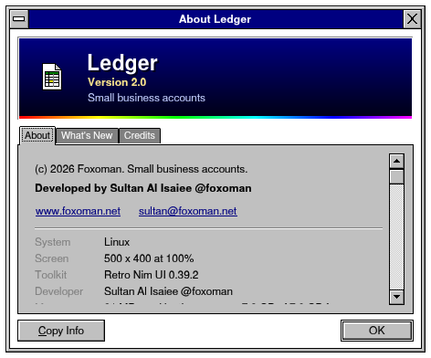 | 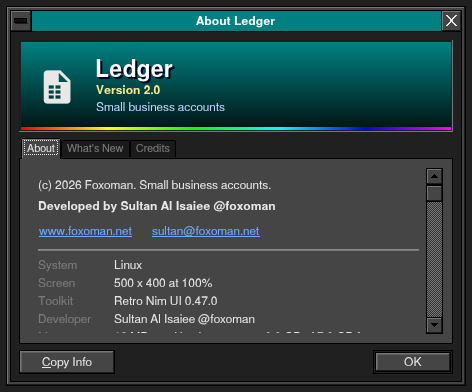 |

```nim
var aboutOpen = true

aboutBox(aboutOpen, "Ledger", "2.0",
         ["(c) 2026 Foxoman. Small business accounts."], glyph = pxSheet,
         tagline = "Small business accounts",
         whatsNew = ["Invoices in PDF", "Bank files read"],
         credits = [RetroFontCredit])
```

**API**

```nim
proc aboutBox*(open: var bool; app: string; version = ""; lines: openArray[string] = [];
               glyph = ""; width = 460; tagline = ""; whatsNew: openArray[string] = [];
               credits: openArray[string] = []; icon: Bitmap = nil; iconPng = "";
               url = "")
```

The About dialog: a banner in the blue of a 1994 Setup screen with the
program's icon (`icon`, or a PNG's bytes in `iconPng`, else `glyph`),
its name, version and `tagline`; then pages (tabs as the docked
panels'): About -- `lines` (what it is, copyright, licence; each wraps)
and what it runs on; What's New -- `whatsNew`, a line each; Credits --
`credits`. Copy Info puts the facts on the clipboard; OK closes it.
`version` is also kept as `reportedVersion` (what a fault's report says).

### splashBox

The box a program shows while it starts, as the About box looks, with a progress bar of blocks.

| Normal | Dark scheme |
|---|---|
| 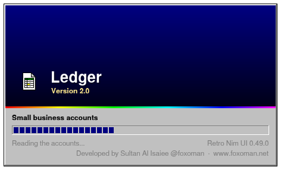 | 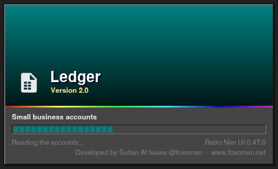 |

```nim
splashBox("Ledger", "2.0", "Small business accounts", glyph = pxSheet,
          progress = 0.4, note = "Reading the accounts...")
```

**API**

```nim
proc splashBox*(app: string; version = ""; tagline = ""; lines: openArray[string] = [];
                art: Bitmap = nil; icon: Bitmap = nil; iconPng = ""; glyph = ""; progress = -1.0;
                note = "Starting..."; width = 460)
```

The box a program shows while it starts, as the About box looks: a
picture (`art`, else the blue of a 1994 Setup screen) with the icon,
the name large and the version over it, a rainbow under it; then
`tagline`, `lines`, a 3.1 progress bar of blocks (`progress` 0 .. 1;
none when less than 0) and `note`. Drawn over everything, in the
middle of the window.

### problemBox, reportProblem

Report a Problem: the fault log (or your text) for the user to add what they were doing, then Copy or Send by Email. `problemBox` every frame also opens it by itself after a run that ended in a fault.

| Normal | Touch screen | Dark scheme |
|---|---|---|
| 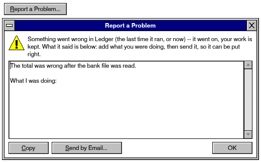 | 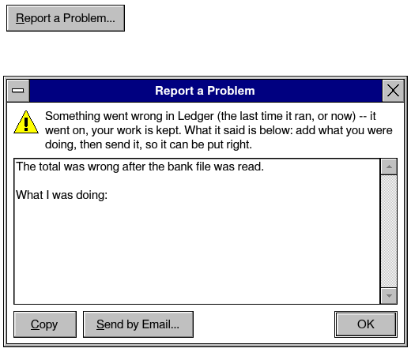 | 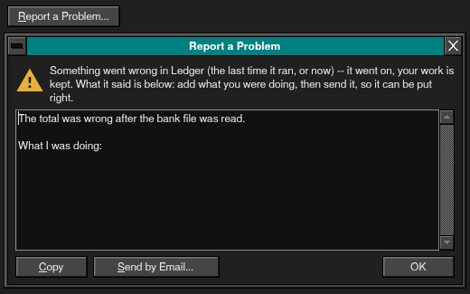 |

```nim
if button("&Report a Problem..."):
  reportProblem("The total was wrong after the bank file was read.")
problemBox("Ledger", "2.0")
```

**API**

```nim
proc problemBox*(app: string; version = reportedVersion)
```

Call it every frame: the "Report a Problem" box when it is open -- and,
the first time, opened by itself when the last run left faults (the
program stopped, or `guarded` caught one). Copy puts the report on the
clipboard; Send by Email writes it to the developer.

```nim
proc reportProblem*(text = "")
```

Opens the "Report a Problem" box (Help > Report a Problem; draw it with
`problemBox`): `text`, else what the fault log holds (`takeFaults`),
for the user to add what they were doing, then copy or send.

### stoppedScreen, stoppedFrame, stoppedPending, startFresh, showStoppedScreen

What a run that ended in a crash wrote down -- an error nothing caught, a fault of the native code, Java's on Android -- shown when the app starts again, before any of its own code runs (`app` does it; an app with its own frame loop calls `stoppedFrame` first in each frame, and asks `stoppedPending` before bringing back what was open): Copy, Send by Email, Start. `startFresh` is true when the user chose to start without what was open the last time.

| Normal | Touch screen | Dark scheme |
|---|---|---|
| 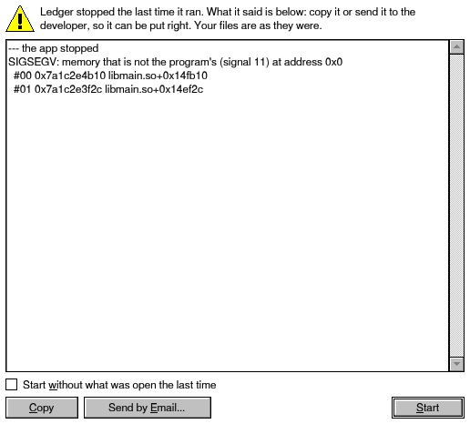 | 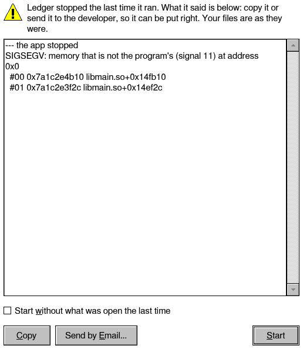 | 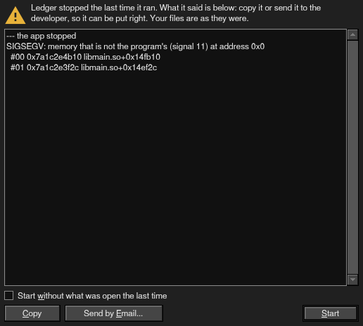 |

```nim
const
  report = "--- the app stopped\nSIGSEGV: memory that is not the program\'s (signal 11) at address 0x0\n" &
      "  #00 0x7a1c2e4b10 libmain.so+0x14fb10\n  #01 0x7a1c2e3f2c libmain.so+0x14ef2c\n"
showStoppedScreen(report)

discard stoppedScreen()
```

**API**

```nim
proc stoppedScreen*(): bool
```

Called before the app's own code in every frame (`app` does it): when
the last run ended in a crash, its report -- before anything of the app
runs, so a crash at the start shows too -- with Copy, Send by Email and
Start; true while it is shown (the app's frame waits).

```nim
proc stoppedFrame*(): bool
```

For an app with its own frame loop, first in each frame: the caption
bar and the "stopped" screen when it is to be shown -- true: the frame
is done (`endFrame`, then the next one).

```nim
while beginFrame():
  if stoppedFrame(): (endFrame(); continue)
  myFrame()
  endFrame()
```

```nim
proc stoppedPending*(): bool
```

The "stopped" screen is to be shown (the last run ended in a crash and
Start was not pressed yet): an app with its own frame loop asks it
before bringing back what was open, and at the start of each frame
(`stoppedFrame`).

```nim
proc startFresh*(): bool
```

The user chose, on the "stopped" screen, to start without what was
open the last time: an app that brings back its documents, windows or
folders leaves them this once.

```nim
proc showStoppedScreen*(report: string)
```

Opens the "stopped" screen with `report` (an app that keeps its own
crash reports; a test): shown by `stoppedScreen` until Start.

### fileDialog (3.1)

The Windows 3.1 Open and Save As dialog: the file name with its list, the folders, the drives and the file types. True once, with `path` set.

| Normal | Touch screen | Dark scheme |
|---|---|---|
| 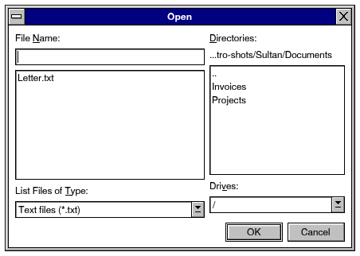 | 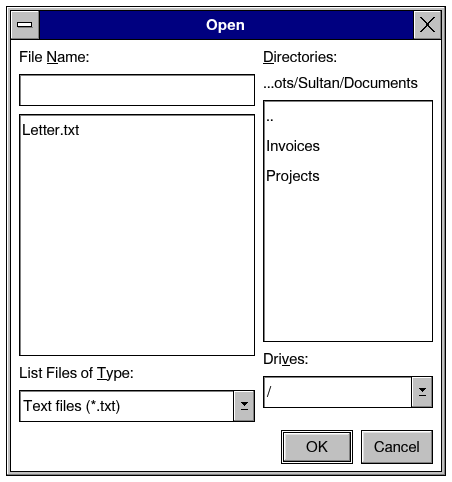 | 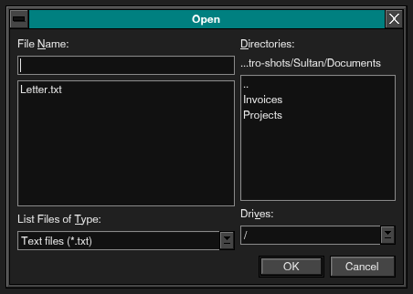 |

```nim
var openOld = true
var oldPath = getHomeDir() / "Documents"

if fileDialog(openOld, oldPath, fmOpen,
              ["Text files (*.txt)", "All Files (*.*)"]):
  discard
```

**API**

```nim
proc fileDialog*(open: var bool; path: var string; mode = fmOpen;
                 filters: openArray[string] = ["All Files (*.*)"];
                 title = ""): bool
```

The 3.1 Open / Save As dialog while `open`. Returns true once, with
`path` set, when the user confirms a file. (In a web page: the
browser's file chooser, and Save As through `/downloads`.)

## App parts

What an app is made of around its content: tool bars, the status bar,
windows in the window, docked panels, the shortcuts the user picks, the
settings page and the parts of a phone app.

### toolbar, toolButton, toolSeparator

A tool bar of small buttons; those that do not fit go into a "more" menu. `down` shows a button held in.

| Normal | Touch screen | Dark scheme |
|---|---|---|
|  |  |  |

More states:

| Mouse over | Pressed |
|---|---|
|  |  |

```nim
toolbar:
  toolButton(pxNew, "New")
  toolButton(pxOpen, "Open")
  toolButton(pxSave, "Save")
  toolSeparator()
  toolButton(pxCut, "Cut")
  toolButton(pxCopy, "Copy")
  toolButton(pxPaste, "Paste", down = true)
```

**API**

```nim
template toolbar*(body: untyped)
```

A bar of tool buttons below the menu bar.

```nim
proc toolButton*(ic: Icon; tip = ""; down = false;
                 enabled = true): bool {.discardable.}
```

A tool bar button with a 16x16 icon. `down` shows it pressed in.

```nim
proc toolButton*(caption: string; tip = ""; down = false; bold = false;
                 enabled = true; size = 1.0): bool {.discardable.}
```

A tool bar button showing a short text, or an icon of the icon font
(`toolButton(nfCopy, "Copy", size = 1.3)`).

```nim
proc toolSeparator*()
```

A gap between groups of tool buttons.

### window

A window of the system's own beside the app's: a tool palette, a second view for another monitor, a preview. It is laid out and drawn as the app's window is, with its own menus and dialogs, at the place in the frame the app draws it; its close button sets the `bool` to false, and it closes when it is no longer drawn. X11, Wayland, Windows and macOS open real windows; on phones, in the browser and on a screen without a desktop it is a dialog over the app.

*The window is the system's: it has the app's look inside a frame of the system's.*

```nim
var toolsOpen = true
var bold = false

if button("&Tools..."):
  toolsOpen = true
window(toolsOpen, "Tools", 240, 160):
  checkbox("&Bold", bold)
```

**API**

```nim
template window*(open: var bool; title: string; w, h: int; body: untyped)
```

A window of the system's own besides the app's, `w` x `h` design
pixels when it opens, shown while `open` is true: a tool palette, a
second view for another monitor, a preview. It is laid out and drawn
as the app's window is (menus, dialogs, tool bars in it are its own),
at the place in the frame the app draws it; its close button sets
`open` to false; it closes when it is no longer drawn. Where the
system has one window (phones, the browser) it is a dialog over the
app (`dialog`).

```nim
var toolsOpen = true
app "Editor", 800, 600:
  if menuItem("&Tools"): toolsOpen = true
  window(toolsOpen, "Tools", 240, 360):
    if button("&Bold"): bold = not bold
```

```nim
proc inWindow*(): bool
```

A window besides the program's own is being drawn (between
`beginWindow` and `endWindow`).

```nim
proc captionBar*()
```

The window's 3.1 title bar where the app draws it. Phones and tablets:
the system does not draw one there -- navy from the top of the screen
(under the status bar, whose icons turn white over it), the
control-menu box (zoom, minimize, close; also Alt+Space), the title,
and the minimize button. Desktops with the 3.1 frame on
(`setClassicFrame`): the title bar of a Windows 3.1 window, its
control-menu box, its minimize and maximize buttons, inside the sizing
border. `app` calls it every frame; with the system's frame it draws
nothing.

### windowBox, inert, showMenu, hideMenu

A window drawn inside this one at a rectangle -- its menu bar, tool bar and status bar along the rectangle's edges, its dialogs and menus kept in it -- the way a designer or a guide shows a window. `inert` draws it without input (its dialogs do not take the window's); `showMenu` opens one of its menus as if it was clicked, `hideMenu` closes it again.

| Normal | Dark scheme |
|---|---|
|  |  |

```nim
let frame = place(available(), 180)
windowFrame(frame, 4)
let box = inset(frame, 4)
inert:
  windowBox(box):
    let shown = showMenu(["&File"])
    menubar:
      menu "&File":
        discard menuItem("&Open...", "Ctrl+O")
        discard menuItem("E&xit")
      menu "&Help":
        discard menuItem("&Contents")
        discard menuItem("&About")
    hideMenu(shown)
    row:
      spring()
      label "A window in the window"
    discard button("OK")
    statusbar("Ready")
```

**API**

```nim
template windowBox*(r: Rect; body: untyped)
```

`body` laid out as a window of its own at `r`, inside this one: its
menu bar, tool bars and status bar along `r`'s edges, its content in
between, and `isCompact` and the size classes asking `r`'s width -- a
preview of a window (a designer's form, a guide's picture). Pair it with
`inert` when its controls should not take input.

```nim
template inert*(body: untyped)
```

`body` drawn without input: its controls are shown as they are but the
mouse, fingers and keys do not reach them, and a dialog or menu in it
does not take the window's input (a preview, a designer's form).

```nim
proc showMenu*(path: openArray[string]): MenuShown
```

Opens the menu bar's menu `path[0]` -- and in it the submenu `path[1]`
-- as if it had been clicked, for the menu bar drawn next: a designer
showing the menu whose items are being set, a tour of an app. The
titles are written as in `menu` and `submenu`; `hideMenu` puts back
what was open.

```nim
proc hideMenu*(s: MenuShown)
```

What was open before `showMenu` open again.

### barButton, setToolbarLook

Tool bar buttons with a picture and a label, shown as the bar's look says: icons only, or the text below or beside them (Explorer's "Text Labels"). An app can offer it as a setting.

| Normal | Touch screen | Dark scheme |
|---|---|---|
|  |  |  |

```nim
setToolbarLook(blTextBelow)
toolbar:
  if barButton(pxBack, "Back"):
    discard
  if barButton(pxForward, "Forward"):
    discard
  toolSeparator()
  if barButton(pxCopy, "Copy", tip = "Copy (Ctrl+C)"):
    discard
  if barButton(pxDelete, "Delete"):
    discard
```

**API**

```nim
proc barButton*(pic: ButtonPic; label: string; tip = ""; down = false; enabled = true;
                look = blDefault): bool {.discardable.}
```

A tool bar button with a picture and a label, shown as the bar's look
(`toolbarLook`, Explorer's "Text Labels") or as `look` says.

```nim
proc barButton*(glyph: string; label: string; tip = ""; down = false; enabled = true;
                look = blDefault): bool {.discardable.}
```

`barButton` with a glyph of the icon font as its picture.

```nim
proc setToolbarLook*(look: ButtonLook)
```

Every tool bar's buttons from now on (blDefault: icon only). Cheap to
call every frame: only a change draws again.

### customizeToolbar

The Customize Toolbar dialog of Windows 95: the buttons the bar can have, the ones it has, their order, and how labels show. The app keeps the bar as a list of keys (`toolKeys`, `toolKeysText`).

| Normal | Touch screen | Dark scheme |
|---|---|---|
|  | 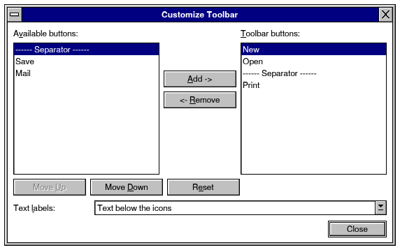 | 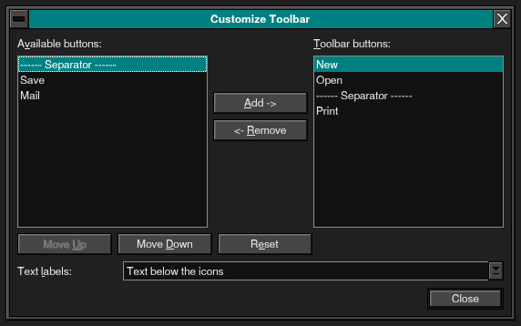 |

```nim
var customizing = true
var barKeys = @["new", "open", "-", "print"]
var barLook = blTextBelow
let toolChoices = [ToolChoice(key: "new", label: "New", glyph: pxNew),
                   ToolChoice(key: "open", label: "Open", glyph: pxOpen),
                   ToolChoice(key: "save", label: "Save", glyph: pxSave),
                   ToolChoice(key: "print", label: "Print", glyph: pxPrint),
                   ToolChoice(key: "mail", label: "Mail", glyph: pxMail)]

if customizeToolbar(customizing, barKeys, toolChoices,
                    ["new", "open", "-", "print"], barLook):
  discard
```

**API**

```nim
proc customizeToolbar*(open: var bool; keys: var seq[string];
                       available: openArray[ToolChoice]; defaults: openArray[string];
                       look: var ButtonLook; title = "Customize Toolbar"): bool
```

The Customize Toolbar dialog while `open`. True when it changed the bar
(`keys`, in order) or the look of its labels (`look`).

```nim
proc toolKeys*(saved: string; defaults: openArray[string];
               available: openArray[ToolChoice]): seq[string]
```

The bar's buttons from a setting (keys joined by commas): keys the app
no longer has are left out; the defaults when there is no setting.

```nim
proc toolKeysText*(keys: openArray[string]): string
```

The bar's buttons as a setting.

### mdiArea, mdiWindow, mdiWindowMenu

Windows in the window, as in Program Manager: the 3.1 frame, moved by their title bars, sized by their edges, minimized to icons, maximized, Ctrl+F6 to the next. Keep each `MdiWindow` in a global. `mdiWindowMenu` fills a Window menu: Cascade, Tile and the windows.

| Normal | Touch screen | Dark scheme |
|---|---|---|
| 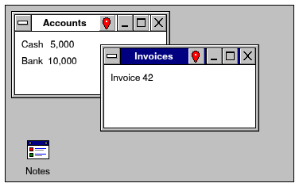 | 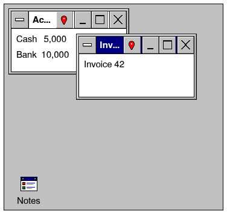 | 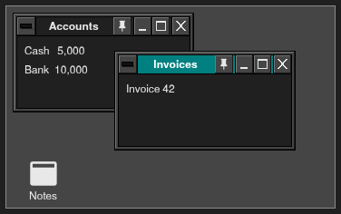 |

```nim
var mdi1 = MdiWindow(title: "Accounts", r: rect(8, 8, 200, 110), open: true)
var mdi2 = MdiWindow(title: "Invoices", r: rect(120, 50, 200, 110), open: true)
var mdi3 = MdiWindow(title: "Notes", open: true, minimized: true)

mdiArea(-1):
  mdiWindow(mdi1):
    label "Cash   5,000"
    label "Bank  10,000"
  mdiWindow(mdi2):
    label "Invoice 42"
  mdiWindow(mdi3):
    label "Notes"
```

**API**

```nim
template mdiArea*(height: int; body: untyped)
```

A workspace for `mdiWindow`s: `mdiArea(-1): mdiWindow(w1): ...`.

```nim
template mdiArea*(height: int; key: string; body: untyped)
```

An area with its own windows when there are several (`key` names it
for `mdiCascade`, `mdiTile` and `mdiWindowMenu`).

```nim
template mdiWindow*(w: var MdiWindow; body: untyped)
```

A window of the `mdiArea` around it; `body` is its content (it
scrolls when taller than the window).

```nim
proc mdiWindowMenu*(key = "")
```

The items of a 3.1 Window menu (inside `menu "&Window":`): Cascade,
Tile, then the windows, the active one checked.

```nim
proc mdiCascade*(key = "")
```

Overlaps the windows of the area, each a title bar lower.

```nim
proc mdiTile*(key = "")
```

Lays the windows of the area side by side.

```nim
proc mdiActivate*(w: var MdiWindow; key = "")
```

Brings `w` to the front (restored when it was minimized).

### dockPanels: docked panels

Panels as today's Photoshop docks them, drawn as 1994 drew its palettes: columns of tabbed groups down the right of an `mdiArea`, a column folded to icons, panels dragged between groups or out into floating palettes. The `Dock` keeps where they are (`toJson`, `loadDock`).

| Normal | Touch screen | Dark scheme |
|---|---|---|
| 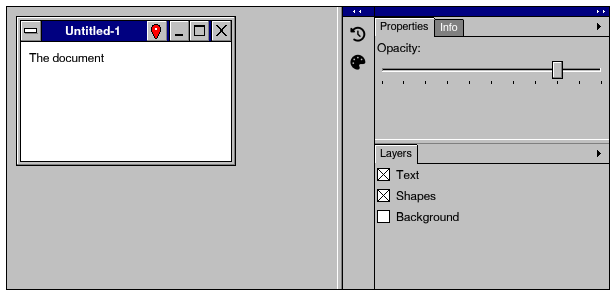 | 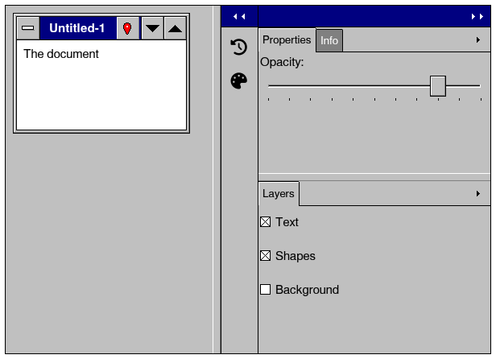 | 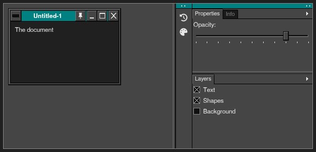 |

```nim
var docDock = block:
  var dk = newDock()
  discard dk.addColumn()
  discard dk.addGroup(0, [dockPanel("props", "Properties", nfSliders),
                          dockPanel("info", "Info", nfInfo)], share = 45)
  discard dk.addGroup(0, [dockPanel("layers", "Layers", nfImageMultiple)],
                      share = 55)
  discard dk.addColumn(iconic = true)
  discard dk.addGroup(1, [dockPanel("history", "History", nfHistory),
                          dockPanel("swatches", "Swatches", nfPalette)])
  dk
var docWin = MdiWindow(title: "Untitled-1", r: rect(10, 10, 220, 150),
                       open: true)
var dockOpacity = 80
var layerOn = [true, true, false]

mdiArea(-1, "work"):
  mdiWindow(docWin):
    label "The document"
  discard dockPanels(docDock, "work", proc (key: string) =
    case key
    of "props":
      label "Opacity:"
      slider(dockOpacity, 0, 100)
    of "layers":
      for i, n in ["Text", "Shapes", "Background"]:
        checkbox(n, layerOn[i])
    else:
      label("The " & key & " panel"))
```

**API**

```nim
proc dockPanels*(d: Dock; area = ""; body: proc (key: string); menu: proc (key: string) = nil): DockEvent
```

Draws the dock down the right of the `mdiArea` named `area` (call it
inside, after the documents' windows), its floating palettes, and
what a drag of a panel shows. `body(key)` draws a panel (in a column
laid out as a palette's: `place`, `row`, the widgets); `menu(key)` its
menu's items (`menuItem`...), Close and Close Tab Group after them.
`left` says where the documents' room ends.

```nim
proc newDock*(): Dock
```

An empty dock (add columns and groups, or `loadDock`).

```nim
proc addColumn*(d: Dock; width = 0; iconic = false): DockColumn {.discardable.}
```

A column at the left of the others.

```nim
proc addGroup*(d: Dock; col: int; panels: openArray[DockPanel]; share = 100; sel = 0;
               folded = false): DockGroup {.discardable.}
```

A group of `panels` at the bottom of column `col`.

```nim
proc dockPanel*(key, title: string; icon = ""): DockPanel
```

A panel to put in a group.

```nim
proc panelHeader*(r: Rect; id: Id; dir: Dir; tip = ""; side = hsRight): bool
```

The strip at the top of a docked column or a toolbar, as today's
Photoshop has it, in the title bar's color (navy in 3.1) with a double
arrow pointing `dir` (white): true when the arrows are clicked (a
column collapsed to icons or opened, a toolbar one column or two).

### paletteTabs

The tabs of a palette that holds several (Layers, Channels, Paths): the one shown joined to the palette, the others behind it, and the arrow of the palette's menu.

| Normal | Touch screen | Dark scheme |
|---|---|---|
|  |  |  |

```nim
var palTab = 0

discard paletteTabs(["Layers", "Channels", "Paths"], palTab)
```

**API**

```nim
proc paletteTabs*(labels: openArray[string]; sel: var int; menu = true): tuple[changed, menu: bool]
```

The tabs of a palette that holds several (Brushes and Options,
Layers, Channels and Paths...): the one shown joined to the palette,
the others behind it; with `menu`, the little arrow at the right that
opens the palette's menu (`menu` reported). (The docked panels' look:
`paletteTabFace`.)

### keymapEditor, keymapPressed

Shortcuts the user picks: a `Keymap` holds the app's defaults and the user's changes; `keymapEditor` lets them change them; `keymapPressed` says which command's keys were pressed.

| Normal | Touch screen | Dark scheme |
|---|---|---|
|  |  |  |

More states:

| Keyboard focus |
|---|
|  |

```nim
var keys = Keymap(defaults: @[("Ctrl+N", "New"), ("Ctrl+O", "Open"),
                              ("Ctrl+S", "Save"), ("Ctrl+P", "Print")])

keymapEditor(keys, ["New", "Open", "Save", "Save As", "Print"], height = 120)
case keymapPressed(keys)
of "Save":
  discard
else:
  discard
```

**API**

```nim
proc keymapEditor*(km: var Keymap; commands: openArray[string]; height = 260): bool {.discardable.}
```

Rows to change the shortcuts: the commands (with theirs), the one
chosen's box -- press the keys -- and Use Default. True when one
changed.

```nim
proc keymapPressed*(km: Keymap): string
```

The command whose shortcut was pressed this frame ("" none); the key
is used.

```nim
proc keyFor*(km: Keymap; command: string): string
```

The shortcut of `command` ("" none).

```nim
proc setKey*(km: var Keymap; command, keys: string)
```

`command`'s shortcut made `keys` (taken off the command that had it).

```nim
proc storeKeymap*(s: var Settings; km: Keymap; prefix = "keys.")
```

The user's shortcuts into `s` (the defaults are not kept).

```nim
proc restoreKeymap*(s: Settings; km: var Keymap; prefix = "keys.")
```

The user's shortcuts back from `s` (as `storeKeymap` put them).

### settingToggle, settingChoice, settingSlider, settingCombo, settingButtons, settingLink

The rows of a settings page, as a phone's or the 3.1 Control Panel's: a title, a line under it and its control at the right.

| Normal | Touch screen | Dark scheme |
|---|---|---|
|  |  |  |

More states:

| Keyboard focus |
|---|
|  |

```nim
var setOn = true
var setChoice = 1
var setLevel = 60
var setCombo = 0

settingToggle("Notifications", setOn, "For new messages")
discard settingChoice("Sync", ["Hourly", "Daily", "Never"], setChoice)
discard settingSlider("Brightness", setLevel, 0, 100, suffix = "%")
discard settingCombo("Color scheme", ["Classic", "Ocean", "Desert"], setCombo)
discard settingButtons("Cache", ["Clear"], "12 MB")
```

**API**

```nim
proc settingToggle*(title: string; v: var bool; detail = "";
                    enabled = true): bool {.discardable.}
```

A settings row: a title, a line or two of detail, and a switch at the
right; a click anywhere on the row flips it. True when it changed.

```nim
proc settingChoice*(title: string; options: openArray[string]; v: var int;
                    detail = ""; enabled = true): bool {.discardable.}
```

A settings row with a choice of a few (segmented buttons), under the
title when the row is narrow.

```nim
proc settingSlider*(title: string; v: var int; lo, hi: int; detail = "";
                    suffix = ""; enabled = true): bool {.discardable.}
```

A settings row with a slider and its value ("120%").

```nim
proc settingButtons*(title: string; buttons: openArray[string]; detail = "";
                     enabled = true): int
```

A settings row with buttons (`["Smaller", "Normal", "Larger"]`);
which was clicked (1-based), 0 if none.

```nim
proc settingCombo*(title: string; options: openArray[string]; v: var int;
                   detail = ""; enabled = true): bool {.discardable.}
```

A settings row with a drop-down list at the right (a choice of many).

```nim
proc settingLink*(title: string; detail = ""; glyph = nfChevronRight;
                  enabled = true): bool
```

A settings row that leads somewhere (another page, a dialog): true
when clicked.

### appearanceSettings

The look of every app in a few rows: the color scheme, the size of everything, the size of the text, controls for a mouse or fingers, the window's frame and the font. `app`'s `look` keeps the user's choice by itself.

| Normal | Touch screen | Dark scheme |
|---|---|---|
| 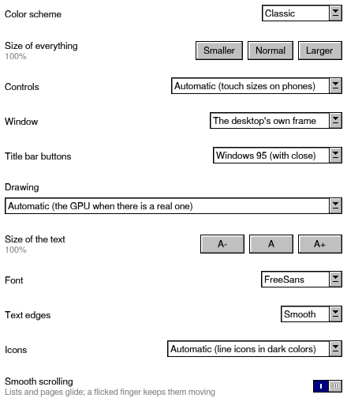 |  |  |

```nim
appearanceSettings()
```

**API**

```nim
proc appearanceSettings*(): bool {.discardable.}
```

Settings rows for how every app looks: the color scheme, the size of
everything, the size of the text, the size of controls (for a mouse
or fingers), the window's frame (on desktops: the system's or Windows
3.1's) and the font. True when something changed (store them with
`storeAppearance`; `app`'s `look` keeps them by itself).

```nim
proc storeAppearance*(s: var Settings)
```

Puts the look the user chose (colors, sizes, font, the window's frame)
into `s`.

```nim
proc restoreAppearance*(s: Settings)
```

Brings back the look `storeAppearance` stored.

### avatar, factList

A person's initials in a colored circle (true when clicked), and facts as name and value lines.

| Normal | Touch screen | Dark scheme |
|---|---|---|
|  |  |  |

```nim
row:
  avatar("Sultan Al-Said")
  avatar("Maryam Ali")
  col:
    factList({"Orders": "10", "Best month": "May"})
```

**API**

```nim
proc avatar*(name: string; size = 0; color = Color()): bool {.discardable.}
```

A round badge with someone's initials, in a color of their own (from
the name); true when clicked.

```nim
proc initialsOf*(name: string): string
```

"Sultan Al-Said" -> "SA" (the first letters of the first two words).

```nim
proc factList*(facts: openArray[(string, string)]; w = 0)
```

Label / value lines as a widget: `factList({"Size": "4.5 KB",
"Modified": "today"})`; long values wrap under themselves.

### bottomNav, fab

The parts of a phone app: the navigation bar at the bottom and the round floating button.

| Normal | Touch screen | Dark scheme |
|---|---|---|
|  |  |  |

```nim
var nav = 0

label "Content"
discard bottomNav([(pxHome, "Home"), (pxSearch, "Search"), (pxUser, "Me")], nav)
discard fab(nfPlus, "New")
```

**API**

```nim
proc bottomNav*(items: openArray[(string, string)]; sel: var int): bool {.discardable.}
```

The navigation bar of a phone app at the bottom of the window: a glyph
and a label per place (`[(nfHome, "Home"), (nfSearch, "Search")]`).
Call it before the content (like `statusbar`). True when `sel` changed.

```nim
proc fab*(glyph: string; tip = ""; color = Color()): bool
```

The round "floating action button" at the bottom right, over the
content (the main action of a screen: new message, add item). Call it
after the status or navigation bar and before the content.

### captionBar

The window's 3.1 title bar where the app draws it: on phones and tablets, and on desktops with the 3.1 frame. `app` calls it every frame, so an app has nothing to do. See [The window's frame](#the-windows-frame).

*Drawn with the window's frame: see the pictures in [The window's frame](#the-windows-frame).*

```nim
captionBar()
```

**API**

```nim
proc captionBar*()
```

The window's 3.1 title bar where the app draws it. Phones and tablets:
the system does not draw one there -- navy from the top of the screen
(under the status bar, whose icons turn white over it), the
control-menu box (zoom, minimize, close; also Alt+Space), the title,
and the minimize button. Desktops with the 3.1 frame on
(`setClassicFrame`): the title bar of a Windows 3.1 window, its
control-menu box, its minimize and maximize buttons, inside the sizing
border. `app` calls it every frame; with the system's frame it draws
nothing.

## Files

What a file manager, an Open dialog or a photo app is made of
(`retroui/filewidgets`). Folders are listed on another thread and pictures
decoded there, so a folder of 50,000 files opens at once. The pictures here
show a sample home folder.

### fileList

The items of a `FolderModel` as rows with columns (`fvDetails`), large icons (`fvIcons`, pictures as thumbnails) or tiles. Selecting, sorting, renaming (F2), type-ahead and drag and drop come with it.

| Normal | Touch screen | Dark scheme |
|---|---|---|
|  |  |  |

More states:

| Keyboard focus |
|---|
|  |

```nim
var folder = newFolderModel(getHomeDir() / "Documents")

let ev = fileList(folder, fvDetails, height = 180)
if ev.activated:
  if ev.item.isDir:
    folder.open(ev.item.path)
  else:
    discard openFile(ev.item.path)
```

**API**

```nim
proc fileList*(m: FolderModel; view = fvDetails; thumbnails = true; bigIcons = true;
               tapActivates = false; checkboxes = false; height = -1;
               iconSize = 0; dragDrop = true): FileListEvent
```

The items of `m` as rows with columns (`fvDetails`), large icons
(`fvIcons`, `iconSize` design pixels; pictures as thumbnails decoded
in the background) or tiles. Click, Ctrl+click, Shift+click, a
selection rectangle, arrows, type-ahead and (on phones) check boxes
select; double click, Enter or (with `tapActivates`) a tap activates;
headers sort; F2 or a slow second click edits a name. With `dragDrop`,
the selection can be dragged (onto folders here, in another list, in
a `folderTree`, a `pathBar`...), and files dragged here are reported
in `drop`. `height` in pixels (-1: the room left). `fvColumns`:
`fileColumns`.

```nim
proc newFolderModel*(path = ""; showHidden = false): FolderModel
```

A model, listing `path` if given.

```nim
proc fileIcon*(f: FileItem; size = 16): Icon
```

`fileGlyph` as an icon `size` logical pixels square.

### fileList: large icons

The same list as icons; pictures show as thumbnails, decoded in the background.

| Normal | Touch screen | Dark scheme |
|---|---|---|
|  |  |  |

```nim
var pics = newFolderModel(getHomeDir() / "Pictures")

discard fileList(pics, fvIcons, height = 180)
```

### folderTree

The places of the device (home, documents, drives) and your favorites, each opening into its folders. Files can be dragged onto them.

| Normal | Touch screen | Dark scheme |
|---|---|---|
|  |  |  |

More states:

| Keyboard focus |
|---|
|  |

```nim
var treeFolder = getHomeDir() / "Documents"

let ev = folderTree(treeFolder, [getHomeDir() / "Documents" / "Invoices"],
                    rows = 10)
if ev.picked:
  discard
```

**API**

```nim
proc folderTree*(selected: var string; favorites: openArray[string] = [];
                 showHidden = false; rows = -1;
                 extra: openArray[tuple[label, glyph, id: string]] = [];
                 padding = 0): FolderTreeEvent {.discardable.}
```

The places of the device (home, documents, storage, drives...) and
`favorites`, each opening into its folders (read when opened). Files
can be dragged onto its folders (a closed one opens when a drag rests
on it). `picked` when the user picked a folder: `selected`. `extra`
nodes come first (`("This device", nfDesktop, "::device")`); picking
one sets `selected` to its id. `padding`: room inside its frame.

### placesView

"This device": the places and your favorites as tiles with how full their disks are. The folder clicked, else "".

| Normal | Touch screen | Dark scheme |
|---|---|---|
|  |  |  |

```nim
let f = placesView([getHomeDir() / "Documents" / "Invoices"])
if f.len > 0:
  discard
```

**API**

```nim
proc placesView*(favorites: openArray[string] = []; height = -1; key = ""): string
```

"This device": the places (home, documents, storage, drives) and the
`favorites` as tiles with how full their disks are; the folder
clicked, "" if none.

### filePreview

The details pane: the file the mouse rests on, else the one selected, else the folder -- its picture or the start of its text, its size and dates, Open, Share and Properties.

| Normal | Touch screen | Dark scheme |
|---|---|---|
|  |  |  |

```nim
var preview = newFolderModel(getHomeDir() / "Pictures")
preview.selectAfterLoad([getHomeDir() / "Pictures" / "Beach.png"])

discard filePreview(preview)
```

**API**

```nim
proc filePreview*(items: openArray[FileItem]; folder = ""; folderStats =
                  (files: 0, folders: 0, bytes: 0'i64); buttons = true;
                  height = -1): PreviewEvent
```

The details pane: for one item its picture (decoded in the background)
or the start of its text, its size (a folder's is measured as you
look), dates and kind, and Open / Share / Properties; for several
items their count and size; for none the `folder` and `folderStats`.
Tall, the picture is above the details; wide (under a list on a
phone), at their left.

```nim
proc filePreview*(m: FolderModel; buttons = true; height = -1;
                  followHover = true): PreviewEvent
```

The details pane of `m`: the item the mouse rests on (`followHover`),
else what is selected, else the folder.

### pathBar

The folder as a row of its folders, as in Explorer: click one to go there, the arrow after it for its folders; a click on the empty part turns it into a box to type a path.

| Normal | Touch screen | Dark scheme |
|---|---|---|
|  |  |  |

More states:

| Mouse over |
|---|
|  |

```nim
discard pathBar("/home/sultan/Documents/Reports/2026")
```

**API**

```nim
proc pathBar*(path: string; key = ""; editNow = false; w = 0): PathBarEvent
```

The folder `path` as a row of its folders, as in Windows Explorer:
click one to go there, click the arrow after it for a menu of the
folders in it, "<<" for the folders that do not fit, drop files on one
to move them there (`ev.go` / `ev.drop`); a click on the empty part, or
`editNow` (F4, Alt+D, Ctrl+L), turns it into a box to type a path in,
with the folders that match suggested. `key` tells several apart.

### driveBar

The drive buttons of File Manager: the places, and your favorites.

| Normal | Touch screen | Dark scheme |
|---|---|---|
|  |  |  |

More states:

| Mouse over |
|---|
|  |

```nim
discard driveBar(getHomeDir(), [getHomeDir() / "Documents"])
```

**API**

```nim
proc driveBar*(current: string; favorites: openArray[string] = [];
               extra: openArray[tuple[label, glyph, id: string]] = [];
               key = ""): DriveBarEvent
```

The drive bar of the 1990s file managers, for today's places: a strip
of small buttons (home, documents, downloads, the disks and cards,
the `favorites`, the `extra` ones such as the trash), the one holding
`current` framed. A click goes there; files dropped on one go there.
It scrolls (the wheel, a finger) when it does not fit.

### filePicker

A modern Open and Save dialog (the whole screen on a phone): places, a path bar, the folder, a preview of the file, and for saving a name. `patterns` limits the files shown; `fmFolder` picks a folder.

| Normal | Touch screen | Dark scheme |
|---|---|---|
|  |  |  |

```nim
var pickOpen = true
var picked = getHomeDir() / "Pictures"

if filePicker(pickOpen, picked, fmOpen, ["*.png", "*.jpg"]):
  discard
```

**API**

```nim
proc filePicker*(open: var bool; path: var string; mode = fmOpen;
                 patterns: openArray[string] = []; title = ""; preview = true): bool
```

A modern Open / Save dialog while `open` (the whole screen on a
phone): places, a path bar, the folder as a list (listed in the
background, folders first, natural order), and for saving a name. True
once, with `path` set, when the user picks a file. `patterns` limits
the files shown (`["*.png", "*.jpg"]`). `fmFolder` picks a folder
instead: only folders are shown, and Choose takes the one selected (or
the one open). With `preview` (opening) the file picked -- or the one
the mouse rests on -- is shown beside the list (under it on a phone):
its picture or the start of its text, its size and dates.

### trashList

The system's trash: what was deleted, from where and when, with Restore, Delete forever and Empty the trash.

| Normal | Touch screen | Dark scheme |
|---|---|---|
|  |  |  |

```nim
var trashBin = block:
  var t = newTrashList()
  t.reload()
  t

let te = trashList(trashBin, height = 180)
if te.changed:
  discard
```

**API**

```nim
proc trashList*(t: TrashList; height = -1): TrashEvent
```

The trash: its items (name, where they were, when deleted, size) with
Restore, Delete forever and Empty the trash. Files dropped on it go to
the trash (reported in `changed`).

```nim
proc newTrashList*(): TrashList
```

An empty trash list (fill it with `reload`).

### propertiesDialog

The properties of files and folders: where they are, their size (folders are measured while it is open), dates, permissions.

| Normal | Touch screen | Dark scheme |
|---|---|---|
|  |  |  |

```nim
var propsOpen = true
let budget = listFolder(getHomeDir() / "Documents").filterIt(
    it.name == "Budget 2026.csv")

propertiesDialog(propsOpen, budget)
```

**API**

```nim
proc propertiesDialog*(open: var bool; items: openArray[FileItem]): bool {.discardable.}
```

The properties of `items` while `open`: location, size (folders are
measured while it is open), what they contain, dates, permissions,
where a link goes. True the frame it closes.

### runJobDialog

Runs a copy, move, delete or zip job a slice a frame with a progress box, and asks Replace, Keep both or Skip when a name is taken (as in the pictures).

| Normal | Touch screen | Dark scheme |
|---|---|---|
|  |  |  |

```nim
var copyJob = newJob(jkCopy, [getHomeDir() / "Documents" / "Letter.txt"],
                     getHomeDir() / "Documents" / "Projects")

if copyJob != nil and runJobDialog(copyJob, "Copying"):
  copyJob = nil
```

**API**

```nim
proc runJobDialog*(job: FileJob; title: string): bool {.discardable.}
```

Runs `job` a slice a frame with a progress box (Cancel stops it) and,
when a name is taken, asks "Replace / Keep both / Skip" (for all the
others too if wanted). True once the job is over (done or cancelled).

```nim
proc newJob*(kind: JobKind; sources: openArray[string]; dest = "";
             onConflict = cfAsk): FileJob
```

A job; call `run` every frame until its `state` is not `jsRunning`
(`jsAsking`: answer with `resolve`). Copy and move put the `sources`
into the folder `dest`; zip writes the archive `dest`; unzip extracts
the archive `sources[0]` into the folder `dest`.

### textFileView, hexFileView

A text file of any size, its lines counted a few milliseconds a frame while the first are shown; and any file as hex, read as it is shown.

| Normal | Touch screen | Dark scheme |
|---|---|---|
|  |  |  |

```nim
var letter = openTextFile(getHomeDir() / "Documents" / "Letter.txt")
var letterHex = openHexFile(getHomeDir() / "Documents" / "Letter.txt")
var lineSel = 0
var hexSel = 0

textFileView(letter, lineSel, height = 110)
hexFileView(letterHex, hexSel, height = 110)
```

**API**

```nim
proc textFileView*(t: TextFile; sel: var int; numbers = true; height = -1;
                   w = 0): LineViewEvent {.discardable.}
```

The lines of a `TextFile` (any size): its lines are counted a few
milliseconds a frame while the first ones are shown already.

```nim
proc hexFileView*(h: HexFile; sel: var int; height = -1; w = 0): LineViewEvent {.discardable.}
```

Any file as hex dump lines (read as they are shown).

```nim
proc openTextFile*(path: string): TextFile
```

Opens `path`; its lines are found by `index` (raises IOError).

```nim
proc openHexFile*(path: string): HexFile
```

Opens `path` to show as hex, 16 bytes a line (raises IOError).

### pictureBox

A picture file as a control: busy dots while it is decoded, an icon if it cannot be.

| Normal | Touch screen | Dark scheme |
|---|---|---|
|  |  |  |

```nim
row:
  pictureBox(getHomeDir() / "Pictures" / "Beach.png", w = 140, h = 100)
  pictureBox(getHomeDir() / "Pictures" / "Sunset.png", w = 140, h = 100)
```

**API**

```nim
proc pictureBox*(path: string; w = 0; h = 0; stamp = 0'i64; frame = true)
```

A picture as a widget, `w` x `h` (0: the room there is): busy dots
while it is decoded, an icon if it cannot be.

### storageDialog

On Android, the dialog that asks the user to let the app reach the shared storage (`askStorage`). Draw it every frame with the other dialogs; elsewhere it draws nothing.

*It shows only on Android.*

```nim
storageDialog()
```

**API**

```nim
proc storageDialog*()
```

The dialog of `askStorage` (draw it every frame, with the others).

```nim
proc askStorage*(app, why: string; then: proc () = nil): bool
```

True when the user's files can be used now (always, but on Android
without "All files access"). Else opens `storageDialog`, which asks
for it and explains `why`; `then` runs when the user goes on without
it (to work in the app's own folder).

## Charts

`chart` draws 21 kinds of business chart from a few lines, or straight from
a CSV table. Every chart has round axis numbers, a legend (click an entry to
hide its series), a tooltip (the mouse, a tap or the arrows), and numbers as
money, shares or 1.2K (`NumFormat`). `exportPng` saves one as a picture.

### chart

A chart of series over labels. `ev.clicked` and `ev.index` tell which bar, point or slice was clicked (or picked with Enter).

| Normal | Touch screen | Dark scheme |
|---|---|---|
|  |  |  |

More states:

| Keyboard focus | Mouse over |
|---|---|
|  |  |

```nim
chart("Sales by month", chBar, chMonths, [
    series("2025", [120.0, 150, 90, 180, 210, 250]),
    series("2026", [140.0, 170, 130, 190, 240, 280])], height = 220)
```

**API**

```nim
proc chart*(title: string; kind: ChartKind; labels: openArray[string];
            series: openArray[Series]; height = 0; w = 0;
            opts = ChartOpts()): ChartEvent {.discardable.}
```

A chart of `series` over `labels`, with everything a reader expects:
round axis numbers, a legend (click an entry to hide that series), a
tooltip (the mouse, a tap, or Left / Right once the chart has the
focus), click events. `height` in pixels (0: a good height for the
screen, -1: the room left); `opts` for the rest (its title is
`title`).

```nim
proc chart*(kind: ChartKind; labels: openArray[string]; series: openArray[Series];
            opts: ChartOpts; height = 0; w = 0): ChartEvent {.discardable.}
```

`chart` with every option in `opts`.

```nim
proc chart*(title: string; kind: ChartKind; t: DataTable; labelCol: string;
            valueCols: openArray[string]; height = 0; w = 0;
            opts = ChartOpts()): ChartEvent {.discardable.}
```

A chart of a table's columns: the labels from `labelCol`, the values
from `valueCols` (see `tableSeries`):
`chart("Sales", chBar, readCsv("sales.csv"), "Month", ["2025", "2026"])`.

```nim
proc series*(name: string; values: openArray[float]; color = Color()): Series
```

A series of values, one per label.

```nim
proc lineSeries*(name: string; values: openArray[float]; color = Color()): Series
```

A series a combo chart draws as a line on its right axis.

```nim
proc xySeries*(name: string; xs, ys: openArray[float]; sizes: openArray[float] = [];
               color = Color()): Series
```

Points for scatter and bubble charts.

```nim
proc ohlcSeries*(name: string; opens, highs, lows, closes: openArray[float];
                 color = Color()): Series
```

Prices for candlesticks.

### A combo chart

Bars, and a line on a second axis with its own number format. `ChartOpts` sets the titles, axis names, legend, data labels, ranges, bands and colors.

| Normal | Touch screen | Dark scheme |
|---|---|---|
|  |  |  |

```nim
chart(chCombo, chMonths, [series("Revenue", [120.0, 150, 90, 180, 210, 250]), lineSeries(
    "Margin", [0.21, 0.25, 0.18, 0.27, 0.3, 0.33])], ChartOpts(
    title: "Revenue and margin", format: NumFormat(prefix: "$", suffix: "K"),
    format2: NumFormat(percent: true), dataLabels: false), height = 220)
```

### gauge

One value on a dial, with a target and bands.

| Normal | Touch screen | Dark scheme |
|---|---|---|
|  |  |  |

```nim
gauge("Sales vs target", 78, hi = 100, target = 90,
      format = NumFormat(suffix: "%"), height = 180)
```

**API**

```nim
proc gauge*(title: string; value: float; lo = 0.0; hi = NaN; target = NaN;
            format = NumFormat(); height = 0; w = 0): ChartEvent {.discardable.}
```

A dial showing `value` (with a `target` mark) from `lo` to `hi`.

### barChart, lineChart, pieChart

The quick ones: a list of numbers as bars, lines or slices, in one call.

| Normal | Touch screen | Dark scheme |
|---|---|---|
|  |  |  |

```nim
row([-1, -1, -1]):
  barChart([12.0, 18, 9, 22], ["Q1", "Q2", "Q3", "Q4"], title = "Orders")
  lineChart([@[3.0, 5, 4, 7, 6], @[2.0, 3, 5, 4, 6]], ["M", "T", "W", "T", "F"],
            ["Sohar", "Muscat"], title = "Guests")
  pieChart([45.0, 30, 25], ["Rooms", "Food", "Spa"], title = "Revenue")
```

**API**

```nim
proc barChart*(values: openArray[float]; labels: openArray[string] = [];
               title = ""; w = 0; h = 170; colors: openArray[Color] = [])
```

Vertical bars, one per value, with a labeled axis (see `chart` for more).

```nim
proc lineChart*(series: openArray[seq[float]]; labels: openArray[string] = [];
                names: openArray[string] = []; title = ""; w = 0; h = 170)
```

One line per series over the same x points (see `chart` for more).

```nim
proc pieChart*(values: openArray[float]; labels: openArray[string] = [];
               title = ""; w = 0; h = 170)
```

Slices of a circle, with a legend of shares (see `chart` for more).

### The 21 kinds of chart

Every kind from one CSV table: `chart(title, kind, table, labelColumn, valueColumns)`. `readCsv` reads a file (comma, semicolon or tab; quotes; a BOM); `writeCsv` saves one.

| Normal |
|---|
|  |

```nim
adaptive(230):
  for k in ChartKind:
    card($k):
      chart("", k, salesTable, "Month", kindCols(k), height = 150)
```

**API**

```nim
proc parseCsv*(text: string; sep = '\0'; header = true): DataTable
```

Reads CSV text: fields separated by `sep` (`'\0'`: `,`, `;` or tab,
whichever the first line has most of), quoted fields with `""` and
line breaks in them, CRLF or LF lines, a byte-order mark. The first
row is the header (`header` false, or a first row of numbers only: the
columns are named "Column 1"...). Huge inputs are cut short.

```nim
proc readCsv*(path: string; sep = '\0'; header = true): DataTable
```

The CSV file `path` as a table (see `parseCsv`); `error` tells why
when it cannot be read (it never raises).

```nim
proc writeCsv*(path: string; t: DataTable; sep = ','; header = true): bool
```

Saves the table to the CSV file `path` (see `toCsv`); false when it
cannot be written (it never raises).

```nim
proc toCsv*(t: DataTable; sep = ','; header = true): string
```

The table as CSV text: the headers first (`header` false: without
them), then each row; CRLF line ends, which every spreadsheet reads.
`parseCsv` reads it back to the same table.

```nim
proc csvLine*(cells: openArray[string]; sep = ','): string
```

One CSV line (no line break at its end) of `cells`, each quoted as
`csvField` says.

```nim
proc csvField*(s: string; sep = ','): string
```

`s` as one CSV field: in quotes (its `"` doubled) when it has `sep`,
a quote, a line break or spaces at either end; as it is otherwise.

```nim
proc tableSeries*(t: DataTable; kind: ChartKind; cols: openArray[int]): seq[Series]
```

The columns `cols` of a table as the series `kind` takes: one series
per column for most kinds; x, y (and size) for scatter and bubbles;
open, high, low, close for candlesticks; values and targets for
bullets.

```nim
proc exportPng*(r: Rect; path: string)
```

Saves the part `r` of the window -- a chart: `ui.lastRect` right after
it -- as the PNG file `path`, as it is drawn on the next frame (without
tooltips); `exportResult` tells when it is written.

### liveGraph

A task manager's graph: the last values, the newest at the right, on a grid that moves with them. Give it a number that grows by one with each new value: the picture is kept and moved a step, only the new part drawn -- a frame costs a copy, however many values (retroui/sysmon reads the numbers).

| Normal | Touch screen | Dark scheme |
|---|---|---|
|  |  |  |

```nim
var lgValues: seq[float]
for i in 0 ..< 60:
  lgValues.add 35 + 25 * sin(i.float / 4) + float((i * 37) mod 11)

liveGraph("guide", lgValues, 60, h = 100, label = "% Utilization",
          caption = "60 seconds")
```

**API**

```nim
proc liveGraph*(key: string; values: openArray[float]; version: int; maxValue = 100.0;
                w = 0; h = 0; color = Color(); step = 0; label = ""; caption = "";
                fillUnder = false)
```

A graph of the last `values` (the newest at the right) that moves left
as values come, on a grid that moves with it -- the processor's graph
of a task manager: black, a dark green grid, a green line (`color`
another). `key` names the graph (its picture is kept); `version` grows
by one with each new value (a sample's number): the graph is drawn
whole once, then only moved a step and its new part drawn, so a frame
costs a copy of the picture whatever the number of values. `maxValue`
is the top; `step` the design pixels between two values (0: the width
over 60 values); `label` and `caption` are written over it, top left
and top right; `fillUnder` fills below the line with its color, darker.
`w` 0 fills the width; `h` 0 is 80 design pixels.

## Planning and dashboards

What a project, sales or service app shows its work with. They take the
mouse, the keyboard and fingers, and draw only what is in view, so
thousands of tasks or cards stay quick.

### kpiTile, statCard, kpiRow

The numbers of a dashboard: a value with its change (green or red), a target and a sparkline; `kpiRow` wraps them to the width.

| Normal | Touch screen | Dark scheme |
|---|---|---|
|  |  |  |

More states:

| Keyboard focus |
|---|
|  |

```nim
kpiRow:
  kpiTile("Revenue", "OMR 84,120", 0.125, "vs last month",
          trend = [3.0, 4, 3.5, 5, 6, 5.5, 7], target = 0.68)
  kpiTile("Complaints", "12", -0.2, "vs last month", lowerIsBetter = true,
          color = color(219, 68, 55))
  statCard(pxUser, "Guests", "214", "38 arriving today", color(15, 157, 88))
```

**API**

```nim
proc kpiTile*(label, value: string; delta = NaN; deltaNote = "";
              lowerIsBetter = false; trend: openArray[float] = [];
              target = NaN; color = Color(); w = 0): bool {.discardable.}
```

A number of a dashboard: what it is, the value (big), how it moved
(`delta` a fraction: 0.125 shows "▲ 12.5 %", green when that is good,
red when it is not -- costs and complaints are better lower:
`lowerIsBetter`), with a `deltaNote` ("vs last month"), the `trend`
drawn small and how much of a `target` is reached (0..1). `w`: its width
(0: the room there is; see `kpiRow`). True when clicked (or Enter),
to show what is behind the number.

```nim
proc statCard*(glyph, label, value: string; detail = ""; color = Color();
               w = 0): bool {.discardable.}
```

A tile with an icon (a pixel icon or an icon-font glyph) beside a
label, a value and a line of detail ("12 new today"). True when clicked.

```nim
template kpiRow*(minW: int; body: untyped)
```

Tiles side by side, as many as fit (each at least `minW` design pixels
wide), wrapping onto more lines on phones.

```nim
template kpiRow*(body: untyped)
```

Tiles side by side, as many as fit, wrapping onto more lines on phones.

### kanbanBoard

Lanes of cards: drag a card to another lane (a finger: hold, then move), or Ctrl and the arrows; Enter opens it. A lane can have a work limit.

| Normal | Touch screen | Dark scheme |
|---|---|---|
|  |  |  |

More states:

| Keyboard focus |
|---|
|  |

```nim
var kanbanLanes = @[KanbanLane(title: "To do", cards: @[KanbanCard(
    title: "Price list", detail: "For the new menu", tag: color(219, 68, 55),
    who: "Sultan Al-Said", due: date(2026, 10, 30)),
    KanbanCard(title: "Staff rota", who: "Amal Z")]), KanbanLane(title: "Doing",
    limit: 2, cards: @[KanbanCard(title: "Pool repair",
                                  detail: "Pump and filter",
                                  tag: color(66, 133, 244))]), KanbanLane(
    title: "Done", cards: @[KanbanCard(title: "Fire drill")])]
var kanbanSel: KanbanPos = (0, 0)

kanbanBoard(kanbanLanes, kanbanSel)
```

**API**

```nim
proc kanbanBoard*(lanes: var seq[KanbanLane]; sel: var KanbanPos; height = -1;
                  key = ""): KanbanEvent {.discardable.}
```

A board of `lanes` side by side, each a list of cards, for work that
moves through stages (To do, Doing, Done). Drag a card to another place
or lane (a finger: hold it, then move); Ctrl + the arrows move the
chosen card too. The arrows choose, Enter or a double click opens
(`opened`), "+ Add card" (or Insert) asks for a new card (`added`).
Lanes over their `limit` show their count in red. Lanes scroll on their
own, the board sideways when they do not fit (a phone shows about one
and a half). `height` in pixels (-1: the room left).

### ganttView

Tasks on a day, week or month scale, with weekends and today marked, parts that fold and links between tasks. Drag a bar to move it, its ends to change its dates.

| Normal | Touch screen | Dark scheme |
|---|---|---|
|  |  |  |

More states:

| Keyboard focus |
|---|
|  |

```nim
var ganttTasks = @[GanttTask(name: "Opening", start: date(2026, 10, 20),
                             finish: date(2026, 11, 12)), GanttTask(
    name: "Kitchen", start: date(2026, 10, 20), finish: date(2026, 10, 28),
    progress: 0.7, level: 1, color: color(219, 68, 55)), GanttTask(
    name: "Rooms", start: date(2026, 10, 25), finish: date(2026, 11, 4),
    progress: 0.3, level: 1, deps: @[1]), GanttTask(name: "Soft opening",
    start: date(2026, 11, 10), finish: date(2026, 11, 10), level: 1,
    milestone: true, deps: @[2])]
var taskSel = 1
var ganttScale = gsDay

ganttView(ganttTasks, taskSel, ganttScale)
```

**API**

```nim
proc ganttView*(tasks: var seq[GanttTask]; sel: var int; scale: var GanttScale;
                height = -1; listW = 0; weekend: openArray[int] = [0, 6];
                key = ""): GanttEvent {.discardable.}
```

Tasks on a time line: their names at the left (deeper ones indented
under the task they are part of, which shows as a summary bar and folds
with its ``[-]`` box), their bars at the right with how much is done, the
`deps` as arrows, milestones as diamonds, today as a red line, the
`weekend` days (0 Sunday .. 6 Saturday) shaded. Drag a bar to move it,
its ends to change its dates (whole days; a finger: hold, then move);
Ctrl + Left / Right move the chosen task a day, Ctrl + Shift + Left /
Right change its end. Zoom with the - and + buttons, the - and + keys or
Ctrl + the wheel; T or "Today" scrolls to today. Up, Down, Page Up, Page
Down, Home, End choose; Space folds; Enter or a double click opens.
`listW`: the width of the names (design pixels; 0: chosen; drag the
line to change it). `height` in pixels (-1: the room left).

### agendaView

Appointments by month, week or day; drag one to move it, its edge to make it longer.

| Normal | Touch screen | Dark scheme |
|---|---|---|
|  |  |  |

More states:

| Keyboard focus |
|---|
|  |

```nim
var agendaItems = @[Appointment(title: "Audit", day: date(2026, 10, 27),
                                start: 9 * 60, finish: 11 * 60), Appointment(
    title: "Holiday", day: date(2026, 10, 29), allDay: true,
    color: color(15, 157, 88)), Appointment(title: "Review",
    day: date(2026, 10, 28), start: 14 * 60, finish: 15 * 60 + 30)]
var agendaDay = date(2026, 10, 27)
var agendaMode = amMonth

agendaView(agendaItems, agendaDay, agendaMode)
```

**API**

```nim
proc agendaView*(items: var seq[Appointment]; day: var Date; mode: var AgendaMode;
                 height = -1; key = ""): AgendaEvent {.discardable.}
```

Appointments by month (a grid of weeks with the entries of each day,
"+3 more" when they do not fit), by week (seven days of hours, the
all-day ones on top) or by day; `day` is the day in focus. Previous,
Next and Today (also Page Up, Page Down, Home) move through time, the
arrows move the day. A click on an entry opens it (`opened`), on an
empty day or time asks for a new one (`added`); drag an entry to
another day or time (a finger: hold, then move), or its lower edge to
change when it ends (15 minutes at a time). `height` in pixels (-1: the
room left).

### orgChart

Who reports to whom, as boxes and lines; branches fold.

| Normal | Touch screen | Dark scheme |
|---|---|---|
|  |  |  |

More states:

| Keyboard focus |
|---|
|  |

```nim
var orgStaff = @[OrgNode(name: "Amal Al-Harthy", title: "General manager",
                         parent: -1), OrgNode(name: "Badr Al-Kindi",
    title: "Rooms", parent: 0, color: color(66, 133, 244)), OrgNode(
    name: "Dana Al-Said", title: "Food & beverage", parent: 0,
    color: color(219, 68, 55)),
                 OrgNode(name: "Eid Saleh", title: "Front office", parent: 1),
                 OrgNode(name: "Huda Nasser", title: "Restaurant", parent: 2)]
var orgSel = 0

orgChart(orgStaff, orgSel)
```

**API**

```nim
proc orgChart*(nodes: var seq[OrgNode]; sel: var int; height = -1;
               key = ""): OrgEvent {.discardable.}
```

Who reports to whom: each node a box (name, title) under the one in
its `parent`, joined by lines; a box with ones under it folds with the
``[-]`` box at its foot. Click to choose, double-click (or Enter) to open;
Up goes to the one above, Down to the first under, Left and Right to
the ones beside; Space folds. Bigger than its room, it scrolls (the
bars, the wheel -- Shift for sideways --, a finger). `height` in pixels
(-1: the room left).

## Maps and 3D

### mapView

A world map with values by country (colored), markers and routes; it pans, zooms (the wheel, a pinch) and says which country is under the mouse. The map is built in: no tiles, no network.

| Normal | Touch screen | Dark scheme |
|---|---|---|
|  |  |  |

More states:

| Mouse over |
|---|
|  |

```nim
var worldMap = MapState()

mapView(worldMap, height = 300, values = [("OM", 120.0), ("AE", 340.0),
    ("SA", 510.0), ("IN", 800.0), ("GB", 380.0), ("US", 950.0)],
        markers = [cityMarker("Muscat", size = 6), cityMarker("London")], routes = [
    MapRoute(fromLat: 23.59, fromLon: 58.41, toLat: 51.51, toLon: -0.13)],
        legendTitle = "Sales")
```

**API**

```nim
proc mapView*(m: var MapState; height = -1;
              values: openArray[(string, float)] = [];
              markers: openArray[MapMarker] = [];
              routes: openArray[MapRoute] = [];
              legend = true; legendTitle = "";
              countryLabels = true; markerLabels = true;
              valueText: proc (v: float): string = nil;
              key = ""): MapEvent {.discardable.}
```

The world map, `height` pixels high (-1: the room left), as wide as
the space it is in. `values` color the countries (ISO alpha-2 or
alpha-3 codes, or names) from `lowColor` to `highColor`, with a legend;
`markers` and `routes` are drawn over it. Drag to move it, the wheel,
a double click, + / - (with the focus) or its buttons zoom; arrows
move it and Home shows the whole world. The country and marker under
the mouse are named; `clicked` reports a click or a tap.

```nim
proc cityMarker*(name: string; label = "\0"; size = 0.0; color = Color();
                 info = ""): MapMarker
```

A marker at one of the cities the map knows (else at a country of that
name or code), labeled with its name unless `label` is given.

```nim
proc fitTo*(m: var MapState; codes: openArray[string])
```

Zooms the view onto these countries (codes or names). Before the map
was first drawn, it happens when it is.

```nim
proc zoomTo*(m: var MapState; lat, lon: float; zoom: float)
```

Centers the view on a place at a zoom (1: the whole world).

```nim
proc resetView*(m: var MapState)
```

The whole world.

```nim
proc countryName*(code: string): string
```

The name of the country with this code (or other name); "" if none.

```nim
proc countryCode*(name: string; alpha3 = true): string
```

The ISO code of the country called `name` (alpha-3, or alpha-2).

```nim
proc latLonOf*(code: string): tuple[lat, lon: float]
```

A point well inside the country (for its label or a marker); (0, 0)
when there is no such country.

### tileMap

A street map from any map service (OpenStreetMap, Google, Azure Maps, Mapbox, HERE, MapTiler, Esri, TomTom, Stadia, AMap, Tencent, Tianditu) or maps of your own (PMTiles, MBTiles, a folder; vector tiles drawn by the kit): dragged, zoomed with the wheel, fingers, keys and its buttons, with markers, lines, areas, circles and routes over it. Places and routes come from `retroui/geo`. The picture is a vector tile of the guide's own.

| Normal | Touch screen | Dark scheme |
|---|---|---|
|  |  |  |

```nim
var coast = TileMapState(lat: 23.59341, lon: 58.40332, zoom: 13.25)
let coastTiles = folderSource(sampleRoot / "tiles", "pbf", maxZoom = 12,
                              attribution = "The guide\'s own map")

tileMap(coast, coastTiles, height = 300,
        markers = [MapMarker(lat: 23.59046, lon: 58.38512, label: "Office")], shapes = [MapShape(
    kind: msLine, points: @[(23.59046, 58.38512), (23.59636, 58.42804)],
    label: "Delivery")])
```

**API**

```nim
proc tileMap*(m: var TileMapState; src: TileSource; height = -1;
              markers: openArray[MapMarker] = []; shapes: openArray[MapShape] = [];
              overlays: openArray[TileSource] = []; showScale = true; showZoom = true;
              key = ""): TileMapEvent {.discardable.}
```

The map of `src`, `height` pixels high (-1: the room left), as wide as
the space it is in; `overlays` drawn over it (labels, sea marks, rain),
`shapes` and `markers` over them. Drag to move it; the wheel, a double
click, two fingers, + / - (with the focus) or its buttons zoom; arrows
move it. `clicked` reports a click or a tap and where.

```nim
proc fitBounds*(m: var TileMapState; south, west, north, east: float)
```

Shows the area from `south`, `west` to `north`, `east` (degrees) as
large as the map shows it (done when it is next drawn).

```nim
proc fitPoints*(m: var TileMapState; points: openArray[LatLon])
```

Shows all of `points` (a route, the markers).

```nim
proc centerOn*(m: var TileMapState; lat, lon: float; zoom = -1.0)
```

Moves the view to `lat`, `lon` (and `zoom` when given).

```nim
proc metersPerPixel*(m: TileMapState): float
```

How many meters a design pixel covers at the middle of the view.

```nim
proc mapPointOf*(m: TileMapState; src: TileSource; p: LatLon): tuple[x, y: int]
```

Where `p` is drawn in the last `tileMap` of `m` (logical pixels).

```nim
proc routeShape*(r: Route; color = Color(); width = 5.0; label = ""): MapShape
```

A route found by `geo.route` as a line on the map.

```nim
proc geoJsonShapes*(text: string; color = Color(); fill = Color()): tuple[shapes: seq[MapShape]; markers: seq[MapMarker]]
```

The lines and areas of a GeoJSON text as shapes, its points as markers.

```nim
proc keepArea*(src: TileSource; south, west, north, east: float; minZoom, maxZoom: int): string
```

Fetches an area's tiles into the disk cache, for a map that works
without the network (a car, a kiosk); "" when it was asked, else why
not. OpenStreetMap's own servers do not allow it (their rule):
take a service that does, or a .pmtiles file of the area.

```nim
proc tilesIn*(south, west, north, east: float; minZoom, maxZoom: int): int
```

How many tiles an area has from `minZoom` to `maxZoom`.

```nim
proc loadingTiles*(): int
```

Tiles asked for and not yet come.

```nim
proc clearTileCache*(disk = false)
```

Forgets the tiles kept in memory (and on the disk with `disk`).

```nim
proc osmTiles*(): TileSource
```

OpenStreetMap's own map (its servers are for light use; your app's
name goes with each request: `tileAgent`).

```nim
proc openTopoMap*(): TileSource
```

OpenTopoMap: heights, contour lines, paths (to zoom 17).

```nim
proc cartoTiles*(style = "light_all"): TileSource
```

CARTO's basemaps: "light_all" (Positron), "dark_all" (Dark Matter),
"rastertiles/voyager" (Voyager); their `_nolabels` and `_only_labels`.

```nim
proc googleTiles*(key: string; mapType = "roadmap"; language = "en-US"; region = "US"): TileSource
```

Google's Map Tiles API (2D tiles): `mapType` "roadmap", "satellite"
or "terrain"; a key with the Map Tiles API enabled.

```nim
proc azureTiles*(key: string; tileset = "microsoft.base.road"; language = ""): TileSource
```

Azure Maps (Render, Get Map Tile): "microsoft.base.road",
"microsoft.base.darkgrey", "microsoft.imagery", "microsoft.base.hybrid.road"...

```nim
proc mapboxTiles*(token: string; style = "mapbox/streets-v12"): TileSource
```

Mapbox's styles as pictures: "mapbox/streets-v12", "mapbox/outdoors-v12",
"mapbox/light-v11", "mapbox/dark-v11", "mapbox/satellite-streets-v12"
or a style of your own ("you/abc123").

```nim
proc mapboxVector*(token: string; style = classicStyle()): TileSource
```

Mapbox Streets v8 as vector tiles, drawn by the kit in `style`.

```nim
proc hereTiles*(key: string; style = "explore.day"): TileSource
```

HERE's Raster Tile API: "explore.day", "explore.night", "lite.day",
"satellite.day", "explore.satellite.day", "logistics.day"...

```nim
proc mapTilerTiles*(key: string; map = "streets-v2"): TileSource
```

MapTiler's maps as pictures: "streets-v2", "outdoor-v2", "basic-v2",
"bright-v2", "satellite", "topo-v2", "dataviz"...

```nim
proc mapTilerVector*(key: string; style = classicStyle()): TileSource
```

MapTiler's vector tiles (OpenMapTiles), drawn by the kit in `style`.

```nim
proc protomapsVector*(key: string; style = classicStyle()): TileSource
```

Protomaps' basemap (its API; or a .pmtiles file of it: `pmtilesSource`).

```nim
proc esriTiles*(service = "World_Street_Map"; token = ""): TileSource
```

Esri's (ArcGIS) basemaps: "World_Street_Map", "World_Imagery",
"World_Topo_Map", "World_Terrain_Base"...; with a token of your
ArcGIS account, through its basemap service.

```nim
proc tomTomTiles*(key: string; layer = "basic"; style = "main"): TileSource
```

TomTom's Map Display API: `layer` "basic", "hybrid" or "labels",
`style` "main" or "night".

```nim
proc stadiaTiles*(key = ""; style = "alidade_smooth"): TileSource
```

Stadia Maps: "alidade_smooth", "alidade_smooth_dark", "outdoors",
"osm_bright", "stamen_toner", "stamen_terrain" (a key, or your app's
web address registered with them).

```nim
proc amapTiles*(satellite = false; language = "zh_cn"): TileSource
```

AMap (Gaode) of China: its streets, or satellite pictures; GCJ-02.

```nim
proc tencentTiles*(): TileSource
```

Tencent's map of China; GCJ-02.

```nim
proc tiandituTiles*(key: string; layer = "vec"): TileSource
```

Tianditu, China's national map (CGCS2000, as GPS): `layer` "vec"
(streets), "img" (satellite), "ter" (terrain); their names over them
are the "cva", "cia", "cta" layers.

```nim
proc pmtilesSource*(path: string; style = classicStyle(); attribution = "© OpenStreetMap contributors"): TileSource
```

A PMTiles archive (a file, or its web address: read in pieces),
raster or vector as it holds.

```nim
proc mbtilesSource*(path: string; style = classicStyle(); attribution = "© OpenStreetMap contributors"): TileSource
```

An MBTiles file, raster or vector as it holds.

```nim
proc folderSource*(dir: string; ext = "png"; maxZoom = 18; attribution = ""): TileSource
```

Tiles in folders of your own: `dir`/z/x/y.`ext` (what a tile tool
writes; "pbf" for vector tiles).

```nim
proc tileJsonSource*(url: string; style = classicStyle()): TileSource
```

A TileJSON's tiles (OpenFreeMap: "https://tiles.openfreemap.org/planet";
a tile server's). Waits for it.

```nim
proc mapKitPage*(token: string; lat, lon: float; zoomMeters = 5000.0): string
```

A page with Apple's map (MapKit JS) for `webView`: `token` a MapKit JS
token of your Apple developer account; the map around `lat`, `lon`,
`zoomMeters` across.

```nim
proc googleMapsPage*(key: string; lat, lon: float; zoom = 12): string
```

A page with Google's own JavaScript map for `webView` (a key with the
Maps JavaScript API enabled).

```nim
proc tileUrl*(s: TileSource; z, x, y: int; dense = false): string
```

The address of tile `z`/`x`/`y` of `s` (`dense`: the one with twice the pixels).

```nim
proc quadkey*(z, x, y: int): string
```

A tile's quadkey (Bing's and Azure's numbering).

### view3d

A 3D view of meshes and models (OBJ, STL): boxes, spheres, cylinders, cones and planes, a grid and axes. Drag to turn it, the wheel to zoom.

| Normal | Touch screen | Dark scheme |
|---|---|---|
|  |  |  |

More states:

| Keyboard focus |
|---|
|  |

```nim
view3d(modelScene, modelCam, height = 240)
```

**API**

```nim
proc view3d*(scene: var Scene3; cam: var Camera3; height = -1; w = 0; key = "";
             controls = true): View3DEvent {.discardable.}
```

The scene seen by `cam`, `height` pixels high (-1: the room left).
Drag to turn it, Shift or Ctrl + drag (or a finger held a moment,
then moved) to move it, the wheel to zoom; with the focus: arrows turn,
+ / - zoom, Home goes back to the first view. `controls`: zoom and home
buttons in the corner (handy for fingers). A click reports the mesh
under it (`picked`), the mouse resting over one `hovered`.

```nim
proc box*(w, h, d: float; color = color(0, 0, 160); name = "box"): Mesh3
```

A box `w` wide (x), `h` high (y) and `d` deep (z), centered.

```nim
proc sphere*(radius: float; color = color(0, 0, 160); segments = 24; rings = 16;
             name = "sphere"): Mesh3
```

A sphere, shaded smoothly.

```nim
proc cylinder*(radius, height: float; color = color(0, 0, 160); segments = 24;
               name = "cylinder"): Mesh3
```

A cylinder standing on the y axis, centered.

```nim
proc cone*(radius, height: float; color = color(0, 0, 160); segments = 24;
           name = "cone"): Mesh3
```

A cone pointing up the y axis, centered.

```nim
proc plane*(w, d: float; color = color(192, 192, 192); name = "plane"): Mesh3
```

A flat rectangle in the x-z plane (seen from both sides).

```nim
proc loadModel*(path: string): Mesh3
```

An OBJ or STL file (by its extension), centered at the origin and
scaled to 2 units across. Raises `ValueError` or `IOError`.

```nim
proc addGrid*(scene: var Scene3; size = 10.0; divisions = 10; y = 0.0;
              color = color(160, 160, 160))
```

A square grid of lines in the x-z plane, `size` across.

```nim
proc addAxes*(scene: var Scene3; length = 1.0)
```

The x (red), y (green) and z (blue) axes from the origin.

```nim
proc fitView*(scene: Scene3; cam: var Camera3)
```

Aims the camera at the middle of the scene, far enough to see all of
it; Home (and the home button) come back to this view.

```nim
proc camera3*(yaw = 35.0; pitch = 25.0; distance = 6.0; target = vec3(0, 0, 0);
              fov = 40.0): Camera3
```

A camera looking at `target` (see `Camera3`); `resetView` comes back
to it.

```nim
proc render3d*(scene: Scene3; cam: Camera3; w, h: int; background = Color()): Bitmap
```

The scene seen by `cam`, `w` x `h` pixels (to save with `encodePng`),
on `background` (else the scene's). Labels are not in it.

### Models: parts and clips

A model's parts are nodes the app finds by name and moves, turns, hides and tints; its clips play. Models come from Blender and every 3D tool as glTF (`loadGltf` in `retroui/gltf`; a `.blend` through Blender: `loadModel3`, or once with `retrokit model`), or are made in code. The picture is a car made in code, its door's clip half played.

| Normal | Dark scheme |
|---|---|
|  |  |

```nim
var car3d = carScene()
var car3dCam = camera3(yaw = 35, pitch = 18)
fitView(car3d, car3dCam)
car3d.seekAnimation("DoorOpen", 0.6)

view3d(car3d, car3dCam, height = 240)
```

**API**

```nim
proc play*(scene: var Scene3; name = ""; loop = true; speed = 1.0)
```

Plays clip `name` ("" the first) from its start, over and over with
`loop`; `animate` moves it on each frame.

```nim
proc stop*(scene: var Scene3; name = "")
```

Stops clip `name` (every clip: "") where it is.

```nim
proc isPlaying*(scene: Scene3; name = ""): bool
```

Clip `name` (any: "") is playing.

```nim
proc animate*(scene: var Scene3; seconds: float): bool {.discardable.}
```

Moves the clips playing on by `seconds` (the time since the last
frame); true while one plays (keep the frames coming: `wakeIn`).

```nim
proc seekAnimation*(scene: var Scene3; name: string; seconds: float)
```

The model as clip `name` has it at `seconds` (a slider scrubbing it).

```nim
proc animationNames*(scene: Scene3): seq[string]
```

The model's clips ("DoorOpen", "WheelsTurn"...).

```nim
proc nodeNames*(scene: Scene3): seq[string]
```

The names of the model's parts (to find what to move: "Wheel_FL"...).

```nim
proc setVisible*(scene: var Scene3; node: string; visible: bool)
```

Shows or hides a part (with what is in it: a door, the hood, a wheel).

```nim
proc tint*(scene: var Scene3; node: string; c: Color)
```

A part (and what is in it) in color `c` (alpha 0: its own colors
again) -- the body of the car in the customer's choice.

```nim
proc turnNode*(scene: var Scene3; node: string; axis: Vec3; degrees: float)
```

Turns a part about `axis` (in its parent's directions) by `degrees`
more (a wheel rolling, a door opening).

```nim
proc moveNode*(scene: var Scene3; node: string; by: Vec3)
```

Moves a part by `by` (in its parent's directions).

```nim
proc recolor*(scene: var Scene3; material: string; c: Color)
```

A material's color (by its name: "CarPaint") changed for every part
that has it.

```nim
proc findNode*(scene: Scene3; name: string): int
```

The node called `name` (-1: none); the first of that name.

```nim
proc newNode*(name = ""; parent = -1): Node3
```

A part with nothing in it yet, in its place (add it with `addNode`).

```nim
proc addNode*(scene: var Scene3; n: Node3): int {.discardable.}
```

Puts `n` in the scene (under its `parent`); its index.

```nim
proc loadGltf*(path: string): Scene3
```

The model in `path` (`.glb` or `.gltf`); `GltfError` when it cannot
be read, `IOError` when the file cannot.

```nim
proc loadModel3*(path: string): Scene3
```

Any model as a scene: `.glb`, `.gltf`, `.blend` (through Blender), and
`.obj`, `.stl` (one mesh, centered, 2 units across).

```nim
proc toGlb*(scene: Scene3): string
```

The scene as a `.glb`: its meshes, their materials' colors (no
pictures), its nodes and clips.

```nim
proc view3dOnGpu*(key = ""): bool
```

The 3D view `key`'s last picture was drawn by the GPU.

```nim
proc view3dPicture*(key = ""): Bitmap
```

The last picture the 3D view `key` showed (device pixels), drawn by the
CPU or by the GPU (read back from it): a screenshot of the model.
Nil before it was shown. Call it in a frame (after the view).

### bars3d

A 3D bar chart, shown in a `view3d`.

| Normal | Dark scheme |
|---|---|
|  |  |

```nim
view3d(barsScene, barsCam, height = 240)
```

**API**

```nim
proc bars3d*(values: openArray[seq[float]]; rowLabels: openArray[string] = [];
             colLabels: openArray[string] = []; colors: openArray[Color] = [];
             showValues = false): Scene3
```

A 3D bar chart: `values[row][col]` stand as bars on a floor, a row of
bars per series (front to back), one color per row (`colors`, else the
kit's), labels along the sides and, with `showValues`, on the bars.
Negative values go down. Pair it with `fitView`.

## HTML, Markdown and rich text

`htmlView` draws a safe subset of HTML and CSS itself: no browser engine, no
scripts. `webView` shows a web page with the system's own browser engine
when you choose it (`engine = weSystem`, or `RETRO_WEB=system`): WebView2 on
Windows, WKWebView on macOS and iOS, WebKitGTK on Linux and BSD, and always
in an Android app its WebView. Its scripts run and talk to your app. With
the kit's own engine local pages are drawn by the kit and a page on the web
gets a button that opens it in the browser.

### htmlView, htmlBlock

HTML: headings, paragraphs, bold, colors, tables, lists, pictures and links (reported when clicked). `htmlBlock` is the same without its own scroll bar, as a part of a page.

| Normal | Touch screen | Dark scheme |
|---|---|---|
|  |  |  |

More states:

| Keyboard focus |
|---|
|  |

```nim
htmlView("<h3>Sales <u>report</u></h3><p>Up <b>12%</b>, costs " &
    "<span style=\"color:#c00\">down</span>, <mark>new store</mark> open.</p>" &
    "<table><tr><th>Month</th><th align=right>Sales</th></tr>" &
    "<tr><td>August</td><td align=right>1,020</td></tr>" &
    "<tr><td>September</td><td align=right>980</td></tr></table>" &
    "<ul><li>North<li>South</ul>", height = 210)
```

**API**

```nim
proc htmlView*(html: string; baseDir = ""; height = -1; key = ""; images: HtmlImageSource = nil;
               padding = -1; zoom: ptr float = nil): HtmlEvent {.discardable.}
```

HTML in a framed view that scrolls (wheel, finger, scroll bar, arrows,
Page keys, Space, Home, End). Returns the link clicked (links to
"#a-name" scroll there themselves) and the one under the pointer.
Text is selected with the mouse (a double click: a word), Ctrl+C
copies it (or all of it), Ctrl+A selects all. Pictures: `data:` ones
from the page, others from `images` or files in `baseDir`; those it
has none for are in `wantedImages`. `padding` (pixels, -1: a
comfortable default) is room around the page. `key` tells several
views apart (each keeps where it is scrolled to).

`zoom`: the page's size, text and all (1.0 normal, 0.5 .. 3.0; 0: 1).
When given, Ctrl+wheel and two fingers pinching over the view, and
Ctrl+plus, minus and 0 (the view focused or under the pointer) change
it; the app keeps it (in its settings), and may change it itself
(View > Zoom). The page is laid out again at the new size, with the
lines under the pointer (or at the top) kept where they were. A page
wider than the view (zoomed in far) scrolls sideways too: Shift+wheel,
a finger, the bar at the bottom, Left and Right.

```nim
proc htmlView*(html: string; zoom: var float; baseDir = ""; height = -1; key = "";
               images: HtmlImageSource = nil; padding = -1): HtmlEvent {.discardable.}
```

`htmlView` that zooms, its zoom in `zoom` (the app's to keep):
`htmlView(body, settings.mailZoom, key = "mail")`.

```nim
proc htmlBlock*(html: string; baseDir = ""; w = 0; images: HtmlImageSource = nil;
                zoom = 1.0): HtmlEvent {.discardable.}
```

HTML flowing in the layout at its natural height (in a page that
scrolls, a card, a dialog). Pictures as in `htmlView`; `zoom` as
there (1.0 normal, 0.5 .. 3.0), set by the app.

```nim
proc htmlToMarkdown*(html: string): string
```

`html` as Markdown the kit draws (inline styles kept as the few HTML
tags `markdown` understands). Scripts, styles, frames and forms are
left out.

### webView, webRun, webPost

A web page in the window. With the system's engine (`engine = weSystem`; the default in an Android app) the page is the system's browser placed over the widget: scripts, forms, video, its own Back and Forward. Its scripts talk to the app: `retro.post(text)` in the page comes in `messages`, `webPost` sends a `retro` event to the page, `webRun` runs a script and its answer comes in `results`. `webAllow` keeps it to the hosts you trust, `webZoom` sizes it. The picture is the kit's own engine (the system's view is drawn by the system, not here).

| Normal | Touch screen | Dark scheme |
|---|---|---|
|  |  |  |

```nim
let ev = webView("html:<title>Order 1042</title><h3>Order 1042</h3>" &
    "<p>Ready to <b>ship</b> on Sunday.</p><ul><li>12 chairs<li>2 tables</ul>",
                 height = 150, key = "order", engine = weSystem)
row([70, 70, -1]):
  if button("&Back", enabled = ev.canGoBack):
    webGoBack("order")
  if button("&Ask"):
    webRun("order", "document.title")
  label ev.title
```

**API**

```nim
proc webView*(url: string; height = -1; key = ""; engine = webEngine): WebEvent {.discardable.}
```

A web page in the window, `height` pixels high (-1: the room left).
`url` is "https://...", a "file://" address or a path, or "html:" and
the HTML itself; giving another address shows that page. `engine`
chooses who shows it (`webEngine`, $RETRO_WEB: the kit's own on
desktops, the system's in an Android app).

The system's engine (`weSystem`; the default in an Android app) is the
browser the system has -- Android's WebView, WebView2 on Windows,
WKWebView on macOS and iOS, WebKitGTK on Linux and BSD when it is
installed -- placed over the widget: scripts, forms, video; links are
followed in it, Back and Forward (`webGoBack`, `webGoForward`) go through
its history. Its scripts talk to the app: `retro.post(text)` comes in
`messages`; `webPost` sends one to them (a `retro` event on `window`),
`webRun` runs a script and its answer comes in `results`. `webAllow`
keeps it to some hosts, `webZoom` sizes it. It is hidden while a menu or a
dialog of the app is over it, and when the widget is not drawn; while it
has the keyboard, keys go to it (a click on the app takes them back).
Android apps need the INTERNET permission (`retroapk
--permission:INTERNET`). Where there is no engine it is the kit's own.
While you make the app, $RETRO_WEB_TOOLS=1 offers the engine's
developer tools (Inspect Element; Safari's Web Inspector for WKWebView).

The kit's own engine shows local pages itself (`htmlView`: no scripts,
no network; links to other local pages are followed, others open in
the browser), and pages on the web get a button that opens them in the
browser.

```nim
proc webGoBack*(key = ""): bool {.discardable.}
```

The page before in the `webView` with `key`; false when there is none.

```nim
proc webGoForward*(key = ""): bool {.discardable.}
```

The page after (one Back left) in the `webView` with `key`, when the
system's engine shows it; false when there is none.

```nim
proc webReload*(key = "")
```

Loads the page of the `webView` with `key` again.

```nim
proc webStop*(key = "")
```

Stops loading the page of the `webView` with `key` (the system's engine).

```nim
proc webRun*(key: string; js: string): int {.discardable.}
```

Runs `js` in the page of the `webView` with `key` when the system's
engine shows it, and returns a number: its answer comes in a later
frame's `WebEvent.results` with that `id` -- its value as JSON, or the
error it raised. With the kit's own engine nothing runs (no answer).

```nim
let ask = webRun("docs", "document.querySelectorAll('h2').length")
for r in ev.results:
  if r.id == ask: echo "headings: ", r.value
```

```nim
proc webPost*(key: string; message: string)
```

Sends `message` to the page of the `webView` with `key` (the system's
engine): its scripts get it as a `retro` event on `window`
(`window.addEventListener("retro", e => use(e.detail))`).

```nim
proc webAllow*(key: string; hosts: openArray[string])
```

The hosts the page of the `webView` with `key` may open, and those under
them ("nim-lang.org" lets "forum.nim-lang.org" in); none: any. Others are
kept from it and come in `WebEvent.blocked` (the app may `openUrl` them).
Local pages always may. The system's engine; the kit's own opens only
local pages anyway. Called every frame, it is sent again only when the
hosts change.

```nim
proc webZoom*(key: string; zoom: float)
```

The size of the page of the `webView` with `key`, text and pictures:
1.0 as it is (0.5 .. 3.0); the system's engine.

```nim
proc webClose*(key = "")
```

Lets the `webView` with `key` go (the system's view is freed; drawing
it again starts afresh).

```nim
proc webPermit*(key: string; allowed: set[WebPermission])
```

What the page of the `webView` with `key` may use when it asks: the
camera, the microphone, the location, notifications (none by
default). What it asks for and is not allowed comes in
`WebEvent.asked`; the app may allow it then and reload the page. The
system's engine (the app needs the system's permission too: an
Android app `--permission:CAMERA`...).

```nim
proc webPrint*(key: string)
```

Prints the page of the `webView` with `key`: the system's print
dialog (the system's engine; the kit's own prints nothing here --
`retroui/report` prints documents).

```nim
proc webAppFolder*(folder: string)
```

The folder of the app's own web pages (its scripts, styles, pictures),
served to pages at `webAppUrl`: an address of their own, so they may
fetch each other as a site's files do (a `file://` page may not).

```nim
proc webAppUrl*(path = "index.html"): string
```

The address of the file `path` of the app's folder (`webAppFolder`):
"app://local/PATH" (on Windows "https://app.local/PATH").

```nim
webAppFolder(getAppDir() / "web")
webView(webAppUrl("index.html"), key = "ui", engine = weSystem)
```

### markdownView, markdown

Markdown: headings, emphasis, code, lists, task lists (a click ticks them: `toggleTask`), tables, quotes and links -- right to left where they are in Arabic. Screen readers read its words (`mdPlainText`).

| Normal | Touch screen | Dark scheme |
|---|---|---|
|  |  |  |

More states:

| Keyboard focus |
|---|
|  |

```nim
markdownView("# Notes\n\nSome **bold**, *italic* and `code`.\n\n" &
    "- [x] Invoices sent\n- [ ] Stock count\n\n" &
    "| Item | Qty |\n|---|--:|\n| Paper | 10 |\n| Ink | 2 |\n", height = 210)
```

**API**

```nim
proc markdownView*(md: string; height = -1; w = 0; baseDir = "";
                   key = ""): MdEvent {.discardable.}
```

Markdown in a framed view that scrolls (wheel, finger, scroll bar,
arrows and Page keys). Returns the link or task box clicked; links to
"#a-heading" scroll there themselves. Pictures load from `baseDir`.
`key` tells views apart (each keeps where it is scrolled to). Arabic
(Hebrew...) reads right to left: a paragraph, a list item or a quote
whose first words are Arabic has its bullet, number or bar at the
right, and such a table its first column at the right.

```nim
proc markdown*(md: string; baseDir = ""; w = 0): MdEvent {.discardable.}
```

Markdown flowing in the layout at its natural height (in a page that
scrolls, a card, a dialog). See `markdownView` for a framed, scrolling
view.

```nim
proc mdPlainText*(md: string): string
```

Markdown as it is read out: the words, without its marks (`#`, `**`,
backticks, a link's address).

### richEdit, richToolbar

A rich text editor (bold, italic, colors, sizes, lists, quotes, links, alignment) with its tool bar; it reads and writes HTML (`richFromHtml`, `toHtml`) and checks spelling where the system can. From `retroui/richedit`.

| Normal | Touch screen | Dark scheme |
|---|---|---|
|  |  |  |

More states:

| Keyboard focus |
|---|
|  |

```nim
var letterDoc = richFromHtml("<p>Dear <b>Maryam</b>,</p><p>The new <i>price list</i> is " &
    "<span style=\"color:#c00000\">ready</span>:</p>" &
    "<ul><li>Rooms</li><li>Food</li></ul><p>Sultan</p>")

richToolbar(letterDoc)
richEdit(letterDoc, height = 180)
```

**API**

```nim
proc richEdit*(d: var RichDoc; height = -1; key = ""; placeholder = "";
               enabled = true): bool {.discardable.}
```

The rich text editor, `height` pixels high (-1: the height left in the
window), bound to `d`: true when its text (or its formatting) changed
this frame. `placeholder` shows while it is empty; `key` tells editors
of the same document apart. Its menu (a right click, a long press):
Undo, Cut, Copy, Paste, Link, Select all. In a right-to-left
interface each paragraph keeps its own direction (Arabic at the right,
English at the left), not mirrored with the frame.

```nim
proc richToolbar*(d: var RichDoc; compact = false)
```

A row of formatting buttons for `d`'s editor: bold, italic, underline,
strikethrough, monospace, the text color and size, bullets, numbers,
a quote, indents, alignment, a link (asked for in a small dialog) and
plain text again; pressed for what the caret has. `compact` (phones):
the most used ones, the rest in a "more" menu.

```nim
proc richFromHtml*(html: string): RichDoc
```

A document from a mail's HTML: paragraphs (p, div, br), bold, italic,
underline, strike, font and span styles (color, size, weight, family),
links, lists (nested), quotes, headings, preformatted text; anything
else gives its text, scripts and styles nothing. Never raises.

```nim
proc richDoc*(text = ""): RichDoc
```

A document of plain `text`: a paragraph for each of its lines.

```nim
proc toHtml*(d: RichDoc): string
```

The document as clean HTML that mail clients show well: inline styles
only, `<p style="margin:0">` paragraphs (an empty one `<br>`), `<ul>` /
`<ol>` lists, `<blockquote>` quotes, `<a href>` links.

```nim
proc toPlainText*(d: RichDoc): string
```

The document as plain text (a mail's text/plain part): bullets as
"- ", numbers as "1. ", quotes as "> ", links as "text <address>".

## Canvas and reports

### canvas: your own drawing

Room for your own drawing: draw into the rectangle it returns with `fill`, `box`, `line`, `text`, `image`, `drawBitmap`, and the smooth `disc`, `ring`, `roundRect`, `polygon`, `thickLine`, `pieSlice`.

| Normal | Touch screen | Dark scheme |
|---|---|---|
|  |  |  |

```nim
let r = canvas(280, 110)
fill(r, color(255, 255, 240))
box(r, ui.theme.frame)
roundRect(rect(r.x + 12, r.y + 12, 100, 40), 8, color(0, 0, 128))
text(r.x + 26, r.y + 24, "Drawn", color(255, 255, 255), true)
disc(float(r.x + 180), float(r.y + 55), 30, color(200, 0, 0))
line(r.x + 12, r.y + 90, r.x + 268, r.y + 70, color(0, 128, 0))
```

**API**

```nim
proc canvas*(w, h: int): Rect
```

Room for your own drawing: draw into the returned rectangle with
`fill`, `box`, `hline`, `vline`, `text` and `image`.

```nim
proc fill*(r: Rect; c: Color)
```

A solid rectangle (see-through when the color's alpha is not 0 or
255: a selection's highlight over a picture).

```nim
proc fill*(x, y, w, h: int; c: Color) {.inline.}
```

A solid rectangle at `x`, `y`, `w` x `h`.

```nim
proc box*(r: Rect; c: Color; t = 1)
```

A rectangle outline `t` pixels thick, inside `r`.

```nim
proc line*(x1, y1, x2, y2: int; c: Color)
```

A one-pixel line in any direction.

```nim
proc disc*(cx, cy, r: float; c: Color)
```

A filled circle centered at `cx`, `cy`.

```nim
proc roundRect*(r: Rect; radius: float; c: Color)
```

A filled rectangle with rounded corners.

```nim
proc drawBitmap*(r: Rect; b: Bitmap)
```

Draw `b` stretched into `r`; the pixels are sampled at the screen's
full resolution, so a photo stays sharp at any zoom.

### canvas2d (the HTML5 Canvas 2D API)

The whole HTML5 Canvas 2D API in Nim: paths, curves, gradients, patterns, shadows, text, pictures, transforms and compositing, as on the web. `newCanvas2D` draws off screen (`toBitmap`, `savePng`).

| Normal | Touch screen | Dark scheme |
|---|---|---|
|  |  |  |

```nim
canvas2d(ctx, 360, 210):
  let sky = ctx.createLinearGradient(0, 0, 0, 210)
  sky.addColorStop(0, "#000080")
  sky.addColorStop(1, "#1084d0")
  ctx.fillStyle = sky
  ctx.fillRect(0, 0, 360, 210)
  ctx.fillStyle = "#2e7d32"
  ctx.beginPath()
  ctx.moveTo(0, 210)
  ctx.bezierCurveTo(110, 100, 220, 220, 360, 130)
  ctx.lineTo(360, 210)
  ctx.closePath()
  ctx.fill()
  ctx.shadowColor = "rgba(0, 0, 0, 0.5)"
  ctx.shadowBlur = 8
  ctx.shadowOffsetX = 4
  ctx.shadowOffsetY = 4
  ctx.fillStyle = "gold"
  ctx.beginPath()
  ctx.arc(270, 60, 34, 0, 2 * PI)
  ctx.fill()
  ctx.shadowColor = "transparent"
  ctx.font = "bold 20px sans-serif"
  ctx.fillStyle = "white"
  ctx.fillText("Retro canvas", 16, 34)
```

**API**

```nim
template canvas2d*(ctx: untyped; w, h: int; body: untyped)
```

A canvas `w` x `h` (logical pixels; `w` <= 0: the room's width) in the
layout, its context named `ctx` in `body`:

```nim
canvas2d(ctx, 300, 200):
  ctx.fillStyle = "navy"
  ctx.fillRect(10, 10, 100, 50)
  if ctx.input.clicked: echo "clicked at ", ctx.input.x, ", ", ctx.input.y
```

```nim
template canvas2dWith*(ctx: untyped; w, h: int; options: CanvasOptions; body: untyped)
```

`canvas2d` with options: `canvas2dWith(ctx, 400, 300,
CanvasOptions(retained: true, key: "pad")): ...`.

```nim
proc beginCanvas2D*(w, h: int; key = ""; retained = false; focusable = false;
                    captureDrag = true; captureWheel = false): Canvas2D
```

A canvas `w` x `h` logical pixels in the layout (`w` <= 0: as wide as
the room); draw on what it returns, then call `endCanvas2D` (the
`canvas2d` template does both). Each frame starts with a fresh state;
the pixels are made again only when the drawing changed. `retained`:
the picture stays from frame to frame and only what you draw is added
(`reset` clears it). `focusable`: it takes the keyboard (Tab, a click)
and reports keys in `input`. `captureDrag`: a finger dragging on it
draws (reported in `input`) instead of scrolling the page.
`captureWheel`: the wheel over it is the canvas's, not the page's.

```nim
proc newCanvas2D*(w, h: int; pixelRatio = 1.0): Canvas2D
```

A canvas of `w` x `h` (logical pixels) without a window: draw on it,
then take `toBitmap`, `getImageData` or `savePng`. `pixelRatio`:
backing pixels per logical pixel (2 for a sharper picture). Sizes are
capped at 8192 pixels a side.

### reportView (an HTML template: PDF, printing)

Reports, invoices and lists laid out on pages, from an HTML template and data or from Nim code; shown on a gray desk with page buttons and zoom, saved as PDF or PNG, or printed.

| Normal | Touch screen | Dark scheme |
|---|---|---|
|  |  |  |

More states:

| Keyboard focus |
|---|
|  |

```nim
let shotReport = reportFromHtml(renderTemplate(shotTemplate, %*{
    "number": "Q-118", "customer": "Al Noor Trading", "total": 268.5, "lines": [
    {"name": "Business cards", "qty": 2, "amount": 25.0},
    {"name": "Letterheads", "qty": 3, "amount": 76.5},
    {"name": "Roll-up banner", "qty": 1, "amount": 167.0}]}))

reportView(shotReport, height = 360)
```

**API**

```nim
proc reportView*(r: Report; height = -1; key = ""): ReportViewEvent {.discardable.}
```

The pages of `r` on a gray desk, one under the other, with page
buttons and a zoom list above them (fit the width, the whole page, 50%
to 200%; 100% is the paper's real size on a 96 dpi screen). The wheel
and the standard scroll bars move through the pages (Shift + the wheel
sideways, Ctrl + the wheel zooms); a finger or a mouse drag moves them;
with the keyboard focus: arrows, Page Up / Page Down, Home / End, + and
-. A click on a link reports it in `link`. `height` -1 takes the room
left; `key` tells two views apart. Pages are drawn once per zoom and
kept (the last 6), so scrolling is quick.

```nim
proc reportViewPage*(key = ""): int
```

The page the `reportView` with `key` shows (from 0).

```nim
proc reportFromHtml*(html: string; baseDir = ""; title = ""): Report
```

A document from HTML -- typically a filled-in template
(`reportFromHtml(renderTemplate(tpl, data))`). It reads:

- `h1`-`h4` (titles), `p`, `div`, `br`, `hr`, `pre`, `blockquote`,
  `ul` / `ol` / `li`
- `b` / `strong`, `i` / `em`, `u`, `code` / `tt` / `kbd`, `small`,
  `a href` (links), `span` and `font` with `style="color: #c00;
  font-weight: bold; font-style: italic; font-size: 14px"`
- `table` (`border="1"`: lines around every cell), `thead` / `tbody` / `tfoot`
  (totals), `tr`, `th`, `td`
  with `colspan`, `align`, `width` (px, pt or %) and a background
  (`bgcolor`, `style="background: ..."`); a header cell's `align` is
  its column's; `class="plain"`: no lines or shading (for layout)
- `img src width height` (PNG, JPEG, BMP files, relative to
  `baseDir`; in a table cell, above the cell's text)
- `style="text-align: center | right"` and `dir="rtl"` on blocks,
  `style="page-break-before: always"` (or `class="page-break"`) for a
  new page
- `<header>` and `<footer>`: the text of every page's top and bottom;
  with spans in them, the first goes left, the last right
  (`{page}` and `{pages}` are filled in); `<title>`: the title

Scripts, styles and forms are left out. Anything else shows its text.

```nim
proc renderTemplate*(tpl: string; data: JsonNode): string
```

The template `tpl` filled in from `data` (see the module's notes for
what a template holds). Parsed templates are kept, so rendering the
same one again is quick.

```nim
proc renderTemplate*[T: not JsonNode](tpl: string; data: T): string
```

The template filled in from any Nim value that `%` (std/json) turns
into JSON: objects, tables, sequences, tuples.

```nim
proc newReport*(title = ""; author = ""; page = A4): Report
```

An empty document with 2 cm margins and 10 pt text.

```nim
proc header*(r: Report; left = ""; center = ""; right = "")
```

The text at the top of every page, at the left, middle and right.
`{page}`, `{pages}`, `{title}` and `{date}` are filled in.

```nim
proc footer*(r: Report; left = ""; center = ""; right = "")
```

The text at the bottom of every page (see `header`):
`doc.footer("", "Page {page} of {pages}", "")`.

```nim
proc newTable*(headers: openArray[string] = []; widths: openArray[float] = [];
               aligns: openArray[Align] = []; grid = false; zebra = true): ReportTable
```

A table with a header row of `headers` (repeated on every page; none
when empty). `widths`: > 0 points, < 0 shares (`[-3.0, -1, -1]`: the
first column three times as wide), `aligns` per column.

```nim
proc addRow*(t: var ReportTable; cells: openArray[string])
```

A row of plain cells.

```nim
proc addRow*(t: var ReportTable; cells: openArray[Cell])
```

A row of cells made with `cell`.

```nim
proc addTotals*(t: var ReportTable; cells: openArray[string])
```

A totals row: bold, with a line above it.

```nim
proc savePdf*(r: Report; path: string)
```

Writes the document as a PDF file -- first to a temporary file next to
it, then moved into place, so a reader never sees half a file. Raises
`IOError` (or `OSError`) when it cannot.

```nim
proc savePng*(r: Report; index: int; path: string; dpi = 150.0): bool {.discardable.}
```

Writes page `index` (from 0) as a PNG picture at `dpi`.

```nim
proc printReport*(r: Report; jobName = ""; printer = ""): tuple[ok: bool; message: string]
```

Prints the document (see `printPdf` for each system): it is written as
a PDF file in a temporary folder first.

```nim
proc printPdf*(path: string; jobName = ""; printer = ""; pages = 0): tuple[ok: bool; message: string]
```

Sends the PDF file `path` to a printer, and says what happened (or why
it could not) in `message`:

- Linux, the BSDs, macOS: through CUPS (`lp`) to `printer`, or the
  default one; it fails cleanly when no printer is set up.
- Windows: to the app that prints PDF files (the "print" verb), so a
  PDF reader must be installed (Acrobat Reader, SumatraPDF, Foxit...).
- Android: the system's print dialog (its printers, Save as PDF);
  `pages` (if known) shows there.
- iOS: not available yet.
- A web page: the browser's print dialog, with the PDF in it (its
  printers, Save as PDF).

### pdfView

A PDF file's pages one under another, each drawn at the size it is shown; the wheel, the scroll bars and a finger move along, Ctrl and the wheel zoom. Call `addPdfPreviews()` once at the start: it teaches the toolkit to draw PDF pages (and the file controls to show them). `pdfPreview` gives a file's first page as a picture. From `retroui/pdfview`.

| Normal | Touch screen | Dark scheme |
|---|---|---|
|  |  |  |

More states:

| Keyboard focus |
|---|
|  |

```nim
addPdfPreviews()
var quotePdf = openPdfView(getHomeDir() / "Documents" / "Quote Q-118.pdf")

pdfView(quotePdf, height = 300)
```

**API**

```nim
proc pdfView*(v: PdfView; height = -1; w = 0): PdfViewEvent {.discardable.}
```

The pages of `v` one under another on a gray ground, each drawn at the
size it is shown (while it is being drawn, the one drawn before, or a
blank page). The wheel and the scroll bars (a finger) move along;
Ctrl + the wheel zooms; a double click (a double tap) goes between as
wide as the view and twice that. With the focus: Page Up / Down,
Space, Home, End, the arrows, + / - / 0 (as wide as the view).

```nim
proc openPdfView*(path: string): PdfView
```

Opens the PDF `path` to read (its pages are drawn when shown). Raises
`PdfError` when it is not one or is damaged past reading, `IOError`
when it cannot be read.

```nim
proc addPdfPreviews*()
```

Teaches the file widgets (lists, previews, Open dialogs) to show the
first pages of PDF and Illustrator files, and `pageAsync` to draw
their pages.

```nim
proc pdfPreview*(path: string; maxW = 512; maxH = 512): Bitmap
```

The first page of a PDF (or an .ai) drawn to fit `maxW` x `maxH`; nil
when it is not one.

### QR codes

`qrEncode` makes the QR code of a text, `qrBitmap` its picture, to draw with `drawBitmap` (or put in a report). From `retroui/qrcode`.

| Normal | Touch screen | Dark scheme |
|---|---|---|
|  |  |  |

```nim
let qr = qrBitmap(qrEncode("https://www.foxoman.net"), scale = 4)

drawBitmap(canvas(qr.w, qr.h), qr)
label "www.foxoman.net"
```

**API**

```nim
proc qrBitmap*(q: QrCode; scale = 4; border = 4; dark = color(0, 0, 0);
               light = color(255, 255, 255)): Bitmap
```

The code as a picture: `scale` pixels a module, `border` modules of
quiet zone (`light`) around it (4 is what the standard asks).

```nim
proc qrEncode*(text: string; ec = qrM; minVersion = 1; mask = -1): QrCode
```

The QR code of `text` (UTF-8): the smallest version from `minVersion`
that holds it at the error correction `ec`; the best mask, or `mask`
(0..7). Raises `ValueError` when it is too long for version 40 (2953
bytes at L, 2331 at M, 1663 at Q, 1273 at H; more digits).

## Sound and video

`playSound` plays a WAV file or its bytes, `tone` and `beep` make a sound
of their own, and `uiSound` plays the system's sounds for a message or an
error. They have no picture.

### animation (animated GIFs)

The frames of `loadGif` played round and round, each for its delay. The app wakes only when the next frame is due.

| Normal | Touch screen | Dark scheme |
|---|---|---|
|  |  |  |

```nim
let gifFrames = loadGif(readFile("examples/assets/pattern.gif"))

row:
  animation(gifFrames, height = 48)
  label "An animated GIF"
```

**API**

```nim
proc animation*(frames: openArray[GifFrame]; height = 0; w = 0; paused = false;
                key = ""): Rect {.discardable.}
```

Plays the frames of `loadGif` round and round, each for its delay; the
first frame's size (or `height` with its proportions kept, or `w`).
It wakes the app only when the next frame is due. `paused` holds the
frame shown. Returns where it is.

```nim
proc loadGif*(data: string): seq[GifFrame]
```

Every frame of the GIF in `data`, each a whole picture (0xAARRGGBB,
transparent where nothing was drawn yet), with its delay in
milliseconds (very short delays become 100 ms, as browsers do). A
still GIF gives one frame. Raises `ValueError` when `data` is not a
GIF or no frame could be read; a frame damaged later on ends the list.

```nim
proc playSound*(s: Sound; volume = 1.0; loop = false): SoundId
```

Plays `s` (made by `decodeWav`, `makeTone`...) over whatever else
plays, at `volume` (1 as recorded), again and again with `loop`
(until `stopSound`). `NoSound` when it cannot be played.

```nim
proc playSound*(path: string; volume = 1.0; loop = false): SoundId
```

Plays the sound file `path`: WAV everywhere; MP3, OGG, AAC, FLAC and
others where the system plays them (see the table above). `NoSound`
when the file is missing or cannot be played here.

```nim
proc tone*(hz: float; ms: int; volume = 0.5; wave = wSine): SoundId {.discardable.}
```

Plays a tone of `hz` hertz for `ms` milliseconds.

```nim
proc beep*()
```

The short beep of an app that says "no" (or "look here").

```nim
proc uiSound*(kind: UiSound; volume = 1.0)
```

A short sound for the moments apps have them: a click, a new
message, something done, a warning, an error. Made here, no files.

### videoView

A video with play, pause, a position bar and the time: a file or a web address (HLS where the system plays it), played by the system's own player and drawn by the kit in the window -- Media Foundation on Windows, AVFoundation on macOS and iOS, GStreamer on Linux, Android's VideoView. Space plays and pauses.

| Normal | Touch screen | Dark scheme |
|---|---|---|
|  |  |  |

```nim
let movie = getHomeDir() / "Videos" / "Harbour.avi"

videoView(movie, height = 260)
```

**API**

```nim
proc videoView*(path: string; height = -1; w = 0; autoplay = false; controls = true;
                key = ""; audio = false): VideoEvent {.discardable.}
```

A video in the window, with play / pause, a position bar and the time
under it (`controls`); Space plays and pauses, Left / Right go back
and on 5 seconds, Home to the start, when it has the focus; a click on
the picture plays and pauses. `path` is a file or a web address
(http, https; HLS where the system plays it). The system's own player
plays it and the kit draws its pictures in the window (under its
menus and dialogs): Media Foundation on Windows, AVFoundation on macOS
and iOS, GStreamer on Linux; in an Android app the system's VideoView
shows it (hidden while a menu or a dialog is over it). Where there is
none it shows a button that opens the file in the system's player.
`key` tells several apart. `audio`: a sound file (`audioView`).

```nim
proc closeVideo*(key: string)
```

Lets the player of the `videoView` (or `audioView`) with this `key`
(or path) go.

### cameraView

The camera's live picture in the window, drawn by the kit under its menus and dialogs, through the system's own API (Video4Linux, Media Foundation, AVFoundation, Camera2; getUserMedia in a web page): photos, videos of it, and sound recorded from the microphone.

*The picture is the camera's.*

```nim
let cam = cameraView(height = 240)
row:
  if button("&Photo"):
    cameraPhoto("", "photo.jpg")
  if button(if cam.recording:
    "&Stop"
  else:
    "&Record"):
    if cam.recording:
      cameraStop()
    else:
      cameraRecord("", "clip.mp4")
```

**API**

```nim
proc cameraView*(key = ""; camera = ""; facing = cfAny; height = -1; w = 0;
                 mirror = false): CameraEvent {.discardable.}
```

The camera's live picture, as large as fits, `height` pixels high (-1:
the room left). `camera`: one of `cameras()` (""): the first, or one
that looks `facing`). `mirror`: shown as in a mirror (a front camera).
The camera is on while the view is drawn, and off once it is not.

```nim
proc cameras*(): seq[CameraInfo]
```

The cameras the system has.

```nim
proc cameraPhoto*(key = ""; path: string)
```

Saves the camera's next picture to `path` (JPEG; PNG by its
extension); `CameraEvent.photo` says when it is there.

```nim
proc cameraRecord*(key = ""; path: string): bool {.discardable.}
```

Records the camera into the video `path` (MP4, H.264, 30 pictures a
second, by `retroui/media`'s writer) until `cameraStop`; false when
the camera shows nothing yet or no writer is there.

```nim
proc cameraStop*(key = "")
```

Ends the recording `cameraRecord` started; `CameraEvent.saved` says
when the video is written.

```nim
proc cameraFrame*(key = ""): Bitmap
```

The camera's latest picture (nil: none yet), to read it: a barcode,
a face. Not to be changed.

```nim
proc cameraClose*(key = "")
```

Lets the camera go now (it goes by itself once its view is not drawn).

```nim
proc recordSound*(path: string): bool
```

Records the microphone into `path` until `stopRecordingSound`: a WAV
file (16-bit, 44.1 kHz, mono) on Linux and Windows; on Android, iOS
and macOS the system's recorder writes it (AAC in an .m4a by its
extension, else WAV). False when there is no microphone (or the user
said no).

```nim
proc stopRecordingSound*(): int {.discardable.}
```

Ends the recording `recordSound` started and writes it; how long it
is in milliseconds (0: not known, -1: it could not be written).

```nim
proc recordingSound*(): bool
```

The microphone records.

```nim
proc soundLevel*(): float
```

How loud the microphone is now, 0..1 (a meter; 0 when not recording).

### setNowPlaying, mediaKeys

What the app plays, shown where the system shows it -- the lock screen, the notification shade, the taskbar's media flyout, the menu bar's Now Playing, the desktop's media applet, the browser's media hub -- and what the user presses there and on media keys, handed to the app (MPRIS, the System Media Transport Controls, MPNowPlayingInfoCenter, a MediaSession, the browser's Media Session). Call it every frame: the system is told only what changed.

*The system draws it, outside the app.*

```nim
setNowPlaying(NowPlaying(title: "Morning bell", artist: "Retro", playing: true,
                         positionMs: 12000, durationMs: 95000, canNext: true))
for k in mediaKeys():
  if k.key == mkPlayPause:
    discard
```

**API**

```nim
proc setNowPlaying*(np: NowPlaying)
```

What the app plays, for the system's media controls; the controls'
presses come in `mediaKeys`. Call it when it changes, or every frame:
the system is told only what changed (a position that keeps time with
the playing is not news).

```nim
proc endNowPlaying*()
```

The app plays nothing now: the system's controls let it go.

```nim
proc mediaKeys*(): seq[MediaKeyEvent]
```

What the system's media controls asked since the last frame (the lock
screen, the media keys of a keyboard or a headset, the desktop's media
applet). Empty (and nothing made) when nothing was pressed.

### audioView

A sound file to play: its name, play and pause, a position bar and the time (MP3, OGG, FLAC, WAV where the system plays them).

| Normal | Touch screen | Dark scheme |
|---|---|---|
|  |  |  |

```nim
let song = getHomeDir() / "Music" / "Morning bell.ogg"

audioView(song, height = 120)
```

**API**

```nim
proc audioView*(path: string; height = -1; autoplay = false; key = ""): VideoEvent {.discardable.}
```

A sound file to play: a panel with a note and its name, play / pause,
a position bar and the time under it (MP3, OGG, FLAC, WAV... where the
system plays them: Android; GStreamer on Linux; elsewhere it plays
from the start with `playSound`, without the position). `closeVideo`
stops it.

## The system's features

`retroui/system` asks each system for its own notifications, share sheet,
place, voice, haptics and more, with the same calls everywhere -- Linux,
Windows, macOS, Android, iOS and a web page. Nothing waits on the system
(an answer that comes later is asked again next frame), and "not here" is
an answer (false, `psNone`, -1), never an error: the app offers what it
can instead. [docs/system.md](system.md) has what each call does on each
system and what an app declares for it (Android permissions, Info.plist,
https).

### notify, share, haptic

Tell the user outside the window (`notify`: the system's notification; `setBadge`: the count on the app's icon), offer something to other apps (`share`: a share sheet, a share menu, Web Share), a tap felt (`haptic`), a buzz (`vibrate`). False where the system has none: the example falls back to a toast and the clipboard.

| Normal | Touch screen | Dark scheme |
|---|---|---|
|  |  |  |

```nim
row:
  if button("&Notify"):
    if not notify("Order 1042", "Ready at the counter", tag = "orders"):
      toast("Order 1042 is ready")
  if button("&Share"):
    if not share(text = "Order 1042", url = "https://example.com/o/1042"):
      putClipboardText("https://example.com/o/1042")
  if button("&Tap"):
    haptic(hSuccess)
  if button("&Attention"):
    requestAttention()
```

**API**

```nim
proc vibrate*(ms = 50): bool {.discardable.}
```

Buzzes the phone for `ms` milliseconds (Android apps need
`retroapk --permission:VIBRATE`; Termux uses Termux:API; iPhones buzz
their standard short buzz; a web page buzzes the phone it runs on).
False where nothing buzzes.

### location, speak

Where the device is (`location`: `psWaiting` until the first fix, the user asked the first time; `stopLocation` when done) and words said aloud with the system's voice (`speak`, `stopSpeaking`, `speaking`).

| Normal | Touch screen | Dark scheme |
|---|---|---|
|  |  |  |

```nim
var sysPlace = false

row:
  if button("&Where am I?"):
    sysPlace = true
  if button("S&peak"):
    speak("Your order is ready")
  if button("Sto&p"):
    stopSpeaking()
if sysPlace:
  let p = location()
  label(case p.state
  of psOk:
    "At " & $p.lat & ", " & $p.lon
  of psWaiting:
    "Looking..."
  of psDenied:
    "The place was not allowed."
  of psNone:
    "No place on this device.")
```

### deviceInfo, setOpenAtLogin

The device in one call (`deviceInfo`: its name, system, language, battery, dark look, network, cores), the app started with the computer (`setOpenAtLogin`: Windows' Run key, a launch agent, an autostart entry), `online`, `systemLanguage`, `battery`, `revealFile`.

*It shows the device it runs on.*

```nim
let d = deviceInfo()
factList({"Device": d.name, "System": d.system, "Language": d.language, "Network":
  if d.online:
    "connected"
  else:
    "offline"
  })
var atLogin = openAtLogin("Shop")
if toggle("Start with the &computer", atLogin):
  setOpenAtLogin(atLogin, "Shop")
```

### saveSecret, loadSecret

Small secrets -- a sign-in's tokens, an API's key -- kept where other users and programs cannot read them: DPAPI on Windows, the keychain on macOS, the desktop's keyring on Linux, a sealed file on phones, WebCrypto in a web page.

| Normal | Touch screen | Dark scheme |
|---|---|---|
|  |  |  |

```nim
var sysSaid = ""

row:
  if button("&Keep the key"):
    sysSaid = $saveSecret("Shop", "api key", "k-1042")
  if button("&Read it"):
    sysSaid = loadSecret("Shop", "api key")
  if button("&Forget it"):
    deleteSecret("Shop", "api key")
label sysSaid
```

### checkForUpdate, downloadUpdate, installUpdate

Updates inside the app: the update file you publish, its signature checked (Ed25519) with the public key built into the app, the file for this system downloaded and its SHA-256 checked, then installed (`restartApp`). `retrokit update-key` makes the key, `retrokit update-sign update.json` signs each release. It waits for the network: on a thread of its own, or at a moment the app may wait.

| Normal | Touch screen | Dark scheme |
|---|---|---|
|  |  |  |

```nim
var updateSaid = ""

if button("Check for &updates"):
  let u = checkForUpdate("https://example.com/shop/update.json",
                         "01VFThQl2gEEkWYqnvsvw+bbRTD59hQ2SAdg6kBwDjU=", "1.2.0")
  if u.available:
    let file = downloadUpdate(u)
    if installUpdate(file):
      restartApp()
  else:
    updateSaid = if u.error.len > 0:
      u.error
    else:
      "This is the newest."
label updateSaid
```

## Looks

### Themes

Nine color schemes come with the kit (`builtinThemes`): Classic, Gray,
Dark, OLED Black, Ocean, Desert, Plum, Hot Dog and Paper. Set one with
`ui.theme = Ocean` or `app`'s `theme`, or let the user pick it in
`appearanceSettings`. A `Theme` of your own is an object of colors
(`window`, `text`, `face`, `select`...).

| Classic | Gray |
|---|---|
|  |  |

| Dark | OLED Black |
|---|---|
|  |  |

| Ocean | Desert |
|---|---|
|  |  |

| Plum | Hot Dog |
|---|---|
|  |  |

| Paper |
|---|
|  |

### Dark mode

Dark and OLED Black are the dark schemes (`themeIsDark`); in them the pixel
icons are drawn as their line twins, in the text's color (`setIconStyle`).
To follow the system: `if systemDarkMode(): ui.theme = Dark`. OLED Black is
true black, for phones whose pixels are off where it is black.

### Size and text size

The UI follows the screen's scale by itself -- 125 %, 150 %, 175 % as asked,
the scale of the monitor the window is on, and of the one it is moved to --
with lines on whole pixels so they stay sharp. `setUiScale(125)` makes everything larger (Ctrl + / - / 0 do it too,
and the phone title bar's menu); `setTextScale(130)` only the text, the
controls growing with it; `setBaseTextSize(14)` changes the size at 100%
(12 pixels per em on desktops and tablets, 15 on phones).
`setControlSizes(csTouch)` gives finger-sized controls on any screen.

| 100% (the normal size) | setUiScale(150) |
|---|---|
|  |  |

| setTextScale(130) |
|---|
|  |

### Fonts

Text is **FreeSans** unless the app chooses another font: GNU FreeFont's
sans, in the manner of Helvetica, built in with its bold, oblique and bold
oblique, drawn smooth in gray with the font's own line gap. `setUiFont(ufSerif)`
gives **FreeSerif** (in the manner of Times), `setUiFont(ufMono)` **FreeMono**
(in the manner of Courier); code, editors and hex are FreeMono whatever
the UI's font. Arabic is everywhere, joined and right to left (FreeSerif's).

**A font file:** `loadUiFontFile("fonts/MyFont-Regular.ttf")` (its bold
and italic beside it are found by their names), or build the app with
`-d:retroAppFont=fonts/MyFont-Regular.ttf` to carry its own font.
`builtinUiFonts` lists the built-in ones for a menu of your own.

**Sharp text:** `setSubpixelText(true)` (or "Text edges: Sharp" in
`appearanceSettings`, or `RETRO_TEXT=sharp`) draws the letters in the
screen's red, green and blue strips, three times as fine across, as
Windows' ClearType does. It is off by default.

| FreeSans (ufSans, the default) | FreeSerif (ufSerif) |
|---|---|
|  |  |

| FreeMono (ufMono) | Sharp text (setSubpixelText) |
|---|---|
|  |  |

### The window's frame

A desktop app has the system's own frame, or the one Windows 3.1 had: the
gray sizing border, the navy title bar with the control-menu box at its
left and the minimize and maximize buttons at its right, and a size grip in
the bottom right corner. The app draws it itself, in the theme's colors, and
the system still does the rest: drag the title bar to move the window (Aero
Snap on Windows), the border or the grip to size it (a finger takes the grip
too), a double click to maximize it, Alt+Space for the control menu.
`resizable = false` keeps the window's size: no sizing border, no maximize
button, no grip, and the system's frame the same.

```nim
app "Ledger", 640, 480, frame = wfClassic:   # wfAsBuilt (the default), wfSystem, wfClassic
  ...
app "Calculator", 260, 320, resizable = false:   # the window keeps its size
  ...
```

Or build with `-d:retroFrame=classic`, or start with `RETRO_FRAME=classic`.
**The user can always switch:** the 3.1 frame's control menu has
"Windows' Own Frame", Windows' system menu gets "Windows 3.1 Frame", and
`appearanceSettings` offers it as "Window"; the choice is kept for the
app. `setClassicFrame(on)` changes it while the app runs and `classicFrame()`
says which one is on; `userFrame = false` takes the choice away. Phones keep
their own.

| Windows 3.1 frame (frame = wfClassic) | In a dark scheme |
|---|---|
|  |  |

## Screen readers and input methods

Every control tells screen readers what it is, its name, its value and its
state as it is drawn: Orca on Linux and BSD (AT-SPI, which the kit speaks
over D-Bus itself), NVDA, JAWS and Narrator on Windows (UI Automation),
VoiceOver on macOS and iOS, TalkBack on Android. The screen reader also
moves the focus, presses buttons, menu items, list and grid items, tree
nodes and calendar days, checks boxes, puts text in boxes and moves sliders
and spin boxes: each comes into the next frame as the click or the typing
would. The grid is read as a table, the tree with each item's depth, a chart
by its title, kind, series and the point the keys are on. Nothing of this
is made while no screen reader listens (`RETRO_ACCESS=1` makes it anyway,
to try it).

A label names the control after it, so a form needs nothing more. What an
app draws itself (`canvas`, `fill`, `text`) is read once it says what it is:
`accessNode` gives it a role and a name, `accessName` names an icon-only
button, `accessNameOr` gives a box the name it has when no label names it
(a placeholder), `accessBegin` / `accessEnd` group nodes (a list of your
own, its items with `accessItem`), `accessRange` gives a value its range. A
control of your own takes a screen reader's press through `interact`, as a
click.

**Input methods** (pinyin, kana, hangul, a phone keyboard's word) compose in
the text box itself: what is being composed is drawn underlined at the
caret and typed when it is settled -- XIM on X11, IMM on Windows, marked
text on macOS, GTK 4's preedit, the kit's own input connection on Android.
`ui.composing` holds it for a text box of your own.

### Screen readers: what an app draws itself

The label names the box; the picture is read as "Sales by month"; the button with only an icon is read as "Print".

| Normal |
|---|
|  |

```nim
row([60, -1]):
  label "&Name:"
  edit lookName
row:
  let r = canvas(dp(160), dp(60))
  fill(r, ui.theme.field)
  for i, v in [30, 45, 25, 55]:
    fill(rect(r.x + dp(10) + i * dp(36), r.y + r.h - dp(v), dp(24), dp(v)),
         ui.theme.select)
  accessNode(arImage, "Sales by month", id = 0, r = r)
  accessName("Print")
  if button("", pxPrint):
    discard
```

**API**

```nim
proc accessNode*(role: AccessRole; name = ""; value = ""; states: set[AccessState] = {};
                 id: Id = ui.lastId; r: Rect = ui.lastRect; help = ""): int {.discardable.}
```

Adds a node to this frame's tree under the container open now (the
window, a group, a menu...), and returns its index; -1 when no screen
reader listens. `id`, `r`: the widget's (the last one `interact` saw).
A control without a `name` takes the label drawn just before it.

```nim
proc accessName*(name: string)
```

The name the next control is read by -- for a button with only an icon,
a box with no label before it. (Labels name the control after them on
their own.)

```nim
proc accessNameOr*(name: string)
```

The name the next control is read by when no label before it names it
(a search box by its placeholder).

```nim
proc accessBegin*(role: AccessRole; name = ""; r: Rect = ui.lastRect; id: Id = 0;
                  states: set[AccessState] = {}; takesLabel = false): int {.discardable.}
```

Opens a container node (a group, a menu, a dialog, a list...): the
nodes added until `accessEnd` go inside it. `takesLabel`: named by the
label before it, as a control is (a list after "Files:"). Its index.

```nim
proc accessEnd*()
```

Closes the container `accessBegin` opened.

```nim
proc accessEnd*(r: Rect)
```

Closes the container `accessBegin` opened, now that its place `r` is
known (a group's height is when its last control is drawn).

```nim
proc accessItem*(i: int; pos, count: int; level = 0)
```

Node `i` is item `pos` (1-based) of `count` (`level`: a tree item's depth).

```nim
proc accessRange*(i: int; lo, hi, now: float; step = 1.0)
```

Node `i`'s range and value (a slider, a spin box, a progress bar).

```nim
proc accessible*(): bool {.inline.}
```

A screen reader reads this frame (widgets of your own add themselves
with `accessNode` then).

---

This guide and its pictures are made by `tools/shots.nim` (`nimble docs`);
`tools/controlscheck.py` checks that it shows every control.
