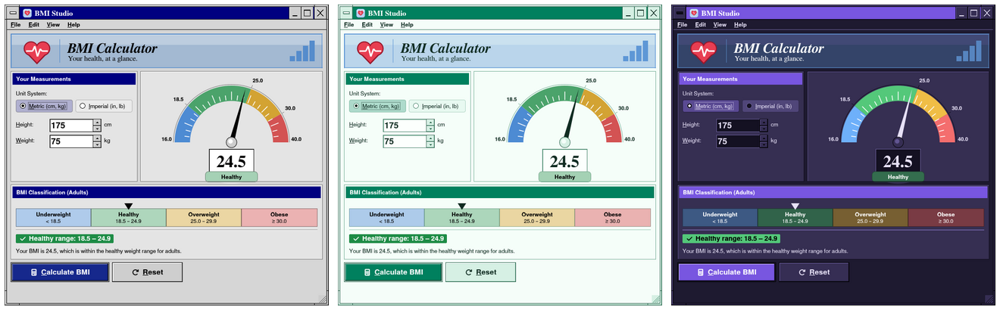

# A look of your own: changing controls, and making new ones



A window that does not look like every other is still best made of the
kit's controls: the keyboard, screen readers, right-to-left, the phone's
sizes and the dark schemes come with them. So there are three steps, in
this order, and most windows never need the third:

1. **[Change a control by its options](#1-change-a-control-by-its-options)**
   -- its colours, its text, its height, its look.
2. **[Put controls together](#2-put-controls-together)** -- a proc of your
   own that draws several of them is a control of your own.
3. **[Draw one yourself](#3-draw-one-yourself)** -- on a `canvas`, with
   `interact` when it is pressed.

And when a control of the kit should itself be different for everyone:
**[change the kit](#4-change-the-kit)**.

`examples/bmi.nim` (BMI Studio, `nimble bmi`) is the worked example: every
part of its window is one of these, and this page says which.

## 1. Change a control by its options

### Colours

Every colour a control is drawn in comes from the scheme, `ui.theme`.

| You want | Write |
|---|---|
| another scheme for the app | `app "Notes", 400, 600, theme = Mint:` -- one of the 28 in `builtinThemes` |
| a scheme of your own | a `Theme` object: copy one and change what differs (below) |
| the user to choose | `appearanceSettings()`, or a menu over `builtinThemes` |
| one part in other colours | `withTheme(t): ...` |
| the button that matters | `button("Save", accent = true)` |
| "good", "bad"... that follow the scheme | `goodColor()`, `warnColor()`, `badColor()`, `infoColor()`, and `goodBack()`... behind text |

A scheme of your own:

```nim
const Studio = Theme(
  window: color(214, 214, 214), text: color(0, 0, 0),         # the window and its text
  face: color(206, 206, 206), light: color(255, 255, 255),    # a button's face, its lit edge
  shadow: color(122, 122, 122), frame: color(0, 0, 0),        # its dark edge, its outline
  select: color(0, 0, 128), selectText: color(255, 255, 255), # the highlight
  gray: color(128, 128, 128),                                 # grayed text
  field: color(255, 255, 255), fieldText: color(0, 0, 0),     # text boxes and lists
  scroll: color(200, 200, 200), tip: color(255, 255, 225), tipText: color(0, 0, 0),
  line: color(150, 150, 150), edge: color(0, 0, 0), link: color(0, 0, 160),
  face2: color(232, 232, 232),                                # a lighter face (rows, headers)
  accent: color(22, 40, 140), accentText: color(255, 255, 255))   # the accent button

app "BMI Studio", 680, 610, theme = Studio:
  ...
```

`accent`, `accentText`, the state colours (`good`, `warn`, `bad`, `info`)
and their backgrounds (`goodBack`...) may be left out: the accent is then
the highlight, the states a green, an amber, a red and a blue fitted to
the window. Keep the text readable: 4.5 to 1 between `text` and `window`,
`fieldText` and `field`, `selectText` and `select` (the kit's schemes are
tested for it, `tests/test_looks.nim`).

One part of the window in other colours:

```nim
withTheme(Sunset):
  group "Offers":
    label "Drawn in Sunset"
    button("So is this")
# the window's own scheme again
```

The window behind the part stays as it was painted: a dark scheme's light
text is not read on a light window. Keep to schemes of the window's kind,
or paint the part first (a `canvas` filled with the scheme's `window`).

Do not write `color(0, 128, 0)` for "good" in a control: it is unreadable
on a dark scheme. `goodColor()` is the scheme's.

### Text

`style(...)` makes a text style: `bold`, `italic`, `serif`, `mono`, `size`
(1.0 is the UI's size).

| You want | Write |
|---|---|
| a line of text in a style | `styledText("Total", style(bold = true, size = 1.4))`, or `text(x, y, s, color, st)` on a canvas |
| a button's label | `button("Go", style = style(bold = true, size = 1.3))` |
| a text box's, a number box's text | `edit(name, style = style(size = 1.3))`, `spin(n, 0, 99, style = ...)`, `intEdit`, `numberEdit` |
| everything in a part | `withTextStyle(style(size = 1.2)): ...` |
| the whole app larger | `setTextScale(130)`, `setUiScale(125)` |
| another font | `setUiFont(ufSerif)`, `loadUiFontFile("MyFont-Regular.ttf")` |

A control grows with its text. Styles in `withTextStyle` multiply: a
`size = 1.3` button in a `size = 1.2` part is 1.56.

### Size

Widths are a control's `w`, or the row's (`row([120, -1]): ...`, -1: what
is left). Heights: `h` on `button`, `edit`, `spin`, `intEdit`,
`numberEdit`; everything at finger size with `setControlSizes(csTouch)`.
The sizes you give a control are design pixels: the kit scales them with
the screen. A `canvas` is yours, in real pixels: its own size too, so
write `canvas(dp(120), dp(40))`, and `dp(12)` for 12 design pixels in it.

```nim
spin(heightCm, 50, 250, w = 110, h = 44, style = style(bold = true, size = 1.5))
if button("&Calculate BMI", nfCalculator, isDefault = true, accent = true,
          style = style(bold = true, size = 1.3), w = 210, h = 42):
  calculate()
```

### Looks

| Control | Its other look |
|---|---|
| `group` | `group "Title", glCaption: ...` -- a raised panel under a title strip; `groupLook = glCaption` for every group and card |
| `radio` | `radio("Metric", unit, 0, boxed = true)` -- in a box that takes the press anywhere |
| `button` with a picture | `look = blTextBelow`, `blIconOnly`...; `setToolbarLook` for a tool bar's |
| `gauge` | bands of your own: `gauge("BMI", v, 16, 40, bands)`; `rangeBar(bands, v, 16)` the same bands as a bar |
| `pill` | `pill("Healthy", goodColor(), nfCheck)` -- a colour, an icon |
| a tool bar | `toolSeparator(line = true)`, `toolSpace(20)`, `toolSpace()` (what follows: at the right end) |
| the 3.1 title bar | `app(..., frame = wfClassic, captionIcon = true, captionAlign = caLeft, captionStyle = style(...))` |
| the title bars' buttons | `captionButtons = cbWin31` |
| every control | `uiLook = lookGlass`: the Glass look, frosted and rounded, in any scheme (`GlassLight`, `GlassDark` made for it); a control of your own asks `glassLook()` and draws with `glassFace(r, pressed, hot)` (a capsule's face), `glassWell(r)` (a field's), `glassAccent(r)` (the highlight's, a switch that is on), `fieldFace(r, back, enabled, focused)` (a field: rounded, the highlight's ring while it has the keys), `glassTrack(r)` (the track of a segmented choice), `glassCard()` (a card's color), `softShadow(r, radius)` (under what floats), `glassSurface(r, radius, tint)` (a pane of the modern glass -- `glassEffect`, `glassFx()` --: what is under it blurred, a sheen, its edge lit by `glassRim`), `selectFill(r)` (a chosen row), `glassHair`, `glassRadius(r)`, `withAlpha(c, a)`, `roundFrame` and `roundRectShaded(r, radius, top, bottom)` (`retroui/gfx`: lit from above). `uiLook = lookMatte` (flat, sharp; `MatteLight`, `MatteDark`) and `lookGloss` (glossy, its bars and blue parts in the scheme's hue: `glossTone(s, v)`, `glossDetail()`; `GlossLight`, `GlossDark`) draw through the same procs; `matteLook()` and `glossLook()` tell them apart, `lookSchemes(look)` gives a look's own schemes, `titleBar(r, active)` a title bar's band, `barFace(r)` a tool bar's face, `tintedFace(r, color)` a button's face in a color of its own; Gloss's parts: `glossBarFill(r)` (a bar), `glossBarButton(r, pressed, back, done)`, `glossBlue(r)` (a chosen row), `glossButtonFace(r, pressed, primary)` (a push button: gray, the default one blue), `glossTwoTone(r, radius, top, mid, low, foot)` (a face lit as glass was then), `glossPopoverFrame(r, arrowX, arrowUp)` and `glossMenuEdge()` (a popover's dark frame, as Gloss's menus and dropped lists have), `buttonInk(pressed, enabled, primary)`, `buttonLabel`, `buttonBold`; `polygonShaded`, `discShaded` (`retroui/gfx`) |
| the phone controls | `MobileStyle` (below) |
| the focus ring | `focusRing = false`: 3.1's dotted rectangle alone |
| icons | `setIconStyle(...)`: 3.1's pixel icons or their line twins |

docs/controls.md has each control's options under its picture.

### The phone controls

The phone's controls -- `navBar`, `bottomNav`, `sideMenu`, `tableGroup` and its rows, the
settings rows in a group -- take the scheme's colors as every control does. In Gloss a scheme
of its own (Gloss Light, Gloss Dark, Gloss Onyx) keeps iOS 6's steel blue and black bars; any
other scheme colors the bars, the tab bar and the side menu, and the status bar over the app's
bars is the top bar's color, darker. For colors and sizes of the app's own, past the scheme,
there is `MobileStyle`, as `Theme` is for colors:

```nim
mobileStyle = MobileStyle(
  bar: color(150, 30, 60),            # the bars at the top (`barText`: their words)
  statusBar: color(90, 14, 34),       # under the system's status bar (left out: the bar's, darker)
  tabBar: color(40, 10, 20), tabChosen: color(255, 160, 180),   # bottomNav (`tabText`: the others)
  sideMenu: color(60, 16, 30),        # the side menu's face (`sideMenuText`: its words)
  group: color(255, 248, 240),        # a tableGroup's face (`groupLine`: between its rows)
  rowText: color(60, 20, 30), rowDetail: color(150, 30, 60),     # a row's title, its value
  groupCorner: 14,                    # a group's corners (a negative: square)
  rowHeight: 50)                      # a row's height, in design pixels
```

A color left out (alpha 0) and a size left at 0 stay the look's own. `withMobileStyle(s): ...`
draws a part of the window in one, then puts the app's back, as `withTheme` does.

## 2. Put controls together

A proc that draws controls is a control. It takes its values as `var`
parameters, as the kit's do, and returns what happened:

```nim
proc unitField(label: string; v: var int; lo, hi: int; unit: string): bool =
  ## A number with its unit after it; true when it changed.
  let before = v
  row([70, 120, -1]):
    label label
    spin(v, lo, hi, w = 120, h = 40, style = style(bold = true, size = 1.5))
    label unit
  v != before

if unitField("Height:", heightCm, 50, 250, "cm"): dirty = true
```

A template takes a body, for a container of your own:

```nim
template panel(title: string; body: untyped) =
  group title, glCaption:
    withTextStyle(style(size = 1.1)):
      body
```

Three things to know:

- **A control is found again by its place in the code and its `var`.** In
  a loop, each turn's control needs its own variable (`items[i]`), or
  `pushId(i)` ... `popId()` round the turn.
- **`ui.lastRect`** is where the control drawn last is: to draw on it or
  beside it.
- **Layouts nest:** `row`, `col`, `group`, `card`, `adaptive`, `tabs`,
  `split`, `scrollPanel`. `isCompact()` says a phone's width: stack
  there what is side by side on a desktop (BMI Studio's `bmiFrame`).

## 3. Draw one yourself

`canvas(w, h)` gives a rectangle in the layout, `w` by `h` real pixels
(0 for `w`: all the width there is). What you draw there is yours:
`fill`, `box`, `hline`, `vline`, `roundRect`, `disc`, `ring`, `pieSlice`,
`polygon`, `thickLine`, `text`, `drawBitmap`; `raised` and `sunken` are
3.1's edges, `buttonFace` a button's. Mix your colours from the scheme's
(`mixColor(ui.theme.window, ui.theme.select, 0.3)`) and it follows a dark
one.

BMI Studio's banner is only drawn:

```nim
proc banner() =
  let r = canvas(0, dp(56))                 # 0: as wide as there is room
  fill(r, mixColor(ui.theme.window, ui.theme.light, 0.5))
  heartShape(float(r.x + dp(30)), float(r.y + r.h div 2), float(dp(30)), badColor(), ui.theme.frame)
  text(r.x + dp(60), r.y + dp(8), "BMI Studio", ui.theme.text, style(bold = true, serif = true, size = 1.8))
```

A control that is pressed adds four lines -- an id, `interact`, the
keyboard, and what it tells screen readers:

```nim
proc star(on: var bool; label: string): bool {.discardable.} =
  ## A star that is on or off; true when it was pressed.
  let r = canvas(dp(28), dp(28))
  let id = idOf(on)                          # who it is: its variable
  var hit = interact(id, r)                  # hover, down, clicked, focused
  spaceKey(id, hit)                          # Space and Enter press it
  if hit.clicked:
    on = not on
    result = true
  let c = if on: warnColor() elif hit.hover: ui.theme.shadow else: ui.theme.gray
  disc(float(r.x + r.w div 2), float(r.y + r.h div 2), float(r.w) / 2 - 3, c)
  if hit.focused: focusDots(inset(r, 2))     # 3.1's dotted rectangle (the ring is the kit's)
  accessNode(arCheckBox, label, id = id, r = r, states = (if on: {asChecked} else: {}))
```

What a control of your own owes its user:

| | |
|---|---|
| the mouse and the finger | `interact(id, r)`: `hover`, `down`, `clicked`, `focused` |
| the keyboard | `interact` puts it in Tab's order; `spaceKey(id, hit)` for Space and Enter; `keyHit(KeyLeft)`... while `hit.focused` for its own keys; `mnemonicHit(label)` for Alt and its underlined letter |
| the focus | `focusDots(r)` inside it; the ring round it is drawn by the kit. `focusFrame(r)` when the ring should go round more than the rectangle given to `interact` (a list with its scroll bar) |
| a text box | `ui.editsText = true` while it has the focus: the arrows are its caret's, and bring no ring |
| screen readers, the driver, tests | `accessNode(role, name, value, states, id, r)` |
| disabled | `interact(id, r, enabled = false)`, drawn in `ui.theme.gray` |
| every screen | `dp()` for your own sizes; sizes from `lineHeight()` and `textWidth()` so it grows with the text |
| every scheme | colours from `ui.theme` and the state colours, never fixed ones |
| right to left | `ui.rtl`: mirror what has a direction (an arrow, a progress) |

Lesson 12 of the tutorials, "Your own control", builds a round gauge this
way in three steps, a picture of each; lesson 15 tests one without a
window (`tests/harness.nim`: `click`, `key`, `px`).

## 4. Change the kit

When the control itself should be different for every app -- a new option,
a new look, a new control -- change the kit, in `src/retroui/`:

| Where | What |
|---|---|
| `core.nim` | `Theme`, the layout, `interact`, the focus, the frame |
| `gfx.nim` | drawing: shapes, text, text styles, layers and clips |
| `widgets.nim` | the basic controls: buttons, boxes, lists, menus, bars, groups, dialogs |
| `business.nim`, `records.nim`, `extras.nim`, `morecontrols.nim` | number and date boxes, grids, cards, banners, pills... |
| `charts.nim` | charts, gauges, the range bar |

How a change goes (AGENTS.md has the rules in full):

1. **An option, not a twin.** A new look is a parameter with a default
   that draws what was drawn before (`accent = false`, `boxed = false`, `h
   = 0`, `style = TextStyle()`), or an enum (`GroupLook`). Old code must
   look as it did.
2. **Colours from the scheme.** A colour a scheme may want its own of is a
   `Theme` field read through a proc that makes it up when the field is
   empty (`accentColor()`: `Theme.accent`, else `select`).
3. **Every size through the text and `dp`.** A control with a style is
   measured with that style (`labelWidth(label, st)`, `lineHeight(st)`).
4. **The keyboard and the screen reader with it.** A new control calls
   `interact` and `accessNode`; one made of several pressable parts moves
   between them with the arrows.
5. **A test without a window** in `tests/` (`tests/test_looks.nim` has one
   for each look named here), added to `retroui.nimble` and, when it needs
   nothing of Linux's, to `PORTABLE` in `.github/workflows/systems.yml`.
6. **Its picture in the guide:** an `example(...)` in `tools/shots.nim`
   naming every new exported proc; `nim c -r -d:release tools/shots.nim`
   draws docs/controls.md again. `python3 tools/controlscheck.py` says
   which exported control has none.
7. **Said where people read:** CHANGELOG.md, README.md, this page,
   `skills/retroui/SKILL.md`.

## BMI Studio, part by part

| Part of the window | Made with | Step |
|---|---|---|
| Gray 3.1 window, navy caption, menus | `app(..., theme = StudioTheme, frame = wfClassic)`, `menubar` | 1 |
| The icon and the large title in the title bar | `captionIcon`, `captionAlign = caLeft`, `captionStyle` | 1 |
| The banner: a heart, a pulse, small bars | `canvas` + `polygon`, `thickLine`, `fill`, styled `text` | 3 |
| "Your Measurements", "Your Result" | `group title, glCaption` | 1 |
| Metric / Imperial | `radio(..., boxed = true)` | 1 |
| Height and weight, large digits | `spin(..., h = ..., style = ...)` | 1 |
| The dial in four bands | `gauge(title, value, lo, hi, bands)` | 1 |
| The classes under it, a marker over yours | `rangeBar(bands, value, lo)` | 1 |
| "Healthy range" with a tick | `pill(text, goodColor(), nfCheck)` in `withTextStyle` | 1 |
| Calculate BMI, navy, large | `button(..., accent = true, style = ..., h = 42)` | 1 |
| The formula at the right | `canvas` + `text` | 3 |
| View > Colours: any of the kit's schemes | `ui.theme = builtinThemes[i].theme` | 1 |
| One column on a phone | `isCompact()` | 2 |

Its bands name no colours, so they are the scheme's blue, green, amber and
red: in Dusk the same window is dark, with nothing changed in the app.

```sh
nimble bmi                       # or: nim c -r -d:release examples/bmi.nim
RETRO_THEME=Mint nimble bmi      # in another scheme
RETRO_APP=bmi nimble appapk      # build/BMIStudio.apk
```
