# The Retro UI Interface Guidelines

How an app made with Retro Nim UI looks and behaves, on the desktop and on the phone, so that
every app feels like a program of one system -- a system that never shipped, between Windows
3.1 and the phones of 2012, with the glass of today. It is drawn from the guides those systems
gave their developers (Microsoft's for Windows 95, Apple's for the Mac and for iOS 6, and
Apple's adoption guide for Liquid Glass) and from what people already expect of a desktop
program and a phone app. Where they disagree, it picks one way and says which.

Two families, one kit:

- **Desktop** -- the **Classic** look (Windows 3.1, with what Windows 95 added: property sheets,
  tool tips, wizards, context menus) and the newer looks. A window with a menu bar, a tool bar
  and a status bar; a mouse, a keyboard, menus and dialogs.
- **Mobile** -- the **Gloss** look (the phones of 2012) and the newer looks. One window of pages
  with a navigation bar, a tab bar, lists of rows, sheets; a finger.
- **Glass** -- the glass effect, the same on both: bars, menus, sheets and buttons of glass over
  the content.

The same code makes both: a window becomes a phone's screen, a menu bar a row of menus, a dialog
a page. What follows says, for each part, what the kit does by itself (nothing to write) and
what the app does (a call to make, a rule to follow). Each rule comes with the API it takes.
The pictures are from the controls guide ([docs/controls.md](controls.md)), which has every
control's code.

Two apps do all of it, to read beside these pages: **Retro Report**
([examples/higdesk.nim](../examples/higdesk.nim)), a report editor for the desktop, and **Retro
Groceries** ([examples/higphone.nim](../examples/higphone.nim)), a shopping list for a phone or a
tablet.

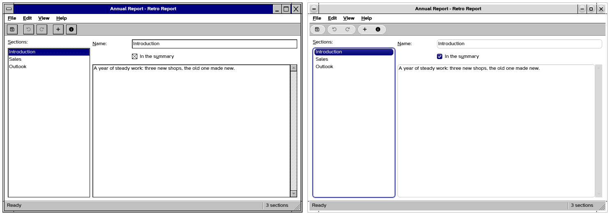

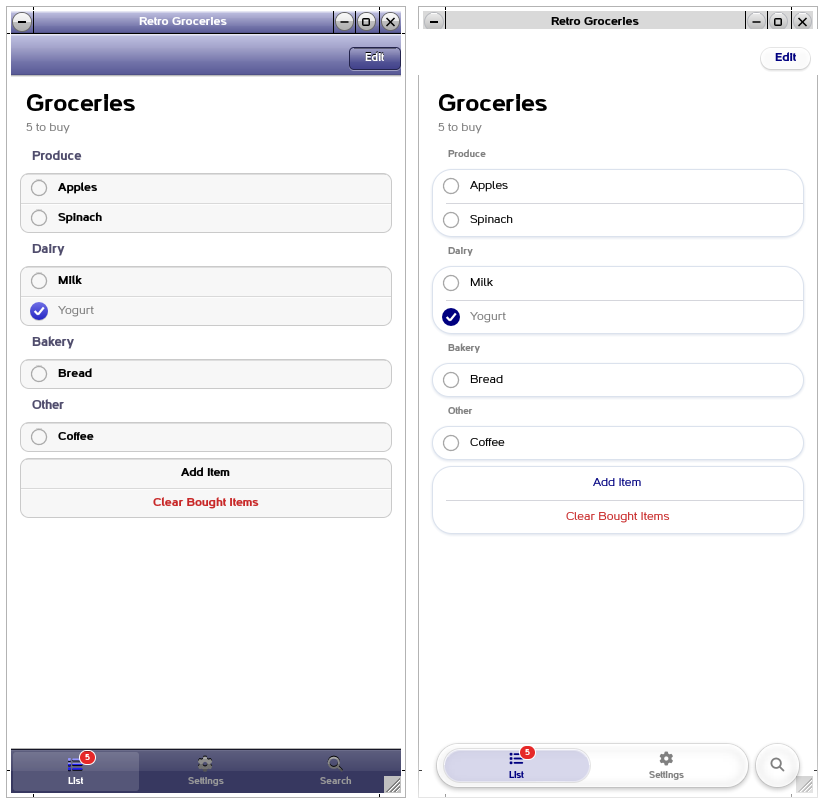

Contents: [Principles](#principles) · Desktop: [the window](#the-window) ·
[mouse and keyboard](#mouse-and-keyboard) · [selection](#selection) · [menus](#menus) ·
[controls](#controls-on-the-desktop) · [dialogs](#dialogs) ·
[message boxes](#message-boxes) · [property sheets and wizards](#property-sheets-and-wizards) ·
[help](#help) · [drag and drop](#drag-and-drop) · [words and layout](#words-and-layout) ·
Mobile: [the app](#the-phone-app) · [touch](#touch) · [bars](#bars) · [lists](#lists) ·
[modal views](#modal-views) · [controls](#controls-on-the-phone) · [saving and starting](#saving-and-starting) ·
[the device](#the-device) · Both: [the glass effect](#the-glass-effect) ·
[accessibility](#accessibility) · [checklists](#checklists) · [the API of these guidelines](#the-api-of-these-guidelines)

## Principles

These hold everywhere.

- **The user is in charge.** The app does what the user asks, when they ask, and says what it is
  doing. It doesn't move things on its own, doesn't take the focus away, doesn't open a window
  nobody asked for. Modes are rare and short, and say how to leave them.
- **Direct.** Things are acted on where they are: a file dragged where it goes, a row tapped to
  open it, a value typed in its place. Commands are for what can't be done directly.
- **Consistent.** The same thing looks and works the same way in every app: OK and Cancel in the
  same order, Ctrl+S saves, a chevron leads deeper, a red button deletes. The kit's controls do
  it right by themselves; an app that draws its own control follows the same rules.
- **Forgiving.** Every change can be undone (`UndoStack`: Undo and Redo with what they undo in
  their names). What can't be undone is asked about first -- and only that: a question before
  every action teaches people to say yes without reading.
- **Feedback.** Every action shows at once that it was taken: a button pressed in, a row lit, a
  tap felt (`haptic`). Work that takes a while shows its progress and can be stopped
  (`busyState`, `progressBox`, `job`).
- **Show what matters.** The common choices up front; the rest a step away (an Options >>
  button, an advanced page, a menu). Content first, controls around it.
- **Safe to explore.** Opening a menu, a dialog or a page never changes anything; Cancel, Esc and
  Back always leave as it was.
- **Looks that mean something.** A control looks like what it does; color and motion say
  something (red is danger, an animation shows where a thing went) and are never the only way
  something is said.

# Desktop

## The window


A desktop app is a window of the system's with, top to bottom: its **menu bar** (every command
of the app is in it), a **tool bar** (the frequent ones, as icons), the **content**, and a
**status bar** (what is selected, what is going on, what a menu item does).

| The app does | With |
|---|---|
| Title the window "Document - App" (the app's name alone with no document) | `setTitle` |
| Put every command in the menu bar, the frequent ones also on the tool bar | `menubar`, `toolbar` |
| Keep one copy of the app running: opening it again brings its window forward, with what it was opened with | `singleInstance()` |
| Ask before work is lost when the window closes | `closeGuard(dirty, name, save)` |

On a Mac the menu bar goes into the system's menu bar at the top of the screen, between the
app's own menu and Window, and the window has none (`macMenuBar`, on by default). Ctrl in the
app's shortcuts is Command there; the kit shows and takes it so.

Secondary windows -- a tool palette, a second view -- are windows of the system's too (`window`),
beside the app's own; on a phone, where there is one window, they are dialogs over the app.

A desktop app's frame, as Retro Report has it -- the order matters: the bars first, then the
content, then the dialogs over it, and the question before closing last:

```nim
import retroui, retroui/device

if not singleInstance("retroreport"): quit 0     # (the first copy comes forward instead)
var history: UndoStack

app "Retro Report", 720, 480:
  setTitle(docName() & (if history.changed: "*" else: "") & " - Retro Report")
  menubar:
    menu "&File":
      if menuItem("&Save", "Ctrl+S", hint = "Saves the report"): discard save()
      menuSeparator()
      if menuItem("E&xit", hint = "Closes Retro Report"): requestClose()
    menu "&Edit":
      undoMenuItems(history)                     # (Undo Typing, Redo Typing)
    menu "&Help":
      if menuItem("&What's This?", "Shift+F1"): startHelpMode()
  toolbar:
    if toolButton(nfSave, "Save (Ctrl+S)"): discard save()
    toolSeparator()                              # (a group: a capsule of glass in Glass)
    if toolButton(nfUndo, "Undo", enabled = history.canUndo): history.undo()
    if toolButton(nfRedo, "Redo", enabled = history.canRedo): history.redo()
  statusbar(if menuHint().len > 0: menuHint() else: "Ready")
  # ... the content: its controls, `helpText` on those that need a word ...
  undoKeys(history)
  if hotkeyPressed("Ctrl+S"): discard save()
  closeGuard(history.changed, docName(), save)   # ("Save changes?" when it closes)
```

## Mouse and keyboard

The kit's controls take the mouse and the keyboard as the table says; a control of the app's own
(`interact`) does the same.

| Mouse | Does |
|---|---|
| Click | selects it, presses it, places the caret; acts when let go over it (let go elsewhere: nothing) |
| Double click | its default action: opens a file, selects a word |
| Right click (a long press on a touch screen) | its context menu, for what is under the pointer |
| Drag | moves it, or selects a range; Ctrl copies; Esc cancels the drag |
| Shift+click | extends the selection from its anchor |
| Ctrl+click | adds to the selection or takes out of it |
| The wheel | scrolls what is under the pointer, Shift across; zooms a picture or a page (`imageView`, `pdfView`) |

| Keys | Do (the kit's own, reserved) |
|---|---|
| Tab, Shift+Tab | the next control, the one before (in reading order) |
| Arrows, Home, End, Page Up, Page Down | move in the control with the focus |
| Enter | the default button; Esc: Cancel, closes the dialog, the menu, the drag |
| Space | presses the button with the focus, ticks the check box |
| Alt + a letter | the control or menu whose label has it underlined (`&Save`) |
| F10, Alt alone | the menu bar |
| Shift+F10, the Menu key | the context menu of the focus |
| F1 | Help; on a control with `helpText`, what it is for |
| Shift+F1 | What's This? -- the next click shows what a control is for |
| F6 | the next part of the window (the tool bar, a list, the content) |
| Ctrl+Shift+P | the command search (`commandHudKeys`, `openCommandHud`): any menu command by a few letters |
| Hold Ctrl a moment | the sheet of every key shortcut (`shortcutSheet`) |

The app keeps these for what they mean everywhere: Ctrl+N New, Ctrl+O Open, Ctrl+S Save, Ctrl+P
Print, Ctrl+Z Undo, Ctrl+Y Redo, Ctrl+X Cut, Ctrl+C Copy, Ctrl+V Paste, Ctrl+A Select All,
Ctrl+F Find, Alt+F4 Close. It gives every menu, command button and labeled control an access key
(`&` in its label), each letter once in a window or a menu -- but not OK and Cancel, which are
Enter and Esc.

## Selection

- Selection shows at once, on the press: the highlight, in the scheme's color (`selectFill`).
- A click selects one, a drag a range from where it began; Shift extends from the anchor, Ctrl
  adds or takes away, a drag on empty space draws a band round what it takes.
- The kit's grids that select several (`grid` with `marked`), its icon views and its text boxes
  do all of this (a band on the empty part of a grid or an icon view, too); an app's own canvas
  selects the same way.
- Commands act on the selection; with nothing selected the commands that need one are grayed,
  not hidden.

## Menus

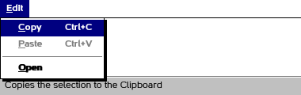

| Rule | With |
|---|---|
| Menu titles one word each: File, Edit, View, Insert, Format, Tools, Window, Help -- in that order, the app's own between View and Window | `menu "&File"` |
| An item's name is what it does, title capitalized: "Save As", "Find Next" | `menuItem("Save &As...")` |
| "..." when it needs more before it acts (a dialog asks something); none when it opens a window to look at (Properties) | -- |
| Gray what can't be done now; take out only what never can | `enabled = false` |
| Say what an item does in the status bar -- and, grayed, why | `menuItem(..., hint = "...")`, `statusbar` shows `menuHint` |
| A check mark for an option that is on or off; the item a double click does in bold | `checked = true`, `isDefault = true` |
| Lines between groups of items | `menuSeparator` |
| The shortcut at the end of the item, in this system's words | `menuItem("&Copy", "Ctrl+C")` |
| Submenus one level deep, two at the most | `submenu` |

**Context menus** (a right click, Shift+F10, a long press) hold what can be done to the thing
under the pointer, the most used first: its default action (Open) first, then Cut, Copy and
Paste, then the rest, Properties last. No shortcuts shown in them. On empty space: the view's
own (Paste, Select All, View, Refresh). `contextMenu`, `popupMenu`.

The **command search** (Ctrl+Shift+P, `openCommandHud`) finds every menu command by a few letters
of its words; the **keys' sheet** (Ctrl held, `shortcutSheet`) lists every shortcut. Both come
from the menus as they are -- nothing to write.

## Controls on the desktop

Which control for what:

| To | Use | Not |
|---|---|---|
| Do something now | a command button: a verb, title caps (`button`); the one that matters, the accent one (`accent = true`) | a link (only for going somewhere) |
| More of a dialog, for the few | `unfoldButton("&Options", open)`: "Options >>" | a second dialog |
| A command with choices | `menuButton`, `splitButton` | a button that opens a dialog of buttons |
| On or off, a clear opposite | `checkbox`; settings on a phone: `toggle` | two radio buttons |
| On, off, or "some are" (things chosen together that differ) | `checkbox(label, var CheckState)`, `mixedOf` | a check box that lies |
| One of 2 to 7 | `radio` (one Tab stop, the arrows inside), `segmented` | a list |
| One of many | `combo` (a drop-down list), `listbox` | radio buttons |
| Several of many | `checkList`, `chips` | a list with Ctrl-clicks only |
| A word, a name | `edit` with a `hint`; a fixed code: `maxLen` and `autoExit` | -- |
| A number | `spin` (`wrap` for minutes and degrees), `numberSpin` with decimals and a list of the usual (a type size), `slider` for a rough amount | an `edit` that checks after |
| A date, a time, a color | `datePicker`, `timePicker`, `colorWell` | three boxes |
| Data | `grid` (sort by its column headings, drag their dividers), `tree`, `iconView` | -- |
| Groups of settings | `tabs` (one row, peer pages), `group` boxes with their labels | nested tabs |
| How far it has got | `progress` with words beside it; endless: `spinner` | a cursor alone |

What the kit's controls do by themselves, and a control of the app's own does too:

- Pressed when the button goes down, acts when it comes up over it; taken away from it, nothing
  happens. A scroll bar's thumb dragged far off its bar goes back where it was.
- Grayed controls look grayed and are skipped by Tab; they still show their value.

What the app does:

- Every control has a label, with an access key. Labels end with ":" before a box; check boxes
  and options have theirs after them.
- A list is 3 to 8 rows high (`listbox(..., rows = 6)`); a drop-down list a little wider than its
  longest item; long paths cut in the middle (`ellipsizePath`), the whole as the tooltip.

## Dialogs

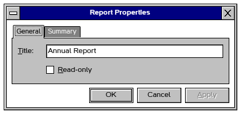

- **Title**: the command that opened it, without the "..." ("Print", "Insert Object").
- **Modeless** when the user may work beside it (Find, a palette); **modal** only when an answer
  is needed before going on. Never system-modal.
- **Buttons**: in a row at the bottom, right-aligned (`buttonRow`) -- or stacked at the top
  right --, the default first: OK, Cancel, then the rest, Help last. Name them by what they do
  ("Delete", "Replace"), not Yes and No, unless it is a question.
- **The default button** (bold ring, Enter: `isDefault = true`) is the most likely and least
  harmful one, never one that destroys. A control that acts on Enter itself -- a text box of
  several lines, a drop-down -- keeps it while it has the focus (`ui.takesEnter`).
- **Where**: centered over the window; moved, it stays where it was put while the app runs.
- **Esc** and the close button are Cancel -- except in a property sheet with changes not
  applied, which asks.
- **Tab order** is reading order: left to right, top to bottom.
- **Checking what was typed**: as it is typed where it can be (`invalid = true` shows it in red);
  else when the field is left; else on OK: a message saying what is wrong, then the focus back on
  the field.

## Message boxes

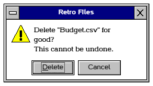

A message box (`msgBox`) interrupts: one only when the user must know or decide something now.

| Kind | When | Buttons |
|---|---|---|
| `miInfo` | the result of a command, nothing to decide | OK |
| `miWarning` | a decision before something that can't be undone | the actions by name, Cancel |
| `miStop` | a problem that stops the work until it is put right | OK, or what puts it right |

- Say what happened, why, and what to do about it, in the user's words: "‘Report.txt’ could not
  be saved because the disk is full. Save it to another disk, or make room on this one." Never
  blame the user; never "Error" as the title or the message.
- Offer the remedy as a button when there is one ("Switch to Landscape").
- One message for one problem -- never a chain of them.
- Cancel puts everything back as it was; when that can't be, the button is Stop.
- A tip the user may know by heart has "Don't show this again" (`msgBox(..., dontAsk)`); a
  warning about losing work never has.
- **Before work is lost**: `saveChangesBox` asks "Do you want to save the changes to
  ‘Report’?" -- Yes, No, Cancel in Classic; Save, Don't Save, Cancel with what is at stake in
  the newer looks. `closeGuard` asks it by itself when the window closes.

## Property sheets and wizards

**Property sheets** show the properties of one thing (`propertySheet`): title "Name Properties",
peer groups as tabs, OK, Cancel and Apply under them.

- OK applies and closes; Apply applies and stays (grayed until something changed); Cancel throws
  away what wasn't applied (not what Apply already did).
- Switching tabs applies nothing.
- Closed with changes not applied, it asks whether to apply them (the kit does).
- Several things selected: one sheet; where they differ the control shows **mixed** (a check
  box's `csMixed`, an empty text box, no option chosen).
- A **property inspector** -- a pane that follows the selection and applies at once -- has no OK
  or Apply (`propertyGrid`, `dockPanels`).

**Wizards** take the user through a task they seldom do (`wizard`): one window, its steps at the
left, Back, Next and Finish, Cancel. Ask questions ("Which layout do you want?"), a few choices a
page; Finish as soon as the defaults are good enough; the last page says what Finish will do.

## Help

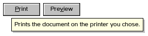

- Every control without a label of its own (a tool button) has a **tooltip** (`tooltip`).
- Controls whose use isn't plain have a sentence of **help** (`helpText`): shown by F1 with the
  focus on it and by What's This? (Shift+F1, `startHelpMode`).
- Menu items say what they do in the **status bar** (`hint`).
- Help never covers what it explains, and is never needed to finish a task.

## Drag and drop

The kit's drags (`startDrag`, `dropTarget`) behave as the guide asks: the thing dragged shows by
the pointer, the target lights while it would take it, Ctrl copies instead of moving, Esc
cancels, a list or a page under the pointer scrolls by itself near its edge. A drag of files
(`startDrag(..., files = ...)`, `fileDragSource`) goes on out of the window to the file manager,
a browser, a mail -- and files from them land on `fileDropTarget`. Dragging is a shortcut: the
same must be possible by commands (Cut and Paste, Move To).

## Words and layout

- **Capitals**: Title Caps for commands, menus and buttons ("Save As", "Page Setup"); sentence
  caps for everything else -- labels, check boxes, options, tabs, group boxes ("Match case").
- **Words**: the user's, never the code's ("picture", not "bitmap"); short; "click" with a mouse,
  "tap" with a finger (the kit's own say what fits: `tr`).
- **Spacing**: the kit's (`Pad` round a window's content, `Gap` between controls); controls of a
  form line up on their left edges (`form`, `field`); labels before their box, on the same line --
  above it on a phone (the kit moves them).
- **Room for other languages**: a word in German or Arabic is longer -- let rows grow (`spring`, no
  fixed widths for labels). Right-to-left languages mirror the window (`setRightToLeft`): the kit
  mirrors its controls.

# Mobile

## The phone app

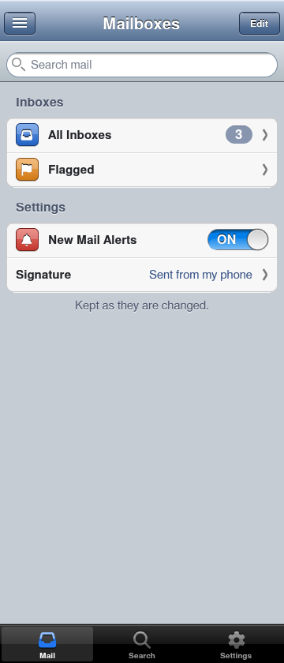

One window, the whole screen. Its content is **pages**: a list leads to a page, which leads to
another; a **navigation bar** at the top of each says where the user is and goes Back. A few
peer sections of the app are a **tab bar** at the bottom. A task of its own is a **modal sheet**
over the page.

| The app does | With |
|---|---|
| A navigation bar on every page: its title, Back to the page before (named after it), one action | `navBar(title, back, action)`, `PageStack`, `pageHeader` |
| 2 to 5 places of the app in a tab bar, always there (but in a modal view) | `bottomNav` |
| The top page's title large, giving way to the bar's as it scrolls | `largeTitle` |
| Settings the user changes often in the app; the rest seldom | `tableGroup`, `settingToggle`, `appearanceSettings` |
| On a tablet: the list and the page side by side; on a phone the page over the list, Back to it | `listDetail`, `sidePane` |
| Turned on its side: more of the content, not the same bigger | `adaptive`, `isCompact`, `sizeClass` |

Back is also the phone's Back button and a swipe from the left edge (the kit takes both:
`backPressed`).

A phone app's frame, as Retro Groceries has it -- the tab bar first, then the page under its
navigation bar, then what goes over it; the list kept by itself, no Save:

```nim
import retroui

var items = restoreState("groceries.items", @["Apples", "Milk"])   # (as it was left)
var place = 0
var editing = false

app "Retro Groceries", 390, 760:
  keepState("groceries.items", items)          # (written as the app goes to the background)
  bottomNav([(nfList, "List"), (nfSearch, "Search")], place, [$items.len, ""], search = 1)
  if navBar("Groceries", action = if editing: "Done" else: "Edit", done = editing) == npAction:
    editing = not editing
  beginPanel(-1, "list", plain = true)
  largeTitle("Groceries", $items.len & " to buy")
  var gone = -1
  editTableGroup("Today", editing):
    for i, it in items:
      if tableRow(it).deleted: gone = i
  if gone >= 0: items.delete(gone)
  endPanel()
```

## Touch

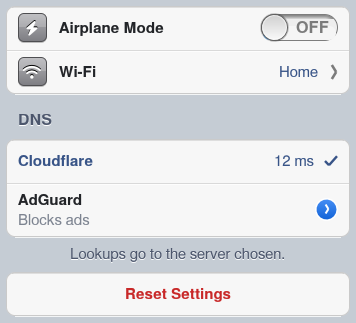

Everything a finger taps is at least 44 points across (the kit's controls are: `fingers()`
makes them so on touch screens).

| Gesture | Does (the kit's controls) |
|---|---|
| Tap | presses, opens, selects |
| Double tap | zooms a picture or a page in and out (`imageView`, `pdfView`) |
| Touch and hold | lifts the item with its menu (`liftMenu`), opens a control's menu (`contextMenu`: a text box's Cut, Copy, Paste) |
| Swipe a row left | its actions (`swipeRow`): Delete in red |
| Swipe from the left edge | Back |
| Pull down at the top | refreshes (`pullRefresh`) |
| Pinch | zooms (an app's own view reads `ui.pinch`, `ui.gesturing`) |
| Flick | scrolls quickly, slowing to a stop |
| Drag a row's grip (edit mode) | moves it (`editTableGroup`) |
| Tap the status bar or the bar's title | back to the top of the page (`askScrollTop`: the kit does it) |
| Shake | Undo, asked first ("Undo Typing?"): the app's, with `shaken` |

- Standard gestures only for what they always mean; a gesture of the app's own is a shortcut,
  never the only way (Delete is also in Edit mode and in the lift menu).
- A tap acts when the finger is lifted, not when it comes down; a finger that moved scrolled
  instead.
- The actions at the top of an item's lift menu are the same as its swipe actions.

## Bars

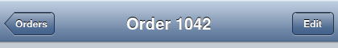

- **Status bar** (the system's): kept, except over a video or a photo shown whole.
- **Navigation bar** (`navBar`): the page's title in the middle; Back at its start (the page
  before's name, a chevron), or Cancel on a modal sheet; one action at its end, a verb or an icon
  (Edit, Done, Add) -- Done in the highlight. Not crowded: more goes in a tool bar.
- **Tool bar** (`actionBar`, `toolbar`): actions on what the page shows, at the bottom on a phone.
- **Tab bar** (`bottomNav`): places, never actions. A number for news on a place (`badges`); the
  search place apart at the end (`search`); with the glass effect it may shrink as the page
  scrolls down (`tabBarMinimizes`).
- **Search bar** (`searchBar`): under the navigation bar, with Cancel; where to search in a
  **scope bar** under it (`scopeBar`, 2 to 4 scopes).

## Lists

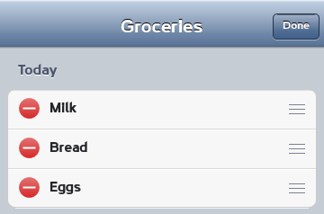

- Groups of rows with a header and a note under them (`tableGroup`); section headers in title
  case.
- A row's end says what a tap does: a chevron goes deeper; an info button shows details of it (a
  tap on the row does something else); a check mark is the one chosen (`TableAccessory`).
- A tapped row lights while the finger is on it, then the next page shows.
- **Edit mode** (an Edit button in the bar, then Done): a red minus before each row, its Delete at
  its end; grips to move rows (`editTableGroup`, `TableHit.deleted`, `tableMoved`).
- Long lists have an index down their side (`indexBar`) and a search bar.
- While rows load: placeholders where they will be (`skeletonRows`); the old rows stay while new
  ones come. Nothing there: say so, and what to do (`emptyState`).
- Rows of one height in a plain list; changes to it animate (`staggered`, `presence`).

## Modal views

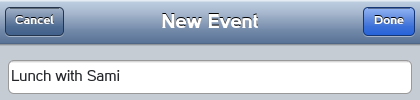

Modal only when the user must finish or abandon something before going on -- short, focused, an
obvious way out.

| View | When | With |
|---|---|---|
| Alert | something the user must know now, or a choice before an action that can't be undone; never just information | `alertBox`: a title that says what (never "Error"), a short message, one or two buttons -- Cancel at the left, the action at the right in bold, a destructive one in red |
| Action sheet | the choices of an action just asked for (Delete Photo, Save to Files) | `actionSheet`: out of the button that opened it (`anchor`) -- a popover with no Cancel on a tablet and with the glass effect; from the bottom with Cancel apart on a phone |
| Modal sheet | a task of its own: a new event, a message | `modalSheet`: Cancel and Done (or Save, Add, Send) on its bar; the whole screen on a phone, a sheet in the middle on a tablet; a tap beside it doesn't close it |
| Popover | a few choices tied to a control (tablet, desktop) | `popover`: closes when tapped beside; nothing over it but an alert |
| Bottom sheet | filters, options, a short form | `bottomSheet`: a handle, dragged down to close |

Words on buttons: OK only when nothing says it better; never "Yes" and "No"; no "you" or "your".

## Controls on the phone

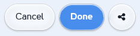

| To | Use |
|---|---|
| On or off in a row of settings | `tableSwitch`, `settingToggle` |
| 2 to 5 views of the same content | `segmented` (text or icons, not both) |
| A number of steps | `quantity`, `numberSpin` |
| One of a set | `wheelPicker`, `dateWheels`, `timeWheels` (many values: a list instead) |
| An amount | `slider` (pictures at its ends for what they mean) |
| Peer pages swiped through | `pageDots` (few pages) |
| The one action of a page | `bigButton`, `glassButton(prominent = true)` |
| Something done to go on (a payment, deleting all) | `slideToConfirm` |

**Text**: the keyboard fits what is typed (`textKeyboard`: numbers, an address, a mail); its
Enter key says what it does (`enter`: Next, Done, Search, Go); a box has a gray `hint` saying
what goes in it. In the kit's text boxes a tap places the caret, a double tap selects a word, and
a long press opens their menu: Cut, Copy, Paste, Delete, Select All.

## Saving and starting

- **Save by itself**: the user's work is kept as it goes, when they switch documents and when the
  app goes to the background -- never only on a Save command. Apps that show more than they edit
  have Edit, which becomes Save and Cancel.
- **Keep the user's place**: Android and iOS end an app in the background whenever they need its
  memory. `keepState` writes what the user was doing (the page, the scroll, a draft) as the app
  goes to the background; `restoreState` brings it back when it starts.
- **Start at once**: no splash, no About box, no questions; good defaults for most people, the
  system's settings read (dark mode, the language, text size: the kit does).
- **Never quit**: the app doesn't end itself; when something it needs is missing, it says so on
  its page and what to do (`emptyState`).
- A popover dismissed by a tap beside it keeps what was typed in it.

## The device

| The app may | With |
|---|---|
| Tell the user of something new, while it is closed too | `notify` (buttons: `actions`), `scheduleBackgroundCheck`, `setBadge` |
| Open from a link of its own (myapp://song/12) | `takeLink`; `retroapk --links`, `retroios --links` |
| Ask the owner before something private | `askUnlock`, `unlockAnswer` (fingerprint, face, PIN) |
| Feel a tap | `haptic` (after a snap, a success, an error -- not every tap) |
| Know how it is held, and a shake | `motion`, `shaken` |
| Go on in a small window over other apps | `pictureInPicture` (`retroapk --pip`) |
| Share and take shared things | `share`, `sharedIn` (`retroapk --share-target`) |
| Drag to the app beside it, take its drops | `dragToApps`, `fileDragSource`, `droppedFromApps` |
| Read a code | `scannerView`, `qrRead`, `barcodeRead` |
| Sell in the app | `storeStart`, `storeProducts`, `storeBuy`, `storeEvent`, `storeFinish` |

[examples/androidapis.nim](../examples/androidapis.nim) tries each of these on its own page.

# Both

## The glass effect

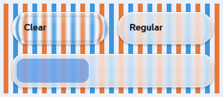

With the glass effect on (the Glass look, `glassEffect`), the bars, the tab bar, menus, sheets,
alerts and buttons float over the content as glass: what is under them shows through, blurred,
bent at their edges as through the rim of a lens, a glint of light along them. It is the same on
the desktop and the phone.

- **Glass is for controls and navigation, never for content.** A list, a picture, a page of text
  are the content; the glass sits over them. No glass on glass.
- **Sparingly**: the kit's own bars, menus and sheets are glass by themselves; an app adds glass
  only to its most important controls of its own (`glassSurface`, `glassButton`).
- **Clear or tinted**: `glassTint` from 0.0 (clear: the most seen through) to 1.0 (tinted: the
  easiest to read) -- the user's "Glass: clear to tinted" in `appearanceSettings`. Clear glass
  over pictures and video (`clear = true`).
- **Reduce transparency**: `glassSolid` makes the glass solid, keeping its shapes and light; the
  kit follows the system's setting.
- **Content under bars** fades as it goes under them (the scroll edge): the kit's bars do it;
  an app's own bar over scrolling content draws `scrollEdge`.
- **Tool bars** group their buttons in capsules of glass by what they do: Undo and Redo in one,
  Bold, Italic, Underline in another (`toolSeparator` between groups). Icons, not words, in a
  group -- each with its tooltip and a name for screen readers.
- **Rounder**: controls are capsules, sections and sheets rounder; a shape inside another is
  rounded round the same center (`concentric`).
- **Alive**: a slider's or a switch's knob swells into clear glass while dragged (`glassKnob`);
  menus grow out of where they hang from; the light follows the pointer, and the phone's tilt
  (`glassTilt`); the tab bar shrinks as the page scrolls down (`tabBarMinimizes`); bottom sheets
  float in from the edges.
- **The prominent action** is tinted glass (`glassButton(prominent = true)`): one a screen.
- Menus of the glass effect show the usual commands with their icons (Cut, Copy, Paste...), by
  themselves.

## Accessibility

The kit's controls are read by screen readers (Narrator, VoiceOver, TalkBack, Orca: their names,
roles and states), work by the keyboard alone, show where the focus is, and follow the system's
settings: larger text (`setTextScale`), less motion (`smoothScrolling`), reduced transparency
(`glassSolid`), dark or light; for high contrast the user picks one of the high-contrast schemes
in Appearance. An app keeps it so:

- Every control has a name: a label, a `hint` in a text box, a `tooltip` on an icon; a control of
  its own says what it is (`accessNode`).
- Nothing is said by color alone (red *and* a word or an icon).
- Nothing depends on time: no message that goes before it can be read, nothing that must be done
  quickly.
- Sound is never the only sign of anything.
- Text stays readable at 200 % (`setTextScale`): rows grow, nothing is cut that matters.

## Checklists

**A desktop app**

- [ ] A menu bar with every command; access keys; shortcuts for the frequent ones
- [ ] A tool bar of the frequent commands, each with its tooltip
- [ ] A status bar; menu items with `hint`s
- [ ] Undo and Redo of every change (`UndoStack`, `undoMenuItems`)
- [ ] `closeGuard` before work is lost; `singleInstance`
- [ ] Dialogs: title, OK and Cancel, the right default, Esc, Tab order; `propertySheet` for
      properties
- [ ] Message boxes that say what, why and what to do
- [ ] `helpText` on what isn't plain

**A phone app**

- [ ] A navigation bar on every page; Back by the button, the edge, the phone's Back
- [ ] A tab bar of 2 to 5 places, or none
- [ ] 44-point targets; standard gestures only for what they mean
- [ ] Work saved by itself; `keepState` and `restoreState`
- [ ] Modal sheets with Cancel and Done; alerts only when they must
- [ ] Placeholders while loading; an empty state that says what to do
- [ ] Upright and on its side; a tablet's two panes

## The API of these guidelines

What each rule above takes, in one place (each is in the controls guide with its code and
pictures):

| Rule | API |
|---|---|
| One copy running; links | `singleInstance`, `takeLink`, `registerLinks` (`retroui/device`) |
| Save before closing | `closeGuard`, `saveChangesBox` |
| Menus that say what they do | `menuItem(hint, isDefault)`, `menuHint`, `statusbar` |
| The keys' sheet, the command search | `shortcutSheet`, `commandHudKeys`, `openCommandHud` |
| The Mac's menu bar | `macMenuBar` |
| Mixed values | `checkbox(var CheckState)`, `mixedOf` |
| Spin boxes that wrap; sizes with a list | `spin(wrap)`, `numberSpin(sizes)` |
| Fixed codes | `edit(maxLen, autoExit)` |
| Options >> | `unfoldButton` |
| Property sheets | `propertySheet` |
| Don't show this again | `msgBox(..., dontAsk)` |
| Context help | `helpText`, `startHelpMode` |
| Paths cut in the middle | `ellipsizePath`, `ellipsizeMiddle` |
| Edit mode | `editTableGroup`, `tableMoved` |
| Scopes | `scopeBar` |
| Modal sheets | `modalSheet` |
| Badges, the search place, a shrinking tab bar | `bottomNav(badges, search)`, `tabBarMinimizes` |
| Action sheets from their control | `actionSheet(anchor)` |
| Back to the top | `askScrollTop` (the kit's bars do it) |
| Large titles, placeholders, lift menus, growing pages | `largeTitle`, `skeletonRows`, `liftMenu`, `growing` (`retroui/modern`) |
| The user's place kept | `keepState`, `restoreState` (`retroui/appstate`) |
| The glass | `glassTint`, `glassSolid`, `glassButton`, `glassSurface`, `glassKnob`, `scrollEdge`, `concentric`, `glassTilt` |
| The device | `askUnlock`, `motion`, `shaken`, `pictureInPicture`, `dragToApps`, `store*` (`retroui/device`) |
| Codes | `scannerView`, `qrRead`, `barcodeRead` |
