# Retro Nim UI: a study of its syntax

By Sultan Al Isaiee ([@foxoman](https://github.com/foxoman)), for Retro Nim UI 0.35.0.

The syntax is immediate mode written as plain Nim: a window is a block that runs every frame, a control is a proc call, its result is the event, and your own variables are the state. That one choice removes callbacks, widget objects and data binding, the three things that make most UI code hard to follow.

Every program below is whole and builds as it stands. The picture under it is what it draws: each was made by running that very code at 200 % (two screen pixels to each design pixel), in the Windows 3.1 frame, with [tools/syntaxshots](../tools/syntaxshots/make.sh) (see [The pictures](#the-pictures)). Red lines under a picture measure the widths the kit gave, in design pixels.

## The whole syntax on one page

Every Retro Nim UI app has the shape of this one, the toolkit's [Hello example](../examples/hello.nim) (here 10 pixels taller, so the 3.1 title bar fits above it):

```nim
import retroui

var name = "World"          # state: your own variables
var greeted = ""

app "Hello", 320, 130:      # a window; the block runs every frame
  row([50, -1]):            # side by side: 50 pixels, then the rest
    label "&Name:"
    edit name               # bound to `name`: typing changes it
  row:
    if button("&Greet", isDefault = true):   # true on the frame it is clicked
      greeted = "Hello, " & name & "!"
    if button("E&xit"): quitApp()
  label greeted
```

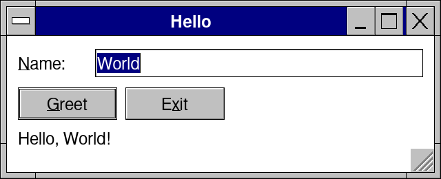

What each line draws (the picture was taken after Enter, which pressed Greet):

| Line | What it draws |
| --- | --- |
| `app "Hello", 320, 130:` | The window titled Hello, 320 × 130 design pixels; the indented block is what is inside it |
| `row([50, -1]):` | The next two controls side by side: the first in a 50-pixel column, the second in all the width left (238 here; see Widths in a row) |
| `label "&Name:"` | The text Name:, its N underlined: Alt+N moves to the field after it |
| `edit name` | The field showing World; what is typed goes straight into `name` |
| `row:` | Greet and Exit side by side, each its own width |
| `button("&Greet", isDefault = true)` | Greet, with the thick border of the default button: Enter presses it |
| `button("E&xit")` | Exit: Alt+X presses it, and `quitApp()` closes the window |
| `label greeted` | Nothing until Greet is pressed; here it says Hello, World! |

Five rules carry the whole syntax:

1. **A window is a block.** `app "Title", w, h:` opens the window and runs its block once per frame until it closes.
2. **A control is a call.** `button("OK")` draws a button where the layout stands, this frame. Nothing is created, kept or freed.
3. **The result is the event.** A control returns true when it was clicked or changed, so the reaction sits right under it, in an `if`.
4. **Your variables are the state.** `edit name` changes `name` itself. There is no model to copy into a widget and back.
5. **Nesting is layout.** Statements stack downward; `row:` puts them side by side; `group`, `form`, `tabs` and `dialog` are blocks that hold others.

The code reads in the order the window shows it: top to bottom, left to right. Anyone who reads Nim can read a Retro app without learning a second language.

## Widths in a row

`row([50, -1])` cuts a row into columns, one number per control, in order. **50** gives the first control a column exactly 50 design pixels wide. **-1** gives the second all the width that is left: in Hello, 238 pixels.

The 238 is worked out like this. The row is 294 wide: the 320-pixel window, less the 3.1 frame's 5 pixels and an 8-pixel margin on each side. Take away the 50 and the 6-pixel gap between the two controls, and 238 is left for the -1.

| Width | What the control gets |
| --- | --- |
| A number above 0 (`50`) | Exactly that many design pixels |
| `0` | Its own width: what its text needs (a button is at least 72) |
| `-1` | One share of the width left after the fixed widths, the own widths and the gaps |
| `-2`, `-3`, ... | Two or three shares: in `[50, -1, -2]` the rest is split one third and two thirds |
| No list (`row:`) | Each control its own width, wrapping to a new line when the next does not fit; an `edit` takes the rest of its line |
| More controls than widths | The widths start again on a new line, so two widths make two columns |

Every number is in design pixels. The kit multiplies it by the screen's scale, so the same code keeps its proportions on a desktop, a tablet and a phone. In these 200 % pictures the 50 is 100 screen pixels; the red numbers are design pixels, measured from the cells the kit placed.

### A fixed column, then the rest

```nim
import retroui

var name = "Maryam"

app "Widths", 320, 80:
  row([50, -1]):        # 50: a fixed column; -1: all the width left
    label "&Name:"
    edit name
```

![row([50, -1]): the Name label in a 50-pixel column, the field 238 pixels wide](syntax/w-fixed.png)

The label's column is 50; the field takes the other 238.

### Its own width

```nim
import retroui

var path = "Documents/Budget.csv"

app "Widths", 360, 80:
  row([50, -1, 0]):     # 0: the control's own width
    label "&File:"
    edit path
    button "&Browse"
```

![row([50, -1, 0]): label 50, field 200, Browse button its own 72](syntax/w-own.png)

The button is as wide as it needs (72). The field gets what the label, the button and two gaps leave of the 334-pixel row: 334 − 50 − 72 − 12 = 200.

### Shares

```nim
import retroui

var first = "Maryam"
var last = "Al Balushi"

app "Widths", 358, 80:
  row([50, -1, -2]):    # -1 and -2: one share and two shares of the rest
    label "&Name:"
    edit first
    edit last
```

![row([50, -1, -2]): label 50, first field 90, second field 180](syntax/w-shares.png)

After the 50 and two gaps, 270 are left. The -1 takes one share of three (90) and the -2 takes two (180).

### Equal parts

```nim
import retroui

app "Widths", 356, 80:
  row([-1, -1, -1]):    # three equal shares
    button "< &Back"
    button "&Next >"
    button "&Finish"
```

![row([-1, -1, -1]): Back, Next and Finish buttons, 106 pixels each](syntax/w-equal.png)

Three equal shares of the 318 left after two gaps: 106 each.

### No widths

```nim
import retroui

app "Widths", 320, 130:
  row:                  # no widths: each its own width, wrapping when full
    button "&New"
    button "&Open..."
    button "&Save"
    button "&Print..."
    button "Cu&t"
    button "&Copy"
    button "&Paste"
```

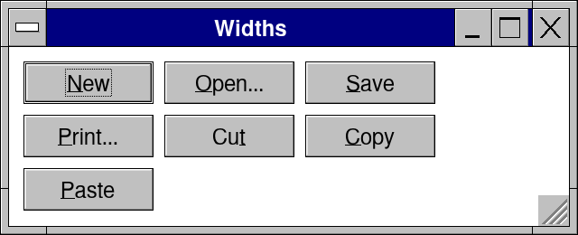

Each button is its own width. A fourth does not fit beside the third, so the row goes on below.

### More controls than widths

```nim
import retroui

var name = "Maryam"
var phone = "+968 9123 4567"

app "Widths", 320, 110:
  row([50, -1]):        # four controls, two widths: two lines
    label "&Name:"
    edit name
    label "&Phone:"
    edit phone
```

![row([50, -1]) with four controls: Name and Phone on two lines, in the same two columns](syntax/w-wrap.png)

Four controls and two widths: the widths start again on a second line, so Name and Phone share one column. This is the quick way to line up a small form.

### Pushing to the right end

```nim
import retroui

app "Widths", 360, 80:
  row:
    button "&Help"
    spring()            # what follows goes to the right end
    button("OK", isDefault = true)
    button "Cancel"
```

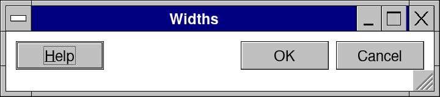

`spring()` sends the controls after it to the row's right end: the place for OK and Cancel.

## A frame, step by step


When something asks for another frame (`ui.redraw`, or a click or key the frame used), the next one runs at once and nothing goes to the screen in between, up to three in a row. Otherwise the changed bands are shown and `beginFrame` waits, so an app at rest takes no CPU.

## Every form the syntax has

The whole vocabulary fits in four shapes of call (an action, a binding, an event object, a block) plus a few helpers. Each is ordinary Nim: a proc, a `var` parameter, a template or one macro. Below, each form is a whole program with the window it draws.

### Window

```nim
import retroui

app "Notepad", 360, 100:      # title, width, height
  label "The block draws what is in the window, every frame."
```

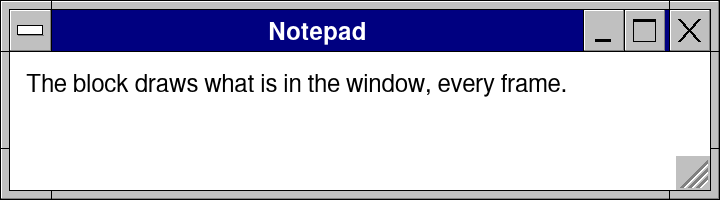

`app` takes the title, the width and the height in design pixels, then the block. The block is one frame; it runs again on every input until the window closes. Built on one macro, `app`. In the 3.1 frame the user sizes the window by its border or by the grip in its bottom right corner, which a finger takes as well as the mouse. On a tablet in Termux, `retrokit run --window app.nim` shows the app the same way: a window of its own size in its frame, in the middle of a desktop, scaled to the screen; `retrokit run --live app.nim` also builds it again each time you save, so a change to the code shows in the window a few seconds later (on Windows, macOS and Linux desktops, `retrokit run --watch app.nim`).

### Options by name

```nim
import retroui

app "Ledger", 360, 100, theme = Dark, frame = wfClassic, look = "ledger":
  label "A dark theme and the 3.1 frame, chosen by name."
```

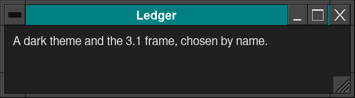

After the size come options by name: `theme`, `frame`, `look` (where the user's colors and sizes are kept), `scale`, `font`, `icon`, and `resizable = false` for a window that keeps the size the app gave it (no sizing border, no maximize button, no grip). A misspelled name does not compile. They are the named parameters of `openApp`. The 3.1 frame follows the theme: its title bar and border take the theme's colors, and change when the user picks another one.

### Action, and the & in a label

```nim
import retroui

var saved = 0

app "Action", 320, 110:
  row:
    if button("&Save"): inc saved     # Alt+S or a click
    if button("E&xit"): quitApp()     # Alt+X
  label "Saved " & $saved & " times"
```

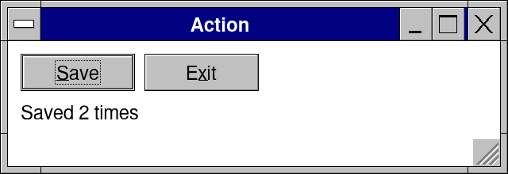

`button` returns true on the frame it is clicked or its Alt key is pressed, so the reaction sits in the `if` under it. Here Alt+S was pressed twice. The `&` underlines the letter after it and makes Alt and that letter press the control. Built on a proc returning `bool`; the result can be dropped (`button "OK"` alone is a statement).

### Binding

```nim
import retroui

var name = "Maryam"
var bold = true

app "Binding", 320, 110:
  edit name                       # shows `name`; typing changes it
  checkbox("&Bold", bold)         # shows `bold`; a click flips it
  label "name = " & name & ", bold = " & $bold
```

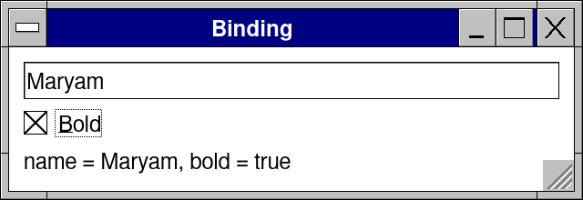

Here " Al Balushi" was typed into the field. `edit` wrote it into `name`, and the label, drawn from the same variables, shows it in the same frame. Built on a `var` parameter.

### Event object, and data on demand

```nim
import retroui

var cols = @[Column(title: "Name", width: 110), Column(title: "City", width: 100)]
var people = @[@["Salim", "Nizwa"], @["Maryam", "Sohar"], @["Aisha", "Sur"], @["Ahmed", "Muscat"]]
var sel = 0

proc cellOf(row, col: int): string = people[row][col]   # asked only for rows on screen

app "Event object", 300, 160:
  let ev = grid(cols, people.len, cellOf, sel, height = 5)
  if ev.sorted:                   # the header was clicked
    sortRows(people, ev.sortColumn, ev.sortDescending)
```

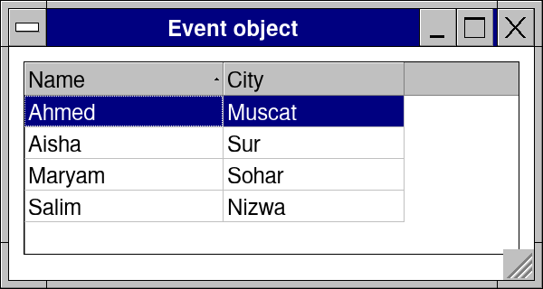

Several things can happen to a grid in one frame (a new selection, a double click, a header click, an edited cell), so `grid` returns a `GridEvent` and you read the field you need. It never holds your rows: it calls `cellOf(row, col)` for the cells on screen only. Here Name's header was clicked, and `sortRows` sorted the rows.

### Containers

```nim
import retroui

var page = 0
var street = "Al Hamra Street"
var city = "Sohar"

app "Containers", 400, 256:
  row([-1, -1]):
    card "Sales":
      label "12,400 OMR"
    card "Orders":
      label "86 this month"
  tabs(page, ["&General", "&Advanced"]):   # bound to `page`
    if page == 0:
      group "Address":
        row([50, -1]):
          label "&Street:"
          edit street
          label "&City:"
          edit city
    else:
      label "The Advanced page."
  panel(60):
    label "A panel: a framed page that scrolls when it is taller."
```

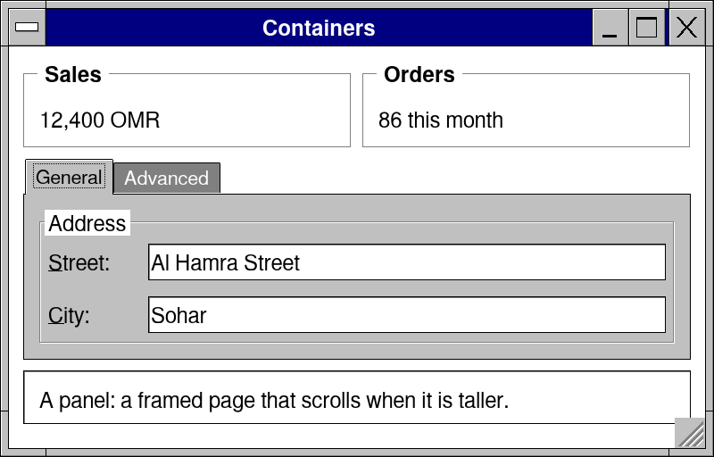

`card`, `tabs`, `group` and `panel` are blocks: what is indented under them is drawn inside. `tabs` is bound to `page`, and its block draws the page `page` says. `panel(60)` is a framed page 60 pixels high. Each is a template: a begin call, your block, an end call.

### Form

```nim
import retroui

var name = "Maryam Al Balushi"
var phone = "+968 9123 4567"
var active = true

app "Form", 360, 130:
  form(70):                       # captions in a 70-pixel column
    field("&Name:"): edit name
    field("&Phone:"): edit phone
    field(""): checkbox("&Active", active)
```

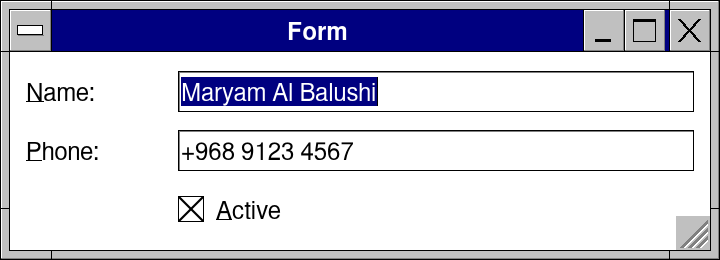

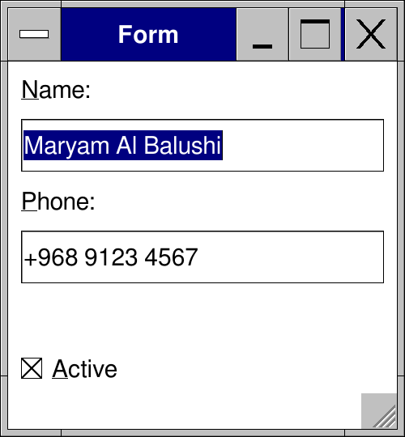

`form(70)` makes a 70-pixel column for the captions; each `field` puts its caption there and its control beside it. When there is too little room beside the captions (a phone), the same code puts each caption above its control: the second picture is this program on a touch screen 250 pixels wide.

### Menus

```nim
import retroui

var chosen = ""

app "Menus", 320, 150:
  menubar:
    menu "&File":
      if menuItem("&Open...", "Ctrl+O"): chosen = "Open"
      if menuItem("&Save", "Ctrl+S"): chosen = "Save"
      menuSeparator()
      if menuItem("E&xit"): quitApp()
    menu "&Help":
      if menuItem("&About Menus..."): chosen = "About"
  label chosen
```

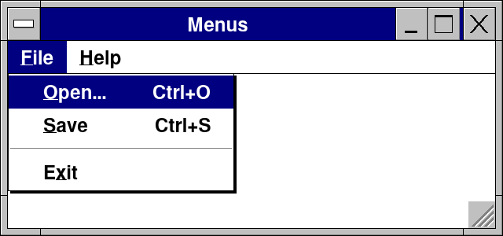

The menus are drawn by the same frame as the rest; here Alt+F opened File. `menuItem` returns true when chosen, like a button. The "Ctrl+O" beside it is only shown (see Shortcut).

### Dialog

```nim
import retroui

var showOptions = false
var autosave = true
var keepCopies = false

app "Dialog", 380, 200:
  if button("&Options..."): showOptions = true
  dialog(showOptions, "Options", 240):    # shown while showOptions is true
    checkbox("&Save by itself", autosave)
    checkbox("&Keep old copies", keepCopies)
    row:
      spring()
      if button("OK", isDefault = true): showOptions = false
      if button("Cancel"): showOptions = false
```

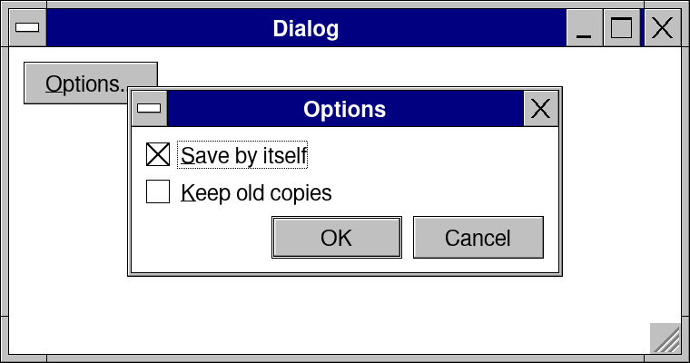

The dialog, 240 pixels wide, is drawn over the window while `showOptions` is true. OK, Cancel, Esc and its close box set it false. Built on a template with a `var bool`.

`window(toolsOpen, "Tools", 240, 360):` is the same form for a window of the system's own beside the app's -- a tool palette, a second view -- with its own size: its close button sets the `bool` false, and it closes when the frame no longer draws it. Where the system has one window (a phone, the browser) it is this dialog.

### Message box

```nim
import retroui

var askExit = false
var answer = ""

app "Notepad", 400, 170:
  if button("E&xit"): askExit = true
  label answer
  case msgBox(askExit, "Notepad", "Save the changes?", ["&Yes", "&No", "Cancel"], miQuestion)
  of 1: answer = "Yes"            # the number of the button chosen
  of 2: answer = "No"
  of 3: answer = "Cancel"
  else: discard                   # 0: still open, or never opened
```

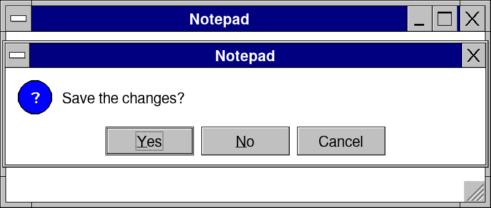

`msgBox` shows while `askExit` is true. It returns 0 until a button is chosen, then that button's number (from 1) once, and closes. Esc counts as the last button.

### Ids in a loop

```nim
import retroui

var people = @["Maryam", "Ahmed", "Salim"]
var chosen = ""

app "People", 300, 170:
  for i, p in people:
    withId(i):                    # row i's controls get ids of their own
      row([-1, 0]):
        label p
        if button("&Delete"): chosen = p
  label "Clicked: " & chosen
```

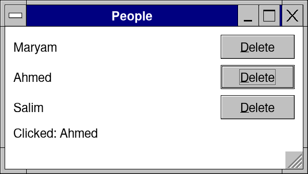

The three Delete buttons have the same label. `withId(i)` gives each row's controls ids of their own, so a click lands on the right one: here the second. Built on a template (`pushId`, your block, `popId`).

### Shortcut

```nim
import retroui

var said = ""

app "Shortcut", 320, 100:
  menubar:
    menu "&File":
      if menuItem("&Save", "Ctrl+S"): said = "Saved from the menu"   # "Ctrl+S" is only shown
  if hotkeyPressed("Ctrl+S"): said = "Saved with Ctrl+S"             # this reads the key
  label said
```

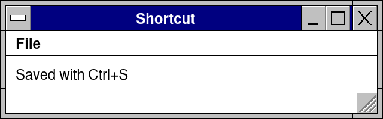

`hotkeyPressed("Ctrl+S")` is true on the frame the keys are pressed, read like a click. Here Ctrl+S was pressed with the menu closed.

### Time

```nim
import std/times
import retroui

app "Clock", 220, 70:
  label now().format("HH:mm:ss"), bold = true
  wakeIn(1000)                    # one more frame in a second
```

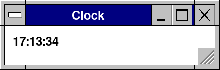

A frame runs only on input, so a clock asks for the next one: `wakeIn(1000)` runs the block again in a second. Without it the time would stop at the last key or click.

### A web page, and its scripts

```nim
import retroui

var said = "nothing yet"

app "Web page", 340, 200:
  row:
    if button("&Greet"): webPost("order", "Hello")   # a retro event in the page
    label "The page said: " & said
  let page = webView("html:<h3>Order 1042</h3><p>Ready to <b>ship</b>.</p>" &
                     "<script>retro.post('loaded')</script>",
                     key = "order", engine = weSystem)   # the room left
  for m in page.messages: said = m              # retro.post(text) in the page
```

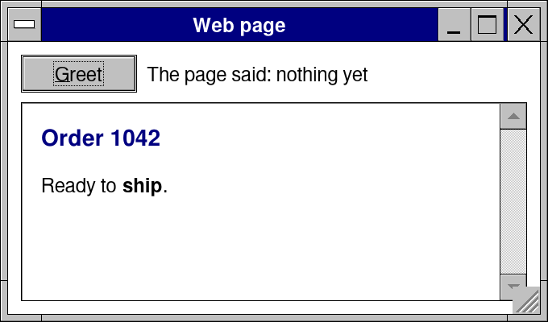

A web page is one more event object: `webView` returns a `WebEvent` (its address, title, loading, Back and Forward), and what the page's scripts posted since the last frame is in its `messages`. Going the other way is an action: `webPost` sends a `retro` event to the page, `webRun` runs a script and its answer comes in a later frame's `results` with the number it returned. No callback, no bridge object: you read the page where you draw it. `engine = weSystem` asks for the system's browser (WebView2, WKWebView, WebKitGTK; an Android app has it unless you ask for `weKit`); the picture is the kit's own engine, which draws the page but runs no scripts, so the label still says "nothing yet". With the system's, it says "loaded".

### Asking the system

```nim
import retroui
import retroui/system

var asked = false

app "Where", 320, 110:
  row:
    if button("&Where am I?"): asked = true      # from a click: the user may be asked
    if button("&Share"):
      if not share(text = "Order 1042"):         # false: no share sheet here
        putClipboardText("Order 1042")           # so the app offers what it can
  if asked:
    let p = location()                           # asked every frame: the answer comes later
    case p.state
    of psOk: label "At " & $p.lat & ", " & $p.lon
    of psWaiting: label "Looking..."
    of psDenied: label "The place was not allowed."
    of psNone: label "No place on this device."  # "not here" is an answer
```

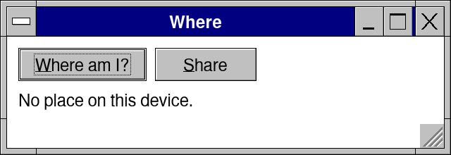

The system's features (`retroui/system`: notifications, sharing, the place, speech...) keep the forms above, with two habits. **An answer that comes later is asked for again**: `location()` is called every frame while it is needed, and says `psWaiting` until the system knows (the user is asked to allow it the first time, so it is asked from a click); the kit draws a frame when the answer comes, as it does for a web page's messages. **"Not here" is an answer**: where a system has no such feature the call says so (false, `psNone`) instead of raising, and the app offers what it can -- here the picture is a desktop with no place to give, and `share` with no share sheet copies the text. The same lines run on every system and in a web page; [docs/system.md](system.md) says what each system answers.

### Sizes, and your own loop

Every size in the code is design pixels: `row([80, -1])`, `dp(16)` for your own drawing, a dialog's width (see Widths in a row). An app that runs its own loop calls `openApp`, `while beginFrame(): ...`, `endFrame()` and `closeApp()` itself; How it is built shows the five calls, and they draw the same window as `app`.

A new control almost never adds a shape: it is an action, a binding or an event object, so learning one control teaches the others. The reference documents 382 controls in [docs/controls.md](controls.md), each with its pictures; they all follow these forms.

## How it is built

Each part of the syntax is backed by a small, plain mechanism. Nothing is hidden in a framework: a reader can follow any line down to the proc it calls.

### The app macro is a loop

`app` is the one macro. It checks its arguments and writes this:

```nim
openApp("Hello", 320, 130)    # the window, with the options by name
while beginFrame():           # waits for input or a timer
  captionBar()                # the 3.1 frame's title bar, when the app draws its own
  # ... your block ...
  endFrame()                  # draws what changed and sends it to the screen
  appFrameDone()              # keeps the look the user chose
closeApp()
```

Without a title, a width, a height and a block, the compile error shows the right form (`app "Hello", 320, 120: ...`). An app that wants its own loop writes these five calls itself, and gets the same Hello window as the first picture.

### Containers are templates

`row(widths): body` is `beginRow(widths)`, then the body, then `endRow()`. A template costs nothing at run time and keeps Nim's own scoping: a `let` inside a row is seen only there, and `if`, `for` and `case` work inside any block. `dialog` wraps its body in `try ... finally`, so its busy box closes even when the code raises.

### Ids come from what you already wrote

A control needs an identity from frame to frame: which one is pressed, which has the focus. The kit makes it without asking:

- **A labelled control:** a hash (FNV-1a) of its label, mixed with the current id scope. The same label twice in a frame gets a second id from a per-frame counter, so two "OK" buttons differ.
- **A bound control:** the address of its variable. `edit name` is always the field for `name`.
- **A loop:** `withId(i)` pushes a scope, so row 3's "Delete" is not row 4's.

The id and layout stacks are reset at every frame, so a slip costs one frame, never the next ones.

### One proc decides what the mouse and keys did

Every clickable control calls `interact(id, rect)`. It sets `hot` (under the mouse), `active` (pressed) and `focus` (the keyboard), adds the control to the Tab order in the order it was called, and reports a click only when the press and the release fall on the same control. Space, Enter on the default button and the Alt mnemonics are handled the same way for every control, so all controls behave alike.

The keys are the same from one control to the next, as Windows has them:

| Keys | What they do |
|---|---|
| Space, Enter | press the focused button (a menu button drops its menu; a split button does its default) |
| F4, Alt+Down, Enter | open a closed drop-down: a drop-down list, a combo box, a date's calendar, a grid's or a property list's drop-down cell, a menu or split button's menu, a number box's slider (`dropKey`) |
| F4, Alt+Up, Alt+Down | close an open one (a list on the item lit); Esc closes it without picking |
| Letters | in a drop-down list, open or closed: the item that starts with them |
| F2 | edit the current cell of a grid, a property, a name in a list |
| Ctrl+Backspace, Ctrl+Delete | the word before or after the caret (Option on a Mac; Cmd the line) |

### Memory for what you do not keep yourself

A caret, a scroll position or an open list is kept by the kit in `state(id)`: made on first use, dropped once the control has not been drawn for a while. Your data stays in your variables; only the control's own state lives in the kit. Notepad, for example, moves its text area's caret through `state(editorId)`.

### Layout in one pass, with the last frame's sizes

Controls are placed by a cursor as they are called: in a column it moves down, in a row it moves right. A row needs the natural widths of what it holds before it draws them; it takes them from the frame before and asks for one more frame when they changed. In `row([...])` a width above 0 is fixed design pixels, 0 is the control's own width and -n a share of what is left. All sizes are design pixels, scaled by the kit (text 12 px at 100 %, 15 px on phones).

### Drawing and the platform

The kit draws every pixel itself, with its own fonts, icons and themes, on the CPU or the GPU. It redraws only the 32-pixel bands that changed: a full 800 × 600 frame takes about 0.4 ms, and an unchanged frame is not sent to the screen at all. Below it, `uirelays` (Araq's platform layer, with my changes for phones, pens and the GPU) talks to X11, Win32, Cocoa, Android and UIKit. A frame runs only on input or after `wakeIn`, so an app at rest takes no CPU.

## Why it is the easiest to follow

The same small task in the four common styles shows the difference: a Save button, grayed while nothing has changed.

| Style | Where the state lives | How a click reaches your code | The Save button | What to learn first |
| --- | --- | --- | --- | --- |
| Widgets and callbacks (GTK, Qt, WinForms, NiGui) | In widget objects, copied to and from your data | A callback set once, run later from somewhere else | `saveBtn = newButton("Save")`, `saveBtn.onClick = save`, and `saveBtn.enabled = dirty` again wherever `dirty` changes | The object tree, signals, who owns what |
| Reactive views (SwiftUI, Compose, React, Owlkettle) | In observed state wrappers | The view is a function re-run when watched state changes | `Button("Save") { save() }.disabled(!dirty)` with `@State var dirty` | What triggers a re-run, state wrappers, keys, effects |
| Immediate mode in C++ (Dear ImGui) | Your variables | The call's return value | `BeginDisabled(!dirty); if (Button("Save")) save(); EndDisabled();` | Begin/End pairs, `##` id suffixes |
| Retro Nim UI | Your variables | The call's return value | `if button("&Save", enabled = dirty): save()` | The five rules |

The Retro line, in a whole program:

```nim
import retroui

var text = ""
var dirty = false

app "Editor", 300, 110:
  if edit(text): dirty = true
  row:
    if button("&Save", enabled = dirty): dirty = false
```

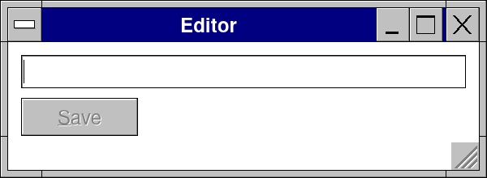

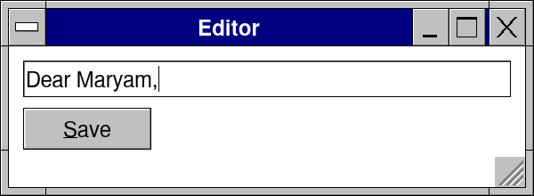

First as it opens, then after typing: `enabled = dirty` is all that keeps Save in step with the text. No handler sets it, and none can forget to.

The reasons, in the order they matter while reading someone else's app:

- **One place per thing.** What a control is, where it stands and what it does sit on neighboring lines. To learn what Save does, read the line under it.
- **Nothing to keep in sync.** Each frame the window is a picture of your variables, so a widget can never show a stale value.
- **Plain Nim does the rest.** Showing something only sometimes is an `if`; a list is a `for`; reuse is a `proc` that draws controls. There is no special syntax for any of them.
- **Blocks instead of Begin/End pairs.** Nim templates close every container by indentation, so a forgotten `End()` cannot happen. Ids come from labels and variables, so `##` suffixes are rarely needed.
- **Names over positions.** Options and parameters go by name, and a misspelled one is a compile error rather than a silent default.
- **A small surface that does not grow.** Four shapes of call cover 382 controls, from Hello (16 lines) to Notepad (206 lines, with menus, dialogs and Print to PDF), Retro Communicator (1,640 lines) and Retro Photo (nearly 30,000 lines across its files).
- **One code base, every screen.** The same lines run on Windows, macOS, Linux (X11, Wayland, a screen with no desktop), Android, iOS and in the browser; design pixels keep the sizes right on each.
- **Testable without a screen.** A frame depends only on the input and your variables, so the fake driver can click, type and read pixels in a test.

## Where it asks for care

The syntax is easy because it trusts plain Nim, and the same trust is where most mistakes come from. Seven rules prevent nearly all of them:

1. **Keep state outside the frame block.** A `var` inside `app:` is made again every frame, so it forgets.
2. **Give loop rows their own ids.** `for i, p in people: withId(i): ...`; without it, rows drawn by the same code share one control's state.
3. **Never block the frame.** Files, the network and big pictures go to a thread (`retroui/background`, `retroui/parallel`, `httpRequest`); otherwise the window freezes.
4. **Read shortcuts yourself.** The "Ctrl+S" in `menuItem("&Save", "Ctrl+S")` is only shown; the key is `if hotkeyPressed("Ctrl+S"): save()`.
5. **Give rows their widths.** In a plain `row`, a `col` or a panel takes all the room left: write `row([40, -1, 0])`.
6. **Sort the grid's data yourself.** `grid` reports the header click (`ev.sorted`); it never reorders your rows.
7. **Widths are design pixels already.** Write `row([80, -1])`, not `row([dp(80), -1])`, which scales twice.

Its honest limits:

- **The block runs every frame.** Frames are cheap and come only on input, but work done inside the block (formatting a long list, parsing) is paid each time. Keep results in variables and redo them when the data changes.
- **Leaving a block early skips its end.** A `break`, `continue` or `return` out of a `row` or `group` misses its `endRow` or `endGroup`. The stacks reset next frame, but that frame's layout is wrong; use an `if` inside the block instead.
- **A control's own state is reached by id.** A caret or a scroll position lives in `state(id)` (with `ui.lastId`), a step less direct than a widget object's field.
- **Drawings say nothing until you name them.** Every control tells screen readers (AT-SPI, UI Automation, VoiceOver, TalkBack) what it is as it is drawn -- the tree is made again each frame while one listens -- but what you draw yourself with `canvas` and `fill` is only pixels until `accessNode(arImage, "Sales by month", id = 0, r = r)` says what it is.
- **Motion is drawn by hand.** Animation is frames you ask for (`wakeInShown`), not transitions you declare.

### Rule 1, shown: state inside the block forgets

```nim
import retroui

var kept = false                  # outside the block: kept

app "State", 300, 90:
  var lost = false                # inside: made again every frame
  checkbox("&Kept (declared outside)", kept)
  checkbox("&Lost (declared inside)", lost)
```

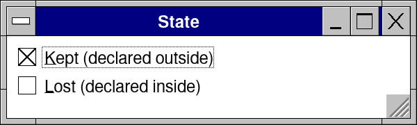

Both boxes were clicked (Alt+K, then Alt+L). Kept stays ticked. The click set Lost to true too, but the next frame declared it again as false.

### Rule 5, shown: a col in a row needs widths

```nim
import retroui

app "Rows", 360, 160:
  row:                            # no widths: the col takes all the room
    label "1."
    col:
      label "Maryam Al Balushi"
      label "+968 9123 4567"
    button "&Call"
  row([24, -1, 0]):               # widths: the button keeps its place
    label "2."
    col:
      label "Ahmed Al Harthy"
      label "+968 9988 7766"
    button "C&all"
```

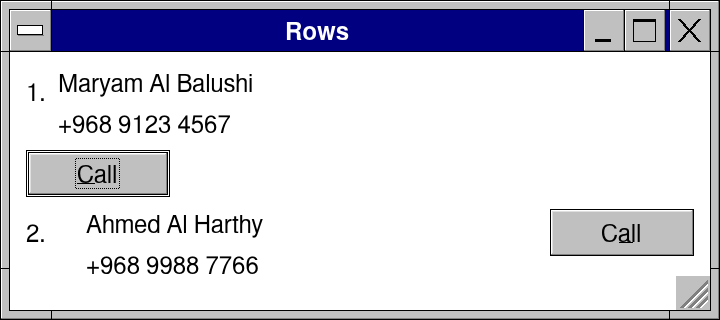

In the first row the `col` takes the whole width, so Call wraps under it. In the second, `[24, -1, 0]` gives the number 24, the `col` the rest and Call its own width, on one line.

### Rule 7, shown: dp() on a width scales it twice

```nim
import retroui

var a = "Sohar"
var b = "Sohar"

app "Scale", 380, 100:
  row([80, -1]):                  # right: 80 design pixels
    label "&City:"
    edit a
  row([dp(80), -1]):              # wrong: scaled twice
    label "C&ity:"
    edit b
```

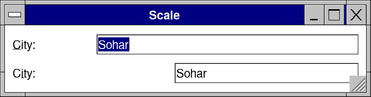

At 200 % `dp(80)` is already 160, and the row scales it again: the second caption column is twice as wide as the first. At 100 % both look the same, which is why the slip goes unseen on a desktop.

## Writing an app that stays easy to read

Five habits keep a Retro app as readable at 2,000 lines as at 20:

1. **All state in one object.** One `State` with the data, the selection and one `bool` per dialog; the whole app's memory is in one place.
2. **One proc per part of the window.** `mainMenu()`, `peopleList()`, `editDialog()`: the `app` block then reads like a table of contents.
3. **Work in procs, not in the frame.** Saving, loading and sorting are plain procs the frame calls on a click.
4. **Dialogs last.** They are drawn over the window while their variable is true, so they go at the end of the block.
5. **Labels with `&`, the default button marked.** Alt keys and Enter then work everywhere without extra code.

The skeleton below follows all five. It compiles against the current Retro Nim UI and runs: New opens the form, OK adds the person, Delete asks first, Ctrl+S saves a CSV.

```nim
import std/os
import retroui

type
  Person = object
    name, phone: string
    active: bool

  State = object                     # everything the app remembers, in one place
    people: seq[Person]
    sel: int
    draft: Person
    showEdit, askDelete, showAbout: bool
    status: string

var s = State(sel: -1)

proc save() =                        # work lives in procs, outside the frame
  var t = DataTable(headers: @["Name", "Phone", "Active"])
  for p in s.people: t.rows.add @[p.name, p.phone, $p.active]
  s.status = if writeCsv(dataDir("people") / "people.csv", t): "Saved " & $s.people.len & " people"
             else: "Could not save"

proc mainMenu() =                    # one proc per part of the window
  menubar:
    menu "&File":
      if menuItem("&Save", "Ctrl+S"): save()
      if menuItem("E&xit"): quitApp()
    menu "&Help":
      if menuItem("&About People..."): s.showAbout = true

proc peopleList() =
  for i, p in s.people:
    withId(i):                       # each row's controls kept apart
      row([-1, 120, 0]):
        if link(p.name): s.sel = i
        label p.phone
        if button("&Delete"):
          s.sel = i
          s.askDelete = true

proc editDialog() =
  dialog(s.showEdit, "Person", 360):
    form(70):
      field("&Name:"): edit s.draft.name
      field("&Phone:"): edit s.draft.phone
      field(""): checkbox("&Active", s.draft.active)
    row:
      spring()
      if button("OK", isDefault = true):
        s.people.add s.draft
        s.showEdit = false
      if button("Cancel"): s.showEdit = false

proc chosen(): string =
  if s.sel in 0 ..< s.people.len: s.people[s.sel].name else: ""

app "People", 520, 380:
  mainMenu()
  if hotkeyPressed("Ctrl+S"): save()
  row:
    if button("&New..."):
      s.draft = Person(active: true)
      s.showEdit = true
  peopleList()
  statusbar(s.status)
  # the dialogs, last: drawn over the window while their variable is true
  editDialog()
  case msgBox(s.askDelete, "People", "Delete " & chosen() & "?", ["&Yes", "&No"], miQuestion)
  of 1: s.people.delete(s.sel)
  else: discard
  aboutBox(s.showAbout, "People", "1.0", ["A list of people, kept as CSV."])
```

Build it with `nim c -r -d:release -d:useMalloc people.nim`.

What it draws, step by step. After three people were added with New... and Ctrl+S was pressed:

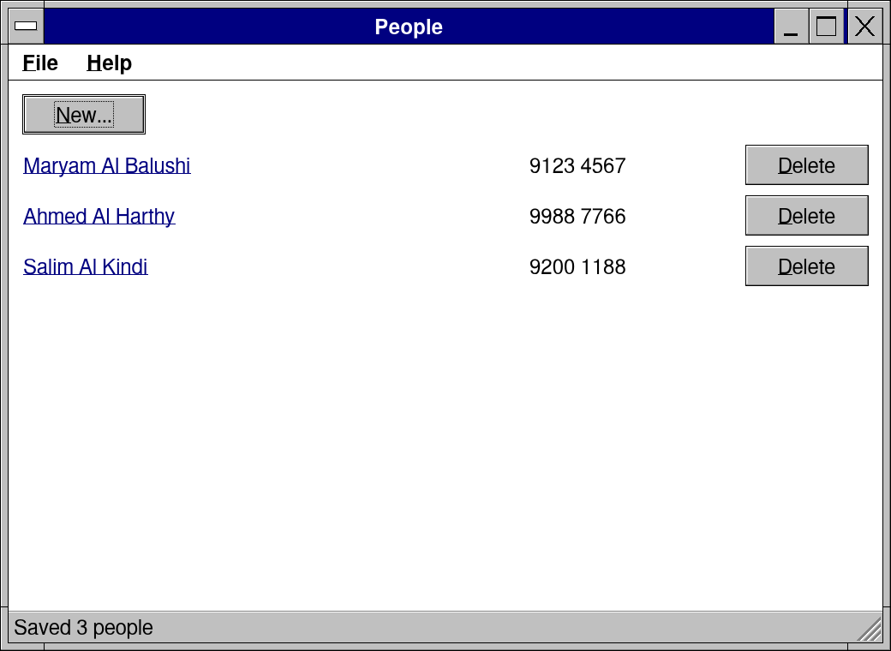

New... opens the Person dialog over the window; its form puts the captions in a 70-pixel column:

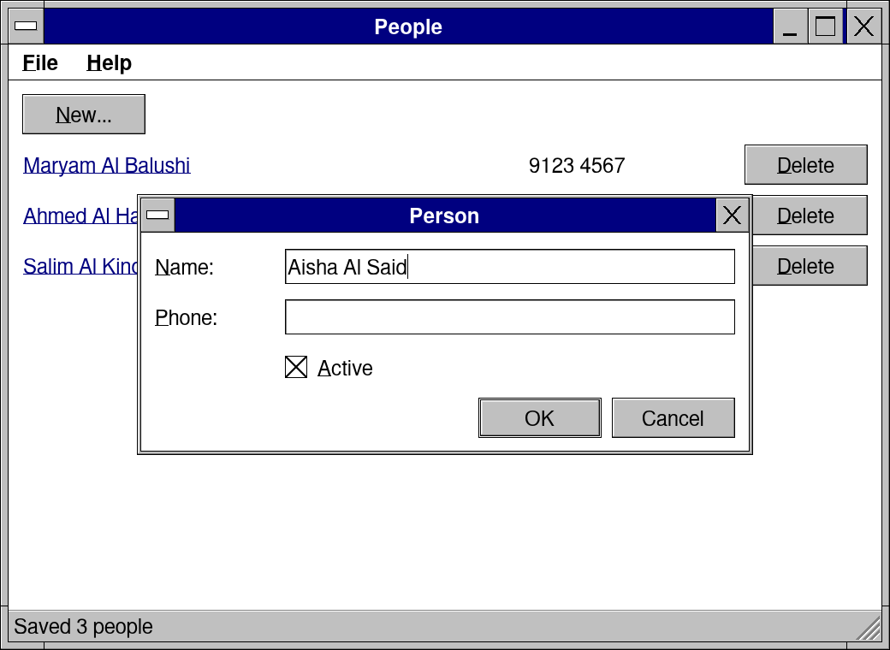

Delete on Ahmed's row asks first. The question comes from the `case msgBox(...)` at the end of the block:

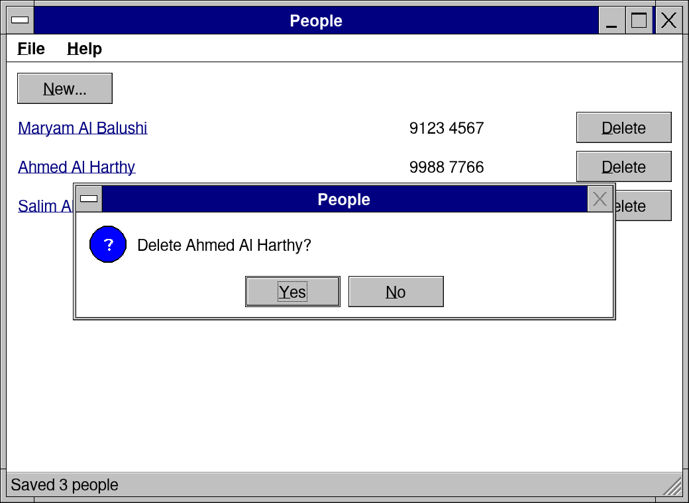

Help, About People... opens the About box drawn by `aboutBox`:

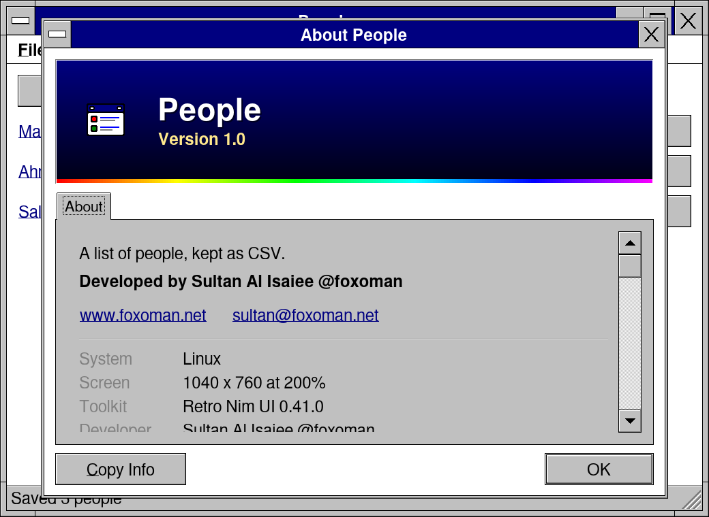

## The pictures

Each picture comes from a program in [tools/syntaxshots/ex](../tools/syntaxshots/ex), the same code this page shows plus two kinds of lines the page leaves out: `#>` lines, the keys and clicks that bring the window to the moment shown, and `mark` lines, which measure a control's cell for the red widths. `sh tools/syntaxshots/make.sh` runs them all on a fake screen at 200 %, draws the widths, puts the pictures in [docs/syntax](syntax) and checks that every program's code is on this page as it is in `ex/`. Change a program, run it, and the page and its picture stay the same code.
