# The examples

Every program in this folder is made with Retro Nim UI, from a five-line
form to full apps. Each one builds with one command from the repository's
folder (Nim 2 and a C compiler: the main README's
[Install](../README.md#install)):

```sh
nim c -r -d:release examples/NAME.nim
```

Most have a `nimble` task too (`nimble photo`, `nimble board`...), and the
apps build for Android with `retroapk examples/NAME.nim` (or `nimble
appapk` with `RETRO_APP=NAME`). Read them in this order to learn the kit:
hello, notepad, ledger, charts, invoice, then the apps.

| Example | What it is |
|---|---|
| [hello](#hello) | the first app: a name, a button |
| [gallery](#control-gallery) | every control, page by page |
| [notepad](#notepad) | the Notepad of Windows 3.1 |
| [ledger](#ledger) | a small business app: grids, forms, charts, CSV |
| [charts](#chart-viewer) | a CSV file as a chart |
| [invoice](#invoice) | an HTML template made into PDF pages |
| [native](#native) | the system's own APIs, called from Nim |
| [filemanager](#retro-files) | Retro Files, a file manager |
| [photo](#retro-photo) | Retro Photo, an image editor |
| [magazine](#the-magazine) | three magazine pages made with Retro Photo's engine |
| [retroboard](#retro-board) | Retro Board, a whiteboard |
| [mail](#retro-mail) | Retro Mail, for Microsoft 365, Outlook.com and Gmail |
| [communicator](#retro-communicator) | Retro Communicator, chat on XMPP |
| [taskman](#retro-task-manager) | Retro Task Manager, what the computer is doing |
| [hrbook](#hr-book) | HR Book, a private book of a hotel group's staff |
| [sevenguis](#7guis) | the seven tasks of the 7GUIs benchmark, a tab each |
| [navigator](#retro-navigator) | Retro Navigator, a web browser in the manner of 1995's |
| [retrodns](#retro-dns) | Retro DNS, a DNS changer for phones and computers |
| [podcast](#retro-podcast) | Retro Podcast, a podcast player for every system and the web |
| [grow](#grow) | Grow, a savings goal planner for phones, its years as 3D bars |

The pictures of hello, the gallery (and its Forms & Code page), charts,
native, HR Book, the magazine, 7GUIs, Retro Navigator, Retro DNS, Retro
Podcast and Grow are made by `sh tools/exampleshots.sh`;
the others are the main README's.

## Hello

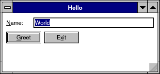

`hello.nim` is the whole idea of the kit in sixteen lines: the window is
code that runs every frame, each widget is a call bound to your own
variable (`edit name`), and a button is an `if`. No callbacks, no widget
objects.

```sh
nim c -r examples/hello.nim
```

## Control Gallery

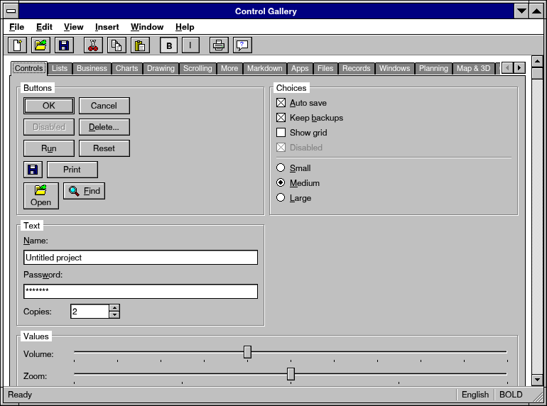

`gallery.nim` has every control of the kit, page by page: buttons and
check boxes, text boxes and the rich text editor, lists, trees and the
data grid, menus and tool bars, dialogs, charts, the calendar and the
Gantt chart, maps, the 3D view, the canvas, windows inside the window.
Open it to see what a control looks like and how it behaves -- with the
mouse, the keyboard alone, a screen reader -- before you use it; the guide, [docs/controls.md](../docs/controls.md), has each
one's code. View, This Page's Code (Ctrl+U) shows how the page in front
is made, from the gallery's own source, in a read-only `codeEdit` with
Copy.

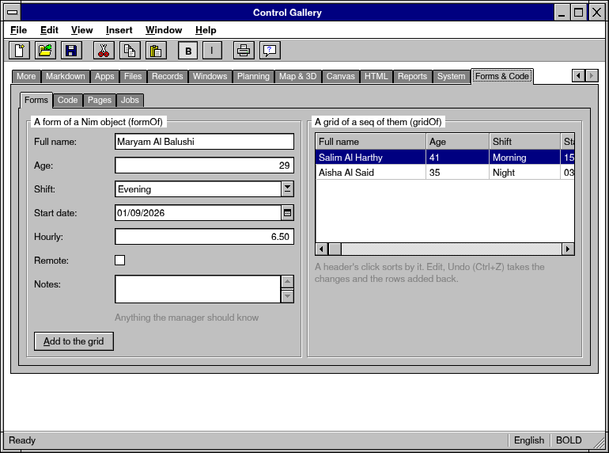

Its Forms & Code page shows the kit's newer parts: a form and a grid made
from a Nim type (`formOf`, `gridOf`), the Edit menu's Undo taking back the
form's changes (`UndoStack`), the code editor, pages over pages and a list
beside its details (`pageView`, `listDetail`), a sum counted on a worker
thread (`job`), a bar that glides (`animated`) and the gallery's icon in
the system's tray (`trayIcon`).

```sh
nimble gallery              # or: nim c -r examples/gallery.nim
nimble galleryapk           # an Android APK
```

## Notepad


`notepad.nim` is the Notepad of Windows 3.1: open and save files, cut,
copy and paste, the time and date (F5), find (Ctrl+F, F3), print to a
PDF (Ctrl+P), a status bar, and "Save changes?" when you close it. A
small, complete app to start from.

```sh
nimble notepad              # or: nim c -r examples/notepad.nim
```

## Ledger


`ledger.nim` is a small business app -- invoices, customers, stock and
reports -- to show the business controls working together: a tree, a
splitter, a sortable grid you edit in place, a form dialog with a date
picker, number fields and auto-complete, charts, CSV import and export,
saved settings. On a phone's narrow screen the tree becomes tabs.

```sh
nimble ledger               # or: nim c -r examples/ledger.nim
retroapk examples/ledger.nim --install       # Android
```

## Chart Viewer

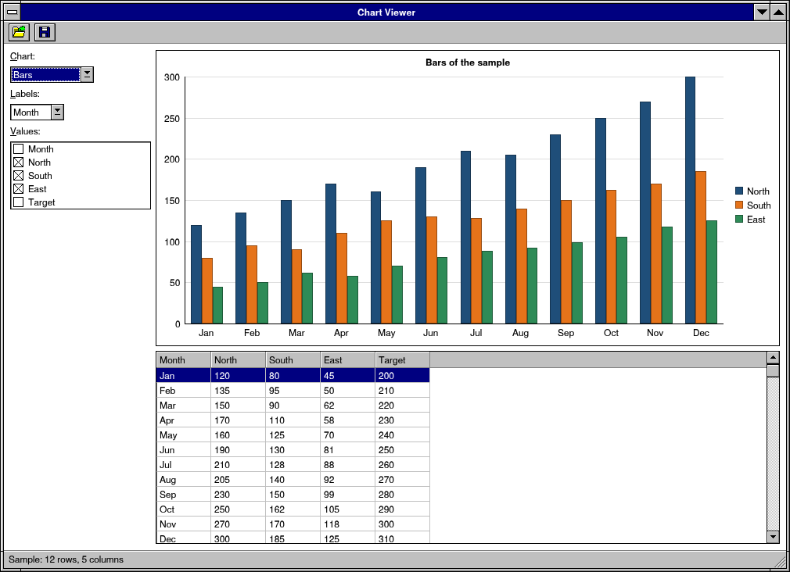

`charts.nim` opens a CSV file (or its sample table) and draws it: pick
the kind of chart and the columns, hover it for the numbers, save it as
a PNG. All the work is the kit's `retroui/charts`; the file only lays
it out.

```sh
nimble charts               # or: nim c -r -d:release examples/charts.nim [sales.csv]
```

## Invoice


`invoice.nim` makes a business document from an HTML template and some
data: `renderTemplate` fills the template, `reportFromHtml` lays it out
on A4 pages, shown page by page, saved as a PDF and printed. Change the
customer, the lines or the VAT at the left and the pages follow.

```sh
nimble invoice              # or: nim c -r -d:release examples/invoice.nim
```

## Native

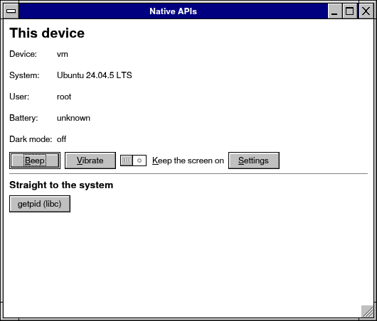

`native.nim` calls the system's own APIs from Nim (`retroui/native`):
what the device is, the battery, dark mode, a beep, a buzz -- and on
each system a call made straight to it: Java on Android, Objective-C on
macOS and iOS, Win32 and COM on Windows, any C library on Linux.

```sh
nim c -r examples/native.nim
```

## Retro Files


`filemanager.nim` is Retro Files, a full file manager in the style of
the Windows 3.1 File Manager with what Explorer has today: tabs, two
panes, an address bar, a folder tree, details, tiles, icons and a list
with picture thumbnails, a preview pane, drag and drop, copy and move in the
background with "Replace or keep both?", Paste Shortcut, the trash, undo,
zip, search, favorites, the disks and how full they are, and viewers for
text, pictures, PDF, Markdown and more. It runs on phones and tablets too.

```sh
nimble files                # or: nim c -r -d:release examples/filemanager.nim
nimble apk                  # an Android APK
```

## Retro Photo


`photo.nim` is Retro Photo, an image editor with the look of 1994 and
the tools of today's: layers and groups with blend modes, masks and
styles, Smart Objects, selections, channels and paths, sixty-two tools,
filters and adjustments with previews, Neural Filters, Arabic type,
panoramas, raw photos, CMYK, Lab, duotones and Multichannel images, PDF
for print, and many undos. Its engine is in
`retroui/photo`.

```sh
nimble photo                # or: nim c -r -d:release examples/photo.nim [picture...]
nimble photoapk             # an Android APK
```

## The magazine

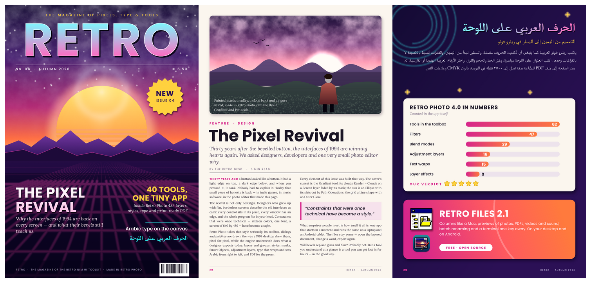

`magazine.nim` has no window: it makes three A4 magazine pages with
Retro Photo's engine, tool by tool, as the app's tools would -- gradients,
clouds and a lens flare, shape and type layers (Arabic set right to
left), layer styles, masks, a Smart Object, adjustment layers, a Neural
Filter -- and saves them as Retro Photo documents (each layer still
editable in the app), PNG pictures and a PDF.

```sh
nimble magazine             # build/magazine: .rpd, .png, .pdf
```

## Retro Board


`retroboard.nim` is Retro Board, an endless whiteboard in the manner of
tldraw: ink with pen pressure, the highlighter and the laser pointer,
nineteen shapes with labels, arrows that hold on to shapes, text, sticky
notes, frames and pictures; select, move, turn, snap, group, align;
pages, pinch to zoom, autosave, a dark mode; PNG, SVG and PDF export;
**presenting** the frames as slides (View > Present the Frames, F5), and
pictures dropped from other programs. Zoomed out on thousands of shapes it
draws those too small to read in brief, and keeps moving.

```sh
nimble board                # or: nim c -r -d:release examples/retroboard.nim
nimble boardapk             # an Android APK
```

## Retro Mail


`mail.nim` is Retro Mail, Outlook Express 4 to look at, with what the
new Outlook does: Microsoft 365, Outlook.com and Gmail signed in in the
browser (no password typed here), threads, Focused and Other, tags, pin,
snooze, offline search of everything kept, rich text writing,
signatures, send later, and the calendar, people, to do and notes beside
the mail. The app registrations it signs in with are made once by
whoever builds it (`examples/mail/appids.nim`, `docs/retromail.md`).

```sh
nimble mail                 # or: nim c -r -d:release examples/mail.nim
nimble mailapk              # an Android APK
```

## Retro Communicator


`communicator.nim` is Retro Communicator, an instant messenger in the
look of 1999 on XMPP (Jabber): the friends list with groups, who is
online and away, a window for each talk, chat rooms, away messages,
profiles with a picture, files and voice messages, OMEMO encryption, and
the history on your device and from your server's archive. An account on
any public server, made from inside the app where the server allows it;
no server of mine, no phone number. Its talks draw only the lines in
view (`visibleRows`), so a long one stays quick to type in.

```sh
nimble communicator         # or: nim c -r -d:release examples/communicator.nim
```

## Retro Task Manager

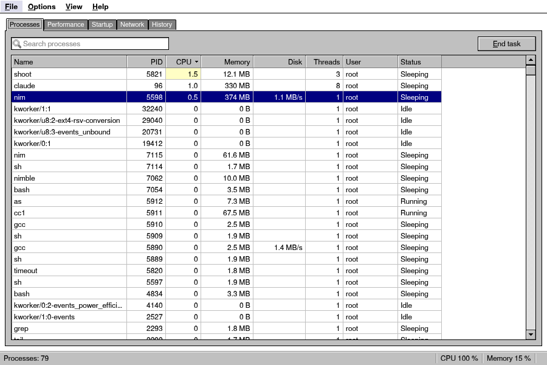

`taskman.nim` is Retro Task Manager, what the computer is doing: every
program with its share of the processor, the memory and the disk (end
one, or it with all it started; give it another priority), graphs of the
processor, the memory, the disks and the network, the programs that
start with the system, the connections, and the last week. It reads the
system on a thread of its own and less often while nobody looks.

```sh
nimble taskman              # or: nim c -r -d:release examples/taskman.nim
nimble taskmanapk           # an Android APK
```

## HR Book

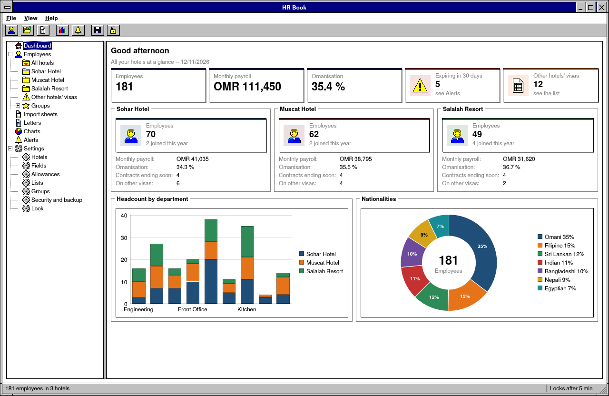

`hrbook.nim` is HR Book, every employee of a group of hotels in one
private book on a tablet: records, salaries and allowances, documents and
the dates they expire, groups, Excel sheets of any layout imported
smartly, letters and certificates from templates in English and Arabic,
charts and alerts, and encrypted backups. The data never leaves the
device: the app has no internet permission, and its file is sealed with
the PIN. The picture is its demo book of invented people
(`nim c -r tests/hrbook_demo.nim`, PIN 246810, with HOME pointed at a
folder of its own).

```sh
nimble hrbook               # or: nim c -r -d:release examples/hrbook.nim
```

## 7GUIs

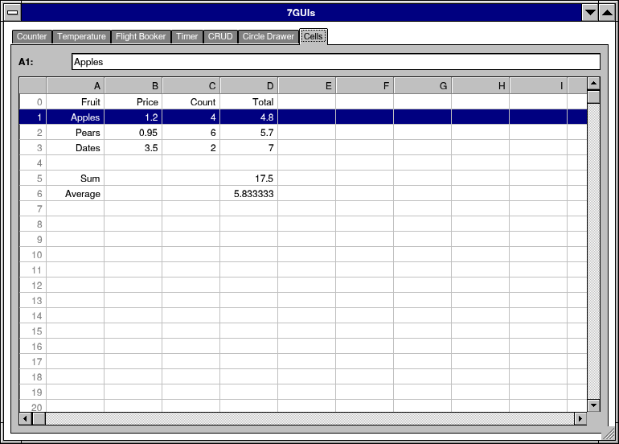

`sevenguis.nim` is [7GUIs](https://eugenkiss.github.io/7guis/), the
benchmark that measures a GUI toolkit by seven small tasks, each made as
the tasks ask, in a tab of its own:

1. **Counter** -- a box and a button that counts.
2. **Temperature Converter** -- Celsius and Fahrenheit, each kept in step
   with the other as it is typed; what is not a number changes nothing.
3. **Flight Booker** -- a one-way or a return flight, two dates typed
   (DD.MM.YYYY), red while they are no date, and Book only when the
   dates allow it.
4. **Timer** -- a gauge of the time gone, a slider for how long, Reset;
   the time goes on in any tab.
5. **CRUD** -- names in a list, filtered by the surname's start; create,
   update, delete.
6. **Circle Drawer** -- a click makes a circle, a right click on one
   adjusts its diameter in a dialog; undo and redo.
7. **Cells** -- a spreadsheet of A..Z by 0..99 with formulas (`=B1*C1`,
   `=SUM(D1:D3)`, `AVG`, `MIN`, `MAX`, `COUNT`, `PROD`); a change reaches
   every cell that reads it, a cycle says `#CYCLE`. F2 edits a cell's
   formula, not its value.

As an app it has its own icon and a menu: the seven tasks (Ctrl+1 to
Ctrl+7), Appearance (its color scheme and sizes, kept) and About. It is
built with the released apps, for Linux, Windows, Android and macOS.

`tests/test_sevenguis.nim` uses it as a person would, by its controls'
names; the picture above was taken the same way (the driver, `RETRO_DRIVE`).

```sh
nimble sevenguis            # or: nim c -r -d:release examples/sevenguis.nim
RETRO_APP=sevenguis nimble appapk   # build/Retro7GUIs.apk
```

## Retro Navigator

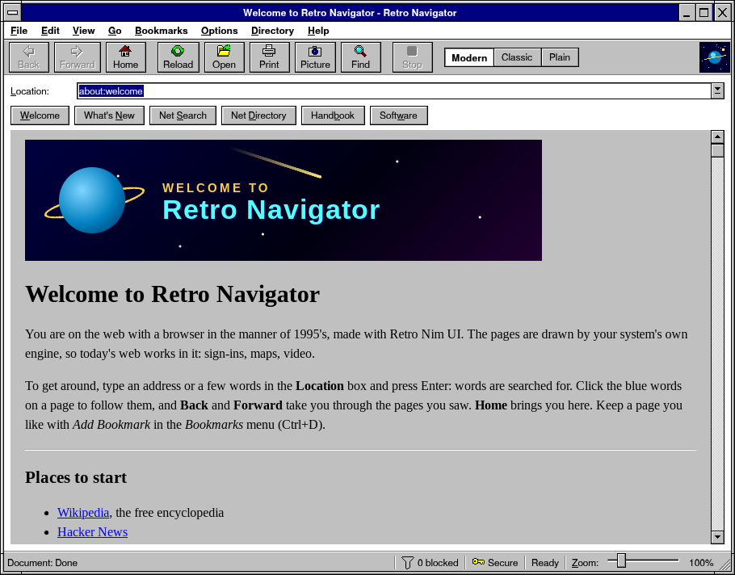

`navigator.nim` is a web browser in the manner of 1995's around the
system's own engine (`webView` with `weSystem`): WebView2 on Windows,
WebKit on macOS and iOS, WebKitGTK on Linux and BSD, Android's WebView.
So today's web works in it -- sign-ins, maps, video -- in a window of 1995:

- the tool bar with its labels (Back, Forward, Home, Reload, Open, Print,
  Picture, Find, Stop), the page's look as a switch (Modern, Classic,
  Plain) and, at its right, a logo of its own -- a planet in the night --
  with a comet going round it while a page loads (a click goes home);
- the **Location** box: an address goes there, a host gets `https://`, a
  file on the computer opens, and anything else is searched for with the
  search engine of General Preferences (DuckDuckGo, Google, Bing,
  Wikipedia); as it is typed in it suggests the pages visited (the last
  400 are kept) and the bookmarks;
- **page looks** (the switch, or View > Page Look): Modern, as the site
  made it; Classic, the site's layout and scripts in 1995's type on white
  paper, with 3.1 buttons and fields and no shadows, rounding or
  animation; Plain, the HTML alone -- none of the site's style sheets or
  scripts, its `<noscript>` shown, its pictures loaded -- the lightest and
  the quickest (`examples/navigator/look.nim`);
- the page's scroll bar is the window's own, drawn by the kit beside the
  page (`webScrollBars`): it follows the page and scrolls it; the boxes
  inside the page get Windows 3.1's, in the window's colors;
- the directory buttons: Welcome, What's New, Net Search, Net Directory,
  Handbook, Software;
- the status bar: what happens, the key (https) or a warning sign (http),
  how much is loaded, downloads, and the page's **zoom** (a slider, 50 to
  300 %; Ctrl and +, -, 0 too);
- **video full screen**: the page's video (or anything of it) fills the
  screen, the bars and the window's frame gone, Esc brings them back; Pop
  Out Video puts it in a window of its own where the engine has one; F11
  gives the page the whole screen with the menus kept;
- **screenshots** (Picture, Ctrl+Shift+S): the page's picture marked up
  with Retro Board's tools -- the pen, the highlighter, boxes, ovals,
  arrows and words, in its colors and sizes, undo and redo -- copied for
  any program, or saved as PNG or as a board (`examples/navigator/markup.nim`);
- **Bookmarks** (Add Bookmark, Ctrl+D; View Bookmarks to go to one or
  remove it), the **Go** menu with the pages of this session, find on the
  page (`window.find`), print, the document's source, larger and smaller
  pages, Back to its own pages too;
- its own pages, `about:welcome` and `about:handbook`, written in HTML and
  CSS (`examples/navigator/pages.nim`);
- **tabs**, shown above the page while there are two or more, in Windows
  3.1's document style: New Tab (Ctrl+T), Close Tab (Ctrl+W), Reopen
  Closed Tab (Ctrl+Shift+T), Ctrl+Tab; a link with Ctrl or the middle
  button opens in a tab behind, a link for a new window in a new tab; a
  tab's menu (Duplicate, Close Other Tabs), and tabs dragged into order;
  **private tabs** (New Private Tab, Ctrl+Shift+N) kept out of the
  history, the session and the closed tabs;
- **History** (Ctrl+H: find, go to, remove, clear), **Downloads** (Ctrl+J:
  open, show in the folder, clear the finished) and **Reader** (Ctrl+Alt+R:
  the page's article alone, in large type);
- **the shield** (`examples/navigator/shield.nim`): the engine never
  fetches what comes from more than 250 ad and tracker sites and the ad
  addresses of sites that serve their pages too (`webBlockList`), nor the
  sites of a list the user imports (a hosts file, or an ad blocker's
  `||site^` lines); and a script in every page before the page's own
  (`webStartScript`) blocks what is left -- the page's requests to them,
  their scripts, frames and pictures, the usual ad boxes, YouTube's ads in
  its player -- with the number kept off the page in the status bar and
  Allow Ads on This Site; sites asked not to track (Global
  Privacy Control); links to `http://` taken to `https://` (not on the
  local network; type `http://` to go anyway);
- **faster**: a link of the site loaded ahead while the pointer rests on
  it, videos kept from playing by themselves (a setting), a tab behind
  paused at once where the engine can, and tabs not looked at for five
  minutes put to sleep to free their memory (on at first);
- **Clear Browsing Data** (Ctrl+Shift+Delete): the pages visited, and the
  cookies, cache and site data (`webClearData`);
- **Preferences** as Netscape had them, a tabbed dialog opened at its
  tab from the Options menu: General (the home page, the search engine),
  Appearance (the colors, the frame, the title bars' buttons), Security
  (the shield, the sites ads are allowed on), Network (the speed); and the
  tool bar, the Location box and the directory buttons shown or hidden,
  kept for the next start.

Where the system has no engine, it shows its own pages and opens the
others in the browser. `tests/test_navigator.nim` checks its places
(`examples/navigator/places.nim`), its history and suggestions, its shield
and block lists, and its looks.

```sh
nimble navigator            # or: nim c -r -d:release examples/navigator.nim
```

## Retro DNS

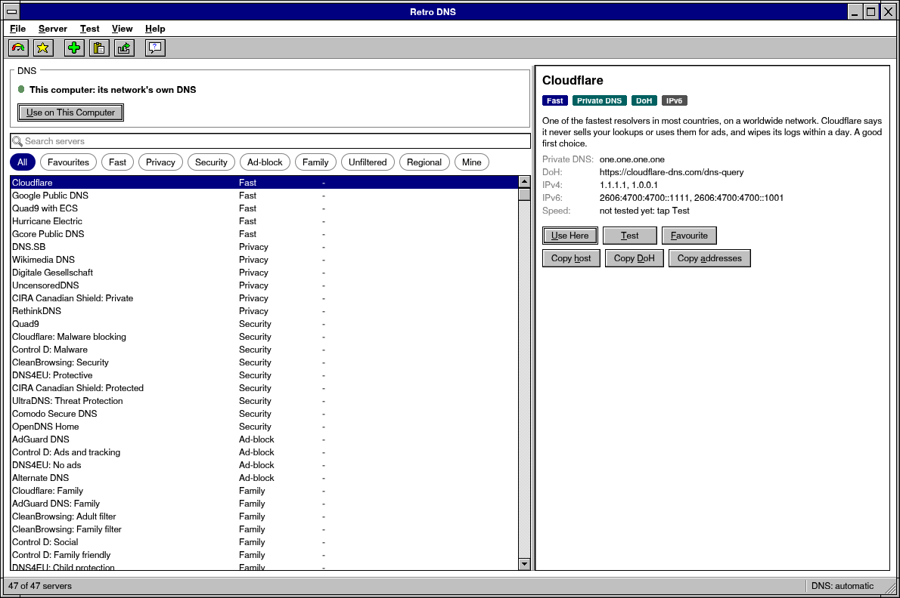

`retrodns.nim` changes the DNS server a phone, a tablet or a computer
uses: 47 public resolvers -- fast, private, secure, ad-blocking, family,
unfiltered, regional -- each with what it is good for, speed tests (the
time to reach it, on two worker threads), favourites, and servers of your
own (CSV, imported and exported). Each system the way it allows:

- **Android:** a VPN that stays on the device and carries DNS only,
  encrypted (DNS over HTTPS or TLS), with a notification while it is on.
  Android starts a VPN only from a Java class its manifest declares, so
  the app brings it: `retrodns/glue/` holds the VPN service (`java/`),
  stand-ins for the Android classes it compiles against (`stubs/`: no
  android.jar), the manifest lines (`manifest.txt`) and the compiled
  `classes.dex`; `retroapk --java:examples/retrodns/glue` puts them in the
  APK or bundle. Nim calls the Java by reflection (`retroui/native`).
- **Windows, Linux, macOS:** Use on This Computer gives the computer the
  server's addresses as its administrator, the system asking first
  (`retroui/admin`: UAC, polkit, the password dialog): every adapter's
  servers on Windows, with DNS over HTTPS where Windows 11 has it;
  NetworkManager's connections on Linux, with DNS over TLS where
  systemd-resolved does it (else systemd-resolved alone); every network
  service on a Mac. Back to Automatic gives back the network's own. The
  scripts are made of checked addresses only (`retrodns/desktop.nim`).
- **macOS, iOS:** a server with encrypted DNS comes as a profile that
  Settings installs (and removes): DNS over HTTPS or TLS for every app.
- **A web page:** the servers and what they are good for.

```sh
nimble dns                                  # or: nim c -r -d:release examples/retrodns.nim
sh examples/retrodns/build.sh apk           # Android, its VPN in it
sh examples/retrodns/build.sh key           # a Google Play upload key, once
sh examples/retrodns/build.sh aab           # the bundle for Google Play
sh examples/retrodns/build.sh dex           # its Java compiled again (javac, d8 or dx)
```

`tests/test_retrodns.nim` checks its servers, the CSV, the VPN's
settings, the scripts and the profile.

## Retro Podcast

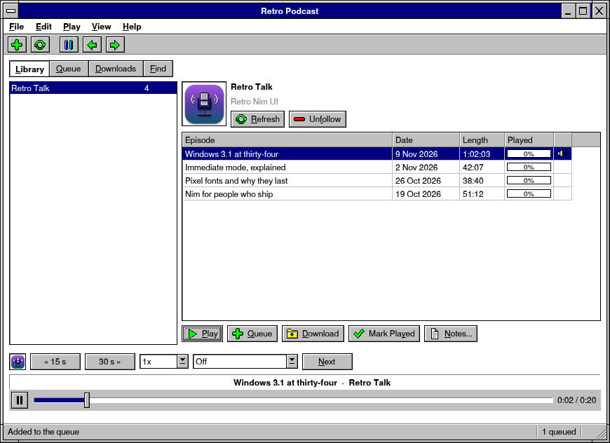

`podcast.nim` is a podcast player for Windows, macOS, Linux, Android, iOS
and web pages: shows found by name (Apple's podcast directory) or added by
their feed's address (RSS or Atom), lists brought from another app and
taken to one (OPML), episodes played at any speed from where they were
left, downloads for the road, a queue, a sleep timer, the system's media
controls (the lock screen, the notification, the media keys), and an icon
in the tray on a desktop (Settings). The sound plays on when another page
is shown, and with the app in the background: on Android with the
system's notification that it plays, on iOS with the app's background
audio. Unfollow, Mark Played and the queue's changes are undone from the
Edit menu.

It is the kit's newer parts put together: `retroui/feeds` reads the feeds
and OPML, `retroui/jobs` reads them, asks the directory and downloads on
worker threads, `audioView` plays (`speed`, `seekVideo`, `playVideo`),
`pageView` and `listDetail` lay it out -- the shows beside their episodes
on a desktop, one over the other on a phone -- `UndoStack` keeps its
history and `retroui/tray` its icon. Its library (`podcast/library.nim`)
is JSON in the app's data folder.

```sh
nimble podcast                              # or: nim c -r -d:release examples/podcast.nim
RETRO_APP=podcast nimble appapk             # build/RetroPodcast.apk
retrokit web examples/podcast.nim           # a web page (see below)
```

In a web page the browser asks each feed's site whether the page may read
it (CORS), and most podcast hosts do not say yes: Settings has a proxy put
before each feed's address. The sounds themselves play without it.
`tests/test_podcast.nim` follows a feed file, plays, queues, undoes and
saves the library without a window.

## Grow

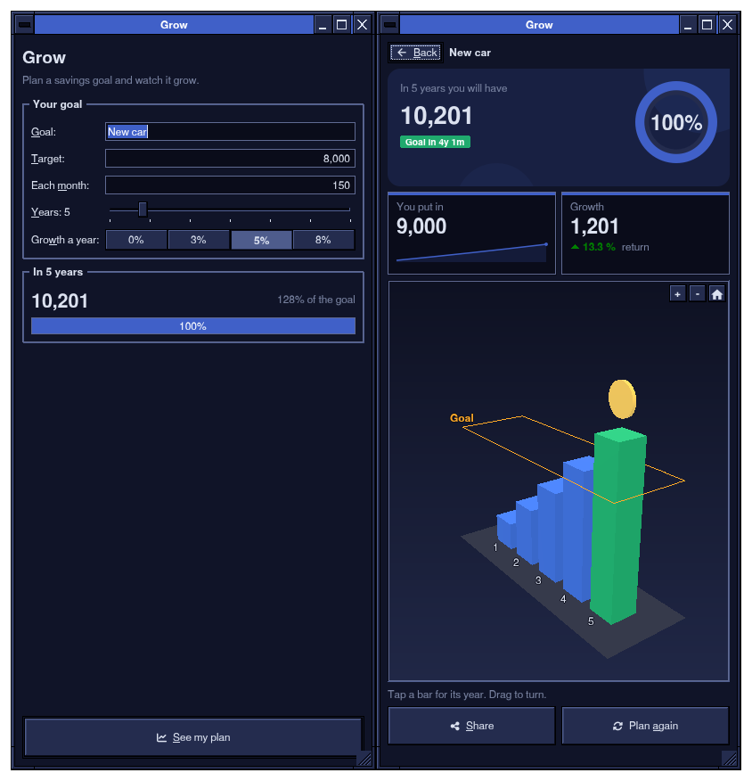

`grow.nim` is a phone app: a savings goal, how much each month, for how
many years, growing how much a year -- and then what it comes to. Two
pages (`pageView`, the phone's Back): the plan, its first look gliding as
the numbers change (`animated`) and its button at the foot, where the
thumb is (`spring()`); then the result, which counts up, fills a ring
(`progressRing`) and raises a 3D bar for each year one after another
(`easedSince`, each a little after the one before) under a camera that
sways round them, a gold coin turning over the last. The bars turn green
from the year the goal is reached; a tap on one says what it holds
(`picked`), a finger turns them; Share opens the phone's share sheet
(`share`), a goal reached is felt (`haptic`). The scene is made in code --
boxes, a cylinder, lines and labels, materials of a color (`material3`) --
and drawn on the GPU where frames are.

```sh
nimble grow                                 # or: nim c -r -d:release examples/grow.nim
RETRO_APP=grow nimble appapk                # build/Grow.apk (portrait)
```

`tests/test_grow.nim` checks the plan's numbers, the button at the
page's foot, and the result's timeline played to its end without a
window.
