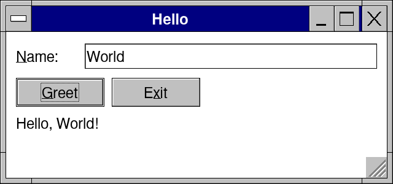
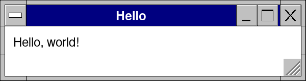
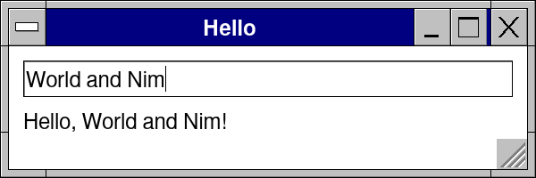

# Lesson 1: Hello, and the frame

**Level:** easy · **Time:** 15 minutes · **You make:** a window that greets you by name



Retro Nim UI is *immediate mode*: the block under `app` is your window, and it runs again every time something happens -- a key, a click, a timer. Each line draws a control and, in the same call, tells you what the user did with it. There are no widget objects to keep, no callbacks to wire: your own variables are the state.

## Step 1: a window

```nim
import retroui

app "Hello", 300, 80:
  label "Hello, world!"
```



`app "Hello", 300, 80:` opens a window 300 × 80 *design pixels* (the kit scales them to the screen: 125 %, 200 %, a phone). The indented block is what is in it. `label` draws a line of text.

Run it: `nim c -r hello.nim`.

## Step 2: a variable and a text box

```nim
import retroui

var name = "World"                 # the state: a variable of your own

app "Hello", 300, 100:
  edit name                        # typing changes `name` at once
  label "Hello, " & name & "!"     # drawn again each frame: always up to date
```



`edit name` draws a text box *bound* to `name`: what you type goes into the variable at once. The label under it is drawn again on the next frame with the new name -- that is the whole trick of immediate mode. The picture was taken after typing " and Nim".

## Step 3: a button, side by side

```nim
import retroui

var name = "World"
var greeted = ""
var times = 0

app "Hello", 320, 150:
  row([50, -1]):
    label "&Name:"
    edit name
  row:
    if button("&Greet", isDefault = true):   # true on the frame it is clicked
      greeted = "Hello, " & name & "!"
      inc times
    if button("E&xit"): quitApp()
  label greeted & (if times > 1: " (" & $times & " times)" else: "")
```


- `button` returns `true` on the frame it is clicked: an action is an `if`.
- `row([50, -1]):` puts its controls side by side: a 50-pixel column, then all the width left. A plain `row:` gives each its own width.
- `&` underlines the next letter: Alt+N goes to the name, Alt+G greets. `isDefault = true` makes Enter press Greet.
- `quitApp()` ends the program.

## What you learned

- The `app` block runs every frame; a control is a call; its result is the event.
- Your variables are the state: bind a control to one (`edit name`) and read it anywhere.
- `row`, widths in design pixels, `-1` for the rest.

## Try it

Add a check box `checkbox("&Shout", shout)` (with `var shout = false`) and greet in capitals when it is on (`toUpperAscii` from `std/strutils`).
