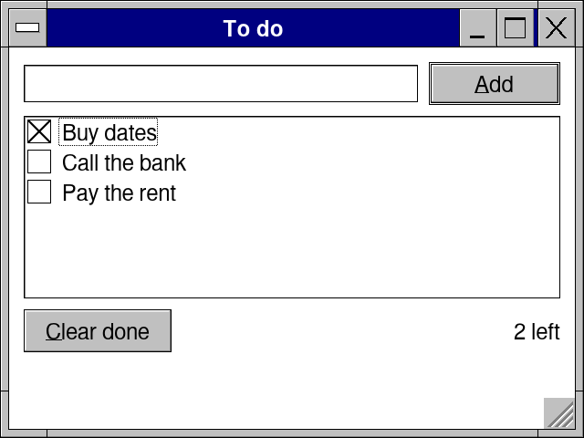
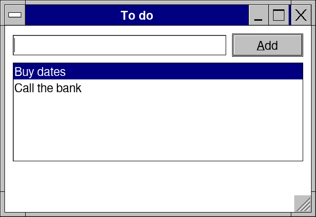
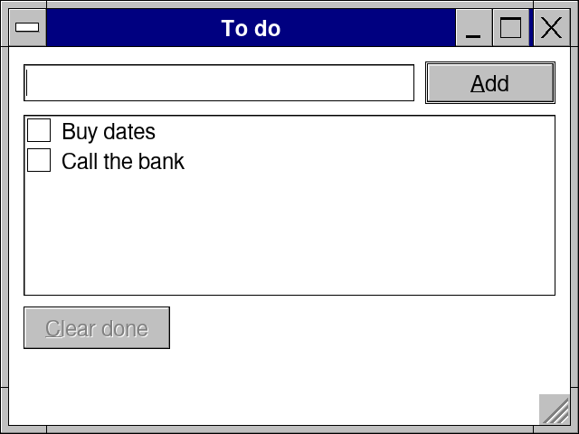

# Lesson 2: A to-do list that keeps itself

**Level:** easy · **Time:** 20 minutes · **You make:** a list of tasks to tick off, saved when it changes



## Step 1: a list and a box to add to it

```nim
import retroui

var tasks: seq[string]
var newTask = ""
var sel = 0

app "To do", 320, 220:
  row([-1, 0]):
    edit newTask
    if button("&Add", isDefault = true) and newTask.len > 0:
      tasks.add newTask
      newTask = ""
  listbox(tasks, sel, rows = 6)
```



`listbox(tasks, sel, rows = 6)` shows a `seq[string]` and keeps the one picked in `sel`. Adding is `tasks.add`: the next frame draws the longer list. `row([-1, 0])` gives the box all the width but the button's own (`0`: its own width). Enter presses Add (`isDefault`), so the picture was made by typing and pressing Enter twice.

## Step 2: tick them off

```nim
import retroui

var tasks: seq[string]
var done: seq[bool]                   # a check box for each task
var newTask = ""

app "To do", 320, 240:
  row([-1, 0]):
    edit newTask
    if button("&Add", isDefault = true) and newTask.len > 0:
      tasks.add newTask
      done.add false
      newTask = ""
  checkList(tasks, done, rows = 6)
  row:
    if button("&Clear done", enabled = true in done):
      for i in countdown(tasks.high, 0):
        if done[i]:
          tasks.delete(i)
          done.delete(i)
    spring()
    var left = 0
    for d in done:
      if not d: inc left
    label $left & " left"
```


`checkList` is a list with a check box on each item, bound to a `seq[bool]` of the same length: a click, a tap or Space flips one. Counting what is left is plain Nim in the frame -- it runs again whenever something changes, so the number is always right. `spring()` pushes what follows to the right end of the row.

## Step 3: saved, and read back at the start

```nim
import std/[os, strutils]
import retroui

let file = dataDir("TodoTutorial") / "tasks.txt"   # a folder only this app writes to

var tasks: seq[string] = @[]
var done: seq[string] = @[]
if fileExists(file):                               # read once, when the app starts
  for line in readFile(file).splitLines:
    if line.len > 2:
      done.add line[0 .. 0]
      tasks.add line[2 .. ^1]
if tasks.len == 0:
  tasks = @["Buy dates", "Call the bank"]
  done = @["0", "0"]
var checks: seq[bool]
for d in done: checks.add d == "1"
var newTask = ""

proc save() =
  var text = ""
  for i, t in tasks: text.add (if checks[i]: "1 " else: "0 ") & t & "\n"
  writeFile(file, text)

app "To do", 320, 240:
  row([-1, 0]):
    edit newTask
    if button("&Add", isDefault = true) and newTask.len > 0:
      tasks.add newTask
      checks.add false
      newTask = ""
      save()                                       # saved when it changes
  if checkList(tasks, checks, rows = 6): save()
  if button("&Clear done", enabled = true in checks):
    for i in countdown(tasks.high, 0):
      if checks[i]:
        tasks.delete(i)
        checks.delete(i)
    save()
```



- `dataDir("TodoTutorial")` is a folder only this app writes to, on every system (on a phone, the app's own folder). `/` comes from `std/os`.
- What is outside the `app` block runs once, when the program starts: here the file is read.
- `save()` runs when something changed -- after Add, a tick (`checkList` returns `true` on the frame it changed) and Clear done -- not every frame.

## What you learned

- `listbox` and `checkList`, bound to your own `seq`s.
- Code before `app` runs once; code in it, every frame.
- `dataDir` for the app's files; save when a control says it changed.

## Try it

Keep the list sorted: `tasks.sort()` (from `std/algorithm`) after Add -- and sort `checks` with it (hint: keep a `seq` of `(string, bool)` instead of two).
