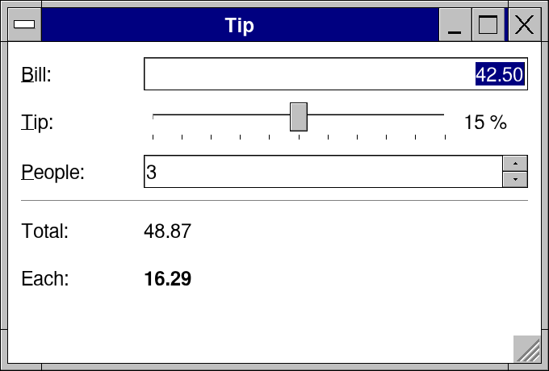
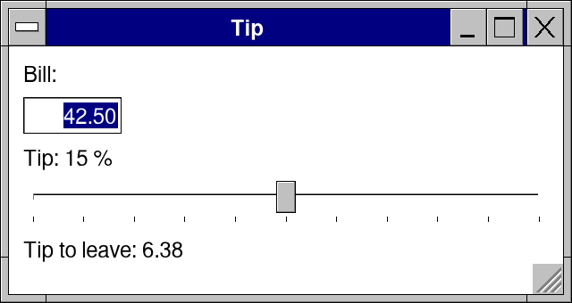
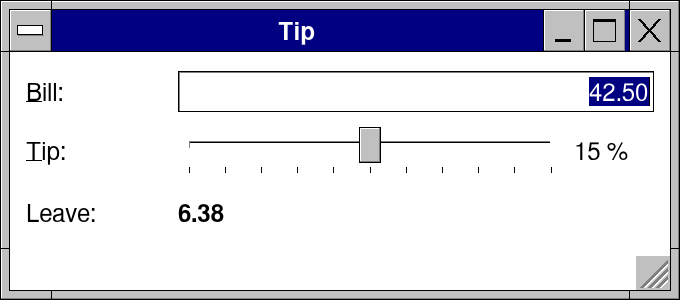

# Lesson 3: A tip calculator, and how rows share the width

**Level:** easy · **Time:** 20 minutes · **You make:** a calculator that splits a bill



## Step 1: numbers in, a number out

```nim
import std/strutils
import retroui

var bill = 42.50
var tip = 15                         # percent

app "Tip", 320, 170:
  label "Bill:"
  numberEdit bill, lo = 0
  label "Tip: " & $tip & " %"
  slider tip, 0, 30
  label "Tip to leave: " & formatFloat(bill * tip.float / 100, ffDecimal, 2)
```



`numberEdit` is a field for decimals ("1,234.50"; `lo` and `hi` keep it in range), `slider` an `int` between two ends. The answer is computed in the frame from the two variables: there is nothing to update when they change.

## Step 2: captions in a column

```nim
import std/strutils
import retroui

var bill = 42.50
var tip = 15

app "Tip", 340, 150:
  row([70, -1]):                     # a column of 70 for the captions, the rest for the controls
    label "&Bill:"
    numberEdit bill, lo = 0
  row([70, -1, 40]):
    label "&Tip:"
    slider tip, 0, 30
    label $tip & " %"
  row([70, -1]):
    label "Leave:"
    label formatFloat(bill * tip.float / 100, ffDecimal, 2), bold = true
```



`row([70, -1])` gives the first control 70 pixels and the second the rest; `row([70, -1, 40])` a third column of 40. Rows that start with the same width line up into a column. (A `col` inside a plain `row` would take all the room left: give the row its widths.)

## Step 3: a form

```nim
import std/strutils
import retroui

var bill = 42.50
var tip = 15
var people = 3

proc money(x: float): string = formatFloat(x, ffDecimal, 2)

app "Tip", 340, 230:
  form 70:                           # captions in a column (above the fields on a phone)
    field "&Bill:": numberEdit bill, lo = 0
    field "&Tip:":
      row([-1, 40]):
        slider tip, 0, 30
        label $tip & " %"
    field "&People:": spin people, 1, 20
  separator()
  let total = bill * (1 + tip.float / 100)
  row([70, -1]):
    label "Total:"
    label money(total)
  row([70, -1]):
    label "Each:"
    label money(total / people.float), bold = true
```


`form 70:` with `field "&Bill:": ...` is the same column of captions, written as what it is. On a phone the captions go above their fields by themselves. `spin` is a whole number with up and down arrows; `separator()` a line across. `proc money` is plain Nim: helpers are ordinary procs.

## What you learned

- `numberEdit`, `slider`, `spin`.
- Widths in a row: a number of pixels, `-1` for the rest, `0` for the control's own.
- `form` and `field` for captions that line up, and move above the fields on a phone.

## Try it

Round each share up to the next 100 baisa (`ceil` from `std/math`) and show how much that adds to the tip.
