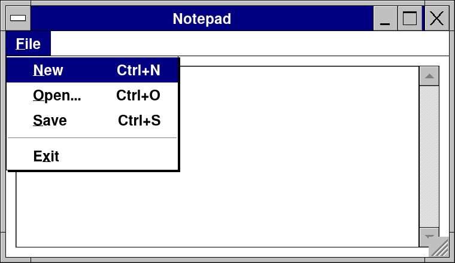
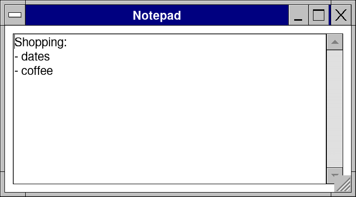
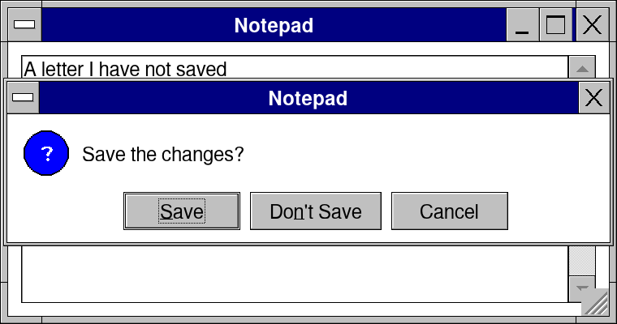
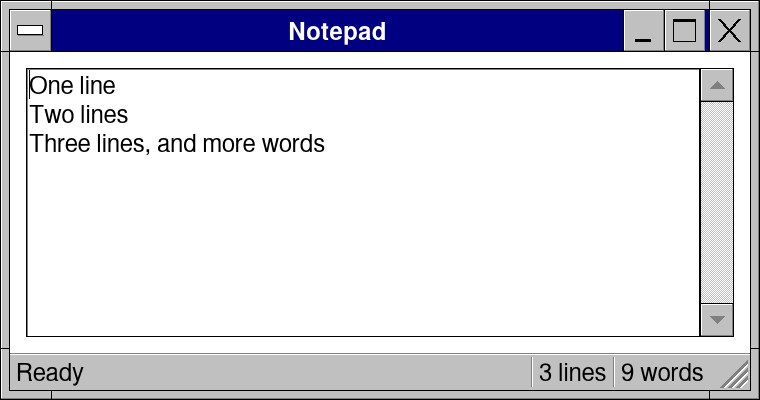

# Lesson 4: Notepad: menus, files and "Save changes?"

**Level:** easy · **Time:** 30 minutes · **You make:** a text editor with menus, open and save, and a question before closing



## Step 1: a text area

```nim
import retroui

var text = "Shopping:\n- dates\n- coffee\n"

app "Notepad", 360, 200:
  editArea text, lines = -1          # -1: all the room left
```



`editArea text, lines = -1` is a box of many lines bound to `text`, filling the room left. It brings selection, the clipboard, its own undo and a scroll bar.

## Step 2: a menu, open and save

```nim
import std/os
import retroui

var text = ""
var path = ""
var opening, saving = false

app "Notepad", 380, 220:
  menubar:
    menu "&File":
      if menuItem("&New", "Ctrl+N"): (text = ""; path = "")
      if menuItem("&Open...", "Ctrl+O"): opening = true
      if menuItem("&Save", "Ctrl+S"): saving = true
      menuSeparator()
      if menuItem("E&xit"): quitApp()
  if hotkeyPressed("Ctrl+O"): opening = true        # a menu's shortcut is only its label:
  if hotkeyPressed("Ctrl+S"): saving = true         # the keys are read here
  editArea text, lines = -1
  if filePicker(opening, path, patterns = ["*.txt"]):
    text = readFile(path)
  if filePicker(saving, path, mode = fmSave, patterns = ["*.txt"]):
    writeFile(path, text)
  setTitle(if path.len > 0: path.extractFilename & " - Notepad" else: "Notepad")
```


- `menubar:` / `menu "&File":` / `menuItem` -- true when chosen. The shortcut written beside an item (`"Ctrl+S"`) is only its label: `hotkeyPressed("Ctrl+S")` reads the keys.
- `filePicker(opening, path, ...)` is the Open dialog while `opening` is true, and returns `true` once, with `path` set, when a file is picked; `mode = fmSave` is Save As. On a phone it fills the screen; in a web page it is the browser's own chooser.
- `setTitle` names the window after the file.

## Step 3: "Save changes?"

```nim
import retroui

var text = "A letter I have not saved"
var saved = ""                       # the text as it was last saved
var asking = false

app "Notepad", 380, 200:
  if closeRequested() and text != saved:   # the close box, Alt+F4, the phone's Back
    cancelClose()
    asking = true
  editArea text, lines = -1
  case msgBox(asking, "Notepad", "Save the changes?", ["&Save", "Do&n't Save", "Cancel"], miQuestion)
  of 1:
    saved = text                     # (write the file here)
    quitApp()
  of 2: quitApp()
  else: discard
```



The close box, Alt+F4 and a phone's Back all set `closeRequested()`. `cancelClose()` keeps the window open, and `msgBox` asks: it returns the button's number (1, 2...) on the frame it is pressed, 0 until then. The picture was taken after a click on the close box.

## Step 4: a status bar

```nim
import std/strutils
import retroui

var text = "One line\nTwo lines\nThree lines, and more words"

app "Notepad", 380, 200:
  statusbar("Ready", $text.countLines & " lines", $text.splitWhitespace.len & " words")
  editArea text, lines = -1
```



`statusbar` takes its parts as texts and keeps its place at the bottom of the window, whatever is drawn after it.

## What you learned

- Menus and their shortcuts; `filePicker` to open and save.
- `closeRequested`, `cancelClose` and `msgBox` for a question before closing.
- `statusbar`.

## Try it

Put the four steps together into one Notepad, and add Edit > Select All (`hotkeyPressed("Ctrl+A")`). The kit's own [examples/notepad.nim](../../examples/notepad.nim) has find, print to PDF and more.
