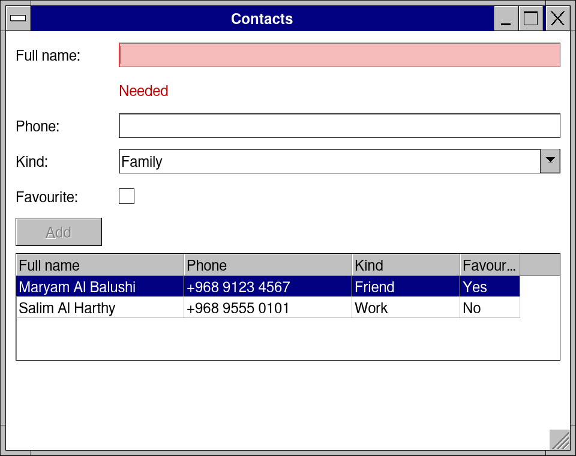
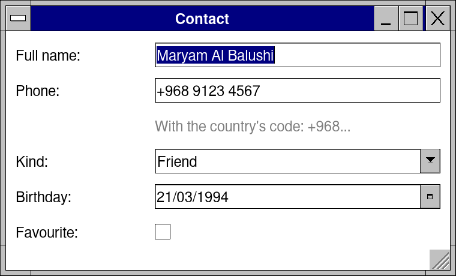
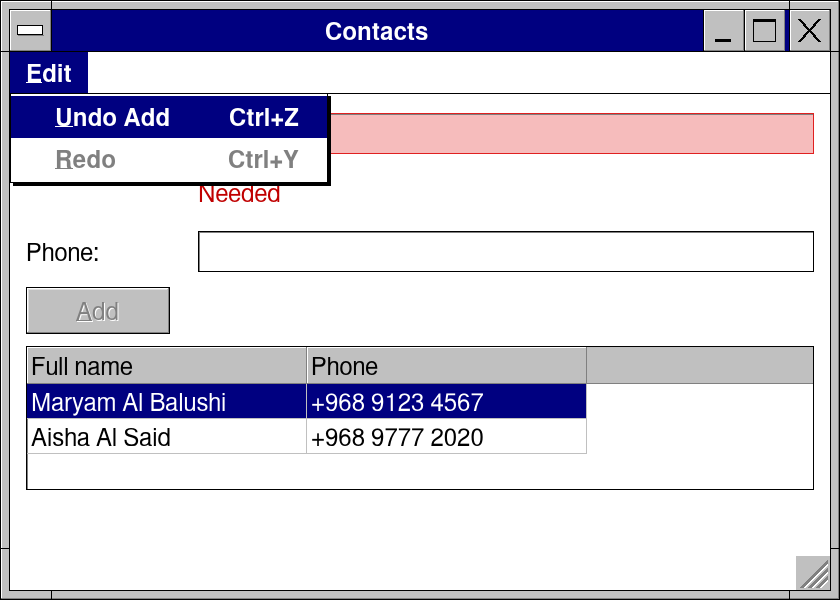
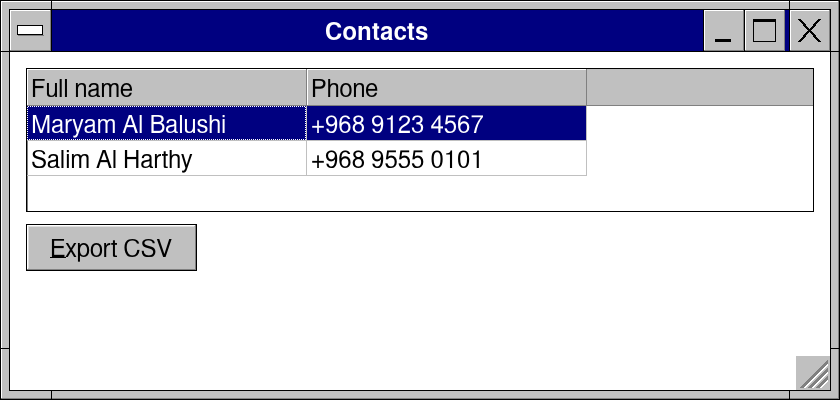

# Lesson 5: Contacts: forms from your types, a grid, undo, CSV

**Level:** intermediate · **Time:** 30 minutes · **You make:** an address book whose form and grid come from one Nim type



## Step 1: a form from a type

```nim
import retroui

type
  Kind = enum Family, Friend, Work
  Contact = object
    fullName {.required, maxLen: 40.}: string
    phone {.help: "With the country's code: +968...".}: string
    kind: Kind
    birthday: Date
    favourite: bool

var c = Contact(fullName: "Maryam Al Balushi", phone: "+968 9123 4567", kind: Friend,
                birthday: Date(year: 1994, month: 3, day: 21))

app "Contact", 380, 230:
  formOf(c)                          # a field for each field of Contact
```



`formOf(c)` draws a field for each field of the object: a text box for a `string`, a list of an enum's values, a date picker for a `Date`, a check box for a `bool`. The captions come from the fields' names (`fullName` is Full name). The pragmas are the rules: `required`, `maxLen`, `limits` for numbers, `help` for a line under the field, `caption` for a name of your own, `multiline`, `readonly`, `noForm` to leave one out.

## Step 2: a grid of them

```nim
import retroui

type
  Kind = enum Family, Friend, Work
  Contact = object
    fullName {.required, maxLen: 40.}: string
    phone: string
    kind: Kind
    favourite: bool

var draft = Contact(fullName: "Salim Al Harthy", phone: "+968 9555 0101", kind: Work)
var book = @[Contact(fullName: "Maryam Al Balushi", phone: "+968 9123 4567", kind: Friend,
                     favourite: true)]
var sel = 0

app "Contacts", 480, 380:
  formOf(draft, labelW = 80)
  if button("&Add", enabled = formValid(draft)):   # grayed until the form is right
    book.add draft
    draft = Contact()
  gridOf(book, sel, height = 4)      # a column for each field; a header's click sorts
```


`formValid(draft)` is false while a rule is broken (and the form says which, under the field): Add stays gray. `gridOf(book, sel)` shows the `seq`, a column for each field; a click on a header sorts it.

## Step 3: Undo

```nim
import retroui

type Contact = object
  fullName {.required.}: string
  phone: string

var draft = Contact(fullName: "Aisha Al Said", phone: "+968 9777 2020")
var book = @[Contact(fullName: "Maryam Al Balushi", phone: "+968 9123 4567")]
var sel = 0
var history: UndoStack               # the changes, to take back

app "Contacts", 420, 300:
  menubar:
    menu "&Edit":
      undoMenuItems(history)         # "Undo Add", grayed when there is nothing
  formOf(draft, labelW = 80)
  if button("&Add", enabled = formValid(draft)):
    let before = book
    book.add draft
    history.record("Add", book, before)   # Undo puts `before` back
    draft = Contact()
  gridOf(book, sel, height = 3)
  undoKeys(history)                  # Ctrl+Z and Ctrl+Y, after the text boxes
```



An `UndoStack` keeps your app's changes. `history.record("Add", book, before)` keeps the value before and after; Undo puts `before` back, Redo the value after. `undoMenuItems` draws Edit's Undo and Redo named by what they do, and `undoKeys` reads Ctrl+Z and Ctrl+Y -- after the text boxes, which take their own Ctrl+Z first.

## Step 4: export as CSV

```nim
import std/os
import retroui

type Contact = object
  fullName: string
  phone: string

var book = @[Contact(fullName: "Maryam Al Balushi", phone: "+968 9123 4567"),
             Contact(fullName: "Salim Al Harthy", phone: "+968 9555 0101")]
var sel = 0
var said = ""

app "Contacts", 420, 200:
  gridOf(book, sel, height = 3)
  row:
    if button("&Export CSV"):
      var t = DataTable(headers: @["Name", "Phone"])
      for c in book: t.rows.add @[c.fullName, c.phone]
      let path = dataDir("ContactsTutorial") / "contacts.csv"
      said = if writeCsv(path, t): "Saved " & path.extractFilename else: "Could not save"
    label said
```



A `DataTable` is headers and rows of texts; `writeCsv` writes it, quoting what needs quoting (`readCsv` reads one back). The file goes to the app's own folder.

## What you learned

- `formOf`, its pragmas, `formValid`; `gridOf`.
- `UndoStack`: `record`, `undoMenuItems`, `undoKeys`.
- CSV with `DataTable` and `writeCsv`.

## Try it

Add an Edit button that copies the picked row into the form and saves it back -- recorded as "Edit", so Undo takes it back too.
