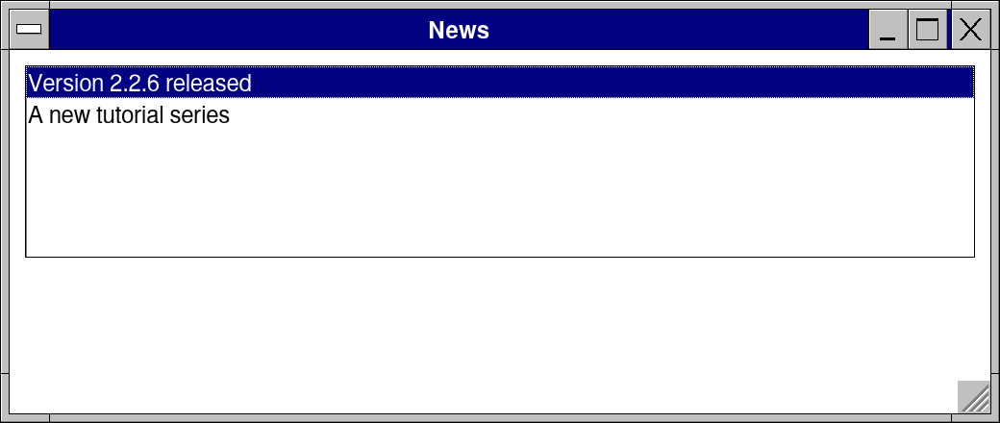
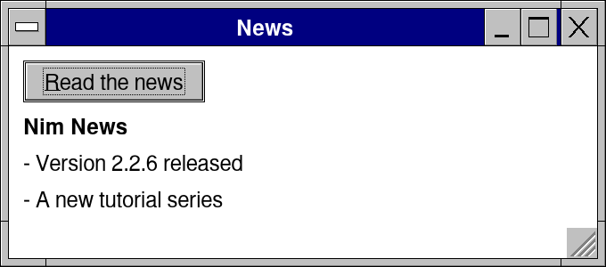
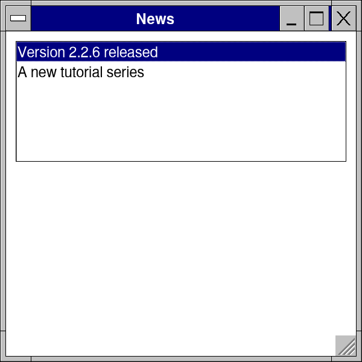
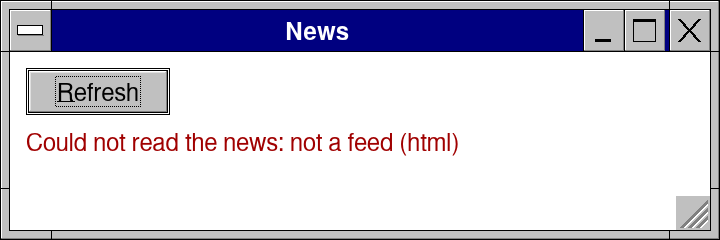

# Lesson 6: A news reader: work off the screen's thread

**Level:** intermediate · **Time:** 30 minutes · **You make:** a reader that fetches a feed without freezing the window



A frame must never wait: while it waits the window cannot move, repaint or take a key. Work that takes a while -- the network, a big file, a sum -- goes to a *job*, on a worker thread, and the frames read what it came to as they read a click.

## Step 1: a job

```nim
import retroui
import retroui/[jobs, feeds]

const sample = """<rss><channel><title>Nim News</title>
<item><title>Version 2.2.6 released</title><pubDate>Mon, 02 Nov 2026 08:00:00 GMT</pubDate></item>
<item><title>A new tutorial series</title><pubDate>Sun, 01 Nov 2026 08:00:00 GMT</pubDate></item>
</channel></rss>"""

var reading: Job[Feed] = nil         # (a job while it runs)
var news: Feed

app "News", 340, 150:
  if button("&Read the news"):
    # on a worker thread: here a feed in the program; fetch(url) brings one from the web
    reading = job(proc (): Feed = parseFeed(sample))
  if reading != nil and reading.done:          # read between frames, like a click
    news = reading.value
    reading = nil
  label news.title, bold = true
  for item in news.episodes: label "- " & item.title
```



- `job(proc (): Feed = ...)` runs the proc on a worker and returns a `Job[Feed]` at once.
- In the frames: `done`, then its `value`. The kit draws a frame when it ends.
- `fetch(url)` is the same for a web request: `fetch("https://nim-lang.org/feed.xml")`, then `parseFeed(j.value.body)`. Here the feed is in the program, so the lesson runs without a network.
- The worker's proc touches no control and no global of the app: it is handed what it needs (here, the text) and returns what it made.

## Step 2: a list beside the details

```nim
import retroui
import retroui/feeds

let news = parseFeed("""<rss><channel><title>Nim News</title>
<item><title>Version 2.2.6 released</title><description>Bug fixes and speed.</description></item>
<item><title>A new tutorial series</title><description>From Hello to your own controls.</description></item>
</channel></rss>""")
var titles: seq[string]
for e in news.episodes: titles.add e.title
var sel = 0
var open = false

app "News", 520, 220:
  listDetail(open, 220):             # side by side when there is room, one at a time on a phone
    if listbox(titles, sel, rows = 6): open = true
  do:
    label news.episodes[sel].title, bold = true
    paragraph plainText(news.episodes[sel].notes)
```




`listDetail(open, 220): list do: detail` puts the list beside the details where the window has room, and on a phone the list alone, then the details over it (with Back) once one is picked. `plainText` turns a feed's HTML into text.

## Step 3: errors, and a spinner

```nim
import retroui
import retroui/[jobs, feeds]

var reading: Job[Feed] = nil
var news: Feed
var problem = ""

app "News", 360, 120:
  row:
    if button("&Refresh", enabled = reading == nil):
      problem = ""
      reading = job(proc (): Feed = parseFeed("<html>not a feed</html>"))   # raises
    if reading != nil: spinner()     # turning while it works
  if reading != nil and reading.ended:
    if reading.done: news = reading.value
    else: problem = reading.error    # what went wrong, in words
    reading = nil
  if problem.len > 0:
    label "Could not read the news: " & problem, color = color(160, 0, 0)
  label news.title
```



A job that raises ends `failed`, its `error` the exception's message: show it in words. `ended` is done, failed or cancelled. While it runs, `spinner()` turns and Refresh is gray.

## What you learned

- `job`, `fetch`, `done`, `value`, `failed`, `error`, `ended`.
- What a worker may touch: what it is handed.
- `listDetail` for phones and desktops alike; `retroui/feeds` for RSS, Atom and OPML.

## Try it

Add a Cancel button: a job made with `proc (c: JobCtl): Feed` can check `c.cancelled` and stop; `reading.cancel()` asks it to. Report `c.progress(f)` and show it with `progress(reading.progress)`.
