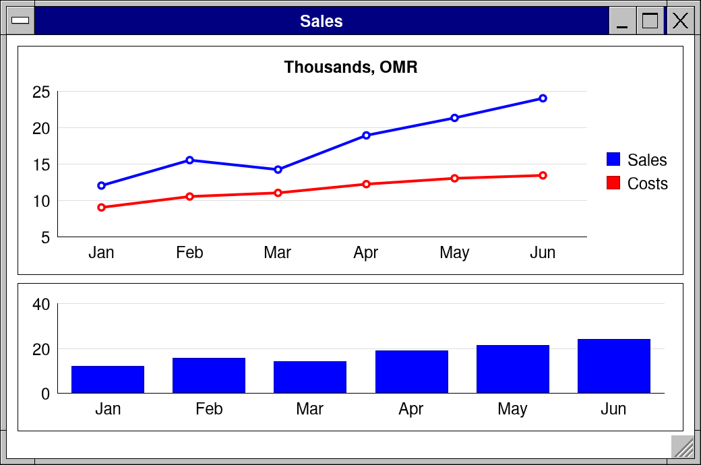
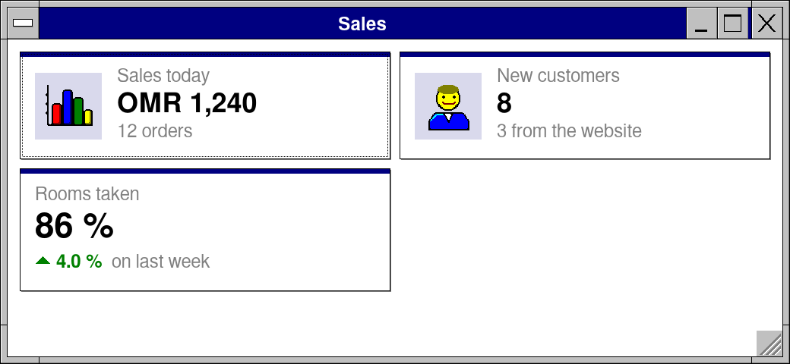
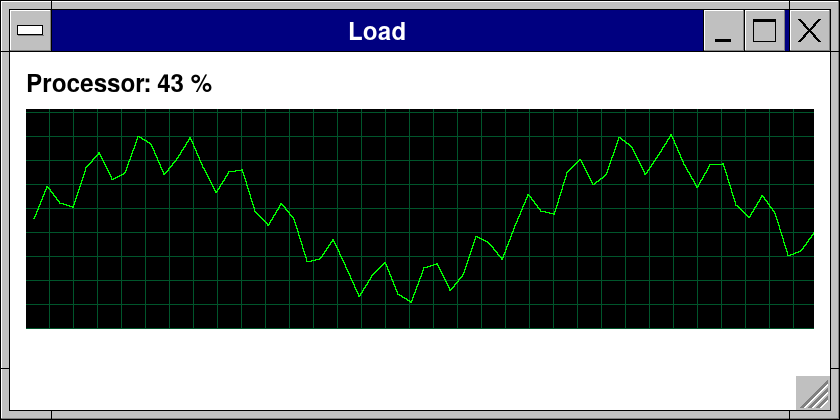

# Lesson 7: A dashboard: tiles, charts and numbers that move

**Level:** intermediate · **Time:** 25 minutes · **You make:** a sales dashboard and a live graph



## Step 1: tiles

```nim
import retroui

app "Sales", 520, 240:
  kpiRow:
    statCard(pxChart, "Sales today", "OMR 1,240", "12 orders")
    statCard(pxUser, "New customers", "8", "3 from the website")
    kpiTile("Rooms taken", "86 %", delta = 0.04, deltaNote = "on last week")
```



`kpiRow:` lays tiles side by side, as many as fit, wrapping on a phone. `statCard` is an icon, a value and a line under it; `kpiTile` a value with its change, a fraction (`0.04` shows "▲ 4.0 %"; green up, red down; `lowerIsBetter` for costs) and an optional trend.

## Step 2: charts

```nim
import retroui

let months = ["Jan", "Feb", "Mar", "Apr", "May", "Jun"]
let sales = @[12.0, 15.5, 14.2, 18.9, 21.3, 24.0]
let costs = @[9.0, 10.5, 11.0, 12.2, 13.0, 13.4]

app "Sales", 520, 345:
  lineChart([sales, costs], months, names = ["Sales", "Costs"], title = "Thousands, OMR")
  barChart(sales, months, h = dp(110))
```


`lineChart` draws one line a series over the same labels, with a legend from `names`; `barChart` one bar a value. A control's own size (`h`, `w`) is in the screen's pixels: `dp(110)` is 110 design pixels at any scale, as the row widths are; left out, a chart takes 170. `chart` (in the [controls guide](../../docs/controls.md)) has 21 kinds, from your numbers or a CSV table.

## Step 3: numbers that move

```nim
import std/[math, times]
import retroui

var load: seq[float]                 # the last minute, a value a second
var version = 0                      # changes when `load` does
var lastAdded = 0

app "Load", 420, 210:
  if ui.now - lastAdded >= 1000:     # a new value each second
    lastAdded = ui.now
    load.add 50 + 30 * sin(load.len.float / 6) + 10 * sin(load.len.float * 1.7)
    if load.len > 60: load.delete(0)
    inc version
  label "Processor: " & (if load.len > 0: $int(load[^1]) & " %" else: "-"), bold = true
  liveGraph("load", load, version, maxValue = 100, h = dp(110))
  wakeIn(1000)                       # the next frame in a second, even untouched
```



A window untouched runs no frames. `wakeIn(1000)` asks for one in a second: the graph moves on its own. `liveGraph` draws a task manager's moving graph for the cost of a copy -- `version` tells it when the values changed. `ui.now` is the time in milliseconds.

## What you learned

- `kpiRow`, `statCard`, `kpiTile`; `lineChart`, `barChart`.
- `wakeIn` for frames that come by themselves; `liveGraph`.

## Try it

Read the months and sales from a CSV file with `readCsv` and `column("Sales")`.
