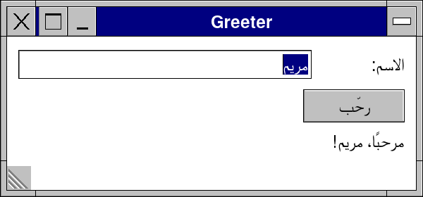
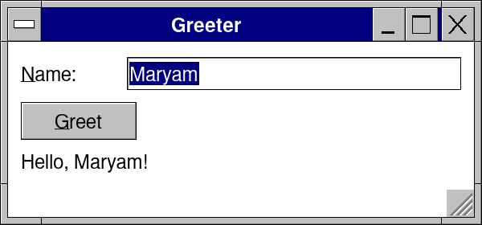
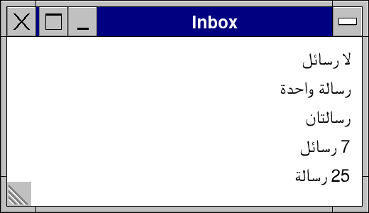

# Lesson 8: Your app in other languages

**Level:** intermediate · **Time:** 20 minutes · **You make:** the same window in English and Arabic, with numbers in the right form



## Step 1: texts that can be translated

```nim
import retroui

var name = "Maryam"

app "Greeter", 300, 140:
  row([60, -1]):
    label "&Name:"                   # every text a control shows is looked up (`tr`)
    edit name
  if button("&Greet"): discard
  label tr("Hello") & ", " & name & "!"   # a text of your own: `tr` it too
```



Every text a control shows -- a label, a button, a menu, a title -- is looked up in the language set, without you doing anything. A text you build yourself goes through `tr` so it is looked up too.

## Step 2: Arabic, right to left

```nim
import retroui

setUiLanguage("ar", @[("Name:", "الاسم:"), ("Greet", "رحّب"), ("Hello", "مرحبًا"),
                     ("Greeter", "المرحِّب")])
var name = "مريم"

app "Greeter", 300, 140:             # the window mirrored: right to left
  row([60, -1]):
    label "&Name:"
    edit name
  if button("&Greet"): discard
  label tr("Hello") & "، " & name & "!"
```


`setUiLanguage("ar", table)` sets the language and its texts: pairs of the English (without `&`) and the translation. Arabic, Hebrew, Persian and Urdu mirror the window: rows run right to left, menus open the other way.

## Step 3: numbers in words

```nim
import retroui

setUiLanguage("ar", @[("{n} message|{n} messages",
                      "لا رسائل|رسالة واحدة|رسالتان|{n} رسائل|{n} رسالة|{n} رسالة")])

app "Inbox", 260, 150:
  for n in [0, 1, 2, 7, 25]:
    label trn(n, "{n} message", "{n} messages")   # each number its form
```



`trn(n, "{n} message", "{n} messages")` takes the number's form. English has two; Arabic six (none, one, two, a few, many, others); Russian and Polish three; Chinese and Japanese one. In the table, the forms are between `|` in the language's order.

## Step 4: the translator's file

```sh
retrokit strings greeter.nim --lang:ar      # writes greeter-ar.txt
```

The file has a line for every text the app shows -- its labels, buttons, menus, titles, `tr` and `trn` -- for a translator to fill in after ` = `. Run it again after changing the app: the translations are kept, new texts added, old ones kept at the end. Read it back with:

```nim
setUiLanguage("ar", loadUiStrings(getAppDir() / "greeter-ar.txt"))
```

`RETRO_LANG=pseudo` shows every text a third longer and marked, to find the layouts too tight for longer words and the texts that are not looked up.

## What you learned

- Texts are looked up by themselves; `tr` for your own.
- `setUiLanguage`, right to left, `trn` and `pluralForm`.
- `retrokit strings` and `loadUiStrings`.

## Try it

Add French with its own forms (`pluralForm("fr", 0)` is 0: "0 message").
