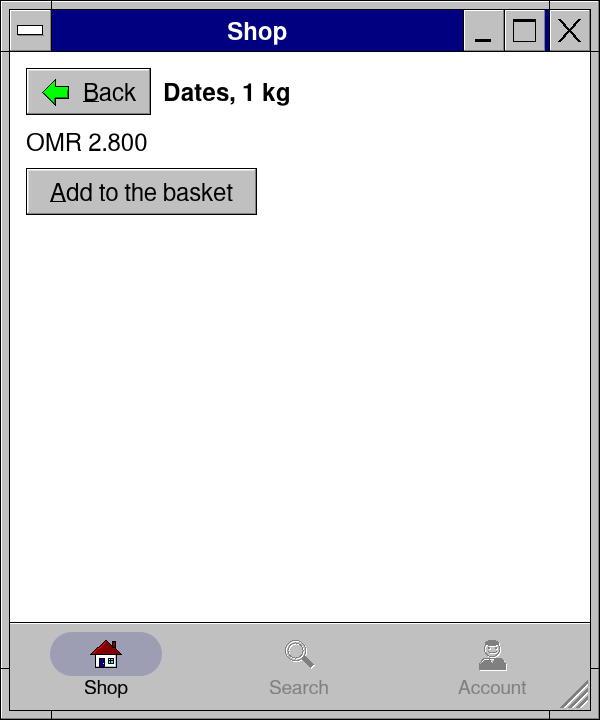
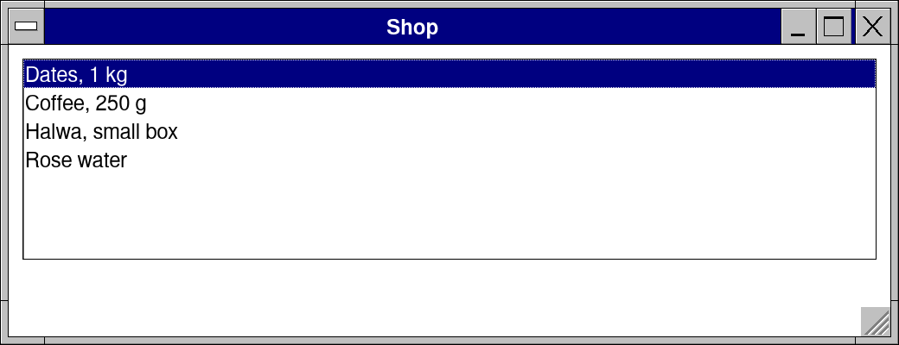
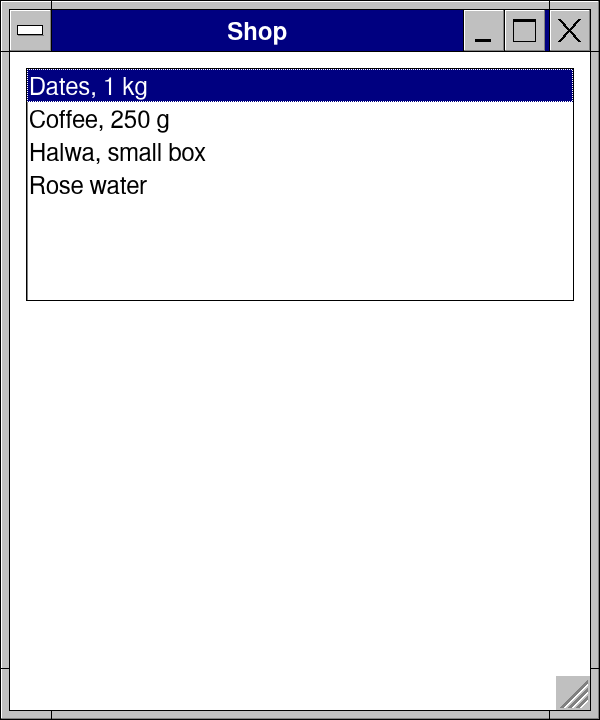
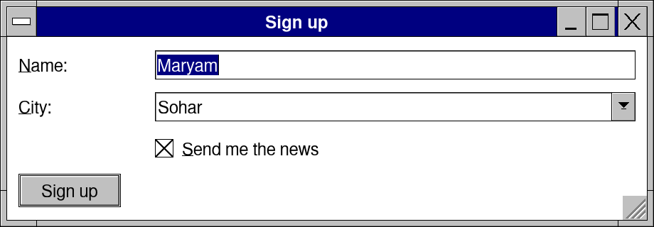
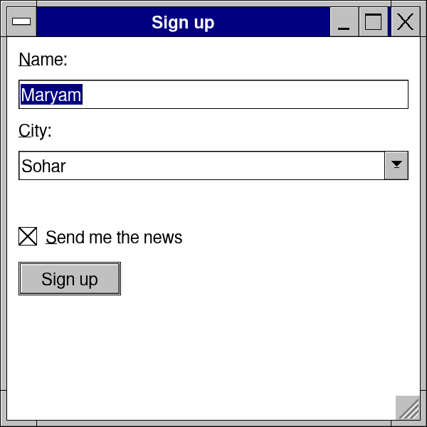

# Lesson 9: Phone layouts

**Level:** mobile · **Time:** 25 minutes · **You make:** one app that is right on a desktop and on a phone



One program runs on Windows, macOS, Linux, Android, iOS and the web. What changes is the room: `sizeClass()` says compact (a phone, a narrow window), medium or expanded, and the kit's containers use it themselves.

## Step 1: a list beside its details

```nim
import retroui

var products = ["Dates, 1 kg", "Coffee, 250 g", "Halwa, small box", "Rose water"]
var prices = ["2.800", "3.500", "4.200", "1.100"]
var sel = 0
var open = false

app "Shop", 520, 200:
  listDetail(open, 200):             # two columns where there is room
    if listbox(products, sel, rows = 7): open = true   # on a phone: the details over it
  do:
    label products[sel], bold = true
    label "OMR " & prices[sel]
    button("&Add to the basket")
```





`listDetail` puts two columns where there is room and one at a time on a phone. On a touch screen the controls grow to finger size by themselves.

## Step 2: pages, and a bottom bar

```nim
import retroui

var nav = initPages("shop")
var tab = 0

app "Shop", 300, 360:
  # the bottom bar of a phone app (drawn first: it keeps its room at the bottom)
  if bottomNav([(pxHome, "Shop"), (pxSearch, "Search"), (pxUser, "Account")], tab):
    nav.goHome()
  pageView(nav):                     # pages over pages, sliding in; Back goes back
    case nav.page
    of "shop":
      pageHeader(nav, "Shop")
      if button("Dates, 1 kg"): nav.push("dates")
      button("Coffee, 250 g")
    of "dates":
      pageHeader(nav, "Dates, 1 kg")       # Back: its button, the phone's, Esc
      label "OMR 2.800"
      button("&Add to the basket")
```


- `pageView(nav)` draws the page on top of a `PageStack`; `nav.push("dates")` opens one over it, sliding in; Back -- `pageHeader`'s button, the phone's Back, Esc, Alt+Left -- goes back.
- Pages are names, so `case nav.page` reads as the app's map.
- `bottomNav` is a phone app's bar of sections.

## Step 3: a layout for each size

```nim
import retroui

var name = "Maryam"
var city = 1
var agree = true

app "Sign up", 460, 160:
  form 90:                           # captions beside the fields; above them on a phone
    field "&Name:": edit name
    field "&City:": combo(["Muscat", "Sohar", "Salalah"], city)
    field "": checkbox("&Send me the news", agree)
  if isCompact():                    # a phone: one big button across
    button("Sign up", isDefault = true)
  else:
    row:
      spring()
      button("Sign up", isDefault = true)
      button("Cancel")
```





`form` moves its captions above the fields by itself on a phone; for the rest, ask `isCompact()` (or `sizeClass()`) and draw what fits. Try any size on a desktop: `retrokit run app.nim --size:360x640 --touch`.

## What you learned

- `sizeClass`, `isCompact`; finger-sized controls on touch screens.
- `listDetail`, `pageView`, `pageHeader`, `bottomNav`.

## Try it

Put the shop's list of step 1 into the "shop" page of step 2, and open a product's page from it.
