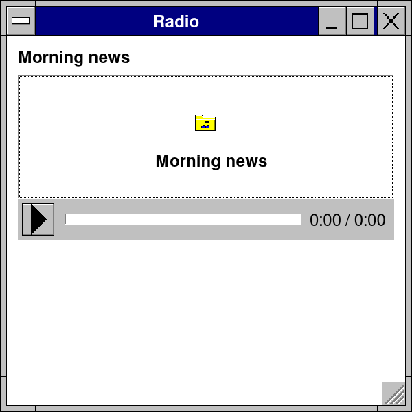

# Lesson 10: Android and iOS

**Level:** mobile · **Time:** 30 minutes · **You make:** an APK of your app, and an iOS build on a Mac



## An APK without the Android SDK

```sh
retroapk app.nim --name:"My App" --id:com.me.myapp
retroapk app.nim --name:"My App" --id:com.me.myapp --install --run   # onto the phone, by adb
```

`retroapk` builds the APK with clang and lld (or zig): no Android SDK, no NDK, no Gradle. It reads what your code uses and lists its permissions by itself -- the camera, the microphone, notifications, the place, the network, a sound playing in the background -- and says which. The app asks the user the first time a feature is used, and goes on without it when the answer is no.

`--orientation:portrait`, `--icon:icon.png`, `--version:1.2.0 --code:12`, `--aab` for Google Play's bundle (signed with `--key`), `--java:DIR` for Java of your own (a service, a receiver).

## The phone's own ways

```nim
import retroui

var leaving = false

app "Radio", 300, 300:
  if backPressed():                  # the phone's Back (a desktop's close box too)
    cancelClose()
    leaving = true
  label "Morning news", bold = true
  # a sound plays on with the app in the background: retroapk adds the
  # service it needs on Android, retroios the background mode on iOS
  audioView("https://example.com/news.mp3", height = dp(120), title = "Morning news")
  case msgBox(leaving, "Radio", "Stop playing and leave?", ["&Leave", "Stay"], miQuestion)
  of 1: quitApp()
  else: discard
```

- The phone's Back is the window's close: `backPressed()` tells it apart; `cancelClose()` keeps the app open (here, to ask first).
- An APK has no command line: `appArguments()`, never `paramCount`.
- A sound of `audioView` plays on with the app in the background (and on the lock screen with `setNowPlaying`): retroapk adds the service and the permissions it needs.
- Files: `dataDir("MyApp")` is the app's own folder; `filePicker` opens the phone's documents.

## iOS, on a Mac

```sh
retroios app.nim --simulator --run                                  # in the Simulator
retroios app.nim --sign:"Apple Development: Me (TEAMID)" --ipa     # for a device, TestFlight
```

`retroios` builds with Xcode's compiler and writes the Info.plist: why the app asks for the camera, the microphone, the place, and the background mode when it plays sounds.

## What you learned

- `retroapk` and `retroios`; permissions found in your code.
- Back, `appArguments`, `dataDir`, sound in the background.

## Try it

Build the to-do list of Lesson 2 as an APK and install it: `retroapk todo.nim --id:com.me.todo --install --run`.
