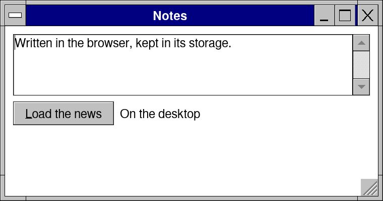

# Lesson 11: The app as a web page

**Level:** web · **Time:** 20 minutes · **You make:** your app in the browser



```sh
retrokit web app.nim                       # build/web: index.html, app.wasm, retro.js
python3 -m http.server -d build/web 8080   # any static server; then http://localhost:8080
```

The same program becomes WebAssembly, made by clang alone (no Emscripten). The page draws exactly what the desktop draws; it installs as an app (a manifest and a service worker come with it) and works offline.

```nim
import retroui
import retroui/jobs

var notes = "Written in the browser, kept in its storage."
var page: Job[HttpResponse] = nil
var said = ""

app "Notes", 380, 200:
  editArea notes, lines = 4
  row:
    if button("&Load the news"):
      # in a page the site asked must allow it (CORS); your own site always does
      page = fetch("data/news.json")
    when defined(wasm):
      label "In the browser"
    else:
      label "On the desktop"
  if page != nil and page.ended:
    said = if page.done: $page.value.status & " " & $page.value.body.len & " bytes" else: page.error
    page = nil
  label said
```

- `when defined(wasm):` for what differs in a browser.
- `fetch` and `httpRequest` go through the browser: another site must allow the page (CORS) -- your own site always does, and a short address (`"data/news.json"`) is your site's.
- Files: `filePicker` is the browser's chooser; saving downloads the file; `dataDir` is kept in the browser's storage.
- Threads: a job runs between frames in a page; `retrokit web --threads` adds a build with real workers (Web Workers sharing memory), taken where the browser allows them -- the server must send the cross-origin isolation headers (COOP and COEP).
- Sound, video, the media keys, the camera, notifications and screen readers (ARIA) work in the page.

## What you learned

- `retrokit web`; `when defined(wasm)`; CORS; `--threads`.

## Try it

Build the dashboard of Lesson 7 for the web and open it on your phone's browser.
