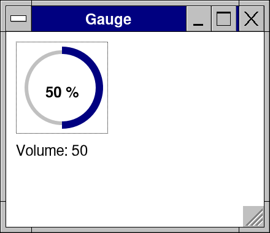
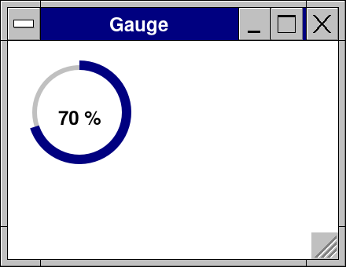
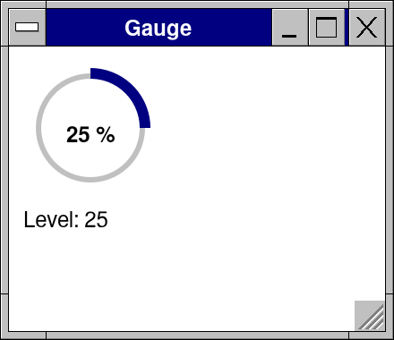

# Lesson 12: Your own control

**Level:** advanced · **Time:** 40 minutes · **You make:** a round gauge that the mouse, the keyboard and screen readers can all use



A control of the kit is a proc that draws, takes the input meant for it and reports what happened -- nothing more. Yours is the same.

## Step 1: drawing

```nim
import std/math
import retroui

var level = 70

app "Gauge", 220, 170:
  let r = canvas(150, 150)           # a place of your own to draw in
  let cx = float(r.x + r.w div 2)
  let cy = float(r.y + r.h div 2)
  ring(cx, cy, 60, 12, ui.theme.face)                     # the track
  pieSlice(cx, cy, 66, -PI / 2, -PI / 2 + 2 * PI * level.float / 100, ui.theme.select)
  disc(cx, cy, 54, ui.theme.window)                       # the hole
  let s = $level & " %"
  text(int(cx) - textWidth(s, bold = true) div 2, int(cy) - 8, s, ui.theme.text, bold = true)
```



`canvas(w, h)` gives a rectangle in the layout to draw in. `ring`, `pieSlice`, `disc`, `text` draw smooth shapes and text in the theme's colors (`ui.theme.select`, `face`, `window`, `text`), so the control follows the color scheme, dark ones too.

## Step 2: input

```nim
import std/math
import retroui

proc gauge(v: var int; size = 150): bool {.discardable.} =
  ## A round gauge bound to `v` (0..100); a click or a drag on it sets it.
  let r = canvas(size, size)
  let id = idOf(v, "gauge")          # its id: from the variable it is bound to
  let hit = interact(id, r)          # the mouse and the focus, as every control has them
  let cx = float(r.x + r.w div 2)
  let cy = float(r.y + r.h div 2)
  if hit.down:                       # pressed (and dragged): the angle is the value
    var a = arctan2(float(ui.my) - cy, float(ui.mx) - cx) + PI / 2
    if a < 0: a += 2 * PI
    let nv = clamp(int(a / (2 * PI) * 100 + 0.5), 0, 100)
    if nv != v:
      v = nv
      result = true
  let rad = float(size) / 2 - 8
  ring(cx, cy, rad - 6, 12, ui.theme.face)
  pieSlice(cx, cy, rad, -PI / 2, -PI / 2 + 2 * PI * v.float / 100, ui.theme.select)
  disc(cx, cy, rad - 12, ui.theme.window)
  let s = $v & " %"
  text(int(cx) - textWidth(s, bold = true) div 2, int(cy) - 8, s, ui.theme.text, bold = true)

var level = 30

app "Gauge", 220, 190:
  if gauge(level): discard           # true on the frames it changed
  label "Level: " & $level
```



- `idOf(v, "gauge")` is the control's id, made from the variable it is bound to: two gauges bound to two variables are two controls, and it is the same from frame to frame.
- `interact(id, r)` is how every control of the kit takes the mouse and the focus: `hover`, `down`, `clicked`, `focused`. `ui.mx`, `ui.my` are the pointer.
- It returns `true` on the frame the value changed, as the kit's controls do.

## Step 3: the keyboard, and screen readers

```nim
import std/math
import retroui

proc gauge(v: var int; name: string; size = 150): bool {.discardable.} =
  ## A round gauge bound to `v`: the mouse, the keyboard (Left, Right, Home,
  ## End) and screen readers ("Volume, slider, 40 %").
  let r = canvas(size, size)
  let id = idOf(v, "gauge")
  let hit = interact(id, r)
  let cx = float(r.x + r.w div 2)
  let cy = float(r.y + r.h div 2)
  var nv = v
  if hit.down:
    var a = arctan2(float(ui.my) - cy, float(ui.mx) - cx) + PI / 2
    if a < 0: a += 2 * PI
    nv = int(a / (2 * PI) * 100 + 0.5)
  if hit.focused and canInput():     # its keys, while it has the focus
    if keyHit(KeyRight) or keyHit(KeyUp): nv += 5
    elif keyHit(KeyLeft) or keyHit(KeyDown): nv -= 5
    elif keyHit(KeyHome): nv = 0
    elif keyHit(KeyEnd): nv = 100
  nv = clamp(nv, 0, 100)
  if nv != v:
    v = nv
    result = true
  let rad = float(size) / 2 - 8
  ring(cx, cy, rad - 6, 12, ui.theme.face)
  pieSlice(cx, cy, rad, -PI / 2, -PI / 2 + 2 * PI * v.float / 100, ui.theme.select)
  disc(cx, cy, rad - 12, ui.theme.window)
  let s = $v & " %"
  text(int(cx) - textWidth(s, bold = true) div 2, int(cy) - 8, s, ui.theme.text, bold = true)
  if hit.focused: focusDots(r)       # where the keyboard is
  # what a screen reader says of it
  accessNode(arSlider, name, $v & " %", {asFocusable} + (if hit.focused: {asFocused} else: {}))

var volume = 40

app "Gauge", 220, 190:
  gauge(volume, "Volume")
  label "Volume: " & $volume
```


- `canInput()` and `keyHit` read the keys while it has the focus; Tab reaches it by itself (`interact` made it a stop).
- `focusDots` shows where the keyboard is.
- `accessNode(arSlider, name, value, states)` tells screen readers what it is -- Orca, NVDA, Narrator, VoiceOver and TalkBack read "Volume, slider, 50 %", and the driver (`retrokit drive`) finds it by its name.

## What you learned

- `canvas` and the drawing calls; `idOf`, `interact`, `ui.mx`.
- The keyboard: `canInput`, `keyHit`, `focusDots`; screen readers: `accessNode`.

## Try it

Make the wheel turn it: `ui.wheel` while `hit.hover`. Then read how the kit's own `knob` does it in [src/retroui/morecontrols.nim](../../src/retroui/morecontrols.nim).
