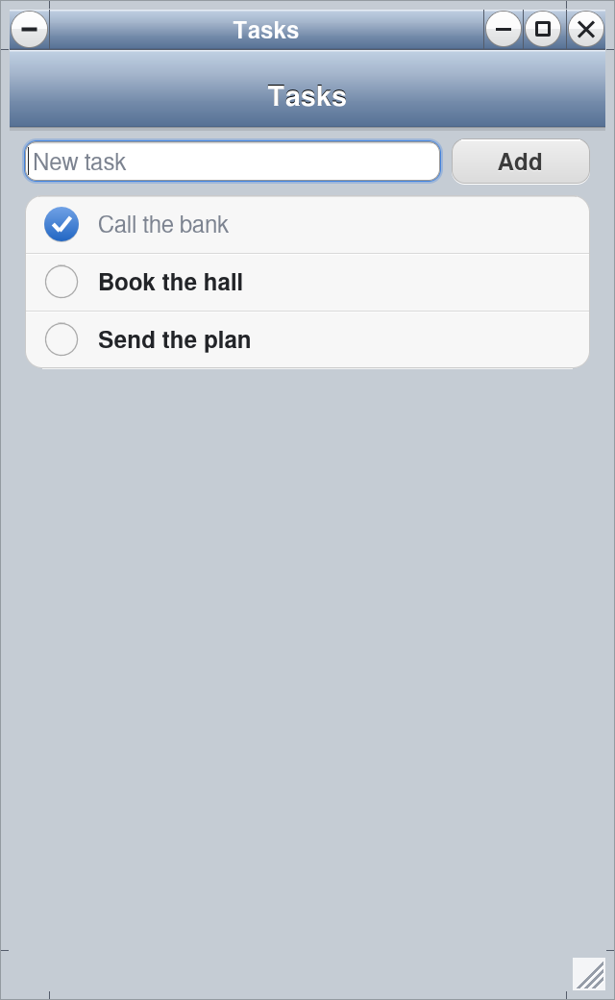
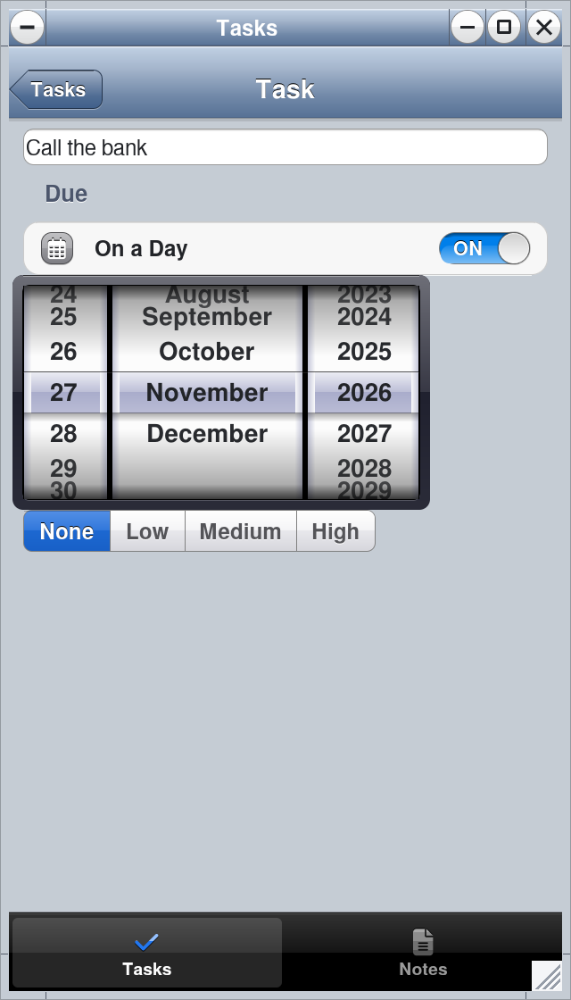
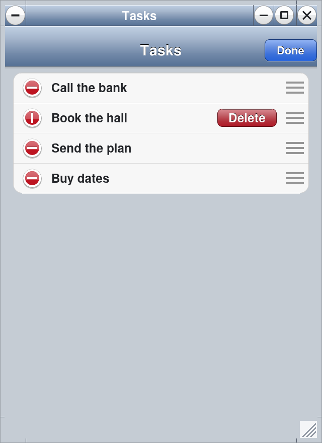
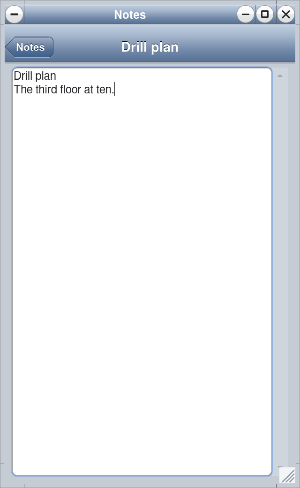

# Lesson 17: A whole phone app

**Level:** mobile · **Time:** 45 minutes · **You make:** tasks and notes for a phone -- lists ticked off, pages with Back, a list put in order, notes, all kept -- then its APK



This lesson builds a phone app the way phone apps are made: a navigation bar at the top of each page, a tab bar at the bottom, rows in groups, a page over a page with Back, a list edited in place. Each step is a whole program; the finished app is [examples/tasks.nim](../../examples/tasks.nim) -- Retro Tasks, with lists made by themselves (Today, Upcoming, Flagged, Completed), reminders that come while the app is closed, a search and its settings. Every control here is drawn in each of the kit's looks; the lesson uses Gloss, the phone look of its time.

## Step 1: tasks, ticked off, kept

```nim
import std/[json, os]
import retroui

type Task = object
  title: string
  done: bool

var tasks: seq[Task]
var newTitle = ""

proc save() =                        # the app's own folder, on every system
  createDir(dataDir("MyTasks"))
  writeFile(dataDir("MyTasks") / "tasks.json", $(%tasks))

uiLook = lookGloss                   # the phone look of its time

app "Tasks", 320, 520, GlossLight:
  discard navBar("Tasks")
  row([-1, 0]):
    edit(newTitle, hint = "New task")
    if button("Add") or keyHit(KeyEnter):
      if newTitle.len > 0:
        tasks.add Task(title: newTitle)
        newTitle = ""
        save()
  tableGroup "":
    for i, t in tasks.mpairs:
      let h = checkRow(t.title, t.done, key = $i)   # a tap on its circle ticks it
      if i == 0: mark "first"
      if h.toggled: save()
```


- `navBar` is a phone page's bar: its title in the middle (a Back and an action come in the next steps).
- `edit(..., hint = "New task")` shows gray words while it is empty.
- `tableGroup` puts rows in a rounded group; `checkRow` is a to-do's row: a tap on its circle ticks it (`toggled`), a tap on the rest is `clicked` -- its page, in step 2. Space ticks it from the keyboard, and screen readers read it as a check box.
- `dataDir("MyTasks")` is the app's own folder on every system -- Android's and iOS's too. The list is written when it changes; read it back with `parseJson(readFile(...)).to(seq[Task])` at the start.

## Step 2: pages, Back and a tab bar

```nim
import retroui

type Task = object
  title: string
  done: bool
  hasDay: bool
  day: Date
  priority: int

var tasks = @[Task(title: "Call the bank"), Task(title: "Book the hall")]
var tab = 0
var open = -1                         # the task whose page is shown (-1: the list)

uiLook = lookGloss

app "Tasks", 320, 560, GlossLight:
  discard bottomNav([(nfCheck, "Tasks"), (nfFileText, "Notes")], tab)
  if open < 0:
    discard navBar("Tasks")
    tableGroup "":
      for i, t in tasks.mpairs:
        if checkRow(t.title, t.done, accessory = taChevron, key = $i).clicked: open = i
        if i == 0: mark "first"
  else:
    template t: untyped = tasks[open]
    if navBar("Task", back = "Tasks") == npBack or backPressed():   # its Back, the phone's
      cancelClose()
      open = -1
    else:
      edit t.title
      tableGroup "Due":
        if tableSwitch("On a Day", t.hasDay, glyph = nfCalendar): t.day = today()
      if t.hasDay: dateWheels(t.day)
      segmented(["None", "Low", "Medium", "High"], t.priority)
```



- `bottomNav` is drawn first: it keeps its room at the bottom of the window, as a phone's tab bar.
- A page is a value (`open`): the list, or a task's page. `navBar(..., back = "Tasks")` returns `npBack` for its Back button (and Alt+Left); `backPressed()` is the phone's own Back -- `cancelClose()` keeps the app open and goes back a page instead.
- `tableSwitch` is a row with a switch; `dateWheels` picks a day as phones did, `timeWheels` a time; `segmented` one of a few.

## Step 3: a list edited in place

```nim
import retroui

var tasks = @["Call the bank", "Book the hall", "Send the plan", "Buy dates"]
var editing = false

uiLook = lookGloss

app "Tasks", 320, 440, GlossLight:
  if navBar("Tasks", action = if editing: "Done" else: "Edit", done = editing) == npAction:
    editing = not editing
  tableGroup "":
    var e: RowEdit
    for i, t in tasks:
      if editing:
        let x = editRow(t, i)          # its minus, then Delete; its grip, dragged
        if x.kind != reNone: e = x
      else: discard tableRow(t)
      if i == 1: mark "second"
    case e.kind                        # the list changed after the rows were drawn
    of reDelete: tasks.delete(e.index)
    of reMove:
      let t = tasks[e.index]
      tasks.delete(e.index)
      tasks.insert(t, e.to)
    of reNone: discard
```



- The bar's action button says Edit, then Done (`done = true` draws it as the blue one).
- `editRow` is a row while its list is edited: its red minus turns up and a Delete comes at the row's end; its grip drags it up or down while the others make way. It returns what was done (`RowEdit`): the app changes its own list after the rows are drawn. With the focus, Delete deletes and Alt+Up, Alt+Down move it.

## Step 4: notes

```nim
import std/strutils
import retroui

var notes: seq[string]
var open = -1

uiLook = lookGloss

proc titleOf(n: string): string =
  for line in n.splitLines:
    if line.strip.len > 0: return line.strip
  "New Note"

app "Notes", 320, 520, GlossLight:
  if open < 0:
    if navBar("Notes", action = "New") == npAction:
      notes.add ""
      open = notes.high
    tableGroup "":
      for i, n in notes:
        if tableRow(titleOf(n), "", taChevron, key = $i).clicked: open = i
  else:
    if navBar(titleOf(notes[open]), back = "Notes") == npBack or backPressed():
      cancelClose()
      open = -1
    else:
      editArea(notes[open], lines = -1)   # the rest of the page
```



- `editArea(..., lines = -1)` takes the rest of the page; its first line is the note's title in the bar.
- The same pattern again: a list page, a page over it, Back from the bar or the phone.

## The finished app, and its APK

[examples/tasks.nim](../../examples/tasks.nim) and [examples/tasks/](../../examples/tasks/) are the whole of Retro Tasks: `model.nim` its data without a window (tasks, lists, notes, the search, the reminders, the file), `screens.nim` its pages. What it adds to the steps:

- Lists made by themselves -- Today, Upcoming (a group a day), Flagged, Completed -- each a filter over the same tasks.
- Reminders: when a task with a reminder is due, `notify` raises the phone's notification; `onBackgroundCheck` and `scheduleBackgroundCheck(15)` raise them while the app is closed too (Android), and `setBadge` counts what is due today on its icon.
- Written two seconds after a change, through a file of its own moved over the old one: a phone that ends the app at any moment loses nothing.
- On a tablet, a phone on its side or a computer, the lists sit down the left and the page chosen beside them, each under its own bar, the list shown drawn chosen (`tableRow(selected = true)`); a phone keeps them one over another. Make every phone app this way: a tablet is the same app with more room.

```sh
nimble tasks                                   # on this computer
RETRO_APP=tasks nimble appapk                  # its APK: build/RetroTasks.apk
retroapk examples/tasks.nim --name:"Retro Tasks" --id:net.foxoman.retrotasks --background --install --run
```

`retroapk` finds what the code uses -- notifications here -- and asks for it in the APK by itself; `--background` adds the background check. Lesson 10 has the rest: signing, Google Play's bundle, iOS.
