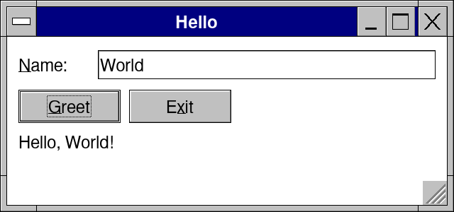
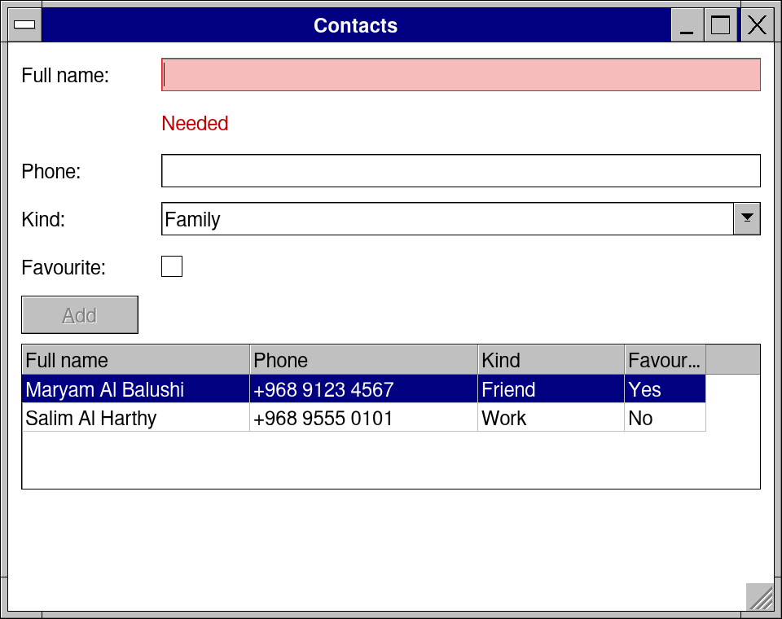
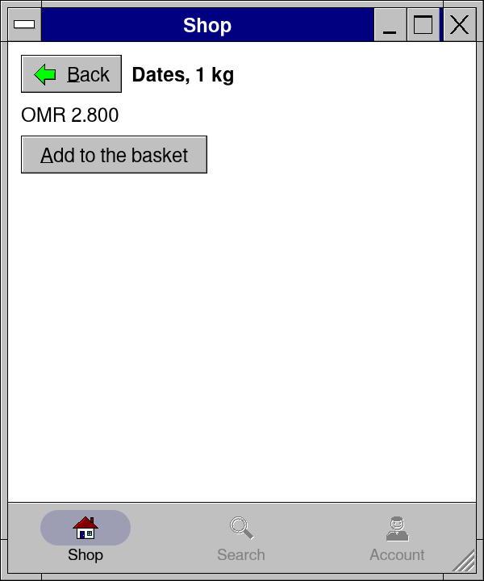
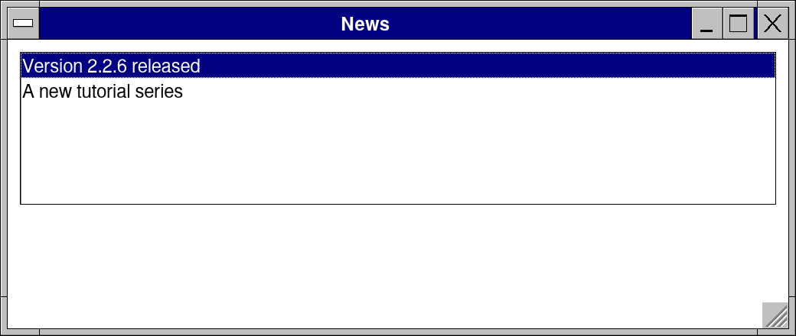
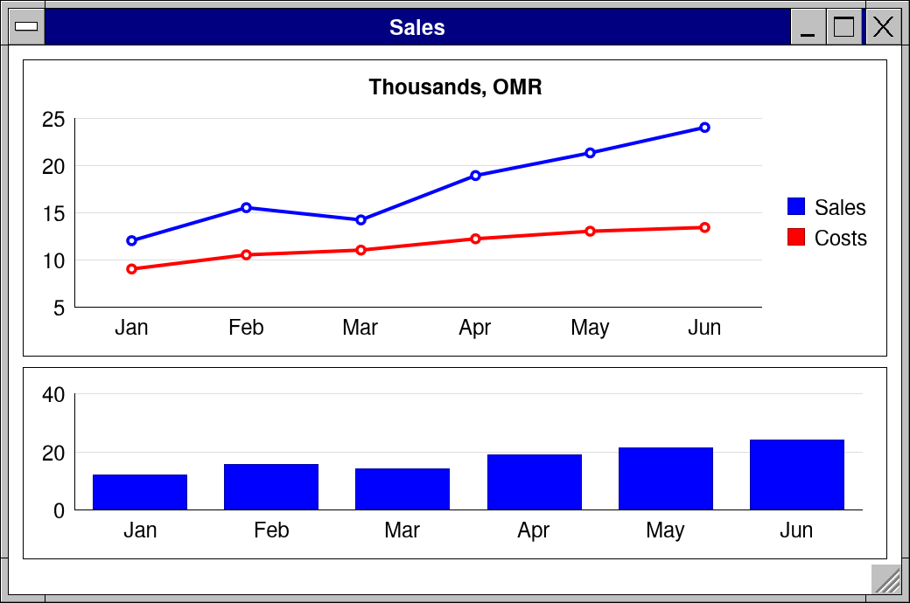
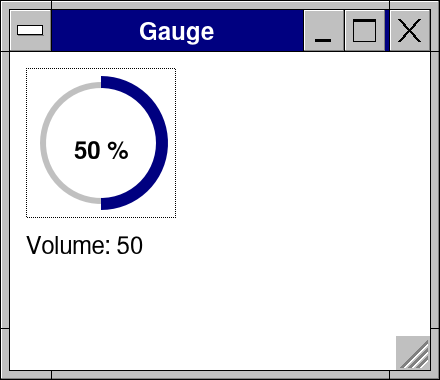

# Tutorials

Step-by-step lessons, from a first window to your own controls and the stores. Each step is a whole program you can run, with a picture of what it draws; the pictures are made from the very programs (`sh tools/tutorialshots/make.sh`), so code and pictures never drift apart. Start with [Start here](00-start-here/), then go in order, or jump to what you need.

| | Lesson | You make | Time |
|---|---|---|---|
| | [Start here](00-start-here/) | the kit installed, a first app, `--watch`, Retro Designer | 10 min |
| **Easy** | [1 Hello, and the frame](01-hello/) | a window that greets you: immediate mode in three steps | 15 min |
| | [2 A to-do list](02-todo/) | lists, check boxes, a file saved when it changes | 20 min |
| | [3 A tip calculator](03-tip-calculator/) | numbers, sliders, rows and forms | 20 min |
| | [4 Notepad](04-notepad/) | menus, open and save, "Save changes?", a status bar | 30 min |
| **Intermediate** | [5 Contacts](05-contacts/) | a form and a grid from one Nim type, Undo, CSV | 30 min |
| | [6 A news reader](06-news-reader/) | work on a worker thread, feeds, a list beside its details | 30 min |
| | [7 A dashboard](07-dashboard/) | tiles, charts, a graph that moves | 25 min |
| | [8 Other languages](08-translate/) | Arabic right to left, plurals, `retrokit strings` | 20 min |
| **Mobile** | [9 Phone layouts](09-phone-layouts/) | one app right on a desktop and a phone: pages, a bottom bar | 25 min |
| | [10 Android and iOS](10-android-ios/) | an APK without the SDK, the phone's Back, sound in the background, iOS | 30 min |
| **Web** | [11 The app as a web page](11-web/) | WebAssembly, CORS, files and threads in the browser | 20 min |
| **Advanced** | [12 Your own control](12-own-control/) | a gauge for the mouse, the keyboard and screen readers | 40 min |
| | [13 Your own loop, and threads](13-own-loop-threads/) | what `app` is made of; what a worker may touch | 30 min |
| | [14 The system's own APIs](14-system-apis/) | Win32, Objective-C, Java and D-Bus from Nim | 30 min |
| | [15 Testing](15-testing/) | tests without a window; an app driven by its controls' names | 30 min |
| | [16 Shipping](16-shipping/) | packages for every store, signed updates inside the app | 30 min |

| | | |
|---|---|---|
|  |  |  |
|  |  |  |

If you know immediate-mode toolkits already (Dear ImGui, egui), [the syntax study](../docs/syntax.md) is the short way in; [the controls guide](../docs/controls.md) has every control with its pictures; [the examples](../examples/README.md) are whole apps to read.
